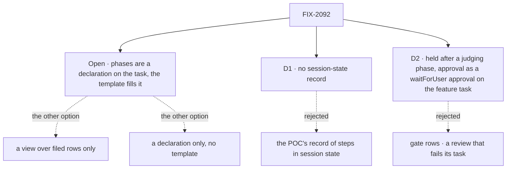

# FIX-2092 · Decisions

[Spec](SPEC.md) · **Decisions**

The calls that sit above any single issue: what was chosen, what lost, why, and what each locks
in for the five issues under it. One is open and the owner's. Two are engineering, from the POC.
The rest were settled while drafting and are recorded so no child reopens them.

## The tree

## Open

**Is "phases" a declaration on the task itself, or only a pattern of filed tasks the screen
reconstructs?** The owner's call: it changes what a person sees and sets a persisted field every
runner copies. Put to the owner on the epic thread on 2026-10-27, recommending the first option.
The set and its rules are written on that recommendation.

| | Recommended: a declaration on the task, the template fills it | A view over filed rows only | A declaration only, no template |
|---|---|---|---|
| **Who can show phases** | Any run that holds a task: a worker filing steps, a flow, a coding run | Only a worker whose steps are filed rows | Any run |
| **Where a filed step's status comes from** | Its own row, always ([ER-2](#who-owns-what)) | Its own row | A record the worker writes and keeps in step |
| **What it adds** | A declared list of phases on `Task`, one field more than the next column | `phase` on a step | The declaration, and every worker's own bookkeeping |

**Recommended because** it gives the expanded view the owner asked for on Oct 21 to every runner,
and keeps the POC's rule that a delegated step's status comes only from its row. **Would change my
mind:** no runner but a worker filing steps will ever want phases; then FIX-2236 drops and the
declaration is a template detail.

It comes down to who can show phases: the view over rows leaves a coding run's stages invisible.

## D1 · No session-state record: phase order lives on the feature task, membership in the rows

| | |
|---|---|
| **Instead of** | The POC's record in session state, `{ name, policy, phases, steps: { key → taskId } }`, kept as a cache of the rows |
| **Because** | Everything the record held is on a row already. Order is the feature task's declared phases. A phase's steps are the rows it filed with that `phase` (`filedByTask`). A step's id is `<feature task id>:<step key>`, so a replay finds it. The POC found a crash between a late filing and the record's write loses the step from the record, and suggested rebuilding it from rows: with no record there is nothing to rebuild |
| **Locks in** | The view reads the feature row and its filed rows, nothing else. A round lives in the step key (`review-a-r2`). A step filed on another board is not in the workflow |

**Would change my mind:** a workflow whose steps are filed on several boards, where `filedByTask`
can't find them.

It comes down to a crash mid-filing: the record loses the step, the rows can't.

## D2 · The phase after a judging phase is filed held, and an approval is a `waitForUser` approval on the feature task

| | |
|---|---|
| **Instead of** | Gate rows (the POC's: one more held row per gate, a no-op run on release, and an answered gate is a row a person answers) · a review that fails its task on "changes" |
| **Because** | A review that asks for changes still completes, and completing satisfies a dependency, so a dispatch pass can start the next phase before the worker reads the review (the POC's 2-control). Filing that phase's steps held means only the worker starts them, and they stay unstarted, so a loop-back can still re-wire them. An approval is the worker's `waitForUser({ kind: "approval" })`, from the turn the ending woke on the feature task. Its suspension hold mirrors onto the feature row, so it is one Inbox item on the row the person follows (PR-3), and the worker reads the yes and releases. It is not a confirm: FIX-2058's rule makes a yes the code reads next an approval, a confirm is asked only at filing, and a midway confirm's default No would cancel the whole feature task. Failing a review mixes "found problems" with "crashed" and spends an attempt |
| **Locks in** | The template marks a phase as judging; its successor is filed held. Every held step is a delegate's row: a step for yourself can't be held. The worker releases with `updateTask({ status: "pending" })`. A gate costs no row and no run. The approval needs a host with durable execution, as `waitForUser` does. "Step N of M" counts steps only |

**Would change my mind:** the kill line. If the woken turn can't suspend an approval on the feature task,
this card reopens before any gate row or hold kind is added.

It comes down to the approval: a gate row is a row a person answers, with a no-op run behind it.

## Who owns what

Every rule has one owner. Read a row to see where it is decided and where it is only used; a
*uses* cell is a place a child must not re-decide.

| # | Rule every child obeys | Owner | Checked at |
|---|---|---|---|
| ER-1 | Phases run on `deps` and the board's dispatch passes. No new runtime, drain mode, board option, engine change, or dependency on a whole phase | FIX-2233 | Every child's spec review; the closure's leg a |
| ER-2 | No phase status is stored anywhere; `workflowView` derives it. A filed step's status is read from its own row. The declaration gives the phases' order and labels and nothing else, and a run that does a phase itself, with no filed steps, reports only which declared phase it is in: the ones before it are done, the ones after it are waiting, and all are done when its task ends. A phase with filed steps can't be reported current; it takes its state from its rows. The current phase is the first one not ended. What a run is doing inside a phase is its `statusNote` | FIX-2232 | FIX-2232's tests; the closure's leg a |
| ER-3 | `workflowView` is the one read of a task's workflow: one `listTasks({ filedByTask })` pass, no read per step. A screen renders it and derives nothing of its own; a task list shows its summary (current phase, N of M), not the whole graph per row | FIX-2232 · FIX-2235, FIX-2236 use | FIX-2235's review; the closure |
| ER-4 | A stop for a person in a workflow is one Inbox item: a `waitForUser` approval on the feature task, mirrored onto its row (PR-3). No confirm asked midway, no row a person answers to release a phase, no new hold kind | FIX-2233 · FIX-2234 uses | The closure's leg c |
| ER-5 | A step's id is `<feature task id>:<step key>`, its round in the key. A replayed `start` or `addStep` files nothing twice. Steps are filed from code (`TaskInit.id`), never through the `createTask` tool, which mints its own ids | FIX-2233 | The closure's leg d |
| ER-6 | A task's declared phases are written only by the run holding its claim, through `TaskCollection.reportProgress`'s fenced write (`tasks/collection/state-backed.ts`). Neither the model tool's schema nor a harness-manager path is a second one | FIX-2232 · FIX-2233, FIX-2236 use | FIX-2233's and FIX-2236's spec review |
| ER-7 | No new model-facing tool. A worker releases, loops back and asks with the five task tools, `askQuestion`, `waitForUser` and `reportProgress`; `start` and `addStep` run from code in the woken turn | FIX-2234 | FIX-2234's spec review |

## Coordination seams

| Seam | Between | Rule |
|---|---|---|
| The declaration and its write | FIX-2232, and FIX-2233 and FIX-2236 | 2232 owns the shape and the write (ER-6); the others call it |
| `workflowView` | FIX-2232 and FIX-2235 | 2232 owns every derived value; the screen adds none (ER-3) |
| Release and the approval | FIX-2233 and FIX-2234 | 2233 files held and words the approval; 2234's worker asks it and decides when to release |
| The feature task's ending | FIX-2233 and FIX-2234 | Rule 6 settles it after its last step; neither ends it by hand |

## Decided while drafting, recorded so no child reopens them

- **`phase` is a field, not a label.** A step has exactly one phase; a label list allows none or several.
- **"Phase" means one thing: a stage of a task's workflow.** A row's
  `phase` is the stage of its filer's workflow it belongs to; a task's declared phases are the
  stages of its own work. Harness-manager's `PhaseSpec.phase` is the first kind: the stage of the
  feature a coding run serves (`"implement"`). A row it works gets `Task.phase` written from it,
  so a row has one phase value, and the topic keeps the segment only as the run record's key.
  The run's in-run stages are the second kind, declared on its own row. No rename. Raised by the
  FSD Architect on #3970.
- **Follow-ups are not declared in a definition.** A follow-up must name a finished task, only one
  can be open per root, and the tools mint its id. The worker files them at runtime (the POC's finding).
- **`addStep` doesn't reuse `applyReplan`'s id handling.** `applyReplan` gives a colliding id a `-replan-N` suffix, which is right for a replanner adding fresh work and wrong here: a replayed `addStep` must find its step, not file a second (ER-5). One helper mints `<feature task id>:<step key>`. Raised by Cursor's review on #3970.
- **Rounds live in the step key.** The worker judges the latest round; a re-review is `review-a-r2`.
- **A loop-back re-wires the first layer that hasn't started,** not "the next phase": the
  reviews after implement have already run (the POC's finding).
- **Every step is a delegate's task, on the feature task's board.** A worker's plan steps for itself
  (FIX-2076) can't be held and aren't filed rows. Its own work between phases happens in its turns.
  Raised by the FSD Architect on #3970.
- **`defineWorkflow` is a plain function** over the collection's existing writes: no state, no
  registry, no block kind.
- **Roles are out.** Delegates carry no job roles today. A step names its worker or none.
- **Phase helpers are out.** Skipping or re-running a phase is task tool calls until a pattern repeats.
- **Concurrent `start` is not covered.** One turn holds the feature task's claim; a second `start`
  in that turn finds its ids filed.

## What the end-state POC showed

**Built:** a 5-phase workflow (plan → plan review → implement → two reviews → feedback) filed as
tasks on a real `taskBoard` with real dispatchers, child sessions and the claim gate, no model.
**See it:** `specs/epics/FIX-2092/poc/phased-workflow/` on `spec/FIX-2092-phased-workflow-poc`
([#3616](https://github.com/fixpoint-labs/flow-state-dev/pull/3616), closed unmerged); `run.ts` exits
0, and `GOAL_CONTROL=no-fanin` exits 1. **Showed:** checks 1 to 5 pass; fan-in deps and today's
board run it with no new runtime; a review that asks for changes starts the next phase early unless
the worker gates it. **Changed:** D2, rounds in the key, follow-ups at runtime, and the re-wire
target. What it stood in for (`metadata.phase`, `undispatched`, a direct `deps` write, an approval)
is on `main` now except the field.

## Analysis · 2026-10-27

My own alternatives pass, not the `adhd` skill's; a reviewer who wants the skill's pass can ask.

- **Right objective:** yes, if the owner keeps the Oct 21 ask. The smaller one, rows only, was the
  POC's plan; the owner's comment is what moved it.
- **Strongest other division of the set:** fold FIX-2236 into FIX-2232, proving the declaration
  with a test flow instead of the coding run. Cheaper by an issue; rejected because a test flow
  proves the write, not that a real runner's stages fit it.
- **Second:** fold FIX-2234 into FIX-2233. Rejected: the template is orchestration's and stays
  workforce-free (the layer rule); the worker's wiring is workforce's.

## How it got here

- **Oct 21** · Epic filed as a hypothesis; POC #3616 passes with the worker gate; the owner asks
  for the workflow to show on the task.
- **Oct 27** · FIX-2058 closes and the project spec frees the epic. Drafted on the declaration
  shape, with the shape put to the owner; five children and a closure filed. The FSD Architect's
  read against `main` moved D2's approval from a midway confirm to `waitForUser`, made every step a
  delegate's row, and stored no phase status (ER-2). It also recommends the view-over-rows shape;
  that stays the owner's call.
