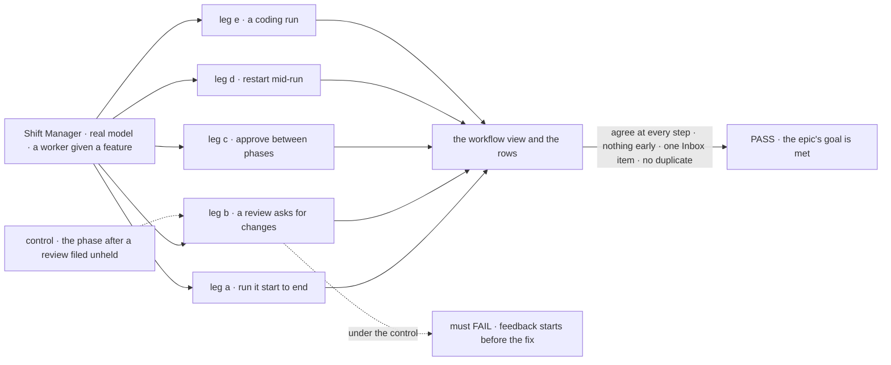
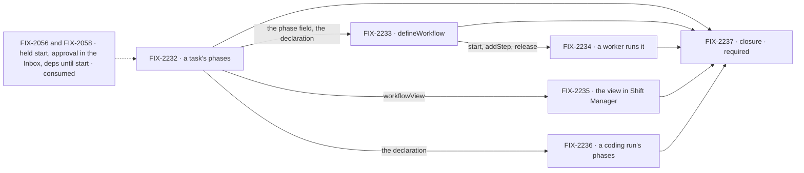

# FIX-2092 · Phased workflows: a feature a person can follow, phase by phase

**Spec** · [Decisions](DECISIONS.md)

## Four teams, before and after

| A team that… | Today | After this epic |
|---|---|---|
| **uses Shift Manager** | A feature given to a worker is one row with a one-line note. The steps it filed are a flat list | The feature opens as a workflow: phases in order, "step 3 of 6", who does each step, what's next, and an approval waiting that links to its one Inbox item |
| **builds a worker that runs a feature** | Files each step by hand. A review that asks for changes lets the next phase start before the fix. A replay after a crash files the steps again | `defineWorkflow` files the steps with fan-in dependencies. The phase after a review waits for the worker. A loop-back is a follow-up and a new round. A replay files nothing twice |
| **writes a flow or a coding run that has stages** | One status note | Declares its phases on its task and reports the one it is in. The same view shows them |
| **maintains the framework** | No phase anywhere | One field per step, one declaration per task, one read. No new runtime, drain mode, board option or hold kind ([ER-1](DECISIONS.md#who-owns-what)) |

**Why now.** FIX-2056 and FIX-2058 are closed, so what the POC lacked is on `main`: a held start
(FIX-2080), an approval that suspends on a task and shows as its one Inbox item (FIX-2129,
FIX-2133), and `deps` editable until a task starts. POC [#3616](https://github.com/fixpoint-labs/flow-state-dev/pull/3616) ran the mechanics
on the real engine and board. A worker that takes a feature and coordinates it to the end is what
Shift Manager has to show for Workforce to be believed. On Oct 21 the owner asked that such a
feature show its workflow and its current phase on the task, not only as rows.

## The goal, and how we'll know it's met

**A person who gives a worker a feature follows it as one workflow on its task (phases in
order, step N of M, what's next, any approval waiting) while the worker runs each phase through
delegates, loops back after a review that asks for changes without starting anything early, and
the feature task ends when its last step does.**

| Is it the right goal? | |
|---|---|
| **The real need** | Workforce's claim is a worker that takes work and coordinates it. A person can't trust what they can't follow. Goal 2, differentiate on hard problems; Goal 1, real usage in Shift Manager |
| **Smaller, and rejected** | "`defineWorkflow` files phased tasks", the POC's plan, FIX-2233 alone. The rows run, but the person sees a flat list, and a coding run's stages stay invisible |
| **Bigger, and not this epic's** | Roles resolved from the roster, a workflow editor, skipping or re-running a phase by button, cost per phase |
| **Not done if** | The view disagrees with the rows · a phase starts before the one before it ends, or before the worker releases it · an approval is answered anywhere but the Inbox · a replay files a duplicate · the feature task ends before its last step · a closure bug is open |

Leg b is the POC's finding: a review that asks for changes still completes, and completing is
what satisfies a dependency. With the phase after it filed unheld, feedback starts before the fix
is filed. Today's `main` fails leg a outright: no task has phases to show.

| How we verify | |
|---|---|
| **Goal check** | The closure issue's (FIX-2237), real model, in Shift Manager, on one `main` commit after every other child merges |
| **Signal** | At each step the view's phases, "step N of M", current phase and next equal what the rows say. No row starts before every dependency ended. The approval is one Inbox item, and its answer releases the next phase. A restart files no row twice. The feature row completes after its last step's ending. A coding run's phases show in the same view |
| **Anti-game** | Read rows through the public task actions and the view through the screen, never a child's own helpers |
| **Control that must fail** | Leg b with the post-review phase unheld. Today's `main` for leg a. Each check names its control and is run red at least once |

**Lead measure:** the set's goal-proven children, named. **None today**, of FIX-2232 to FIX-2236.

**Not doing:**

- **Roles** (`assignee: { role }`). A step names its worker, or is filed with none and the worker
  assigns it before release.
- **`drain({ phase })` and `listTasks({ phase })`.** No caller needs either: the board's own passes run the phases, and `workflowView` groups by phase in memory after one `filedByTask` read.
- **Phase helpers** (skip, re-run). The worker uses the task tools; helpers wait for a repeated pattern.
- **A dependency on a whole phase.** Fan-in edges only: one ordering mechanism.
- **A workflow editor**, and cost or time per phase beyond what the task view shows today.

**Kill line:** if the turn that hears a step's ending can't suspend on a `waitForUser` approval
mirrored onto the feature task, an approval would need a gate row a person answers or a new hold kind. We stop and re-gate before
adding either ([D2](DECISIONS.md#d2)).

## What's in the box

Inside the box is what a worker or a flow gets by declaring phases; below the fence is the Not
doing list, with the POC's session-state record, which [D1](DECISIONS.md#d1) drops.

**Docs:** the task-board page teaches phases as a view over a task's own steps: declare them,
file the steps, read the view. FIX-2233 publishes it; each child documents its own specifics.

## The set · as of 2026-10-27

The reviewed snapshot; live state is in Linear.

| Issue | Delivers | Blocked by |
|---|---|---|
| [FIX-2232](https://linear.app/fixpoint-labs/issue/FIX-2232) · a task's phases | `phase` on a task, a task's declared phases written through `reportProgress`, and `workflowView`, the one read | — |
| [FIX-2233](https://linear.app/fixpoint-labs/issue/FIX-2233) · `defineWorkflow` | The template: validated definition, `start` with stable ids and fan-in deps, held phases after a judging phase, `addStep` in rounds, release, the approval's words. A plain function over the collection's existing writes: no state, no registry, no block kind | FIX-2232 |
| [FIX-2234](https://linear.app/fixpoint-labs/issue/FIX-2234) · a worker runs it | A workforce worker given a workflow starts it on a task, hears each ending, releases, loops back or asks for an approval, with the existing task tools and `waitForUser`. It names the code path that calls `addStep` and release from the woken turn ([ER-5](DECISIONS.md#who-owns-what)) | FIX-2233 |
| [FIX-2235](https://linear.app/fixpoint-labs/issue/FIX-2235) · the view in Shift Manager | The workflow view in the task detail's existing `<TaskPlan />`, "step N of M" in the task list, the approval linked to its Inbox item and not answered from the view | FIX-2232 |
| [FIX-2236](https://linear.app/fixpoint-labs/issue/FIX-2236) · a coding run's phases | A row harness-manager works carries its `PhaseSpec.phase` as `Task.phase`, one value, written from it. The run then declares its own stages (checkout, coding session, review wait, verdict) as its task's phases and reports the current one ([phase means one thing](DECISIONS.md#one-meaning-of-phase)) | FIX-2232 |
| [FIX-2237](https://linear.app/fixpoint-labs/issue/FIX-2237) · closure · **required** | The QA plan, on one `main` commit | every other child |

Five and a closure. FIX-2236 is the one I'd cut: without it only filed steps have phases, which is
the view-over-rows shape. It stays because it is the only producer that runs its phases itself,
so it is what proves the declaration is a contract and not a template detail. If the owner picks
the view-over-rows shape ([Open](DECISIONS.md#open)), the set is four and a closure: FIX-2236
drops, FIX-2232 ships `phase` and the read with no declaration, ER-6 goes, and the closure's leg e goes with it.

## How the issues flow into each other

An edge is what one issue hands the next; the dashed input is consumed, not owned. FIX-2232 goes
first. Then three run in parallel: the template, the screen and the coding run. The worker
wiring waits on the template.

## What stays as it is

- **Ordering by `deps`** and the board's dispatch passes, unchanged ([ER-1](DECISIONS.md#who-owns-what)).
- **The five task tools,** `askQuestion`, `waitForUser` and `reportProgress`'s tool. No new model-facing tool.
- **The Inbox and PR-3:** a stop for a person stays one item, answered through the two routes.
- **A coding run's stages** and FIX-2163's review wait. FIX-2236 names them; it adds none.

## What's already here, and the debt

| Already here | What the set does with it |
|---|---|
| FIX-2080's held start (`held: true`, released by `updateTask({ status: "pending" })`) | **Builds on.** The phase after a judging phase is filed held ([D2](DECISIONS.md#d2)) |
| FIX-2129's `waitForUser` approval, mirrored as a suspension hold on the task's row (FIX-2133), and the Inbox (FIX-2058, PR-3) | **Builds on.** An approval is a `waitForUser({ kind: "approval" })` from the turn on the feature task: one Inbox item, and the worker reads the yes. Not a midway confirm: FIX-2058's rule makes a yes the code reads next an approval, and `askQuestion` opens only a question |
| FIX-2076's plan steps, a worker's steps for itself on the plan ledger | **Not used.** A step for yourself can't be held (`step_cannot_be_held`) and isn't a filed row, so `filedByTask` never sees it. Every workflow step is a task for a delegate on the feature task's board; the worker's own work between phases happens in its turns |
| FIX-2056's `updateTask({ deps })` until a task starts; follow-ups that run in their root's session | **Builds on.** A loop-back re-wires the first unstarted layer and files the fix as a follow-up |
| FIX-2077: a task stays running while work it filed is open (rule 6), and each ending wakes a turn for it | **Builds on.** The feature task ends with its last step |
| FIX-2081's `filedByTask` and its filter | **Builds on.** A phase's steps are the rows the task filed with that phase |
| FIX-2081's `TaskCollection.reportProgress`, claim-fenced (`tasks/collection/state-backed.ts`) | **Extended** to take the declared phases, the one write path ([ER-6](DECISIONS.md#who-owns-what)) |
| POC #3616's `metadata.phase` and session-state record | **Not built.** A field replaces the first; [D1](DECISIONS.md#d1) drops the second |
| Harness-manager's `PhaseSpec.phase`: the phase a coding run serves (`"implement"` in the devteam lab), the phase segment of its run record's topic and of the rows it files | **Same meaning, one value on the row.** `Task.phase` is written from it; the topic keeps the segment as the run record's key, not as a second phase field. FIX-2236 owns the mapping ([one meaning of phase](DECISIONS.md#one-meaning-of-phase)) |

| Adds | Existing piece considered | Why it doesn't fit / how composed |
|---|---|---|
| `Task.phase` (FIX-2232) | A `phase:` label · harness-manager's `PhaseSpec.phase` and topic segment | A label list allows none or several; a step has exactly one phase. `PhaseSpec.phase` names a run, not a row: harness-manager writes it to `Task.phase`, so a row has one phase value |
| A task's declared phases (FIX-2232) | `statusNote` | One line with no order. The declaration rides the same fenced write |
| `workflowView` (FIX-2232) | Each screen deriving its own | A second copy of "step N of M" drifts; one read, screens render it ([ER-3](DECISIONS.md#who-owns-what)) |
| `defineWorkflow` (FIX-2233) | A sequencer; one board per phase | The epic's own *why not*: a fixed structure, and loop-backs become awkward. A factory that files tasks |

| The debt | |
|---|---|
| **Removes** | Nothing shipped. The POC's stand-ins never landed |
| **Adds** | Two task fields, one read, one template, one screen |

**Net: up, by design.** It is a new capability. What it doesn't add is a second way to order work
(dependencies only), a hold kind, or an answer route.

## Sign off

**[The goal](#the-goal-and-how-well-know-its-met):** one workflow on the task, followed end to
end, loop-back included. If wrong: the person still sees a flat list, or the rows run and lie.
**[The debt](#whats-already-here-and-the-debt):** up, by design, with no second mechanism. If
wrong: a second way to order work or answer a person survives.

1. **[Open](DECISIONS.md#open) · Phases are a declaration on the task; the template fills it.**
   The owner's call, on the thread's card. If wrong: either only one kind of runner can show its
   phases, or every worker keeps its own record in step with its rows.
2. **[D1](DECISIONS.md#d1) · No session-state record:** phase order lives on the feature task,
   membership in the rows. Engineering. If wrong: a view that can't be rebuilt after a crash.
3. **[D2](DECISIONS.md#d2) · The phase after a judging phase is filed held, and an approval is a
   `waitForUser` approval on the feature task.** Engineering, from the POC. If wrong: a phase starts early, or a
   gate row a person answers outside PR-3.

**Open:** which shape, on the owner's card.

Epic · 5 issues and a closure · Orchestration Primitives · Goal 2, differentiate on hard problems · Goal 1, validate through real usage
