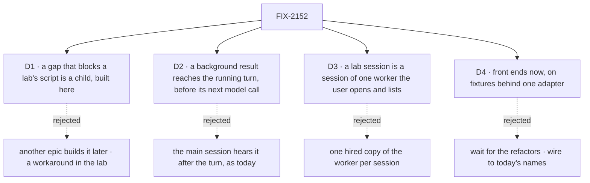

# FIX-2152 · Decisions

[Spec](SPEC.md) · **Decisions**

The calls above any one lab. The product brief on FIX-2152 sets the bar, the scope and the order.
D1 and D2 come to the owner for sign-off. D3 and D4 are engineering calls, recorded because
every lab obeys them. D3 waits on fsd-architect ([Open](#open)).

## The tree

## D1 · A gap that stops a lab passing its script is a child of this epic, and is built here

*An engineering call that changes the epic's size, so it comes to the owner.*

| | |
|---|---|
| **Instead of** | Filing every gap for another epic to build later, or working around it in the lab |
| **Because** | The epic is done when the scripts pass on `main`. If another epic builds the gaps, *done* waits on a queue this epic doesn't own. A workaround puts glue in the lab, which is the thing the inventory exists to show is absent |
| **Locks in** | A gap that blocks a script is filed as a child of FIX-2152 in the Workforce: Shift Manager project. It blocks its lab's wiring and the closure. A gap that blocks no script is filed in the project, linked from the lab's spec, and is not a child. Two are known now ([the set](SPEC.md#the-set--as-of-2026-10-23)); each lab's spec lists the rest |

**What would change my mind:** a gap big enough to be an epic of its own. Then it is filed as one,
and the lab's wiring waits on it.

It comes down to whether the epic can finish on its own work.

## D2 · A background result reaches the main session inside its running turn

*A product call the brief makes (step 4 of FIX-2153's script); the cost is engineering, so it is
recorded here.*

| | |
|---|---|
| **Instead of** | The main session hearing the result only after its turn ends, which is what happens on `main` today: a settled notice waits for the reply (`AFTER_REPLY_CONCURRENCY`, `workforce/src/conversation-board/task-settled.ts`) |
| **Because** | Claude Code shows a background result inside the running turn, and the brief's script asks for it. The package already delivers a steer to a running assignee before its next model call (`orchestration/src/skills/steer-context.ts`, over the generator's `prepareStep`), so a filer's notice can take the same path |
| **Locks in** | [ER-6](#who-owns-what): one gap issue in workforce. A filer's running request takes a settled notice before its next model call. The deferred notice turn runs only if no model call took it, so the notice is heard once. No change in core or engine |

**What would change my mind:** fsd-architect showing that it breaks one request per session or
the one-ending rule (FIX-2077). Then the lab shows the result after the turn and step 4 changes,
which is a product call.

It comes down to working the way Claude Code does: the turn uses the result while it runs.

## D3 · A lab session is a session of one worker that the user opens and lists

*An engineering call, pending fsd-architect ([Open](#open)).*

| | |
|---|---|
| **Instead of** | Hiring one copy of the main worker per session, which puts N identical workers on the roster |
| **Because** | A session belongs to a worker through its `workerId`. Several sessions of one worker already exist in forms the framework opens: workstream sessions (FIX-1883), task sessions, and a delegate's ongoing session. What is missing is the user opening and listing their own: `createWorkforceClient` has only `roster`, `findWorkerSession`, `ensureWorkerSession` and `standingRules` (`workforce/src/workers/client.ts`). One copy per session would show a roster of clones, which neither original app has |
| **Locks in** | [ER-7](#who-owns-what): one gap issue in workforce adds opening and listing a user's sessions of one worker to the workforce client. The worker's one conversation stays where other workers' messages land. Grok Bot-style workers keep one conversation each and need none of this |

**What would change my mind:** fsd-architect showing that a workstream session already is this, so
the gap is one line, or that it needs a name of its own in the concept.

## D4 · Front ends are built now, on fixtures behind one adapter

*An engineering call on sequencing, from Jake's go-ahead of 2026-10-23.*

| | |
|---|---|
| **Instead of** | Waiting for the refactors (FIX-2056's closure, FIX-2058, FIX-2070, FIX-2071) before any UI, or wiring the UI to today's names now |
| **Because** | Jake asked for the UI to be designed and the front end built while the refactors land. Today's names (`messageWorker`, `onWorkerMessage`, `chief-of-staff`) are about to change, so wiring to them now is rework at every call site |
| **Locks in** | [ER-5](#who-owns-what): each lab reads and writes through one adapter module. Each function names the package call it stands for, by its post-refactor name. A fixture function that stands in for a gap carries the gap's issue id. At wiring the fixtures are deleted and the functions call the package. The closure checks that no fixture code ships |

**What would change my mind:** the refactors landing before the front ends start. Then the adapter
calls the package from the first commit.

It comes down to finishing the UI first: the adapter is the only file that changes at wiring.

## Who owns what

A *uses* cell is a place a child must not decide again. FIX-2153 owns the lab rules because it
goes first; the gap issues own their mechanisms.

| # | Rule every child obeys | Owner | Checked at |
|---|---|---|---|
| ER-1 | A lab has three kinds of code: configuration (`fsdev.config.mts`, the host file, `WORKER.md`, `SKILL.md`, `TEAM.md`, resources), React UI, and small flows (at most a few, each under 200 lines, composed only from package exports). The lab's README carries the inventory: files by kind, with line counts. A check in the lab fails on any file that fits none of the three, and the closure runs it. This inventory is the "what this app adds" table the brief asks for | FIX-2153 | Every lab's spec review; the closure |
| ER-2 | A lab imports only a package's public entry points (its `exports` map), never a `src/` path or a private helper | FIX-2153 | The closure sweep |
| ER-3 | One way to set up a lab: under `labs/`, private, launched with `fsdev dev --app` as Shift Manager is; the theme from `@flow-state-dev/design-system` and components from the `packages/ui` registry (`fsdev ui add`). A lab defines no color tokens of its own. The two labs share no code: a piece both need that isn't UI is a package gap ([ER-4](#who-owns-what)), and a piece of UI both need is copied, so each inventory shows what that app adds. FIX-2157 is a mode of FIX-2153's app, not a third lab, so it shares that app's code | FIX-2153 | Every lab's spec review |
| ER-4 | Any need beyond ER-1's three kinds goes to the package: filed against workforce or orchestration (or react, for a hook), named in the lab's spec, and never worked around in the lab, not even for a while. A gap that blocks a script is a child of this epic ([D1](#d1)) | FIX-2153 | Every lab's spec review; the closure |
| ER-5 | Until wiring, a lab reads and writes through one adapter whose functions each name the package call they stand for, by post-refactor names ([D4](#d4)); a fixture standing in for a gap carries its issue id; at wiring the fixtures are deleted | FIX-2153 | Each lab's wiring PR; the closure |
| ER-6 | A settled notice reaches a filer's running request once: taken before its next model call, or by the deferred notice turn when no model call took it, never both. It lives in workforce, over the generator's existing `prepareStep` ([D2](#d2)) | The mid-turn gap | FIX-2153's wiring; the closure's leg a |
| ER-7 | A user opens and lists only their own sessions of one worker, through the workforce client; the worker's one conversation is still where other workers' messages land ([D3](#d3)) | The sessions gap | FIX-2153's wiring; the closure's legs a and c |

## Coordination seams

| Seam | Owner, then who else touches it |
|---|---|
| The workforce client (`workforce/src/workers/client.ts`, `derive-session-id.ts`) | The sessions gap adds opening and listing a user's sessions of one worker; FIX-2153 and FIX-2157 call it through their adapters |
| The settled notice (`workforce/src/conversation-board/task-settled.ts`) and the steer path (`orchestration/src/skills/steer-context.ts`) | The mid-turn gap makes a filer's running request take its notices before the next model call; FIX-2153 shows them in the main thread |
| Messages (`workforce/src/messages/`) | FIX-2070 owns the rename to `sendMessage` and `receive` and where a message lands. FIX-2154 writes against those names and files any read its worker-talk view needs ([Open](#open)) |
| Routed tasks, task statuses and the hold on questions (`workforce/src/coordinator/`, FIX-2058's hold and `waitForUser`) | FIX-2083 and FIX-2058 own them. FIX-2157's status board reads them and adds no status of its own; a column the statuses can't fill is a gap |
| The app's mode switch (FIX-2153's host and UI) | FIX-2153 plans for it in its spec; FIX-2157 adds threads mode behind it |

## Decided before review, recorded so no child reopens them

- **Scope** (the brief): core messaging and session management only. No file diffs or changes
  view, no permission UI, no harness picker; Kitchen Sink covers them. Landing copy is GTM's.
- **Design** (the brief): no designs are provided. Each lab copies its original's core layout and
  interaction closely, in the Flow State theme ([ER-3](#who-owns-what)).
- **Skills don't start workers.** `agents:` and `workers:` frontmatter stay refused
  (`orchestration/src/skills/skill-md.ts`). In the Claude Code-style lab, a skill that "starts a
  worker" tells the model to `createTask` for a named delegate. That is configuration, not a gap.
- **Stopping a task through the main session** is the main worker calling
  `updateTask({ status: "cancelled" })`, which exists (FIX-2081). Steering is `updateTask({ message })`
  (FIX-2086).
- **A long conversation** (FIX-2154) composes `@flow-state-dev/memory` into the worker's flow
  through `defineAgentWorkerFlow({ uses })`, which is configuration. If the history window drops
  what the script needs, that is a gap, not lab code.
- **Names.** Every spec and adapter uses the post-refactor vocabulary: `respond`, `receive`,
  `sendMessage`, `createTask`, `getTask`, `updateTask`, `waitForUser`, request, conversation,
  Shift Coordinator. Docs say "worker", never "seat".
- **FIX-2157's two questions go to its spec**, with the epic's recommendation: you can talk inside
  a thread directly, as a steer to its task through the board's public `updateTask` action
  (FIX-2081), as Shift Manager's task session already lets a person write into a task (FIX-2009);
  *Pinned* is a person's choice, kept in user state, and needs no task status.

## Open

Asked of fsd-architect on [agent-mailbox#46](https://github.com/fixpoint-labs/agent-mailbox/pull/46),
2026-10-23. Each answer is folded here before the objective gate.

1. **Is a main session that both works and delegates a new concept?** The epic's reading: no. The
   agent flow's planned turn (`board.planned`, `workforce/src/agent-worker-flow.ts`) already does
   both, and the concept's `writer` worker is the example.
2. **Is several sessions of one worker a new concept?** The epic's reading: a new entry point, not
   a new concept ([D3](#d3)).
3. **Does D2 break one request per session, or the one-ending rule?** The epic's reading: no,
   because the notice is taken by the request that is already running.
4. **Where is worker-to-worker talk shown (FIX-2154)?** The concept lands a message in the
   recipient's conversation, and FIX-2070 keeps that. The epic's reading: the lab shows each pair's
   talk as a view over the durable messages log, not as a new kind of session.
