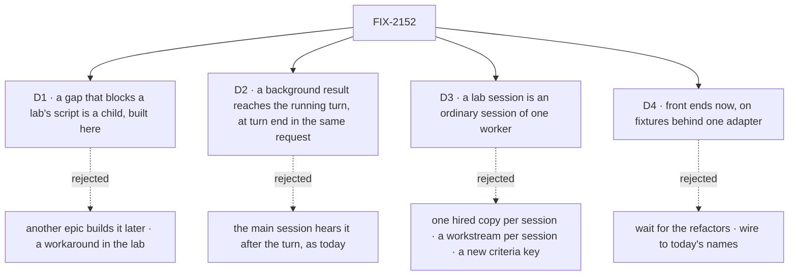

# FIX-2152 · Decisions

[Spec](SPEC.md) · **Decisions**

The calls above any one lab. The product brief on FIX-2152 sets the bar, the scope and the order.
D1 and D2 come to the owner for sign-off, and D2 amends the coordination concept. D3 and D4 are
engineering calls, recorded because every lab obeys them. fsd-architect checked D2, D3 and the
worker-talk view against `main` ([agent-mailbox#46](https://github.com/fixpoint-labs/agent-mailbox/pull/46#issuecomment-6374763392),
[D3 corrected](https://github.com/fixpoint-labs/agent-mailbox/pull/46#issuecomment-6374906557)).

## The tree

## D1 · A gap that stops a lab passing its script is a child of this epic, and is built here

*An engineering call that changes the epic's size, so it comes to the owner.*

| | |
|---|---|
| **Instead of** | Filing every gap for another epic to build later, or working around it in the lab |
| **Because** | The epic is done when the scripts pass on `main`. If another epic builds the gaps, *done* waits on a queue this epic doesn't own. A workaround puts glue in the lab, which is the thing the inventory exists to show is absent |
| **Locks in** | A gap that blocks a script is filed as a child of FIX-2152 in the Workforce: Shift Manager project. It blocks its lab's wiring and the closure. A gap that blocks no script is filed in the project, linked from the lab's spec, and is not a child. Two are known now ([the set](SPEC.md#the-set--as-of-2026-10-23)). Each lab's spec lists the rest, and they join in one batch when that spec merges; a gap found after that joins only with the owner's sign-off, so the epic can't grow unseen |

**What would change my mind:** a gap big enough to be an epic of its own. Then it is filed as one,
and the lab's wiring waits on it.

It comes down to whether the epic can finish on its own work.

## D2 · A background result reaches the main session inside its running turn

*A product call the brief makes (step 4 of FIX-2153's script); the cost is engineering, so it is
recorded here.*

> **Amended 2026-10-23, after the merge of #3783.** The outcome is unchanged. The owner's direction,
> relayed by fsd-product-lead (agent-mailbox #46, comment 6375479737), is that the loop belongs to the
> lab, as a showcase of customizing a flow. FIX-2153's main worker runs on one small lab flow. At turn
> end, in the same request, it takes each settled notice for that session, acknowledges it, and loops
> back to the generator with the results. It *consumes* the notice, so the queued `onTaskSettled`
> finds it cleared and skips it. That keeps the one ending path, with no second path that reads task
> rows. Only the main session does this, since it is not backed by a task; the task-backed case
> stays as the row below says.
>
> **What decides FIX-2159:** whether a public `exports` entry (ER-2) lets a flow take and acknowledge
> a settled notice. On `main` none does: the take record (FIX-2123) and Workforce's handling are
> internal. So FIX-2159 adds the take, and it keeps the guarantees in the row below. It also
> extracts the answer-once-more step `Planning.planned` (FIX-2076) already runs into one shared
> step with one exported cap, and adds an `answerAgain` source slot on `defineAgentWorkerFlow`
> with no loop or cap of its own, so there is one way to answer again (#3799 review). The shared
> step runs the loop; the lab passes only the source block that calls the take.

| | |
|---|---|
| **Instead of** | The main session hearing the result only after its turn ends, which is what happens on `main` today: a settled notice waits for the reply (`AFTER_REPLY_CONCURRENCY`, `workforce/src/conversation-board/task-settled.ts`) |
| **Because** | Claude Code shows a background result inside the running turn, and the brief's script asks for it. A flow can already loop back to its generator within one request, so a small lab flow can take the result in at turn end |
| **Locks in** | *As amended above: FIX-2159's shared answer-again step runs the loop under its cap, and FIX-2153's lab supplies only the `answerAgain` source block that calls the take; this row is the guarantee that take keeps.* [ER-6](#who-owns-what), built by [FIX-2159](https://linear.app/fixpoint-labs/issue/FIX-2159): a delivery mode on FIX-2078's one ending path, not a second path, with one durable "taken in request R" mark like `steersTakenIn`; the deferred notice skips once R has completed. The take, the notice's handling and its acknowledgement move as one transaction from the queued `onTaskSettled` request to the running one, so the ending is never handled twice or skipped. Only a conversation request in a session that is not backed by a task takes it, never a `receive`. In a task-backed session the notice stays on the queued `onTaskSettled`, because that handler also does the task's own work at an ending (`admitOwnTask`, `workforce/src/conversation-board/task-settled.ts`) and acknowledging a taken notice would skip it (`orchestration/src/tasks/notice/task-settled-entry.ts` refuses a cleared notice). The lab's `answerAgain` source block takes the notice through FIX-2159's public take (`takeFinishedTasks`) at its turn end; the steer entry (`steer-context.ts`) doesn't change and stays task-only. A request waiting on the task with `getTask` resumes with the result instead. Rules 5 and 6 (FIX-2077) are untouched: a take records no ending. No change in core or engine |
| **Amends** | Rule 7 of [`workforce-coordination-concept.md`](../../../docs/internal/design/workforce-coordination-concept.md) gains a third destination for an ending's notice: the filer's running request. It stays consistent with FIX-2103's call that an ending is not a message and changes no open work |

**What would change my mind:** a take that can't be made crash-safe the way `steersTakenIn` is.
Then the lab shows the result after the turn and step 4 changes, which is a product call.

It comes down to working the way Claude Code does: the turn uses the result while it runs.

## D3 · A lab session is an ordinary session of one worker

*An engineering call. fsd-architect's first answer proposed a new criteria key; the corrected answer,
checked on `main`, needs no model change.*

| | |
|---|---|
| **Instead of** | Hiring one copy of the main worker per session, which shows a roster of identical workers that neither original app has; a workstream per session, which needs a project, goals and a lead (BR-42); or a new criteria key on `WorkerSessionCriteria` |
| **Because** | Nothing enforces one conversation per worker. The worker flow's create check accepts a session at any id that isn't a derived address (`workforce/src/workers/installation.ts`), and only derived addresses are reserved. The derived session is the worker's default conversation: what `ensureWorkerSession` and `findWorkerSession` return, and where messages land. Other sessions of the worker are ordinary sessions on its flow, which `find` deliberately never returns (`workers/client.ts`) |
| **Locks in** | [ER-7](#who-owns-what), built by [FIX-2158](https://linear.app/fixpoint-labs/issue/FIX-2158): a list of a person's sessions of one worker on the workforce client, and a documentation line in the concept that the derived conversation is the default and the message inbox, not the only one. No model amendment |

**What would change my mind:** a lab that needs a message to land in one of the other sessions.
That is session-to-session messaging, which rule 21 forbids today ([Answered](#answered-by-fsd-architect)).
Later: rule 21 carries `{ session }` since #3797, and FIX-2070 places it as FIX-2160 ([FIX-2070](../FIX-2070/SPEC.md)).

It comes down to opening a session the way Claude Code does: one step, with nothing around it.

## D4 · Front ends are built now, on fixtures behind one adapter

*An engineering call on sequencing, from Jake's go-ahead of 2026-10-23.*

| | |
|---|---|
| **Instead of** | Waiting for the refactors (FIX-2056's closure, FIX-2058, FIX-2070, FIX-2071) before any UI, or wiring the UI to today's names now |
| **Because** | Jake asked for the UI to be designed and the front end built while the refactors land. Today's names (`messageWorker`, `onWorkerMessage`, `chief-of-staff`) are about to change, so wiring to them now is rework at every call site |
| **Locks in** | [ER-5](#who-owns-what): each lab reads and writes through one adapter module. Each function names the package call it stands for, by its post-refactor name. A fixture carries a plain `fixture:` marker in code, and the lab's README maps each fixture to the gap it stands in for (no issue ids in code, BP-006). At wiring the fixtures are deleted and the functions call the package. The closure checks that no fixture code ships, by finding no `fixture:` marker |

**What would change my mind:** the refactors landing before the front ends start. Then the adapter
calls the package from the first commit.

It comes down to finishing the UI first: the adapter is the only file that changes at wiring.

## Who owns what

> **Amended 2026-10-23, after the merge of #3783.** ER-8 and ER-9 come from the owner, relayed by
> fsd-product-lead (agent-mailbox #46): a lab works where you point it, never in its own repository,
> and only delegated workers run on a coding harness. The rows are canonical. The lead measure grew
> to 18 with the steps the labs added for them.

A *uses* cell is a place a child must not decide again. FIX-2153 owns the lab rules because it
goes first; the gap issues own their mechanisms.

| # | Rule every child obeys | Owner | Checked at |
|---|---|---|---|
| ER-1 | A lab has three kinds of code, classified by path. **Configuration:** `fsdev.config.mts`, `host.mts`, and `workforce/**` Markdown (`WORKER.md`, `SKILL.md`, `TEAM.md`, resources). **React UI:** `src/**` (`.tsx`, `.ts`, `.css`). **Small flows:** `workforce/flows/**/*.mts`, at most 3, each under 200 lines. Outside the count: `README.md`, `package.json`, `tsconfig.json`, `vite.config.ts`, `index.html`, the lockfile and `test/**`. Anything else under the lab is *other*. Config caps at 300 lines in all, so glue can't hide in a host file. A script in the lab prints the inventory (files by kind, with line counts) and fails on any *other* file or a broken cap; the README's table is its output. Reading config and UI for logic the package should own stays a review gate at each lab's spec and the closure, because no path rule can see it. The caps are first estimates: FIX-2153's spec may change them once, with its reason | FIX-2153 | Every lab's spec review; the closure |
| ER-2 | A lab imports only a package's public entry points (its `exports` map), never a `src/` path or a private helper | FIX-2153 | The closure sweep |
| ER-3 | One way to set up a lab: under `labs/`, private, launched with `fsdev dev --app` as Shift Manager is; the theme from `@flow-state-dev/design-system` and components from the `packages/ui` registry (`fsdev ui add`). A lab defines no color tokens of its own. The two labs share no code: a piece both need that isn't UI is a package gap ([ER-4](#who-owns-what)), and a piece of UI both need is copied, so each inventory shows what that app adds. FIX-2157 is a mode of FIX-2153's app, not a third lab, so it shares that app's code | FIX-2153 | Every lab's spec review |
| ER-4 | Any need beyond ER-1's three kinds goes to the package: filed against workforce or orchestration (or react, for a hook), named in the lab's spec, and never worked around in the lab, not even for a while. A gap that blocks a script is a child of this epic ([D1](#d1)) | FIX-2153 | Every lab's spec review; the closure |
| ER-5 | Until wiring, a lab reads and writes through one adapter whose functions each name the package call they stand for, by post-refactor names ([D4](#d4)); a fixture carries a plain `fixture:` marker, and the README maps each to its gap (BP-006); at wiring the fixtures are deleted. FIX-2153's spec sets the adapter's layout (file names, one function per package call), and FIX-2154 copies the layout, not the code | FIX-2153 | Each lab's wiring PR; the closure |
| ER-6 | A settled notice reaches a filer's running request once, as [D2](#d2) locks in. FIX-2159's shared answer-again step runs the loop; FIX-2153's lab supplies the `answerAgain` source block, which consumes the notice through FIX-2159's public take, so the queued `onTaskSettled` skips it | FIX-2153 (the source block), FIX-2159 (the take and the shared step) | FIX-2153's wiring; the closure's leg a |
| ER-7 | A lab session is an ordinary session of the worker on its flow; a person lists only their own, through the workforce client; the derived session stays the default conversation, where messages and routed tasks land ([D3](#d3)) | FIX-2158 | FIX-2153's wiring; the closure's legs a and c |
| ER-8 | Every run a lab starts works in a **project's** checkout, never the lab's own and never a scratch directory. A session or worker holds its project, and tasks it files inherit it through `filingProjectId`, which `projectWorkspace()` reads. When a job needs a project and none is set, the lab's screen asks before anything runs; `projectWorkspace()`'s `no-project` refusal is only the backstop. Each lab's spec says when it asks: FIX-2153 and FIX-2157 at New session, FIX-2154 (talk-first) at the first job that touches files. A raw path outside any project is not offered. [FIX-2161](https://linear.app/fixpoint-labs/issue/FIX-2161) lets an ordinary session, or a worker's default conversation, carry a project, set from the screen and stored on the server, never read from lab config | FIX-2153 | Every lab's spec review; each lab's wiring; the closure |
| ER-9 | Only delegated workers run on a coding harness (Claude Code or Codex); a main session stays on the lab's generator, because its loop owns the turn ([D2](#d2)). The harness path is the one `harness-manager` already gives, as DevTeam's `coder` flow uses it, and no new mechanism. A lab has **one** coding worker flow, whatever the number of harnesses: it builds one `harnessManager` per harness (the slot is fixed when a manager is built) and routes each task by the worker's own `harness` setting, a key in its `WORKER.md` that the hire passes to the flow as settings, as DevTeam's `coder` routes by task and reads its worker's settings. So a harness is chosen in config and the flow count stays flat as harnesses are added. If that flow can't stay under ER-1's 200 lines, FIX-2153's spec raises the cap once and says why; a harness flow is never left out of the count. A harness run shows as an ordinary task row, tagged from the worker's `harness` setting; the task row gains no harness field (amended by FIX-2288: one generic spend field) | FIX-2153 | Every lab's spec review; the closure |

## Coordination seams

| Seam | Owner, then who else touches it |
|---|---|
| The workforce client (`workforce/src/workers/client.ts`) | FIX-2158 adds the list of a person's sessions of one worker; FIX-2153 and FIX-2157 call it through their adapters |
| The settled notice (`workforce/src/conversation-board/task-settled.ts`, its deferred entry) and the answer-once-more step `Planning.planned` runs (FIX-2076) | FIX-2159 adds a public take-and-acknowledge for a settled notice and shares that step under one cap; FIX-2153's lab passes the `answerAgain` source block and shows the result in the main thread |
| Messages (`workforce/src/messages/`, the user-scoped `workerMessagesCollection`) | FIX-2070 owns the rename to `sendMessage` and `receive`, where a message lands, and the row it ships (call ids, `{ task }` addresses). FIX-2154 is blocked by FIX-2070 and keys its worker-talk view to that row; a pair filter is UI, and a gap is filed only if paging by pair needs a server index |
| Routed tasks, task statuses and the hold on questions (`workforce/src/coordinator/`, FIX-2058's hold and `waitForUser`) | FIX-2083 and FIX-2058 own them. FIX-2157's status board reads them and adds no status of its own; a column the statuses can't fill is a gap |
| The app's mode switch (FIX-2153's host and UI) | FIX-2153 plans for it in its spec; FIX-2157 adds threads mode behind it |

## Decided before review, recorded so no child reopens them

- **Scope** (the brief): core messaging and session management only. No file diffs or changes
  view, no permission UI, no harness picker; Kitchen Sink covers them. Landing copy is GTM's.
- **Design** (the brief): no designs are provided. Each lab copies its original's core layout and
  interaction closely, in the Flow State theme ([ER-3](#who-owns-what)).
- **Skills don't start workers.** `agents:` and `workers:` frontmatter stay refused
  (`orchestration/src/skills/skill-md.ts`). In the Claude Code-style lab, a skill that "starts a
  worker" tells the model to `createTask` for a named delegate. That is configuration, not a gap.
- **Stopping a task through the main session** is the main worker calling
  `updateTask({ status: "cancelled" })`, which exists (FIX-2081). Steering is `updateTask({ message })`
  (FIX-2086).
- **A long conversation** (FIX-2154) composes `@flow-state-dev/memory` into the worker's flow
  through `defineAgentWorkerFlow({ uses })`, which is configuration. If the history window drops
  what the script needs, that is a gap, not lab code.
- **Names.** Every spec and adapter uses the post-refactor vocabulary: `respond`, `receive`,
  `sendMessage`, `createTask`, `getTask`, `updateTask`, `waitForUser`, request, conversation,
  Shift Coordinator. Docs say "worker", never "seat".
- **FIX-2157's two questions go to its spec**, with the epic's recommendation: you can talk inside
  a thread directly, as a steer to its task through the board's public `updateTask` action
  (FIX-2081), as Shift Manager's task session already lets a person write into a task (FIX-2009);
  *Pinned* is a person's choice, kept in user state, and needs no task status.

## Answered by fsd-architect

Checked against `main` at d5ecdb72, on [agent-mailbox#46](https://github.com/fixpoint-labs/agent-mailbox/pull/46#issuecomment-6374763392), 2026-10-23.

1. **A main session that works and delegates is not a new concept.** One worker on the agent flow,
   roles `manager` and `contributor`; background work is delegation-board tasks with
   `resultTo: "filer"`, the default, heard through `onTaskSettled`. The side pane is the
   conversation's `listTasks`, one board per conversation. A filing naming the worker itself is a
   plan row the drain waits on (FIX-2076 D1, FIX-2082 D2), so a background copy of the main worker
   is a second hired worker on the same flow: configuration, not a gap.
2. **More sessions with one worker are not workstreams**, and need no new key: they are ordinary
   sessions of the worker ([D3](#d3), corrected after the first answer).
3. **A result in a running turn** keeps rules 5 and 6 and adds a destination to rule 7, under the
   conditions in [D2](#d2).
4. **Worker talk is a view, not a session.** FIX-1989 D1 already rejected a session per pair. The
   read exists: `workerMessagesCollection` is user-scoped with a client read, and its rows carry
   from, to, exchange and sessions. FIX-2154 is blocked by FIX-2070 and keys its view to the row
   FIX-2070 ships.
5. **Session-to-session messaging** (proposed in the corrected answer): an optional target session
   on a message, so one session of a worker can message another. No script in this epic needs it,
   and rule 21 says a message never addresses a raw session, so it is filed for the owner to place
   ([FIX-2160](https://linear.app/fixpoint-labs/issue/FIX-2160)), not a child here under [D1](#d1).
   Later: rule 21 carries `{ session }` since #3797, and [FIX-2070](../FIX-2070/SPEC.md) places FIX-2160.
