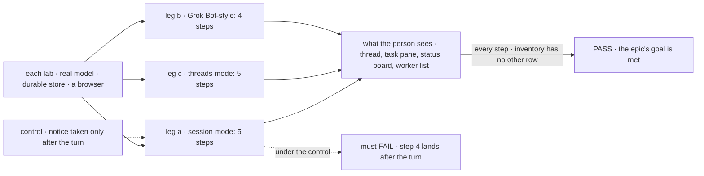
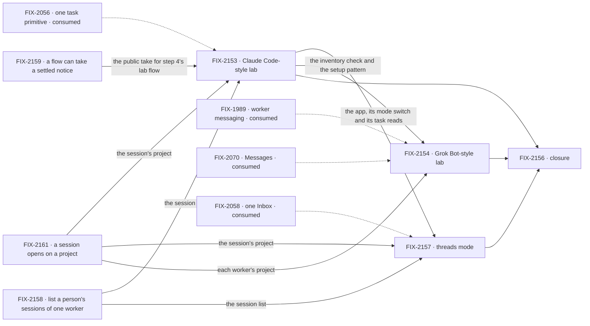

# FIX-2152 · Same pieces, different apps: a Claude Code-style lab and a Grok Bot-style lab

**Spec** · [Decisions](DECISIONS.md)

## Three teams, before and after

| A team that… | Today | After this epic |
|---|---|---|
| **evaluates Flow State** | Has to believe that Workforce is an operating system for agents. Shift Manager is the only app, and its way of working is new | Opens two apps that work the way Claude Code (in its session and threads modes) and Grok Bot do, built from the same pieces, and reads how little each app adds |
| **hardens the workforce package** | When Shift Manager breaks, can't tell a gap in the package from an open product question, because Shift Manager mixes both ways of working | Sees each break against a way of working that is already known to be right. Any glue an app needs is a gap filed against the package |
| **tells the story (GTM)** | Explains a new paradigm first | Shows two familiar apps first, with a "what this app adds" inventory for each, and then Shift Manager as what the same pieces make possible |

**Why now.** The one task primitive (FIX-2056) is on `main` except its closure (FIX-2087), and
worker messaging (FIX-1989) is merged. Jake approved starting specs and UI design on 2026-10-23,
and on the same day approved building the front ends before the refactors land. Only the wiring
waits.

## The goal, and how we'll know it's met

**Two apps that copy the core layout and interaction of Claude Code and Grok Bot pass one
scripted session per way of working with a real model: Claude Code's session mode and threads
mode, and Grok Bot. App code is only configuration, React UI and a few small
flows, and every other need is a gap filed against the package.**

| Is it the right goal? | |
|---|---|
| **The real need** | Proof that the package's pieces reproduce ways of working people already trust, and a list of where they don't. Goal 1, validate through real usage; goal 4, keep the foundation honest |
| **Smaller, and rejected** | "The apps look right." A front end on fixtures meets it, while the package can't run either session. "One lab." Only two apps on the same pieces show that the UI and config are the only difference |
| **Not done if** | A lab carries code that is not config, UI or a small flow (its inventory has an *other* row) · a lab imports a package's internals · a gap is solved in a lab instead of in the package · a scripted step passes only on fixtures · a closure bug is open |

| How we verify | |
|---|---|
| **Goal check** | The closure issue's (FIX-2156), on one `main` commit after every other child merges |
| **Signal** | Leg a, FIX-2153's script: you ask the main session; it does part of the work; it starts 2 background tasks; one result shows in the main thread while that turn is still running; you stop the other task by asking the main session. Leg b, FIX-2154's script: you talk to worker A; A messages worker B; B's reply reaches A while you are still talking to A; the conversation stays coherent over a long session. Leg c, FIX-2157's script: you ask the main session; it starts 3 threads; one waits on you for a decision; one becomes ready for review; you resolve it. Plus each lab's inventory |
| **Anti-game** | Assert on what a person sees in the browser, and on task rows read through public task actions. Never on a lab's own state. Leg a also asserts each ending is heard once: no second notice turn answers a result the running turn already took |
| **Control that must fail** | Leg a with the lab flow's loop-back off ([D2](DECISIONS.md#d2)): step 4 lands after the turn. Leg b with B's `sendMessage` dropped from its tools: A never hears B. Leg c with the main worker's delegates removed: no thread starts |

**Lead measure:** scripted steps that pass on `main` with a real model, of 18 (7, 6 and 5). **0 today.**

## What's in the box

The fence holds the features each original app has that this epic leaves out. The arrow down
is the rule that makes the inventory honest: a need goes to the package, not into the lab.

**Docs:** each lab's README carries its inventory and how to run it. No `apps/docs` page in this
set; the landing page is GTM's.

## The set · as of 2026-10-23

The reviewed snapshot; live state is in Linear.

| Issue | Delivers | Blocked by |
|---|---|---|
| [FIX-2153](https://linear.app/fixpoint-labs/issue/FIX-2153) · Claude Code-style lab | Spec and UI design; the front end on fixtures now; the wiring and its scripted session after the refactor | FIX-2056 (wiring only); the gaps it files ([D1](DECISIONS.md#d1)) |
| [FIX-2157](https://linear.app/fixpoint-labs/issue/FIX-2157) · Claude Code-style lab, threads mode | A second mode of FIX-2153's app: the main session hands everything to background threads, and the right pane is a status board. Spec after FIX-2153's | FIX-2153; FIX-2056 and FIX-2058 (wiring only) |
| [FIX-2154](https://linear.app/fixpoint-labs/issue/FIX-2154) · Grok Bot-style lab | The same, second. Rides worker messaging (FIX-1989), written against FIX-2070's names | FIX-2056 (wiring only); FIX-2070, whose message row its worker-talk view reads; the gaps it files |
| [FIX-2158](https://linear.app/fixpoint-labs/issue/FIX-2158) · list a person's sessions of one worker | A list on the workforce client, and the concept line that the derived conversation is the default, not the only one ([D3](DECISIONS.md#d3)) | — |
| [FIX-2159](https://linear.app/fixpoint-labs/issue/FIX-2159) · a result reaches a running turn | A take-and-acknowledge for a settled notice on the one ending path, and an `answerAgain` source slot on `defineAgentWorkerFlow`. The answer-once-more step `Planning.planned` already runs becomes one shared step with one exported cap, and it runs the loop; FIX-2153's lab passes only the source block that calls the take ([D2](DECISIONS.md#d2), amended; [ER-6](DECISIONS.md#who-owns-what)) | — |
| [FIX-2161](https://linear.app/fixpoint-labs/issue/FIX-2161) · a session opens on a project | An ordinary session of any worker can open on a project the person may work in (a member of a shared project or the owner of a private one; reading isn't enough, since `projectWorkspace()` refuses a reader), and a worker's default conversation can carry a project, a server-written field the screen sets through a client call and never lab config (BP-031), checked as the roster owner, the person whose worker it is, so a lab's runs work in that project's checkout ([ER-8](DECISIONS.md#who-owns-what)). Today only the project coordinator's session can | — |
| [FIX-2156](https://linear.app/fixpoint-labs/issue/FIX-2156) · closure · **required** | The QA plan, run on one `main` commit | every other child |

Two labs, one with two modes, three gaps, and a closure. fsd-architect checked the first two
against `main` and agreed their shape. FIX-2161 came from FIX-2153's spec, when the working directory
was added ([ER-8](DECISIONS.md#who-owns-what)). Each lab's spec may add more.

## How the issues flow into each other

An edge is what one issue hands the next. FIX-2153's and FIX-2154's specs and front ends start
at once; FIX-2157's spec follows FIX-2153's, and its build follows FIX-2153's session mode and
FIX-2154. FIX-2154 copies FIX-2153's setup pattern and shares no code with it
([ER-3](DECISIONS.md#who-owns-what)). FIX-2157 is a mode of FIX-2153's app, so it shares that app's
code.

## What stays as it is

- **The worker model.** A lab adds no kind of worker and no role. The Claude
  Code-style main worker is a `manager` on the agent flow in session mode and a `coordinator` in
  threads mode; each Grok Bot-style worker is an ordinary worker with one conversation
  ([D3](DECISIONS.md#d3)). A background copy of the main worker is a second hired worker on the
  same flow, which is configuration.
- **Skills.** A skill can't start a worker: `agents:` and `workers:` frontmatter stay refused
  (`orchestration/src/skills/skill-md.ts`). A skill that "starts a worker" tells the model to
  `createTask` for a named delegate, which is the package's one way to start work.
- **Shift Manager**, its shell and its Lab contract. The labs use the same launch contract
  (`fsdev dev --app`) and the same theme, and change neither.
- **Core and engine.** Nothing in this set goes below the workforce and orchestration packages.

## What's already here, and the debt

| Already here | What the set does with it |
|---|---|
| The five task tools, the waited `getTask`, `updateTask({ message })` and cancel (FIX-2056) | **Builds on.** Background tasks, stopping a task through the main session, and steering |
| Routed tasks, the coordinator flow and the task-board statuses (FIX-2083) | **Builds on.** Threads mode's threads and its *Working* and *Resolved* columns |
| `waitForUser` and the hold on questions (FIX-2058, planned: specs merged, not on `main`) | **Builds on**, once landed. Threads mode's *Waiting on you* and *Ready for review* columns; FIX-2157's wiring waits on it |
| `messageWorker` and `onWorkerMessage` (FIX-1989); `sendMessage` and `receive` (FIX-2070, planned) | **Builds on.** FIX-2154 is written against FIX-2070's names |
| The agent flow's planned turn (`board.planned`), where one worker does work and files work | **Builds on.** The main session that works and delegates |
| A worker's sessions: the derived default conversation, and any other session on its flow, which the create check already accepts (`workforce/src/workers/installation.ts`) | **Extended** by FIX-2158's list. Workstreams (FIX-1883, opened by `openWorkstream` or a coordinator) are not used: they need a project and a lead ([D3](DECISIONS.md#d3)) |
| `@flow-state-dev/harness-manager`'s `harnessManager`, with a harness slot, and `projectWorkspace()`, which runs a task in its session's project (DevTeam's `coder` flow) | **Builds on.** Delegated workers on Claude Code or Codex, one lab flow that routes to a manager per harness, working in the session's project ([ER-8, ER-9](DECISIONS.md#who-owns-what)) |
| `@flow-state-dev/design-system` and the `packages/ui` registry | **Builds on.** The labs' only theme and components |

| The debt | |
|---|---|
| **Adds** | Two private labs under `labs/` · one list call on the workforce client · a public take on the ending path and an `answerAgain` source slot on `defineAgentWorkerFlow`, with `Planning.planned`'s answer-once-more step extracted as one shared step under one exported cap (D2) · an ordinary session that opens on a project (FIX-2161) |
| **Removes** | Nothing |

**Net: up, by two labs and four package entries.** The labs are the evidence the epic exists to
produce. Each package entry is a gap the labs proved, and the next app gets it for nothing.

## Sign off

**[The goal](#the-goal-and-how-well-know-its-met):** three scripts, 18 steps, with a real model,
and an inventory with no *other* row. **[The debt](#whats-already-here-and-the-debt):** up, by
two labs and four package entries.

1. **[D1](DECISIONS.md#d1) · A gap that blocks a lab's script is a child of this epic and is
   built here.** If wrong: the epic grows by package work that another epic should own.
2. **[D2](DECISIONS.md#d2) · A background result reaches the main session inside its running
   turn.** If wrong: step 4 of the Claude Code-style script is dropped, and the lab works
   differently from the app it copies.
3. **[D4](DECISIONS.md#d4) · Front ends are built now, on fixtures behind one adapter, and the
   fixtures are deleted at wiring.** If wrong: some UI is redone when the refactor changes a
   shape.

**Open, the owner's:** none beyond the sign-off. D2 amends rule 7 of the coordination concept,
and the merge of this PR approves it. Session-to-session messaging (FIX-2160) is filed outside
this epic for the owner to place.

Epic · 2 labs (one in two modes), 3 known gaps and a closure · Workforce: Shift Manager · Goal 1, validate through
real usage · Goal 4, keep the foundation honest
