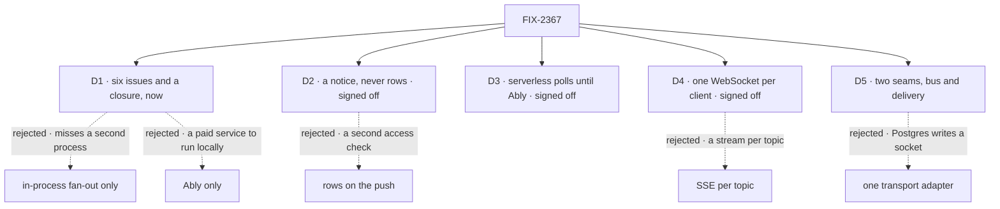

# FIX-2367 · Decisions

[Spec](SPEC.md) · **Decisions**

The calls that sit above any single issue: what was chosen, what lost, why, and what each locks
in for the six issues under it. D1 and D5 are the sign-off. D2, D3 and D4 were signed off by the
owner before drafting; they are recorded so no child reopens them.

## The tree

Solid edges are the calls. Dashed edges lost, and the label says why.

## D1 · A push channel is worth six issues and a closure, now

| | |
|---|---|
| **Instead of** | FIX-1506 alone, as an in-process fan-out inside the engine · or Ably alone |
| **Because** | A fan-out in one process passes on `fsdev dev` and fails the first time a host runs two. Ably alone reaches every process, but makes a paid service the only way to get push, including on a laptop. The bus with an in-memory default and a Postgres adapter covers both, and Ably then fills the serverless case |
| **Locks in** | An epic slot while the active-epic cap is already exceeded (the owner asked for this one). A collapse trigger on the Postgres bus: cut it if no host we support runs more than one process |

**What would change my mind:** evidence that no deployment we care about runs more than one
process. Then FIX-1506 plus the delivery child is the set.

It comes down to a viewer on another process: the in-process fan-out never reaches it.

## D2 · A push carries a notice, never rows · signed off

| | |
|---|---|
| **Instead of** | A push that carries the changed rows |
| **Because** | A notice names a scope and a change kind. The client calls the read or route it already uses, which already checks who may see what, so the push repeats no access check. A lost notice is harmless: the client reads again on reconnect. So at-most-once is enough, and every adapter stays thin |
| **Locks in** | Every client can make a request back. A notice costs one read |

**What would change my mind:** a client that can't make a request back. Then the push needs its
own projection and access check, as FIX-2286 D3 already said.

It comes down to the access check: rows on the push copy every scope's check onto it.

## D3 · Serverless hosts poll until a managed adapter ships; Ably is the second adapter · signed off

| | |
|---|---|
| **Instead of** | A push of our own on Vercel and Next |
| **Because** | A serverless function ends after its response and can't hold a connection open. A relay we hosted would be a service to run. Ably is one, and it fills both seams |
| **Locks in** | Docs state push per host. Kitchen Sink, on Next, polls until FIX-380 ships |

It comes down to the open connection: a serverless function can't hold one.

## D4 · One WebSocket per client is the delivery on long-lived hosts · signed off

| | |
|---|---|
| **Instead of** | An SSE stream per topic, or per user |
| **Because** | A screen adds and drops topics as the person moves. On a socket that is a message; on SSE it is a new stream or a reconnect, and HTTP/1.1 browsers allow six connections per host |
| **Locks in** | SSE request and item streams stay exactly as they are. The socket carries notices and subscribe messages, nothing else (ER-7). The route is the existing user-stream route, so its guard stays |

It comes down to watching one more topic: SSE opens another stream for it.

## D5 · Two seams: a bus in the stores profile, delivery at the host

| | |
|---|---|
| **Instead of** | One transport adapter that does both |
| **Because** | The adapters split differently. Postgres crosses processes but holds no client sockets; the Node host holds sockets but can't cross processes; Ably does both. With one seam, a Postgres user writes a socket server to cross a process. The bus sits in the stores profile because the database that carries it is configured there; delivery sits at the host because only the host knows it can hold a socket |
| **Locks in** | A `bus` slot in `CapabilitySlotMap`. Two places to configure. One notice shape across both seams (ER-1) |

**What would change my mind:** an adapter we'd ship that fills only the delivery seam turning out
to need the bus's internals, or every adapter we'd ship filling both.

It comes down to Postgres on two processes: with one seam it writes a socket server.

## Who owns what

Every rule has one owner. Read a row to see where a rule is made and where it is only obeyed. A
*consumes* cell is a place a child must not re-decide.

| # | Rule every child obeys | Owner | Checked at |
|---|---|---|---|
| ER-1 | A notice names a topic and a change kind. It never carries rows ([D2](#d2)) | the bus | Every child's spec review |
| ER-2 | Topics come only from the session, user and org scopes, optionally narrowed to one resource under them. No child invents a topic of its own | the bus | Each publisher's spec review |
| ER-3 | Every publisher publishes through the one bus. No child adds a second channel, in a product ticket or a lab | the bus | Every child's spec review |
| ER-4 | A subscribe is checked on the server, from the caller's trusted identity, by the check the scope's read route already uses (BP-031). Never a claim the client sends; never a second check | delivery | Delivery's and FIX-380's spec review; closure leg c |
| ER-5 | Every client hook goes through `client.subscribe`, and polls when `GET /capabilities` says there is no push | delivery | FIX-1506's and the task board's spec review |
| ER-6 | Notices are at most once: no replay, no acks, nothing stored. A client reads again on connect and reconnect | the bus | Each adapter's spec review |
| ER-7 | SSE request and item streams don't change. Only notices and subscribe messages travel on the socket ([D4](#d4)) | delivery | Delivery's spec review |

## Coordination seams

| Seam | Between | Rule |
|---|---|---|
| The notice and topic shape | the bus · every publisher · delivery · FIX-380 | The bus defines it once (ER-1, ER-2). A child that needs a field comments up here |
| The `bus` slot in `resolve-slots.ts` | the bus · Postgres bus · FIX-380 | The bus adds the slot; an adapter declares it in its `capabilities` |
| The user-stream route and `GET /capabilities` | delivery · FIX-380 | Delivery owns what capabilities reports. FIX-380 reports its own kind and mints its token through the ER-4 check |
| The resource hooks' invalidation | FIX-1506 · delivery | One invalidation path with two sources: the writer's own `resource_change` item and the notice. The writer's tab reads once, not twice |
| Shift Manager's `TasksPanel` and the Teammates lab's `adapter.ts` polls | the task board child | Only that child turns them into the fallback |

## Decided in review, recorded so no child reopens them

- **The socket lives on the existing user-stream route.** Its user guard and the capabilities
  flag were left for this; a new path would be a second door with a second guard.
- **Request-finished notices are out.** FIX-2043 is a read by id; the request's own stream
  already tells its caller when it ends.
- **FIX-1506 keeps its parent, FIX-2171.** It is a row here, linked, and blocks the closure.
- **FIX-380 is re-scoped** from a spike that routed item streams through Ably to the Ably
  adapter for both seams. Item streams stay on SSE (ER-7).

## What the end-state POC showed

None built for this revision. The coordinator can dispatch one if review doubts the split.

## Analysis

Not run on this revision: the drafting session had no way to dispatch the analysis sub-agent.
The reuse table in [SPEC.md](SPEC.md#whats-already-here-and-the-debt) was checked against the
code by hand (the user-stream route, the capabilities flag, the Postgres notifier and the slot
map were found that way, and each became an *extend* rather than a new piece). The `analysis`
and `reuse-review` pass is owed before the gate.

## How it got here

- **Drafted (Oct 31)** — six issues and a closure under one outcome. D2, D3 and D4 came signed
  off; D1 and D5 are the asks. Docs folded into the delivery child instead of a row.

**Open: none.**
