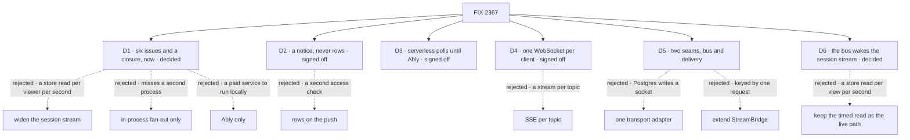

# FIX-2367 · Decisions

[Spec](SPEC.md) · **Decisions**

The calls that sit above any single issue: what was chosen, what lost, why, and what each locks
in for the six issues under it. D5 is the sign-off. The owner decided D2, D3 and D4 before
drafting, and D1 and D6 on Oct 31, amended Nov 1; they are recorded so no child reopens them.

## The tree

Solid edges are the calls. Dashed edges lost, and the label says why.

## D1 · A push channel is worth six issues and a closure, now · decided

| | |
|---|---|
| **Instead of** | Widening `GET /sessions/:id/stream`'s once-a-second store read to user and org scopes · FIX-1506 alone, in process · Ably alone |
| **Because** | The session stream already crosses processes on every store, so widening it is the cheapest set, about two issues. Its price is a store read every second for every open view of every scope, whether anything changed. An in-process fan-out fails today: BullMQ's `dispatch-only` and `worker-only` modes run actions in other processes. Ably alone makes a paid service the only way to get push, even on a laptop. The bus reads only after a notice, and Ably then fills the serverless case |
| **Locks in** | An epic slot while the active-epic cap is already exceeded (the owner chose this one). The Postgres bus is no longer a collapse candidate |

**What would change my mind:** store queries per second from session-stream connections,
widened to session, user and org, **under 100 at 100 idle open views**. Then widen and cut the
bus, the Postgres bus and the socket. One scope costs 4.00 per view today
([FIX-2426's POC](../../issues/FIX-2426/DECISIONS.md#settled)), so widened about 1,200 at 100
views, a small app and twenty times the labs. The bar sits twelve times under that, so only a
redesigned read crosses it, not a tuned one.

**The first flip fired; the bus was kept.** "Fits with headroom at the labs' view counts" fired
at their one to five views. The owner kept the bus ([#4445](https://github.com/fixpoint-labs/flow-state-dev/pull/4445)):
widening would ship polling for user and org changes, which FIX-1506 rules out, and leave
FIX-380 without its seam.

It comes down to what an open view costs: the widened stream reads every second, the bus only on
a change.

## D2 · A push carries a notice, never rows · signed off

| | |
|---|---|
| **Instead of** | A push that carries the changed rows |
| **Because** | A notice names a scope and a change kind. The client calls the read or route it already uses, which already checks who may see what, so the push repeats no access check. A lost notice is harmless: the client reads again on reconnect. So at-most-once is enough, and every adapter stays thin |
| **Locks in** | Every client can make a request back. A notice costs one read |

**What would change my mind:** a client that can't make a request back. Then the push needs its
own projection and access check, as FIX-2286 D3 already said.

It comes down to the access check: rows on the push copy every scope's check onto it.

## D3 · Serverless hosts poll until a managed adapter ships; Ably is the second adapter · signed off

| | |
|---|---|
| **Instead of** | A push of our own on Vercel and Next |
| **Because** | A serverless function ends after its response and can't hold a connection open. A relay we hosted would be a service to run. Ably is one, and it fills both seams |
| **Locks in** | Docs state push per host. Kitchen Sink, on Next, polls until FIX-380 ships |

It comes down to the open connection: a serverless function can't hold one.

## D4 · One WebSocket per client is the delivery on long-lived hosts · signed off

| | |
|---|---|
| **Instead of** | An SSE stream per topic, or per user |
| **Because** | A screen adds and drops topics as the person moves. On a socket that is a message; on SSE it is a new stream or a reconnect, and HTTP/1.1 browsers allow six connections per host |
| **Locks in** | SSE request and item streams stay exactly as they are. The socket carries notices, subscribe messages and delivery control frames (such as [FIX-2428's](../../issues/FIX-2428/DECISIONS.md#decided-not-asked) `crossing`), nothing else (ER-7). A control frame is about the socket, never a notice kind. The route is the existing user-stream route, so its guard stays |

It comes down to watching one more topic: SSE opens another stream for it.

## D5 · Two seams: a bus in the stores profile, delivery at the host

| | |
|---|---|
| **Instead of** | One transport adapter that does both · extending `StreamBridge` · a missing `bus` slot that fails loudly |
| **Because** | The adapters split differently. Postgres crosses processes but holds no client sockets; the Node host holds sockets but can't cross processes; Ably does both. With one seam, a Postgres user writes a socket server to cross a process. The bus sits in the stores profile because the database that carries it is configured there; delivery sits at the host because only the host knows it can hold a socket. `StreamBridge` is keyed by one request, ends with its result and carries abort; a topic outlives every request, so the bus is a sibling that keeps the bridge's invariant (stores persist, the push is best-effort). `resolveStores` fills a missing piece in memory, so a Postgres primary with no `bus` slot would run single-process without a word. The primary adapter backs `bus` when the profile names none and it declares the slot; a loud failure instead would break every single-process Postgres app that never asked for push |
| **Locks in** | A `bus` slot in `CapabilitySlotMap`, defaulting to the primary adapter's. Two places to configure. One notice shape across both seams (ER-1) |

**What would change my mind:** an adapter we'd ship that fills only the delivery seam turning out
to need the bus's internals, or every adapter we'd ship filling both.

It comes down to Postgres on two processes: with one seam it writes a socket server.

## D6 · The bus wakes the session stream's read · decided

| | |
|---|---|
| **Instead of** | Leaving `GET /sessions/:id/stream`'s once-a-second read as it is, a second live path beside the bus |
| **Because** | That read costs a store read a second for every open connection, whether or not anything changed. Woken, an idle view costs nothing, and the bus has a real consumer the day it lands. The stream also sends other callers' items and run changes, which a plain reply makes with no resource, state or task write, so the bus child publishes the session topic from every request and session store write, through one wrapper applied in `resolveStores` and at each entry that takes a raw registry (`runAction`, BullMQ's job processor, `fsdev run` and `chat`), or turning the timer off would strand them. The stream's cross-process reach then rests on the bus, so the timed read stays as a slow fallback where the bus can't cross processes: the in-memory bus on two or more processes, and serverless hosts. The wake goes in the bus child, because the delivery child is already the largest |
| **Locks in** | The bus child owns the wake and its publisher: an item persisted under a session's request, a request status change, and a run created or updated each publish that session's topic. The timed read stays **only** where the bus can't cross processes (the in-memory bus on two or more processes, and serverless hosts); with a cross-process bus it is off. No child adds an always-on poll beside the session stream and the socket (ER-3). The bus child changes a route that works today across processes, so it proves both the woken and the fallback path, and a reply with no other write (closure leg d) |

**What would change my mind:** the session stream alone **under 100 store queries a second at
100 idle open views** (today 400; [D1](#d1)'s bar), or the bus child unable to land the wake
without the delivery child. The first flip, a read "negligible at our viewer counts", fired with
D1's; the bus was kept for the same reasons.

It comes down to the idle view: as now, it pays a read every second for nothing.

## Who owns what

Every rule has one owner. A *consumes* cell is a place a child must not re-decide.

| # | Rule every child obeys | Owner | Checked at |
|---|---|---|---|
| ER-1 | A notice names a topic and a change kind, and may name the request that made it. It never carries rows ([D2](#d2)) | the bus | Every child's spec review |
| ER-2 | Topics come only from the session, user and org scopes, optionally narrowed to one resource under them. No child invents a topic of its own | the bus | Each publisher's spec review |
| ER-3 | Every new publisher publishes through the one bus, and the bus wakes the session stream ([D6](#d6)). Its timed read runs only where the bus can't cross processes; no child adds an always-on poll, in a product ticket or a lab | the bus | Every child's spec review |
| ER-4 | A subscribe is checked on the server, from the caller's trusted identity, by the check the scope's read route already uses (BP-031), on every connect and reconnect, not only the first (FIX-1620). Never a claim the client sends; never a second check | delivery | Delivery's and FIX-380's spec review; closure leg c |
| ER-5 | Every client hook goes through `client.subscribe`, and polls wherever push can miss a change: `GET /capabilities` says there is no push, the socket is down, or its bus can't cross processes ([FIX-2428 D3](../../issues/FIX-2428/DECISIONS.md#d3)). On Ably, an open connection counts as crossing, since its bus is the delivery; a dropped one polls. One obvious way per scope: a scope `live: true` already watches gets no second hook | delivery | FIX-1506's and the task board's spec review |
| ER-6 | Notices are at most once: no replay, no acks, nothing stored. A client reads again on connect and reconnect | the bus | Each adapter's spec review |
| ER-7 | SSE request and item streams don't change. Only notices, subscribe messages and delivery control frames travel on the socket ([D4](#d4)). A control frame, such as `crossing`, says something about the socket itself; it is never a notice kind and never carries rows or items | delivery | Delivery's spec review |

## Coordination seams

| Seam | Between | Rule |
|---|---|---|
| The notice and topic shape | the bus · every publisher · delivery · FIX-380 | The bus defines it once (ER-1, ER-2), with the wire's `topic.*` constructors, which name no user, org or tenant id. A child that needs a field comments up here |
| The `bus` slot in `resolve-slots.ts` | the bus · Postgres bus · FIX-380 | The bus adds the slot and its default to the primary; an adapter declares it in its `capabilities` |
| The session stream's wake | the bus · delivery · the task board child | The bus child owns it, and its one write wrapper, in `resolveStores` and at each raw-registry entry; the only timed read is its fallback where the bus can't cross processes ([D6](#d6)) |
| The task board's topic | the task board child · the bus | The conversation's session topic, with a *board change* kind, published from whichever process settles the task. A scope's subscriber also hears the notices narrowed under it; the session stream filters by kind and wakes only on `items`, `request` and `run`, so a board is no second way to watch a session |
| The user-stream route and `GET /capabilities` | delivery · FIX-380 | Delivery owns what capabilities reports and the mint's answer, one union keyed by transport, defined once in FIX-2428 with both arms and the Ably arm's crossing rule. FIX-380 adopts it and owns only the Ably implementation, minting its token through the ER-4 check. The mint answer's `transport` is authoritative; `capabilities.push.transport` only advertises |
| The resource and state hooks' invalidation | FIX-1506 · delivery | One invalidation path with two sources: the writer's own `resource_change` or `state_change` item and the notice. The writer's tab reads once, not twice: the notice names its request (`origin`), and that view skips it |
| Shift Manager's and the labs' polls | the task board child · FIX-2466 | The task board child turns the board views into the fallback; FIX-2466 the rest |

## Decided in review, recorded so no child reopens them

- **The socket lives on the existing user-stream route.** Its user guard and the capabilities
  flag were left for this; a new path would be a second door with a second guard.
- **Reading a request's result by id is FIX-2043's, not a notice.** No topic per request: the
  request's own stream tells its caller when it ends. A request's items and status still publish
  its session's topic ([D6](#d6)); that is the session view, not the result.
- **FIX-1506 keeps its parent, FIX-2171.** It is a row here, linked, and blocks the closure.
- **FIX-1506 publishes scope-state writes too.** A `ctx.user` or `ctx.org` patch emits
  `state_change` through `wrapStateOpsWithEmit`, not `onResourceChanged`, so a resource-only
  publisher would miss the state the goal names. One row, not two: both are a publish beside an
  emit in `createExecutionContext.ts`, read again by the same hooks. Closure leg a patches both.
- **FIX-380 is re-scoped** from a spike that routed item streams through Ably to the Ably
  adapter for both seams. Item streams stay on SSE (ER-7).
- **The socket reports crossing; the server doesn't tick.** A server that sent a synthetic
  notice at the poll pace where its bus can't cross would drop FIX-2428's `crossing` frame, but
  add a server timer per connection, while the client already keeps one for a dropped socket.
  The frame reports a per-process fact that can change at runtime (FIX-2427's ping), so it rides
  the socket as a control frame (ER-7). On Ably an open connection counts as crossing.

## What the end-state POC showed

None built for this revision. The coordinator can dispatch one if review doubts the split.

## Analysis

The pre-gate `analysis` and `reuse-review` pass found the baseline wrong: the session stream
already crosses processes for one session. Folded into the goal, D1, D5, ER-3 to ER-5 and the
reuse rows. Its one hold became [D6](#d6).

## How it got here

- **Drafted (Oct 31)** — six issues and a closure under one outcome. D2, D3 and D4 came signed
  off; D1 and D5 are the asks. Docs folded into the delivery child instead of a row.
- **Analysis folded (Oct 31)** — the baseline corrected to the session stream; the Postgres bus
  kept, since BullMQ already runs two processes.
- **Owner decisions (Oct 31)** — D1 as recommended: widening the session stream rejected for its
  read per second per scope per view. The hold became D6: the bus wakes the session stream.
- **Review (Oct 31)** — FIX-1506 widened to scope-state writes, which skip `onResourceChanged`;
  closure leg a patches `ctx.org`. D1's flip names its metric; D6's timed read is fallback only.
- **Review (Oct 31)** — D6's wake widened to request and run writes, which a plain reply makes
  alone; closure leg d checks it with the timed read off. FIX-2043 stays out, as a read by id.
- **Amended (Nov 1)** — D1's flip fired at the labs' view counts; the owner kept the bus. D1 and
  D6 now flip in queries a second at 100 views. D6's publish also wraps raw-registry entries.
- **Amended (Nov 2)** — FIX-2466 joins the set from FIX-2429's D1 and blocks the closure. ER-5
  polls wherever push can miss a change, a bus that can't cross included (FIX-2428 D3).
- **Review (Nov 2)** — ER-7 and D4 admit delivery control frames such as `crossing`, never a
  notice kind. The server tick was weighed and dropped; the mint union lives once, in FIX-2428.

**Open: none.**
