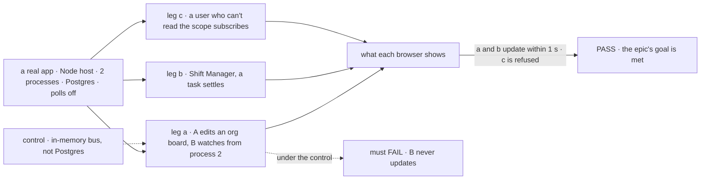
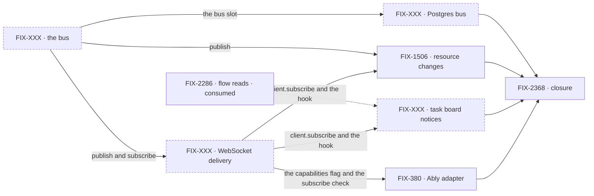

# FIX-2367 · A change reaches every screen watching it

**Spec** · [Decisions](DECISIONS.md)

## Four teams, before and after

| A team that… | Today | After this epic |
|---|---|---|
| **builds a screen two people watch** (a shared board, a roster) | The second viewer never sees the first one's change until the component remounts | Sees it within a second on a long-lived host, through the hooks it already uses |
| **runs the labs or Shift Manager** | The Teammates lab reads its task views again every 1.5 s and Shift Manager every 3 s, per viewer, whether anything changed or not | Reads when a notice says the board changed. The poll stays only as the fallback |
| **runs more than one process on Postgres** | Nothing crosses even one process | A change in one process reaches a viewer connected to another, through the Postgres it already runs |
| **deploys to Vercel or Next** | Polls | Still polls by default, and the docs say so. With the Ably adapter, gets push |

**Why now.** Two apps we use every day poll because nothing else exists, and
[FIX-1506](https://linear.app/fixpoint-labs/issue/FIX-1506) has waited since September for a
channel its owner notes say no product ticket may invent. [FIX-2286 D3](../../issues/FIX-2286/DECISIONS.md#d3)
(merged) settled the shape: the push says *when* to read, a read says *what* changed. Reads have
shipped (`runRead`, `client.read`). The push is the missing half.

## The goal, and how we'll know it's met

**On a long-lived host, a change to session, user or org state reaches every client that is
watching it and may see it, within a second and across processes, and an app gets that by using
the framework's hooks, not by writing push code.**

| Is it the right goal? | |
|---|---|
| **The real need** | Goal 2's scoped state only holds if a change to org state is seen by everyone looking at it, not only by the tab that wrote it. Goal 1: the apps we run stop polling |
| **Smaller, and rejected** | "FIX-1506 alone, as an in-process fan-out in the engine." It passes on one process. Behind a load balancer, a viewer on the other process never updates ([D1](DECISIONS.md#d1)) |
| **Bigger, and not this epic's** | Rows on the push (live sync), anything sent back over the socket (interrupts, barge-in), push on serverless without a managed service |
| **Not done if** | A viewer on another process misses a change · a subscribe to a scope the caller can't read succeeds · a lab or Shift Manager still polls with push configured · the docs imply push on Vercel without Ably · a closure bug is open |

Polling is off, so a poll can't pass legs a and b. Leg c is there because a push that skips the
access check passes the other two.

| How we verify | |
|---|---|
| **Goal check** | The closure issue's ([FIX-2368](https://linear.app/fixpoint-labs/issue/FIX-2368)), on one `main` commit after every other child merges. Its clean run is the wrap condition |
| **Signal** | Leg a: B's browser shows A's row within 1 s. Leg b: the board updates within 1 s, with no read between notices. Leg c: the subscribe is refused, and no notice reaches that user |
| **Anti-game** | Assert on what each browser shows, not on calls to `publish`. Two real processes, not two clients of one |
| **Control that must fail** | The in-memory bus on two processes: leg a must FAIL. Today's `main`: legs a and b must FAIL |

## What's in the box

![In the box: a notice that names a scope and carries no rows; topics from the session, user and org scopes; a bus with an in-memory default and a Postgres adapter; one WebSocket per client on the Node host; client.subscribe and hooks that read again on a notice; polling when there is no push; two publishers. Composed in by the app: which views watch, its host, the Postgres bus. Replaced in one line: the Ably adapter. Not built, below a fence: rows on the push, replay, items on the socket, push on serverless without Ably, request-finished notices, session-to-session messages](figures/end-state.svg)

Everything in the box is what an app gets for nothing. The fence is [D2](DECISIONS.md#d2): the
push carries no rows, so it needs no access check and no replay of its own.

**Docs:** one realtime guide: the push says when, a read says what, and a table of which host
gets push. The WebSocket delivery child publishes it when delivery ships; FIX-380 adds the Ably
row. Each child documents its own API with its implementation.

## The set · as of 2026-10-31

The reviewed snapshot. Live state is the epic's sub-issues in Linear.

| Issue | What it delivers | Why the set needs it | Status |
|---|---|---|---|
| FIX-XXX · the bus | The notice and topic shape, `publish` and `subscribe`, an in-memory adapter, and a `bus` slot in the stores profile | The seam every other child is written against | Not filed |
| FIX-XXX · Postgres bus | A bus on `LISTEN`/`NOTIFY`, through the tail pool `store-postgres` already opens | Without it nothing crosses a process. The one I'd cut ([D1](DECISIONS.md#d1)) | Not filed |
| FIX-XXX · WebSocket delivery | The Node host serves the user-stream route as a WebSocket; per-topic subscribe, checked on the server; `GET /capabilities` reports push; `client.subscribe`; a React hook that reads again on a notice and polls without push; the realtime guide | The wire, and the one client path | Not filed |
| [FIX-1506](https://linear.app/fixpoint-labs/issue/FIX-1506) · resource changes reach other sessions | `onResourceChanged` publishes a notice for its scope; the resource hooks read again on one | The outcome FIX-1506 asked for | Todo · keeps parent FIX-2171, linked here |
| FIX-XXX · task board notices, polls off | A task-board change publishes a session notice; Shift Manager and the Teammates lab move their polls behind notices | Goal 1: the apps we run stop polling ([FIX-2286 D3](../../issues/FIX-2286/DECISIONS.md#d3)) | Not filed |
| [FIX-380](https://linear.app/fixpoint-labs/issue/FIX-380) · Ably adapter | Bus and delivery through Ably, with a server-minted token for the topics the caller may read | Serverless push, and the test that the two seams are the right two ([D5](DECISIONS.md#d5)) | Backlog · re-scoped from a spike |
| [FIX-2368](https://linear.app/fixpoint-labs/issue/FIX-2368) · closure · **required** | The QA run on one `main` commit: the three legs, each team's journey (Vercel with Ably among them), every child's goal check | The only child that runs the whole set | Backlog · blocked by every other child |

3 filed, 4 not yet. Is six really five? The Postgres bus is the one to cut: if no host we
support runs more than one process, the in-memory bus still serves `fsdev dev`, the labs and
Shift Manager. Docs are not a row; the delivery child publishes the guide. A bug the closure run
finds joins as a row that blocks it.

## How the issues flow into each other

An edge is what one issue hands the next; a dashed input is consumed, not owned; a dashed node
isn't filed yet. The bus goes first. The Postgres bus and delivery run in parallel, then the two
publishers and Ably. FIX-1506 is a row of the set but keeps its parent, FIX-2171. Every child
blocks the closure issue, which waits on all of them.

## What stays as it is

- **SSE request and item streams**, resume included. Items never move onto the socket ([D4](DECISIONS.md#d4)).
- **Reads and the existing routes.** A notice triggers them; it doesn't replace them.
- **Same-session `resource_change` items.** The writer's tab still sees its own change on its stream.
- **Serverless hosts and Kitchen Sink**, which runs on Next. They poll until Ably ships ([D3](DECISIONS.md#d3)).
- **Request results.** [FIX-2043](https://linear.app/fixpoint-labs/issue/FIX-2043) (read a result by id) stays its own fix; the request stream already tells its caller when it ends.
- **Messages between sessions or workers.** Worker messaging (FIX-1989) owns that. A notice reaches screens.

## What's already here, and the debt

| Already here | What the set does with it |
|---|---|
| `onResourceChanged` and `makeResourceChangeHandler` (`createExecutionContext.ts`), writing to one request's emitter | **Builds on.** FIX-1506 adds a publish beside the emit |
| The task substrate's `onChange` (`TaskChangeEvent`), adapted to `task-change` component items | **Builds on.** The task-board child publishes from the same callback |
| `GET /users/:userId/stream`, routed and guarded as a user route, answering 501 | **Extended.** The Node host serves it as the WebSocket; the guard stays |
| `GET /capabilities`, answering `{ userStream: false }`, and `FlowCapabilities` in the client | **Extended.** It says whether push is there, which is how a hook knows to poll |
| `store-postgres`'s `liveTailPool` and its `LISTEN flow_events` notifier (FIX-569) | **Extended.** The Postgres bus listens on a second channel through the same pool |
| `CapabilitySlotMap` and `resolve-slots.ts`, with forward-compatible `queue` and `scheduler` slots | **Extended** with a `bus` slot ([D5](DECISIONS.md#d5)) |
| Flow reads (`runRead`, `client.read`), FIX-2286 | **Builds on.** The fetch a notice triggers |
| FIX-2286 D3: the push says when, the read says what | **Kept**, as [D2](DECISIONS.md#d2) and ER-1 |
| FIX-441's cross-flow `.notify(topic)` (canceled Aug 2026 for Relay) | **Not revived.** It started work in other flows; a notice starts nothing |
| FIX-1235 Watch, under FIX-1197 Relay (canceled Sep 2026 when Workstreams, Relay's premise, went) | **Not revived.** Watch told a session; this tells a screen |
| FIX-123, the Phase 2 transport question (canceled May 2026, undecided) | **Answered** for notices only, by [D4](DECISIONS.md#d4). Interrupts and queued messages stay out |

| Adds | Existing piece considered | Why it doesn't fit / how composed |
|---|---|---|
| The bus contract and in-memory adapter | The memory request store's per-request callback bus; `response-emitter`'s fan-out | Both fan out within one request. Composed from the same pattern, keyed by topic, behind a stores slot |
| The Postgres bus | The `flow_events` LISTEN notifier | Extends it: same pool, a second channel. No new connection pool |
| WebSocket delivery | The SSE request stream | SSE is one stream per request; a client watching many topics needs one connection it can add topics to ([D4](DECISIONS.md#d4)) |
| `client.subscribe` and one hook | `useSession`'s `resourceChanges` | Extends the hooks' existing invalidation; it adds a second source, not a second cache |

| The debt | |
|---|---|
| **Adds** | One stores slot, one bus contract with two adapters, one socket path in the Node host, one client call and one hook. The Ably package |
| **Removes** | The 501 user-stream answer, the Teammates lab's and Shift Manager's fixed polls, FIX-1506's remount workaround |
| **Leaves** | `useSession`'s same-session path beside the notice path; one invalidation path, two sources (see the seam) |

**Net: up**, by one push channel. It is the one Goal 2 is missing, and every later realtime need
is a publisher on it.

## Sign off

**[The goal](#the-goal-and-how-well-know-its-met):** across processes, checked on the server,
with polls off. If wrong: an epic that wraps with one process working.

**[The debt](#whats-already-here-and-the-debt): up**, by one push channel, which removes two
polls and a workaround. If wrong: a channel only two apps use.

1. **[D1](DECISIONS.md#d1) · A push channel is worth six issues and a closure, now.** If wrong:
   an epic slot over the cap, on a gap one issue could have closed for one process.
2. **[D5](DECISIONS.md#d5) · Two seams, a bus in the stores profile and delivery at the host.**
   If wrong: two places to configure, for an adapter split nobody uses.

D2, D3 and D4 were signed off by the owner before drafting and are recorded with their
trade-offs in [DECISIONS.md](DECISIONS.md).

**Open: none.**

Epic · 6 issues and a closure · Realtime / WebSockets · Goal 2, scoped state · Goal 1, validate through real usage
