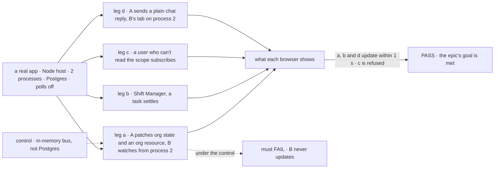
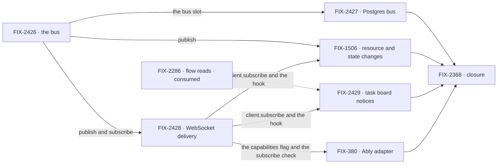

# FIX-2367 · A change reaches every screen watching it

**Spec** · [Decisions](DECISIONS.md)

## Four teams, before and after

| A team that… | Today | After this epic |
|---|---|---|
| **builds a screen two people watch** (a shared board, a roster) | A session view already follows other writers through the session stream (`useSession({ live })`, `BoardList`). A change to user or org state never reaches it until the view reads again | Sees it within a second on a long-lived host, through the hooks it already uses |
| **runs the labs or Shift Manager** | A task board settled from another session never reaches the conversation's stream ([FIX-2286 D1](../../issues/FIX-2286/DECISIONS.md#d1)), so the Teammates lab reads its task views every 1.5 s and Shift Manager every 3 s, per viewer | Reads when a notice says the board changed. The poll stays only as the fallback |
| **runs more than one process** (Postgres, or BullMQ workers) | The session stream crosses processes by reading the store about once a second per open connection. User and org changes don't cross at all | A change in one process reaches a viewer on another, through the Postgres it already runs, on one connection per process |
| **deploys to Vercel or Next** | Polls | Still polls by default, and the docs say so. With the Ably adapter, gets push |

**Why now.** `GET /sessions/:id/stream` covers one session, by reading the store every second
for every viewer. User and org state, which Goal 2's scoped state rests on, and task boards
settled from another session have no live path at all, so two apps we use every day poll and
[FIX-1506](https://linear.app/fixpoint-labs/issue/FIX-1506) has waited since September for a
channel. [FIX-2286 D3](../../issues/FIX-2286/DECISIONS.md#d3) settled the shape: the push says
*when* to read, a read says *what* changed. Reads have shipped; the push is the missing half.

## The goal, and how we'll know it's met

**On a long-lived host, a change to user or org state, or to a task board settled from another
session, reaches every client that is watching it and may see it, within a second and across
processes, without a store read per viewer per second, and an app gets that by using the
framework's hooks, not by writing push code.**

| Is it the right goal? | |
|---|---|
| **The real need** | Goal 2's scoped state only holds if a change to org state is seen by everyone looking at it, not only by the tab that wrote it. Goal 1: the apps we run stop polling |
| **Smaller, and rejected** | Widening the session stream's once-a-second read to user and org scopes: it crosses processes, at a store read per viewer per scope per second ([D1](DECISIONS.md#d1)). Or FIX-1506 alone, in process, which BullMQ's separate workers already defeat |
| **Bigger, and not this epic's** | Rows on the push (live sync), anything sent back over the socket (interrupts, barge-in), push on serverless without a managed service |
| **Not done if** | A viewer on another process misses a change · a subscribe or a reconnect to a scope the caller can't read succeeds · a lab or Shift Manager still polls, or the session stream still reads each second, with the Postgres bus configured · with the timed read off, a session view on another process misses a plain reply that wrote no resource, state or task · an app has two hooks for watching one scope (`live: true` beside the push hook) · the docs imply push on Vercel without Ably · a closure bug is open |

Polling and the session stream's timed read are off, so neither can pass legs a, b and d. Leg d writes no resource, state or task, so only the request and run publish carries it. Leg c is there because a push that skips the
access check passes the other two.

| How we verify | |
|---|---|
| **Goal check** | The closure issue's ([FIX-2368](https://linear.app/fixpoint-labs/issue/FIX-2368)), on one `main` commit after every other child merges. Its clean run is the wrap condition |
| **Signal** | Leg a: B's browser shows both of A's changes within 1 s, the plain `ctx.org` state patch and the resource row. Leg b: the board updates within 1 s, with no read between notices. Leg c: the subscribe is refused, and no notice reaches that user. Leg d: B's session view shows A's reply within 1 s |
| **Anti-game** | Assert on what each browser shows, not on calls to `publish`. Two real processes, not two clients of one |
| **Control that must fail** | The in-memory bus on two processes: leg a must FAIL. Today's `main`: legs a and b must FAIL. The request and run publish cut out: leg d must FAIL |

## What's in the box

![In the box: a notice that names a scope and carries no rows; topics from the session, user and org scopes; a bus with an in-memory default and a Postgres adapter; one WebSocket per client on the Node host; client.subscribe and hooks that read again on a notice; polling when there is no push; three publishers: request and run writes, scope changes, task boards. Composed in by the app: which views watch, its host, the Postgres bus. Replaced in one line: the Ably adapter. Not built, below a fence: rows on the push, replay, items on the socket, push on serverless without Ably, a topic per request, session-to-session messages](figures/end-state.svg)

Everything in the box is what an app gets for nothing. The fence is [D2](DECISIONS.md#d2): the
push carries no rows, so it needs no access check and no replay of its own.

**Docs:** one realtime guide: the push says when, a read says what, and a table of which host
gets push. The WebSocket delivery child publishes it when delivery ships; FIX-380 adds the Ably
row. Each child documents its own API with its implementation.

## The set · as of 2026-11-01

The reviewed snapshot. Live state is the epic's sub-issues in Linear.

| Issue | What it delivers | Why the set needs it | Status |
|---|---|---|---|
| [FIX-2426](https://linear.app/fixpoint-labs/issue/FIX-2426) · the bus | The notice and topic shape, `publish` and `subscribe`, an in-memory adapter, and a `bus` slot in the stores profile. The session stream woken by it: a publish on the session topic from every request and session store write, wrapped in `resolveStores` and at each raw-registry entry; its timed read kept as the fallback ([D6](DECISIONS.md#d6)) | The seam every other child is written against | Spec approved |
| [FIX-2427](https://linear.app/fixpoint-labs/issue/FIX-2427) · Postgres bus | A bus on `LISTEN`/`NOTIFY`: one shared listening connection per process, from the tail pool `store-postgres` already opens, fanned out in process. The Postgres adapter backs the `bus` slot by default ([D5](DECISIONS.md#d5)) | Without it nothing new crosses a process, and BullMQ's `dispatch-only` and `worker-only` modes run actions in other processes today | Backlog |
| [FIX-2428](https://linear.app/fixpoint-labs/issue/FIX-2428) · WebSocket delivery | The Node host serves the user-stream route as a WebSocket, a second way notices reach a client beside the session stream; per-topic subscribe, checked on the server at every connect; `GET /capabilities` reports push; `client.subscribe`; a hook on `followSession`'s pattern that reads again on a notice and polls without push; the realtime guide | The wire, and the one client path | Spec approved |
| [FIX-1506](https://linear.app/fixpoint-labs/issue/FIX-1506) · resource and scope-state changes reach other sessions | `onResourceChanged` publishes a notice for its scope, and so do scope-state writes (`ctx.user`, `ctx.org`, `ctx.session` patches, which emit `state_change` through `wrapStateOpsWithEmit`, not `onResourceChanged`); the resource and state hooks read again on one | The outcome FIX-1506 asked for, widened to plain user and org state, which the goal names | Todo · keeps parent FIX-2171, linked here · scope widened by this set |
| [FIX-2429](https://linear.app/fixpoint-labs/issue/FIX-2429) · task board notices, polls off | A task-board change publishes a notice on the conversation's session topic, from whichever process settles the task; Shift Manager and the Teammates lab move their polls behind notices | Goal 1: the apps we run stop polling ([FIX-2286 D3](../../issues/FIX-2286/DECISIONS.md#d3)) | Backlog |
| [FIX-380](https://linear.app/fixpoint-labs/issue/FIX-380) · Ably adapter | Bus and delivery through Ably, with a server-minted token for the topics the caller may read | Serverless push, and the test that the two seams are the right two ([D5](DECISIONS.md#d5)) | Backlog · re-scoped from a spike |
| [FIX-2368](https://linear.app/fixpoint-labs/issue/FIX-2368) · closure · **required** | The QA run on one `main` commit: the four legs, each team's journey (Vercel with Ably among them), every child's goal check | The only child that runs the whole set | Backlog · blocked by every other child |

All 7 filed. Is six really five? Not by cutting the Postgres bus: BullMQ hosts already
run two processes. A Redis bus on BullMQ's own connection is a possible follow-up, not filed.
A bug the closure run finds joins as a row that blocks it.

## How the issues flow into each other

An edge is what one issue hands the next; a dashed input is consumed, not owned. The bus goes first. The Postgres bus and delivery run in parallel, then the two
publishers and Ably. Every child blocks the closure issue.

## What stays as it is

- **SSE request and item streams**, resume included. Items never move onto the socket ([D4](DECISIONS.md#d4)).
- **Reads and the existing routes.** A notice triggers them; it doesn't replace them.
- **The session stream's route** and `useSession({ live })`, as clients see them. Only what wakes its read changes ([D6](DECISIONS.md#d6)).
- **Same-session `resource_change` and `state_change` items.** The writer's tab still sees its own change on its stream.
- **Serverless hosts and Kitchen Sink**, which runs on Next. They poll until Ably ships ([D3](DECISIONS.md#d3)).
- **Request results.** [FIX-2043](https://linear.app/fixpoint-labs/issue/FIX-2043) (read a result by id) stays its own fix; the request stream already tells its caller when it ends.
- **Messages between sessions or workers.** Worker messaging (FIX-1989) owns that. A notice reaches screens.

## What's already here, and the debt

| Already here | What the set does with it |
|---|---|
| `onResourceChanged` and `makeResourceChangeHandler` (`createExecutionContext.ts`), writing to one request's emitter | **Builds on.** FIX-1506 adds a publish beside the emit |
| `wrapStateOpsWithEmit` (`scope-emit.ts`), through `emitWrap` in `createExecutionContext.ts`: scope-state writes emit `state_change` items, a separate path from resources | **Builds on.** FIX-1506 publishes beside this emit too, so a plain `ctx.org` patch reaches other sessions |
| The task substrate's `onChange` (`TaskChangeEvent`), adapted to `task-change` component items | **Builds on.** The task-board child publishes from the same callback |
| `GET /sessions/:id/stream` (`session-stream-routes.ts`): other writers' items and run notices for one session, on every store, across processes, by a store read about once a second per connection | **Extended.** Kept beside the socket; the bus wakes its read, and the timed read stays as the fallback ([D6](DECISIONS.md#d6)) |
| `resolveStores` (`http-handlers.ts`): `createFlowState`'s registry and the router's pass their `request` and `session` stores through it, and those carry every write the session stream reads: items, request status, and runs (child sessions, whose status is their requests'). `runAction`, BullMQ's `createFlowJobProcessor` and `fsdev run` and `chat` take a raw registry | **Builds on.** The bus child wraps those two stores' writes there, and at each raw-registry entry, to publish the session topic, the run's parent's too, instead of at a dozen call sites |
| `followSession` and `coalescedReads` (`react/src/internal/followSession.ts`), shared by `useSession({ live })` and `BoardList`'s `ReadDriver` | **Extended.** The notice hook is another driver on them: hear, then one coalesced read |
| `StreamBridge` (`engine/src/transports/runner.ts`), Redis in `bullmq/src/stream-bridge.ts` | **Not extended** ([D5](DECISIONS.md#d5)) |
| `GET /users/:userId/stream`, routed and guarded as a user route, answering 501 | **Extended.** The Node host serves it as the WebSocket; the guard stays |
| `GET /capabilities`, answering `{ userStream: false }`, and `FlowCapabilities` in the client | **Extended.** It says whether push is there, which is how a hook knows to poll |
| `store-postgres`'s `liveTailPool` and its `LISTEN flow_events` notifier (FIX-569), one connection per subscriber from a pool of 10 | **Extended.** The Postgres bus listens on a second channel, on one connection per process, not per subscriber |
| `CapabilitySlotMap` and `resolve-slots.ts`, with forward-compatible `queue` and `scheduler` slots; `resolveStores` fills any missing piece in memory | **Extended** with a `bus` slot that the primary adapter backs when it can ([D5](DECISIONS.md#d5)) |
| Flow reads (`runRead`, `client.read`), FIX-2286 | **Builds on.** The fetch a notice triggers |
| FIX-2286 D3: the push says when, the read says what | **Kept**, as [D2](DECISIONS.md#d2) and ER-1 |
| FIX-441's cross-flow `.notify(topic)` (canceled Aug 2026 for Relay) | **Not revived.** It started work in other flows; a notice starts nothing |
| FIX-1235 Watch, under FIX-1197 Relay (canceled Sep 2026 when Workstreams, Relay's premise, went) | **Not revived.** Watch told a session; this tells a screen |
| FIX-123, the Phase 2 transport question (canceled May 2026, undecided) | **Answered** for notices only, by [D4](DECISIONS.md#d4). Interrupts and queued messages stay out |

| Adds | Existing piece considered | Why it doesn't fit / how composed |
|---|---|---|
| The bus contract and in-memory adapter | `StreamBridge`; the memory request store's per-request callback bus | Both are keyed by one request and end with it; a topic outlives every request. Keeps the bridge's invariant (stores persist, the push is best-effort) behind a stores slot |
| The Postgres bus | The `flow_events` LISTEN notifier | Extends it: same pool, a second channel, one shared connection per process. No new pool |
| WebSocket delivery | The session stream; the SSE request stream | New wire: both are one fixed stream per connection; a client watching many topics needs one it can add topics to ([D4](DECISIONS.md#d4)) |
| `client.subscribe` and one hook | `followSession`, `coalescedReads`, the panels' `ReadDriver` | Extends them: a notice source beside the session stream's, the same coalesced read |

| The debt | |
|---|---|
| **Adds** | One stores slot, one bus contract with two adapters, a publish on request and session writes, one socket path in the Node host, one client call and one hook. The Ably package |
| **Removes** | The 501 user-stream answer, the Teammates lab's and Shift Manager's fixed polls, FIX-1506's remount workaround, the session stream's read each second where the bus crosses processes |
| **Leaves** | `useSession`'s same-session path beside the notice path; one invalidation path, two sources (see the seam). The session stream's timed read, as a slow fallback where the bus can't cross processes: the in-memory bus on two or more, and serverless ([D6](DECISIONS.md#d6)) |

**Net: up**, by one push channel. It is the one Goal 2 is missing, and every later realtime need
is a publisher or a listener on it; FIX-1658's pushed wake for the lease backend is the likely
second.

## Sign off

**[The goal](#the-goal-and-how-well-know-its-met):** across processes, checked on the server,
with polls off. If wrong: an epic that wraps with one process working.

**[The debt](#whats-already-here-and-the-debt): up**, by one push channel, which removes two
polls and a workaround. If wrong: a channel only two apps use.

1. **[D5](DECISIONS.md#d5) · Two seams, a bus in the stores profile and delivery at the host;
   `StreamBridge` not extended; the primary adapter backs `bus`.** If wrong: two places to
   configure, for an adapter split nobody uses.

The owner decided on Oct 31: **[D1](DECISIONS.md#d1)**, the bus, the Postgres bus and the socket
over widening the session stream, and **[D6](DECISIONS.md#d6)**, the bus wakes the session
stream's read, in the bus child, with the timed read as the fallback. D1's flip then fired at the
labs' view counts; on Nov 1 the owner kept the bus, and both now flip in store queries a second
at 100 views. D2, D3 and D4 were decided
before drafting. All are recorded with their trade-offs in [DECISIONS.md](DECISIONS.md).

**Open: none.**

Epic · 6 issues and a closure · Realtime / WebSockets · Goal 2, scoped state · Goal 1, validate through real usage
