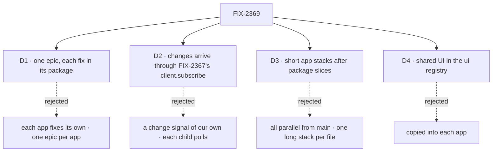

# FIX-2369 · Decisions

[Spec](SPEC.md) · **Decisions**

The calls that sit above any one of the 53 children: what was chosen, what lost, and what each
locks in. D1 is the objective and is on the sign-off. D2 to D4 are
engineering calls, recorded here so no child reopens them; they are not asked.

## The tree

## D1 · Four daily-driver apps are worth one epic of shared package work, now · for sign-off

| | |
|---|---|
| **Instead of** | Each app fixes its own findings · or one epic per app |
| **Because** | 40 of the 53 children are needed by two or more apps. Fixed per app, each fix lands up to four times and the copies drift, which is what the review found. Per-app epics make the same fix four times or leave the package fix with no owner, and only two epics run at once |
| **Locks in** | Package slices go first and apps adopt after, so the epic is as slow as its slowest foundation: FIX-2389 (the one L-sized package child), FIX-2361 (design first), and FIX-2367's delivery child, which this set consumes ([D2](#d2)) |

**What would change my mind:** if FSD stops being developed in these apps. Then this is polish
for apps nobody drives, and the epic should not finish.

It comes down to whether a fix carries over: per app, the same bug is fixed four times.

## D2 · Every change reaches an app through FIX-2367's `client.subscribe` · engineering, decided

| | |
|---|---|
| **Instead of** | A change signal of our own in `@flow-state-dev/client`, with a focus-and-age poll until FIX-2367 swapped its source (this card's first draft) · or each child polling on its own |
| **Because** | FIX-2367's epic spec is merged (#4294). Its [ER-5](../FIX-2367/DECISIONS.md#who-owns-what) says every client hook goes through `client.subscribe` and polls only when `GET /capabilities` reports no push, one way per scope. Its ER-3 forbids an always-on poll, "in a product ticket or a lab". A signal of our own would be a second client watch interface, and the focus-and-age source is the poll ER-3 forbids |
| **Locks in** | FIX-2409 (an app's snapshot refresh and its *as of* label), FIX-2411 (live session list) and FIX-2412 (live roster) consume `client.subscribe`. They add no client watch interface; a helper they need is asked of FIX-2367's delivery child. They stack on that child, which is not filed yet. The two task-board polls (Teammates' `adapter.ts` task views, Shift Manager's `TasksPanel`) are FIX-2367's task board child's, as its seams table already says. No child here converts them |

**What would change my mind:** FIX-2367 being shelved. Then its ER-5 is amended first, and this
card follows; it is not routed around.

It comes down to one way to watch a scope: a signal of our own puts two on the board at once.

## D3 · Package slices merge first; apps adopt in short stacks · engineering, decided

| | |
|---|---|
| **Instead of** | Every child in parallel from `main` · or one long stack per hot file (this card's first draft: 14 deep on the Claude Code-style lab's adapter, 11 on Teammates') |
| **Because** | In parallel, up to 14 PRs collide in one file at merge. One long stack means a merge at its root rebases everything above it, which is the long rebase chain to avoid. Package slices are small and touch no app file, so they can merge first; then each app's work on a hot file splits into short stacks that start from `main` |
| **Locks in** | A foundation child ships its **package slice** first, from `main`, in wave 1. App adoption runs in **app stacks of five or fewer**, each starting from `main` once the package slices it needs have merged. **One open stack per hot file at a time**: the next starts from `main` when the one before merges. The order is the [build order](#coordination-seams), the only copy of it. GitHub stacks per [orchestration.md → Worktree branching](../../../docs/contributing/orchestration.md#worktree-branching-base-every-issue-branch-on-fresh-originmain) |

**What would change my mind:** package slices stalling in review. Then an app stack bases on the
open slice and lands after it.

It comes down to rebase chains: no stack in this set is more than five deep.

## D4 · A piece two apps need lives in its package, or in the ui registry · engineering, decided

| | |
|---|---|
| **Instead of** | Copying it into each app, as [FIX-2152 ER-3](../FIX-2152/DECISIONS.md#who-owns-what) says for UI both labs need |
| **Because** | FIX-2152 copied UI so each lab's inventory showed what that app adds. The inventories are gone and are not coming back, and the review found the copies drifting (a failed-turn line in one app, nothing in two others). The registry is still copied in (`fsdev ui add`), so an app keeps its own file but starts from the shared one |
| **Locks in** | Non-UI logic goes to the package that owns its noun. UI goes to `packages/ui/registry`. Labs still import no code from each other. Amends FIX-2152 ER-3 for UI; its ER-4, a need goes to the package, stays |

It comes down to the fix: one source to fix, or a copy per app to find.

## Who owns what

Five children each own one shared artifact, and every other child consumes it. A *uses* cell is
a place a child must not build its own.

| # | Rule every child obeys | Owner | Checked at |
|---|---|---|---|
| ER-1 | Workforce concepts stay out of the layer below. No worker, task, board, hold or harness noun enters `core`, `engine`, `client` or `react`; those offer generic hooks, and workforce, orchestration and harness-manager compose them. **Data on items:** a meaning `core` already types keeps its typed field ([items.md](../../../docs/architecture/items.md)); a package's own data and its reader are FIX-2378's to place; door turns join task scope through FIX-2422 | Each child | Every spec review; the closure's sweep |
| ER-2 | The generator stays unopinionated. Optional behaviour (checks, the setup hook, approval holds, the issue prelude, readiness) ships as a composable block, step, capability or PhaseSpec helper a host opts into. No child changes a default for every app | FIX-2387 decides the shape (a helper composed into `isDone`) · FIX-2420, 2389, 2388, 2391 consume | Those children's spec reviews |
| ER-3 | One implementation per need ([D4](#d4)). The PR that adopts a lifted piece deletes the app's copy in the same change. A need an app shows goes to the package, never a workaround in the app | Each child | The closure's sweep |
| ER-4 | **Consume the owner child's artifact; never build a second.** FIX-2374: the session feed, `sessionFeed`. FIX-2409: changes through FIX-2367's `client.subscribe`, polling only when `GET /capabilities` reports no push ([FIX-2367 ER-3 and ER-5](../FIX-2367/DECISIONS.md#who-owns-what) govern; [D2](#d2)). FIX-2379: the task-row view, the only status and *waiting on* vocabulary. FIX-2370: the request-recovery component, which FIX-2377 extends. FIX-2385: the harness-manager `./browser` entry. A child that needs a change comments on the owner's spec | The owner of each artifact | Every consumer's spec review; the closure's sweep |
| ER-5 | A coding run works in a git worktree, never in the developer's checkout. FIX-2419 and FIX-2420 extend the workspace host; neither adds a second provisioning or removal path, and removal stays one path shared with FIX-1768 | FIX-2420 | FIX-2419's spec review; the closure, leg a |
| ER-6 | Every goal check and lab check shows its control failing: the red state is produced, not argued | Each child | Every implementation PR; the closure |
| ER-7 | Docs and copy say *worker*, never the word `scripts/check-retired-terms.mjs` retires. README inventory or code-stats tables are not restored | Each child | CI (`check-retired-terms`); every docs review |
| ER-8 | Build order per [D3](#d3), from the [build order](#coordination-seams) below and nowhere else. Implementation PRs open ready for review, assigned to jhoffner, with no review request to him | The coordinator | Each wake |
| ER-9 | Consumed issues (FIX-2274, FIX-1768, FIX-2367 and its children, FIX-2168, FIX-2164, FIX-2252) keep their own parents. FIX-2274 blocks the closure; FIX-1768 does not | The coordinator | Each refresh |

## Coordination seams · the build order

**This table is the build order, and the only copy of it.** An arrow is a stack: the next child
starts on the one before. *Merge order* means the edits are far apart and only the order of
merges matters. *After X merges* means the stack starts from `main` then. No stack is more than
five deep, and each hot file has one open stack at a time. Paths checked on `main` at
`2686edb38`.

| Wave | Hot file or seam | Stack, in order | Starts | Rule |
|---|---|---|---|---|
| 0 | Quick wins: 2392, 2424 alone; Kitchen Sink `flow-state/page.tsx`; Shift Manager `TaskFrame.tsx`, `Tasks.tsx`, `JumpTo.tsx`, `task.tsx`; the labs' `App.tsx` and composers | Merge order: 2415 → 2416 → 2417 → 2400 · 2413 → 2418 → 2414 → 2401 · 2413 → 2371 · 2372 → 2400 · 2371 → 2390 | Now, from `main` | Not stacked; each merges the same day. None reads a wave-1 artifact (ER-4); 2418's COST column is filled by 2398's slice, not here |
| 1 | Package slices | 2374, 2379, 2383, 2370, 2385, 2384, 2420, 2378, 2389, 2391, 2393, 2405, 2407, 2408, 2421, 2422 | Now, from `main` | No app file, except Shift Manager's own copy that 2385 and 2405 move out. They merge before any app stack that needs them |
| 1–4 | `session-flow.ts`, the *session state, workspace, create input* region; harness-manager `package.json` exports | 2385 → 2386 → 2419 → 2388 | Stacked | 2384, 2391 and 2398 add to `./browser` after 2385 (ER-4) |
| 1–3 | `session-flow.ts`, the *turn record, turn end, feeds* region | 2384 → 2387 → 2398 | Stacked; 2387 merges after 2420 | FIX-2420's one hunk (wait for setup on the first turn) lands in wave 1 |
| 1–2 | Package dependents | 2383 → 2381 · 2374 → 2410 · 2374 → 2373 · 2379 → 2380 · 2370 → 2377 | Stacked | 2370 and 2377 stay two issues in one stack: 2377 adds the client's interrupted-requests helper, and its check needs a server restart, which 2370's does not |
| 2 | Change arrives through `client.subscribe` | FIX-2367's delivery child → 2409 · → 2411 · → 2412 | When that child has a branch | FIX-2367 ER-3 and ER-5 govern (D2): no new client watch interface, no always-on poll |
| 2 | A follow-up's run identity | FIX-2274 → 2361 | Design first | A follow-up resolves to its root task's run; 2386 records the run under that identity |
| 2 | Claude Code-style `adapter.ts`, stack 1 · Teammates `adapter.ts`, stack 1 | 2374 → 2375 → 2376, in each lab | After 2374 merges | The feed and its runs |
| 2 | Shift Manager `task.tsx`, `conversation.ts`, `run.ts`, `App.tsx`, `lab-data.tsx` | 2422 → 2374 → 2408 → 2373 → 2409 | After 2422, 2374, 2408 and 2373 merge; 2409 also needs FIX-2367's delivery child | — |
| 2 | Shift Manager `reads.ts` | 2379 → 2381 → 2380 | After 2379, 2381 and 2380 merge | SM drops its own row shaping in 2379's slice |
| 2 | Kitchen Sink `flow-state/page.tsx`, stack 1 | 2370 → 2377 → 2376 | After 2370 and 2377 merge | 2377's slice also edits `harness-session.tsx`; it merges after 2410 there |
| 2 | Kitchen Sink `harness-session.tsx` | 2410 → 2386 → 2384 → 2398 | After those package slices merge | — |
| 2 | The labs' first run | 2403 | After 2391 merges | Its harness chips read 2391's readiness |
| 3 | Claude Code-style `adapter.ts`, stack 2 · Teammates `adapter.ts`, stack 2 | 2378 → 2379 → 2370 → 2393, in each lab | After that lab's stack 1 merges | The entry mapping |
| 3 | Teammates `WorkersList.tsx`, `status.ts`, `TaskCard.tsx` | 2395 → 2397 | After 2379 merges | Task-row consumers, moved out of wave 0 (ER-4) |
| 3 | Claude Code-style `Entry.tsx`, `TasksPane.tsx`, `TaskCard.tsx` | 2399 → 2394 | After 2379 merges; 2394 merges after 2397 | 2394 is one PR for both labs |
| 3 | Shift Manager `TaskFrame.tsx` | 2382 → 2384 → 2387 → 2386 | After those package slices and wave 0's 2413 and 2418 | One tab per child: Diff is 2384's, Checks is 2387's |
| 3 | Kitchen Sink `flow-state/page.tsx`, stack 2 | 2411 → 2405 | After stack 1 merges | — |
| 4 | Claude Code-style `adapter.ts`, stack 3 | 2382 → 2386 → 2384 → 2387 → 2389 | After stack 2 merges | Each adds a function and leaves the entry mapping alone. 2405 merges in order after |
| 4 | Teammates `adapter.ts` and `Popups.tsx`, stack 3 | 2380 → 2382 → 2398 → 2396 | After stack 2 merges | 2405 merges in order after |
| 4 | The labs' contract tests | 2406 | After both labs' stack 2 merges | **One owner, one PR from `main`:** a single scenario matrix (a mid-turn result, a failed turn, a held question and its answer, an interrupt, a lapsed feed) run against both real adapters and both fakes |
| — | `packages/ui/registry.json` (8 additions) | Merge order | — | Append-only; a conflict at the tail is one line. 2377 extends 2370's entry |
| — | `packages/harness-manager/src/manager.ts` | Merge order | — | 3,586 lines; the edits (2386 output, 2387 `isDone`, 2388 phase input, 2389 approval) are hundreds of lines apart |
| — | `labs/teammates/host.mts`, `src/flows/coder.ts`; `harness-thread.mts`; Kitchen Sink `harness-frame.tsx` | Merge order: 2391 → 2380 → 2387 → 2382 → 2398 → 2377 → 2407's goals · 2390 → 2389 → 2387 · 2400 → 2411 → 2419 → 2388 | — | Small options each |
| — | The labs' sheets and Esc | FIX-2340 (FIX-2152, open) → 2413 → 2401 | — | 2413 owns every Esc that stops a run; 2401 leaves it alone |
| — | The task-board polls: Teammates `adapter.ts` task views, Shift Manager `TasksPanel` | FIX-2367's task board child | — | That child alone turns them into the fallback, as FIX-2367's seams table says. FIX-2374 converts session feeds, not these |
| — | `followSession`, lifted into the client | FIX-2374 and FIX-2367's delivery child | — | One lift: whichever lands second builds on the other's |
| — | Worktree removal | FIX-2419, FIX-1768, FIX-2252 | — | ER-5: one removal path. 2419 adds list and remove; FIX-1768 removes after merge; FIX-2252 decides staleness |

## Decided, recorded so no child reopens them

Engineering calls, one line each, and one product call from review.

- **FIX-2402, FIX-2404 and FIX-2423 moved to [FIX-2430](https://linear.app/fixpoint-labs/issue/FIX-2430).** Jake, in review: "Move the large one and two which add package changes into a separate epic, and then keep the rest." No closure check needed them, and no remaining child depends on them.
- **D2, D3 and D4 above** are engineering calls. They are recorded, not asked.
- **The closure does not wait on FIX-1768.** Leg a stops at a reviewed branch; pushing and opening
  a PR is FIX-1768's goal, not this one's. The coordinator removes its blocks relation on FIX-2425. FIX-2274
  still blocks: FIX-2361 builds on it.
- **FIX-2370 and FIX-2377 are one stack of two issues** (reason in the build order). One
  registry component; 2377 extends 2370's entry.
- **FIX-2406 has one owner and one scenario matrix** for both labs, not a node at each adapter's tail.
- **FIX-2395, FIX-2397, FIX-2399 and FIX-2403 left wave 0.** Each reads a wave-1 artifact (the
  task-row view, or readiness), so each starts after it merges.
- **FIX-2407's restart helper goes in `goals/lib`, not `@flow-state-dev/testing`.** `goals/lib/server.mts`
  already stops a process group and `durable.mts` holds the durable-store scaffolding.
- **FIX-2392 shrinks.** FIX-2344 fixed the ENAMETOOLONG root (Done, #4227). Reproduce first; what
  is left is the config header (it says `claude-code` is the default and lists only `codex`,
  while the host defaults to `cursor`) and the env knobs.
- **FIX-2388 reuses Shift Manager's `projectMcpTools` call.** The review said nothing calls it
  outside docs; the devteam host does (`packages/shift-manager/teams/devteam/host.mts:797`).
- **FIX-2389's approval is a task hold, answered through the inbox.** A hold is general and a
  question is one kind of it; FIX-2389's spec does not name hold storage after approvals. No
  second answer path; the card comes from the registry's `approval` family.
- **FIX-2387's check composes into `isDone`.** A failed check is *not done*, and its output feeds
  the next attempt; no second gate beside the judge.
- **FIX-2381's task actions live in orchestration's `./inbox` entry, next to `createInboxClient`**,
  not as a new client constructor.
- **FIX-2372 must not name its helper `useAction`.** `@flow-state-dev/react` already exports one.
- **FIX-2421's product sign-off on repository hooks is FIX-2421's own spec gate.**
- **FIX-2361 writes its design first, and stacks on FIX-2274.**

## What the end-state POC showed

None built. The division into issues was filed from the review, and the analysis below found no
seam a POC would settle that the build order doesn't already settle.

## Analysis

### Analysis — FIX-2369 epic spec · 2026-10-31 · watermark 2026-10-31

Run in the authoring context, not by a fresh sub-agent: this session had no way to dispatch one.
The coordinator may re-run it independently before the gate.

**Verdict:** Right approach, with changes. The division holds. The changes are three folds,
one cut (taken in review), and review round 1's folds (D2 now follows FIX-2367, and the build order uses short stacks).

1. **Reuse** — 24 Adds checked below: 19 extend an existing piece and 5 reuse one. Nothing is
   genuinely new. Three moved the set: the restart helper (extend `goals/lib`), the approval
   hold (extend task holds and the inbox), the request-recovery pair (one component). Review
   round 1 moved a fourth: the change signal reuses FIX-2367's `client.subscribe`.
2. **Prior art** — LangGraph's `useStream` keeps the error, reconnect (`reconnectOnMount`,
   `joinStream`) and the run feed in its SDK hook ([docs](https://docs.langchain.com/langgraph-platform/use-stream-react)).
   The Vercel AI SDK's `useChat` carries `error` and `regenerate()` in the hook, with resumable
   streams as an SDK feature ([docs](https://ai-sdk.dev/docs/ai-sdk-ui/chatbot)). Both put the
   feed, the failure and the retry in the client library, not in each app, which is D4.
3. **Other shapes** — the strongest other division is two theme epics, *trust the feed*
   (client, react, registry) and *ship the code* (harness-manager, workspace). It loses: neither
   proves the goal alone, and both together take the two running-epic slots. Next-variant test on
   watching a scope: the next source (Ably, FIX-380) copies nothing, because every consumer
   reads through `client.subscribe`.
4. **New factors** — 6 read since the epic was filed: FIX-2367's epic spec merged (#4294; D2
   follows its ER-3 and ER-5); FIX-2344 Done (shrinks FIX-2392); FIX-2364 and FIX-2363 Done
   (workers work things out before asking, which narrows FIX-2361's symptom but not its cause);
   FIX-2340 open (Esc seam).
5. **Necessity** — 53 of 56 carried a part of the goal. FIX-2402, 2404 and 2423 didn't, and moved to FIX-2430 in review.
6. **Ergonomics** — a developer building the next app meets `sessionFeed`, `client.subscribe`,
   `taskRowView`, task actions and the harness-manager browser entry. Each replaces app code. One
   surprise found and folded: a second client constructor for task actions. One walked past:
   `useAction` in react and a lab helper of the same name.
7. **Concerns** — the slowest foundations set the wrap date: FIX-2389 (L), FIX-2361 (design
   first), and FIX-2367's delivery child, which is not filed yet and gates FIX-2409, 2411 and 2412.

| Finding | Objective | Changes the approach? | Disposition |
|---|---|---|---|
| Restart helper belongs in `goals/lib` | 1 | Yes | Folded |
| Approval hold must be a task hold answered through the inbox | 1 | Yes | Folded |
| 2370 and 2377 are one component | 1 | Yes | Folded, ER-4 |
| D2 forks from merged FIX-2367 ER-3 and ER-5 (Architect, round 1) | 1, 4 | Yes | Folded, D2 |
| Three items serve no closure check | 5 | Changes what users get | Cut in review: moved to FIX-2430 |
| Task actions as a new constructor | 6 | Yes | Folded |
| `useAction` name clash | 6 | No | Recorded, FIX-2372's implementer note |
| FIX-2388's evidence claim is wrong | routed | No | Recorded |

**Builds on / Adds**, one row per package item, with its verdict.

| Adds (child) | Existing piece considered | Verdict |
|---|---|---|
| `sessionFeed` (2374) | react's internal `followSession`, `useSession`; FIX-2367's delivery hook on the same pattern | extend: lifted into the client, one lift |
| snapshot refresh on notices (2409) | FIX-2367's `client.subscribe` and its capability-gated poll | reuse |
| tail read (2408) | Shift Manager's `send.ts` tail pattern | extend |
| state-only re-read (2410) | `useSession.refresh` | extend: an option, not a second hook |
| live session list (2411) | `FlowNavigator`; `client.subscribe` | extend |
| live roster (2412) | `createWorkforceClient`; `client.subscribe` | extend |
| `taskRowView` (2379) | `taskSpendView`, `inboxItems`, holds; three app copies | extend |
| task actions (2381) | `createInboxClient`, `updateTask_tasks` | extend, in `./inbox` |
| `retryTask` (2383) | attempts ledger in `task-caps.ts`, `updateTask` | extend: no second counter |
| `parseNotice`, structured notice fields (2378) | `task-notice.ts` records, `noticeText` | extend |
| browser entry, `readRecordedWork` (2385) | Shift Manager's `run.ts` | reuse: a move |
| `readRunDiff`, read action (2384) | `readRunCommits`, the run record's base | extend `commits.ts` |
| `commandCheck` (2387) | `isDone`, the judge | extend: composed into `isDone` |
| setup hook (2420) | workspace `prepare` | extend with an after-checkout phase |
| approval hold (2389) | task holds, inbox answer, harness review hold, `onToolApproval` | extend |
| `harnessReadiness` (2391) | KS `harness-gate.ts`, Teammates' READY probes | extend: lift KS's shape |
| `onUsage` on session feeds (2398) | `recordHarnessUsage`, `harnessUsageAction`, `taskSpendView` | reuse |
| base choice, list and remove (2419) | `HarnessSessionWorkspace`, workspace host; FIX-1768 | extend: one removal path |
| `issue` field, Linear relay (2388) | `projectMcpTools`, project `mcpServers` | reuse |
| door task stamp (2422) | door turn metadata | extend |
| trusted-repo policy (2421) | env-pass helpers in claude-code, codex, cursor | extend |
| `readDevtoolUrl`, trace link (2405) | Shift Manager's `connection.ts`, `SESSION_ADDRESS_PARAM` | reuse: a move |
| restart helper (2407) | `goals/lib/server.mts`, `durable.mts` | extend `goals/lib` |
| registry: recovery, banner, review card, changes, chip, spend, tool vocabulary | `error`, `stuck-request-banner`, `approval`, `tool-naming`/`grouping`/`summaries`; KS `ResumePrompt`; CC `ReviewCard`, `Spend` | extend or lift |

## How it got here

- **Filed (Oct 31)** — 57 children from the four-app review (PR #4295's `app-review` skill), with
  the closure blocked by every other child and by FIX-2274 and FIX-1768.
- **Drafted (Oct 31)** — four cross-cutting calls; a build order of stacks and waves; three
  folds from the analysis; one open cut.
- **Review round 1 (Oct 31)** — D2 now follows FIX-2367's merged ER-3 and ER-5 (Architect).
  D3 changed: package slices merge first, then app stacks of five or fewer, and the seams table
  is the only build order (Cursor). D2 to D4 left the sign-off as engineering calls, and four
  wave-0 items moved behind the artifact they read (Codex). ER-4 to ER-8 became one ER-4.
  FIX-2406 has one owner. The closure no longer waits on FIX-1768. Jake answered the Open:
  FIX-2402, 2404 and 2423 moved to FIX-2430, leaving 53 children and the closure.
