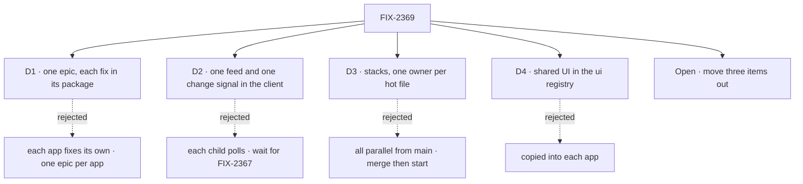

# FIX-2369 · Decisions

[Spec](SPEC.md) · **Decisions**

The calls that sit above any one of the 56 children: what was chosen, what lost, and what each
locks in. Four are on the sign-off and one is open. The rest are engineering calls recorded so
no child reopens them.

## The tree

## D1 · Four daily-driver apps are worth one epic of shared package work, now

| | |
|---|---|
| **Instead of** | Each app fixes its own findings · or one epic per app |
| **Because** | 40 of the 56 children are needed by two or more apps. Fixed per app, each fix lands up to four times and the copies drift, which is what the review found. Per-app epics make the same fix four times or leave the package fix with no owner, and only two epics run at once |
| **Locks in** | Package slices go first and apps adopt after, so the epic is as slow as its slowest foundation: FIX-2389, the one L-sized package child, and FIX-2361, which needs a design first |

**What would change my mind:** if FSD stops being developed in these apps. Then this is polish
for apps nobody drives, and the epic should not finish.

It comes down to whether a fix carries over: per app, the same bug is fixed four times.

## D2 · One session feed and one change signal in the client; FIX-2367 swaps the source later

| | |
|---|---|
| **Instead of** | Each child adds its own poll or subscription (FIX-2373, 2408, 2409, 2411 and 2412 each describe one) · or wait for the push channel epic, FIX-2367 |
| **Because** | Five children need to know that something changed. Built separately, that is five pollers, and FIX-2367 then rewrites every caller. Built once over the stream events that exist today (`session.runs`, `resource_change`), with focus and age as the stopgap, FIX-2367 replaces the source and no caller changes |
| **Locks in** | FIX-2374 owns the session feed and FIX-2409 the change signal, both in `@flow-state-dev/client` with no workforce nouns ([ER-1](#who-owns-what)). FIX-2373, 2375, 2376, 2408, 2410, 2411 and 2412 only consume. The signal's interface is the seam FIX-2367 builds behind |

**What would change my mind:** FIX-2367 merging before FIX-2409 starts. Then FIX-2409 builds on the
push channel directly and the stopgap is never written.

It comes down to the day push lands: one source to swap, or five pollers to unpick.

## D3 · Stacked PRs, one owner per hot file at a time

| | |
|---|---|
| **Instead of** | Every child in parallel from `main` · or strict order, each child waiting for the one before to merge |
| **Because** | Twelve files are touched by four to fourteen children each (the lab adapters, Kitchen Sink's Flow State page, Shift Manager's task frame, harness-manager's session flow). In parallel, those PRs collide at merge and the last one pays. In strict order, 57 merges run end to end. A stack lets a child start on its parent's branch, so nothing waits, and one owner per file keeps each conflict to the hunk the parent changed |
| **Locks in** | A foundation child ships its **package slice** first, from `main`, then one **adoption slice per app**, each stacked in that app's chain ([coordination seams](#coordination-seams)). A child that sits in two chains stacks on the one it conflicts with more and merges after the other. Quick wins go first in any chain and merge the same day. GitHub stacks per [orchestration.md → Worktree branching](../../../docs/contributing/orchestration.md#worktree-branching-base-every-issue-branch-on-fresh-originmain): base is the parent's branch, then `main` once it merges |

**What would change my mind:** stacks past five deep stalling in review. Then the chain splits at
the hot file into two shorter ones.

It comes down to the hot files: fourteen parallel PRs in one lab adapter is the collision we avoid.

## D4 · A piece two apps need lives in the package that owns its noun, or in the ui registry

| | |
|---|---|
| **Instead of** | Copying it into each app, as [FIX-2152 ER-3](../FIX-2152/DECISIONS.md#who-owns-what) says for UI both labs need |
| **Because** | FIX-2152 copied UI so each lab's inventory showed what that app adds. The inventories are gone and are not coming back, and the review found the copies drifting (a failed-turn line in one app, nothing in two others). The registry is still copied in (`fsdev ui add`), so an app keeps its own file but starts from the shared one |
| **Locks in** | Non-UI logic goes to the package that owns its noun. UI goes to `packages/ui/registry`. Labs still import no code from each other. Amends FIX-2152 ER-3 for UI; its ER-4, a need goes to the package, stays |

It comes down to the fix: one source to fix, or a copy per app to find.

## Open

### Three items no closure check needs: move them out of this epic, or keep all 57?

**Plain terms.** Three children make the apps nicer but are not on the path the closure tests:
renaming and archiving sessions in the Claude Code-style lab (FIX-2402), a tidier Talk panel in
Teammates (FIX-2404), and letting Kitchen Sink's assistant hand a change to a coding worker
(FIX-2423). The epic cannot wrap until every child is done, so these hold the wrap.

**The trade-off.** Moving them out makes the epic three children smaller, removes the one
L-sized app child, and drops two package additions that only one app uses (title and archive
verbs on workforce sessions, and a Kitchen Sink coding worker). You get those three things
later, or not at all.

**My recommendation: move them out**, still filed in the project and linked to this epic. None is
on the goal path, and two of them add package surface for a single app, which is the pattern
this epic exists to stop.

**What would change my mind:** if you use the lab's session list every day and it already gets in
your way. Then FIX-2402 is a daily-driver need and stays.

**What being wrong costs: low.** Each is independent of the rest; moving one back in is a
re-parent and a blocks relation.

It comes down to the wrap: the closure waits on three children its checks never touch.

## Who owns what

Seven children each own one shared piece, and everyone else consumes it. A *uses* cell is a place
a child must not build its own.

| # | Rule every child obeys | Owner | Checked at |
|---|---|---|---|
| ER-1 | Workforce concepts stay out of the layer below. No worker, task, board, hold or harness noun enters `core`, `engine`, `client` or `react`; those offer generic hooks (a session feed, a change signal over sessions and collections, a state-only re-read), and workforce, orchestration and harness-manager compose them | Each child | Every spec review; the closure's sweep |
| ER-2 | The generator stays unopinionated. Optional behaviour (checks, the setup hook, approval holds, the issue prelude, readiness) ships as a composable block, step, capability or PhaseSpec helper a host opts into. No child changes a default for every app | FIX-2387 decides the shape (a helper composed into `isDone`) · FIX-2420, 2389, 2388, 2391 consume | Those children's spec reviews |
| ER-3 | One implementation per need ([D4](#d4)). The PR that adopts a lifted piece deletes the app's copy in the same change. A need an app shows goes to the package, never a workaround in the app | Each child | The closure's sweep |
| ER-4 | One session feed: FIX-2374's `sessionFeed`. No child polls a session's items on its own | FIX-2374 | Spec review of every consumer |
| ER-5 | One change signal: FIX-2409's, with no workforce nouns in it. FIX-2411 and FIX-2412 compose it; FIX-2367 later replaces its source behind the same interface ([D2](#d2)) | FIX-2409 | FIX-2411's and FIX-2412's spec review; FIX-2367's spec |
| ER-6 | One task-row view: FIX-2379's `taskRowView` is the only status and *waiting on* vocabulary. Shift Manager, both labs and every display child read it | FIX-2379 | Spec review of FIX-2380, 2382, 2386, 2394, 2395, 2397 |
| ER-7 | One request-recovery component in the registry: FIX-2370 creates it (failed reason, Retry), FIX-2377 extends it (Continue, Discard). No app keeps its own failed or interrupted line | FIX-2370 | The closure, leg b |
| ER-8 | One harness-manager browser entry, `./browser`, beside `./checkout`. FIX-2385 creates it; FIX-2384, 2386, 2391 and 2398 add to it | FIX-2385 | Those children's spec review |
| ER-9 | A coding run works in a git worktree, never in the developer's checkout. FIX-2419 and FIX-2420 extend the workspace host; neither adds a second provisioning or removal path, and removal stays one path shared with FIX-1768 | FIX-2420 | FIX-2419's spec review; the closure, leg a |
| ER-10 | Every goal check and lab check shows its control failing: the red state is produced, not argued | Each child | Every implementation PR; the closure |
| ER-11 | Docs and copy say *worker*, never the word `scripts/check-retired-terms.mjs` retires. README inventory or code-stats tables are not restored | Each child | CI (`check-retired-terms`); every docs review |
| ER-12 | Build order per [D3](#d3): one owner per hot file at a time, the next child stacks on it. Implementation PRs open ready for review, assigned to jhoffner, with no review request to him | The coordinator | Each wake |
| ER-13 | Consumed issues (FIX-2274, FIX-1768, FIX-2367, FIX-2168, FIX-2164, FIX-2252) keep their own parents. FIX-2274 and FIX-1768 block the closure, as wired today | The coordinator | Each refresh |

## Coordination seams

The hot files, with the order each is owned in. An arrow is a stack; *merge order* means the
edits are far apart and only the merge order matters. Paths checked on `main` at `2686edb38`.

| Seam | Children, in order | Rule |
|---|---|---|
| `labs/claude-code-style/src/adapter.ts` (14 children) | 2374 → 2378 → 2379 → 2370 → 2375 → 2376 → 2393 → 2406 | Additive adopters (2381, 2382, 2384, 2386, 2389, 2402, 2405) merge after the tip they need and add a function; they never edit the entry mapping |
| `labs/teammates/src/adapter.ts` (11) | 2371 (wave 0) → 2374 → 2378 → 2379 → 2370 → 2375 → 2376 → 2393 → 2398 → 2406 | 2405 is additive |
| `apps/kitchen-sink/app/flow-state/page.tsx` (9) | 2415 → 2416 → 2417 → 2400 (wave 0) → 2370 → 2377 → 2376 → 2411 → 2405 | The wave-0 links merge the same day |
| `apps/kitchen-sink/components/harness-session.tsx` (5) | 2410 → 2377 → 2386 → 2384 → 2398 | 2377 stacks on the page chain and merges after 2410 |
| `packages/shift-manager/src/surfaces/TaskFrame.tsx` (6) | 2413 → 2418 (wave 0) → 2382 → 2384 → 2387 → 2386 | One tab per child: Diff is 2384's, Checks is 2387's |
| `packages/shift-manager/src/lib/reads.ts` (5) | 2379 → 2381 → 2380 → 2386 | SM drops its row shaping in 2379's slice |
| Shift Manager's `task.tsx`, `conversation.ts`, `run.ts`, `App.tsx`, `lab-data.tsx` | 2413 → 2371 (wave 0) → 2422 → 2374 → 2408 → 2373 → 2409 | 2385 moves `readRecordedWork` out of `run.ts` in wave 1, before the chain reaches it |
| `packages/harness-manager/src/session-flow.ts` (7) | Region *session state, workspace, create input*: 2385 → 2386 → 2419 → 2388. Region *turn record, turn end, feeds*: 2384 → 2387 → 2398 | FIX-2420's one hunk (wait for setup on the first turn) lands in wave 1, before either chain reaches it |
| `packages/harness-manager/package.json` exports | 2385, then 2384, 2386, 2391, 2398 | ER-8 |
| `packages/ui/registry.json` (8 additions) | merge order | Append-only; a conflict at the tail is one line. 2377 extends 2370's entry, it doesn't add one |
| `packages/harness-manager/src/manager.ts` | merge order | 3,586 lines; the edits (2386 output, 2387 `isDone`, 2388 phase input, 2389 approval) are hundreds of lines apart |
| `labs/claude-code-style/workforce/flows/harness-thread.mts`, `apps/kitchen-sink/components/harness-frame.tsx` | merge order: 2390 (wave 0) → 2389 → 2387; and 2400 (wave 0) → 2411 → 2419 → 2388 | Small options each |
| `labs/teammates/host.mts`, `labs/teammates/src/flows/coder.ts` | merge order: 2391 → 2380 → 2387 → 2382 → 2398 → 2377 → 2407 | Small options each |
| The labs' sheets and Esc | FIX-2340 (FIX-2152, open) → 2413 → 2401 | 2413 owns every Esc that stops a run; 2401 leaves it alone |
| The change signal's source | FIX-2409 and FIX-2367 | ER-5. If FIX-2367 lands first, D2 flips |
| A run's identity across tasks | FIX-2274 → 2361, and 2386 | A follow-up resolves to its root task's run; 2386 records the run under that identity |
| Worktree removal | FIX-2419, FIX-1768, FIX-2252 | ER-9: one removal path. 2419 adds list and remove verbs; FIX-1768 removes after merge; FIX-2252 decides staleness |

## Decided before review, recorded so no child reopens them

Engineering calls made while writing the set, one line each.

- **FIX-2370 and FIX-2377 build one registry component.** 2377 extends 2370's with Continue and
  Discard; both issues stay, because 2377 also adds the client's interrupted-requests helper.
- **FIX-2407's restart helper goes in `goals/lib`, not `@flow-state-dev/testing`.** `goals/lib/server.mts`
  already stops a process group and `durable.mts` holds the durable-store scaffolding; a published
  package gains nothing from a goal-only helper.
- **FIX-2392 shrinks.** FIX-2344 fixed the ENAMETOOLONG root (Done, #4227). Reproduce first; what
  is left is the config header (it says `claude-code` is the default and lists only `codex`,
  while the host defaults to `cursor`) and the env knobs.
- **FIX-2388 reuses Shift Manager's `projectMcpTools` call.** The review said nothing calls it
  outside docs; the devteam host does (`packages/shift-manager/teams/devteam/host.mts:797`).
  The labs and KS don't.
- **FIX-2389's approval is a task hold, answered through the inbox.** No second answer path; the
  card is drawn from the registry's `approval` family.
- **FIX-2387's check composes into `isDone`.** A failed check is *not done*, and its output feeds
  the next attempt; no second gate beside the judge.
- **FIX-2381's task actions live in orchestration's `./inbox` entry, next to `createInboxClient`**,
  not as a new client constructor beside it.
- **FIX-2372 must not name its helper `useAction`.** `@flow-state-dev/react` already exports a
  `useAction` that runs a flow action.
- **FIX-2421's product sign-off on repository hooks is FIX-2421's own spec gate.** It touches one
  issue, so it is not asked here.
- **FIX-2361 writes its design first, and stacks on FIX-2274.**

## What the end-state POC showed

None built. The division into issues was filed from the review, and the analysis below found no
seam a POC would settle that the stacks don't already order.

## Analysis

### Analysis — FIX-2369 epic spec · 2026-10-31 · watermark 2026-10-31

Run in the authoring context, not by a fresh sub-agent: this session had no way to dispatch one.
The coordinator may re-run it independently before the gate.

**Verdict:** Right approach, with changes — the division holds; three engineering folds and
one open cut.

1. **Reuse** — 25 Adds checked below: 21 extend an existing piece (one with a genuinely new, temporary
   part: the change signal's stopgap source) and 4 reuse one (moves). Three moved the set: the restart helper (extend
   `goals/lib`), the approval hold (extend task holds and the inbox), and the request-recovery
   pair (one component).
2. **Prior art** — LangGraph's `useStream` keeps the error, reconnect (`reconnectOnMount`,
   `joinStream`) and the run feed in its SDK hook ([docs](https://docs.langchain.com/langgraph-platform/use-stream-react)).
   The Vercel AI SDK's `useChat` carries `error` and `regenerate()` in the hook, with resumable
   streams as an SDK feature ([docs](https://ai-sdk.dev/docs/ai-sdk-ui/chatbot)). Both put the
   feed, the failure and the retry in the client library, not in each app, which is D2 and D4.
3. **Other shapes** — the strongest other division is two theme epics, *trust the feed*
   (client, react, registry) and *ship the code* (harness-manager, workspace). It loses: neither
   proves the goal alone, and both together take the two running-epic slots. Next-variant test on
   the change signal: the next source (push, FIX-2367) copies nothing under D2, five pollers
   without it.
4. **New factors** — 5 issues read since the epic was filed: FIX-2344 Done (shrinks FIX-2392);
   FIX-2367 in spec review (D2's flip); FIX-2364 and FIX-2363 Done (workers work things out
   before asking, which narrows FIX-2361's "asks the user to paste a diff" symptom but not its
   cause); FIX-2340 open (Esc seam).
5. **Necessity** — 53 of 56 carry a part of the goal. FIX-2402, 2404 and 2423 don't: Open.
6. **Ergonomics** — a developer building the next app meets `sessionFeed`, the change signal,
   `taskRowView`, task actions and the harness-manager browser entry: five entry points where
   today there are none, and each replaces app code. One surprise found and folded: a second
   client constructor for task actions. One walked past: `useAction` in react and the lab
   helper of the same name.
7. **Concerns** — the slowest foundations (FIX-2389, L; FIX-2361, design first) set the wrap
   date; both are off most stacks, so they gate only the closure.

| Finding | Objective | Changes the approach? | Disposition |
|---|---|---|---|
| Restart helper belongs in `goals/lib` | 1 | Yes | Folded (decided above) |
| Approval hold must be a task hold answered through the inbox | 1 | Yes | Folded |
| 2370 and 2377 are one component | 1 | Yes | Folded, ER-7 |
| Three items serve no closure check | 5 | Changes what users get | Open |
| Task actions as a new constructor | 6 | Yes | Folded (decided above) |
| `useAction` name clash | 6 | No | Recorded, FIX-2372's implementer note |
| FIX-2388's evidence claim is wrong | routed | No | Recorded |

**Builds on / Adds**, one row per package item, with its verdict.

| Adds (child) | Existing piece considered | Verdict |
|---|---|---|
| `sessionFeed` (2374) | react's internal `followSession`, `useSession` | extend: lifted into the client |
| change signal (2409) | `session.runs` and `resource_change` stream events; FIX-2367 | extend the events; the focus-and-age source is genuinely new and temporary |
| tail read (2408) | Shift Manager's `send.ts` tail pattern | extend |
| state-only re-read (2410) | `useSession.refresh` | extend: an option, not a second hook |
| live session list (2411) | `FlowNavigator` | extend |
| roster change signal (2412) | `createWorkforceClient`; 2409 | extend: composes 2409 |
| `taskRowView` (2379) | `taskSpendView`, `inboxItems`, holds; three app copies | extend |
| task actions (2381) | `createInboxClient`, `updateTask_tasks` | extend, in `./inbox` |
| `retryTask` (2383) | attempts ledger in `task-caps.ts`, `updateTask` | extend: no second counter |
| `parseNotice`, structured notice fields (2378) | `task-notice.ts` records, `noticeText` | extend |
| browser entry, `readRecordedWork` (2385) | Shift Manager's `run.ts` | reuse: a move |
| `readRunDiff`, read action (2384) | `readRunCommits`, the run record's base | extend `commits.ts` |
| `commandCheck` (2387) | `isDone`, the judge | extend: composed into `isDone` |
| setup hook (2420) | workspace `prepare` | extend with an after-checkout phase |
| approval hold (2389) | task holds, inbox answer, harness review hold, `onToolApproval` | extend |
| `harnessReadiness` (2391) | KS `harness-gate.ts`, Teammates' READY probes | extend: lift KS's shape |
| `onUsage` on session feeds (2398) | `recordHarnessUsage`, `harnessUsageAction`, `taskSpendView` | reuse |
| base choice, list and remove (2419) | `HarnessSessionWorkspace`, workspace host; FIX-1768 | extend: one removal path |
| `issue` field, Linear relay (2388) | `projectMcpTools`, project `mcpServers` | reuse |
| door task stamp (2422) | door turn metadata | extend |
| title and archive verbs (2402) | `listWorkerSessions` | extend (Open) |
| trusted-repo policy (2421) | env-pass helpers in claude-code, codex, cursor | extend |
| `readDevtoolUrl`, trace link (2405) | Shift Manager's `connection.ts`, `SESSION_ADDRESS_PARAM` | reuse: a move |
| restart helper (2407) | `goals/lib/server.mts`, `durable.mts` | extend `goals/lib` |
| registry: recovery, banner, review card, changes, chip, spend, tool vocabulary | `error`, `stuck-request-banner`, `approval`, `tool-naming`/`grouping`/`summaries`; KS `ResumePrompt`; CC `ReviewCard`, `Spend` | extend or lift |

## How it got here

- **Filed (Oct 31)** — 57 children from the four-app review (PR #4295's `app-review` skill), with
  the closure already blocked by every other child and by FIX-2274 and FIX-1768.
- **Drafted (Oct 31)** — four cross-cutting calls; stacks and waves as the build order; three
  folds from the analysis; one open cut.
