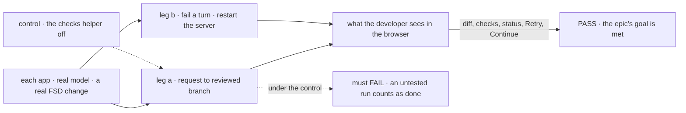
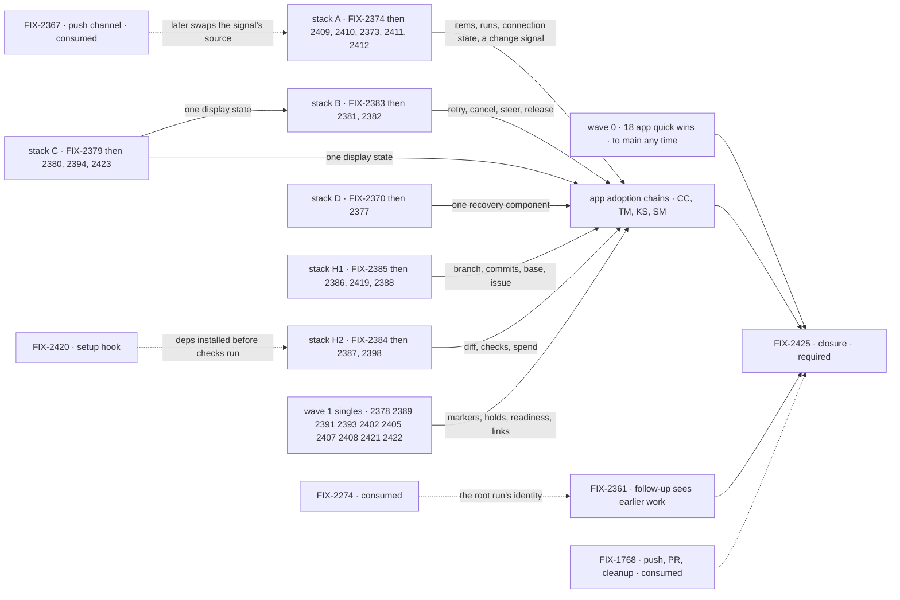

# FIX-2369 · Make the workforce apps a daily driver

**Spec** · [Decisions](DECISIONS.md)

## Four teams, before and after

| A team that… | Today | After this epic |
|---|---|---|
| **develops FSD in these apps** | A failed turn vanishes without a word. A coding run's diff, tests and branch are found by hand in a terminal. A restart loses the turn that was running | Sees why a turn failed and retries it. Reads what a run changed, with typecheck and tests already run, before accepting it. Continues a turn a restart cut off |
| **hardens the packages** | Each app polls on its own and keeps its own copy of the session feed, the task-row view and the recovery UI. A fix lands in one app | A fix lands once, in the package that owns the noun, and four apps pick it up |
| **builds the next workforce app** | Copies a lab's adapter, and its bugs | Gets the feed, the change signal, the task-row view, the task actions, a run's changes and its checks from packages and the ui registry |
| **leaves coding runs unattended** | Runs bypass permissions. A harness that isn't signed in is found when a task fails. Polls freeze silently when the server goes | An approval parks the run as a hold. Readiness shows before anything runs. A banner says the server is gone |

**Why now.** The two labs from [FIX-2152](../FIX-2152/SPEC.md) shipped (FIX-2153, FIX-2154 and
FIX-2157 are Done). A review of all four apps, run with the `app-review` skill (PR #4295),
found that they hit the same walls, and that 41 of its 58 findings are needed by two or more
apps. Every app is about to grow its own copy. Now a fix costs one implementation. Later it
costs four, plus the work to make the copies agree.

## The goal, and how we'll know it's met

**In each of the four apps, a developer takes one real flow-state-dev change from request to a
reviewed branch. Along the way they see what is running, what failed and what waits on them
without asking a model; they read what the run changed, with typecheck and tests already run;
and they recover from a failed turn and a server restart. Each of those pieces is one shared
implementation.**

| Is it the right goal? | |
|---|---|
| **The real need** | Goal 1, validate through real usage: FSD is developed in these apps every day, so every gap is found by use, not by a synthetic test. Goal 4: a fix that lands four times is a foundation that is not honest |
| **Smaller, and rejected** | "The foundations ship." Every package piece passes its own tests while every app still polls, hides failures and shows no diff |
| **Bigger, and not this epic's** | "Push the branch, open the PR, answer review comments." That is FIX-1768 and the PR-feedback loop. This goal stops at a reviewed branch |
| **Not done if** | Every child is Done and the closure has not run · an app keeps its own copy of a piece the set lifted · a leg passes only on fixtures or on the stub harness · a bug the closure found is open |

Leg a is the developer's whole loop. With the checks helper off, a run reaches *done* with no
check result, and leg a must fail on that.

| How we verify | |
|---|---|
| **Goal check** | The closure issue's (FIX-2425) QA plan, on one `main` commit after every other child merges: two legs in each of the four apps, and a sweep |
| **Signal** | Leg a: ask for a change; the coding run shows what it changed as a diff and *Checks 2/2 passed*; accept it; the reviewed branch exists. Running, held and failed tasks read correctly with no model turn. Leg b: remove the model key, so the turn fails with its reason and Retry works once the key is back; kill `fsdev dev` mid-turn, restart, and Continue finishes the turn. The sweep: every piece the set lifted is imported from its package or added from the registry in each app that uses it |
| **Anti-game** | Assert on what the browser shows, never on a child's own unit output. Leg a runs a real harness, not the stub |
| **Control that must fail** | The checks helper off: leg a FAILS. Today's `main`: both legs FAIL in every app, and the sweep finds the copies |

**How much of Goal 1's gap this closes.** It moves the four workforce apps from "built" to "used
every day for FSD's own work". It adds restart goals in three apps (FIX-2407) and the closure's
end-to-end checks, all with a real model, to the goal corpus. It does nothing for subsystems
these apps don't touch.

## What's in the box

Everything in the top band is built once. Each app only lays it out. Below the fence are the
pieces the goal leans on that other issues own; two of them block the closure.

**Docs:** one guide in `apps/docs`, *building a workforce app from the packages* (the feed, the
task-row view, task actions, a run's changes and checks). FIX-2387 publishes it once checks
ship. Each child documents its own surface in its package README.

## The set · as of 2026-10-31

The reviewed snapshot. All 57 children are in Backlog with no spec PR; live state is in
[Linear](https://linear.app/fixpoint-labs/issue/FIX-2369). Bugs take the direct route and get
no spec. Build order is in [Stacks and waves](#stacks-and-waves).

| Issue | What it delivers | Package or app |
|---|---|---|
| **Trust the feed** | | |
| FIX-2370 | A failed turn shows inline with its reason and Retry | ui registry, then 3 apps |
| FIX-2371 | Keep the draft until a send lands; failures offer Retry | apps |
| FIX-2372 | Busy and failed states on every mutation button | CC lab, KS |
| FIX-2373 | A connection banner and stale styling when the server is gone | ui registry, 3 apps |
| FIX-2375 | Stop a running turn, with feedback afterwards | labs |
| FIX-2376 | A real *queued* state for a line sent mid-turn | labs, KS |
| FIX-2377 | Continue or Discard a turn a restart cut off | ui registry, client, 4 apps |
| FIX-2422 | Door turns sent from a task carry the task id | workforce, SM |
| **Live session plumbing** | | |
| FIX-2374 | A non-React session feed in the client: items, runs, connection state | client, react |
| FIX-2378 | Structured task-result and delegate markers, not regex over text | orchestration, workforce |
| FIX-2408 | Tail-first session reads with *Load earlier* | client |
| FIX-2409 | One change signal that refreshes an app's snapshot | client |
| FIX-2410 | A state-only re-read in useSession, and the followed request's status | react |
| FIX-2412 | A live roster | workforce |
| **Control running work** | | |
| FIX-2379 | One task-row view: held, waiting on you, timing, harness | orchestration |
| FIX-2380 | Answer holds and review coding changes in Teammates | ui registry, TM, SM |
| FIX-2381 | Shared task actions: cancel, steer, answer, re-file, release | orchestration |
| FIX-2382 | Cancel, Steer, Retry and Re-run buttons on task cards | apps |
| FIX-2383 | A retry verb that keeps the task id, history and spend | orchestration |
| FIX-2389 | Tool approvals as durable *waiting on you* holds | harness-manager |
| FIX-2390 | Plan-first and harness choice as workers, plus a composer chip | CC lab, SM |
| FIX-2391 | Harness readiness, probed at startup and shown | harness-manager |
| FIX-2392 | Teammates' config header and run env (bug) | TM |
| FIX-2413 | Interrupting a run takes a deliberate gesture | SM, CC lab |
| FIX-2421 | An operator *trusted repository* policy for harness runs | claude-code, codex, cursor |
| **Ship the code** | | |
| FIX-2361 | A follow-up task can see an earlier task's worktree, branch and PR | design first (FSD Architect) |
| FIX-2384 | What a run changed: files, line counts, per-file diff | harness-manager, ui registry |
| FIX-2385 | `readRecordedWork` moves into a harness-manager browser entry | harness-manager |
| FIX-2386 | Where the work went: branch and commits, with a copy chip | harness-manager, ui registry |
| FIX-2387 | Typecheck and tests run before *done* | harness-manager, workforce |
| FIX-2388 | Issue-aware work: a Linear relay and an `issue` field | harness-manager, workforce |
| FIX-2419 | Choose a run's starting point; list and remove worktrees | harness-manager, workspace |
| FIX-2420 | A setup hook after checkout warms a fresh worktree | workspace, harness-manager |
| FIX-2423 | Kitchen Sink hires a coding worker and hands desk work to a harness | KS |
| **See what the work is doing** | | |
| FIX-2393 | Tool lines that say what was read, run or edited | ui registry, labs |
| FIX-2394 | Task time, progress and stall signals | labs, via FIX-2379 |
| FIX-2395 | Teammates' Background list split into Running, Failed and Done | TM |
| FIX-2396 | The coding-task popup summary | TM |
| FIX-2397 | Attention signals: *needs your OK*, tab-title count | apps |
| FIX-2398 | Cost, tokens, duration and attempts for every harness | harness-manager, ui registry |
| FIX-2399 | A result line opens its task | CC lab |
| **Navigate and get started** | | |
| FIX-2400 | Selection survives a reload, in the URL | labs, KS |
| FIX-2401 | Keyboard-first navigation and focus | labs, SM |
| FIX-2402 | Sessions list: rename, archive, search | workforce, CC lab · [Open](DECISIONS.md#open) |
| FIX-2403 | A first run that teaches | apps, workforce |
| FIX-2404 | Teammates' Talk panel | TM · [Open](DECISIONS.md#open) |
| FIX-2411 | A live session list with per-row status | react |
| FIX-2414 | Shift Manager routes are real links | SM |
| FIX-2415 | Flow State's suggestion chips do nothing (bug) | KS |
| FIX-2416 | Flow State's session controls are remembered by the session | KS |
| FIX-2417 | The picked coordinator or worker panel gets a header and a way back | KS |
| FIX-2418 | Not-yet-built placeholders and ticket ids hidden by default | SM |
| **Debug and test** | | |
| FIX-2405 | *Open in DevTool* links, with the address reader shared | devtool/react |
| FIX-2406 | Contract tests run the real lab adapter, not only the fake | labs |
| FIX-2407 | A restart goal that proves each app's durability claim | goals |
| FIX-2424 | Kitchen Sink's config tells the truth | KS |
| FIX-2425 · closure · **required** | The QA plan on one `main` commit: both legs in all four apps, each child's goal check, the seams | blocked by every other child, and by FIX-2274 and FIX-1768 |

57 children: 56 and the closure. By their own *where it's built*, 32 of the 56 put work in a
package and 40 are needed by two or more apps. **Consumed, not owned:** FIX-2274 (a follow-up
continues its root task's run, in the gap epic FIX-2273) and FIX-1768 (push, PR, cleanup, in
FIX-1763) block the closure already; FIX-2367 (push channel), FIX-2168 and FIX-2164 (task
timing and step fields), and FIX-2252 (worktree staleness) are inputs that don't.

**Is 57 really 54?** The analysis says three items serve no closure check: FIX-2402, FIX-2404
and FIX-2423. Moving them out changes what users get, so it is [Open](DECISIONS.md#open), not
done here. Everything else carries a part of the goal, and most of what remains is
small app work with no package dependency.

## How the issues flow into each other

An edge is what one stack hands the next. A solid edge is a stack: the child starts on its
parent's branch. A dashed edge from a consumed issue is an input another epic owns, never
re-parented. The dashed edge from FIX-2420 is *merge after*, not a stack: checks need deps
installed at run time, not FIX-2420's code. Nothing in wave 0 waits on anything.

### Stacks and waves

A **wave** is a child's depth in its stack, so wave *n* starts as soon as its wave *n−1*
parent has a branch. Waves 0 and 1 never touch the same files (apps against packages), so they
run fully in parallel. A foundation child ships its **package slice** first, from `main`, then one
**adoption slice per app** in that app's chain ([D3](DECISIONS.md#d3)). Hot-file ownership is in
[DECISIONS.md → Coordination seams](DECISIONS.md#coordination-seams).

| Wave | Children | Base |
|---|---|---|
| **0 · quick wins** | Bugs FIX-2392 and FIX-2415. App-only, no package dependency: FIX-2371, 2372, 2390, 2395, 2397, 2399, 2400, 2401, 2403, 2404, 2413, 2414, 2416, 2417, 2418, 2424 | `main`, any time. Where two touch one file they merge in the seams table's order |
| **1 · package foundations** | FIX-2374, 2379, 2383, 2370, 2385, 2384, 2420 (heads of stacks A, C, B, D, H1, H2 and the setup hook) · singles FIX-2378, 2389, 2391, 2393, 2402, 2405, 2407, 2408, 2421, 2422 | `main`, all in parallel |
| **2 · first dependents** | FIX-2409, 2410, 2373 on 2374 · 2381 on 2383 · 2380, 2394 on 2379 · 2377 on 2370 · 2386 on 2385 (merges after 2379) · 2387 on 2384 (merges after 2420) · 2361 on FIX-2274's branch · app-only FIX-2375 and 2376, which read 2374's runs, in the lab chains · each foundation's adoption slices start their app chains | its parent's branch |
| **3** | FIX-2411, 2412 on 2409 · 2382 on 2381 · 2419 on 2386 · 2398 on 2387 · 2423 on 2380 · 2396 on 2385 (merges after 2393) | its parent's branch |
| **4** | FIX-2388 on 2419 · FIX-2406 at the tail of each lab's adapter chain | its parent's branch |
| **closure** | FIX-2425: its QA plan is specced now, and its run waits for every merge | `main` |

**The app adoption chains** each hold one hot file, in this order; a link stacks on the one before
it. Lab adapters: FIX-2374 → 2378 → 2379 → 2370 → 2375 → 2376 → 2393 → 2406 in the Claude
Code-style lab, and the same in Teammates with 2398 before 2406. Kitchen Sink's
`flow-state/page.tsx`: wave 0's 2415 → 2416 → 2417 → 2400, then 2370 → 2377 → 2376 → 2411 → 2405.
Shift Manager's `TaskFrame.tsx`: 2413 → 2418 (wave 0), then 2382 → 2384 → 2387 → 2386. The
rest are in the seams table.

## What stays as it is

- **Core and engine.** Nothing here adds a workforce noun below the client ([ER-1](DECISIONS.md#who-owns-what)).
- **harness-manager's verdict path.** `isDone` and the judge stay the one way a run is judged;
  checks compose into `isDone`, they don't sit beside it.
- **The push channel**, PR opening and cleanup, and worktree staleness: FIX-2367, FIX-1768 and
  FIX-2252 own them.
- **Kitchen Sink is glue.** A need it shows is built in a package; KS only wires it.
- **No inventory tables.** Lab READMEs don't get their inventory or code-stats tables back.

## What's already here, and the debt

| Already here | What the set does with it |
|---|---|
| `followSession` inside `@flow-state-dev/react` (`src/internal/followSession.ts`) | **Builds on.** FIX-2374 lifts it into the client, and `useSession` rebases on it |
| Client `requests.interrupted()`, `request(id).continue()`, `.retry()`, `.abort()`; the engine's ErrorItem per failed request | **Builds on.** Only DevTool calls the interrupted sweep today |
| Registry `error.tsx`, `stuck-request-banner.tsx`, `approval.tsx`, `tool-naming`, `tool-grouping`, `tool-summaries` | **Builds on**, and extends each |
| Orchestration `taskSpendView`, `inboxItems`, `createInboxClient`, the attempts ledger in `task-caps.ts` | **Builds on.** The row view, task actions and retry sit beside them |
| harness-manager `readRunCommits`, the review hold, `isDone` and the judge, `recordHarnessUsage` and `harnessUsageAction` (unused by KS) | **Builds on** |
| Workspace `prepare`, which runs before the checkout only | **Extended** by FIX-2420 with an after-checkout phase |
| `projectMcpTools`: Shift Manager's devteam host already calls it (`host.mts:797`) | **Builds on.** FIX-2388 wires the labs and KS the same way |
| Copies that move: SM `readRecordedWork` and `readDevtoolUrl`, KS `ResumePrompt` and `harness-gate.ts`, CC `ReviewCard` and `Spend.tsx`, SM's Refusal and Unreachable screens | **Superseded** by the lifted version; each app deletes its copy |
| `goals/lib/server.mts` and `durable.mts` | **Extended** by FIX-2407's restart helper (folded here from `@flow-state-dev/testing`) |
| [FIX-2152](../FIX-2152/DECISIONS.md#who-owns-what) ER-3: "a piece of UI both labs need is copied" | **Amended** by [D4](DECISIONS.md#d4): it goes to the ui registry |
| FIX-2152 ER-4: a need goes to the package | **Kept**, widened to four apps as ER-3 |

The set's **Builds on / Adds** table, one row per package item, with the reuse verdict for each,
is in [DECISIONS.md → Analysis](DECISIONS.md#analysis).

| The debt | |
|---|---|
| **Removes** | Teammates' 169-line `session-feed.ts`; the Claude Code-style lab's re-read pollers; Shift Manager's four pollers; three copies of the task-row view; the regexes over notice text; KS's `BackgroundWorkRefresh` ("Demo debt") and its hard-coded `SHELL_COORDINATORS`; each moved copy above |
| **Adds** | About 20 package entries, seven registry components, one new subpath export (`@flow-state-dev/harness-manager/browser`) |
| **Leaves** | FIX-2409's focus-and-age refresh, a stopgap source that FIX-2367 replaces ([D2](DECISIONS.md#d2)) |

**Net: down.** Each lifted piece removes two to four app copies, and the next app starts with none.

## Sign off

**[The goal](#the-goal-and-how-well-know-its-met):** a real change, request to reviewed branch, in
all four apps, with a restart and a failed turn recovered. If wrong: we wrap with apps that
look fixed and still aren't where FSD gets built.

**[The debt](#whats-already-here-and-the-debt), net down:** apps shed copies, packages gain one
of each. If wrong: package surface grows faster than apps shrink.

1. **[D1](DECISIONS.md#d1) · Four daily-driver apps are worth one epic of shared package work,
   now.** If wrong: 57 children of polish while the framework's own goals wait.
2. **[D2](DECISIONS.md#d2) · One session feed and one change signal in the client; FIX-2367
   swaps the signal's source later.** If wrong: five pollers to unpick when push lands.
3. **[D3](DECISIONS.md#d3) · Stacked PRs, one owner per hot file at a time.** If wrong: rebase
   churn in deep stacks, or conflicts piling into the last PR.
4. **[D4](DECISIONS.md#d4) · A piece two apps need lives in its package or the ui registry.**
   If wrong: the registry grows components that each app then bends.

**Open, one:** [should FIX-2402, FIX-2404 and FIX-2423 leave the epic?](DECISIONS.md#open)

Epic · 56 children and a closure · Workforce: Shift Manager · Goal 1, validate through real
usage · Goal 4, keep the foundation honest
