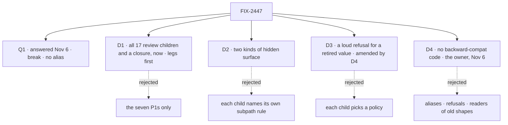

# FIX-2447 · Decisions

[Spec](SPEC.md) · **Decisions**

The calls that sit above any single child: what was chosen, what lost, and what each locks in for
the 18 children and the closure. D1 and D2 are the sign-off. On Nov 6 the owner answered Q1
(break) and added D4 (no backward-compat code), which amends D3. Nothing is open.

## The tree

## Q1 · Answered (Nov 6): break. A moved name loses its old path, with no alias

**The answer.** The owner, on [#4836](https://github.com/fixpoint-labs/flow-state-dev/pull/4836#issuecomment-6689198303): "Remove the aliases, we don't need backward
compat." A moved or renamed published export loses its old path, with no `@deprecated` alias,
and ships in whatever minor follows its child. The changeset names the new home (ER-7). The
removal child and the *Shims* exemption the alias needed are not built. The same day the owner
widened it to every kind of compat code: [D4](#d4).

**What it costs.** What the ask priced under *break as each lands*: an adopter's upgrade fails
with "no exported member", up to once per moving child, and only the changeset names the new
home. The fifth team's *after* is amended to match ([the goal](SPEC.md#five-teams-before-and-after)).

**As asked (Nov 5).** Kept as the record of the fork the owner decided.

**In plain terms.** The brief said FIX-2454 must land before 0.4.0 publishes. Core, engine,
client and react 0.4.0 went to npm on Nov 3, and orchestration is at 0.5.0. So every root name
this epic moves is one an adopter can import today, and moving it breaks their code. We choose
how that break reaches them. "Moves" covers every published name the set takes off a public
entry: moved to a new home, moved behind an `/internal` (which leaves an adopter no home),
removed, or renamed, a method on a returned object included (FIX-2450's
`resumeSuspension` → `answerSuspension`).

**The options.** *Alias, then one removal:* each child adds the new home and keeps the old root
name as a `@deprecated` alias naming the new path and a removal version, and every alias goes in
one named foundation minor. That removal is either its own child, blocking the closure, or the
named minor itself, with BP-030's checklist and no 19th child; then the closure runs after that
minor ships. Either way the aliases are exempt from the *Shims* row, which they would otherwise
fail, until that minor. *Hold:* the next minor of core, engine, client and react waits
for all seven P1 moves. *Break as each lands:* no alias, each child's move ships in whatever
minor follows it.

**The trade-off.** Alias and hold both break an adopter once; only the alias warns first, and
it is what Mastra, the Vercel AI SDK and LangChain.js each did for the same kind of move. Holding
also holds the 19 changesets already pending on `main`, and every sibling package, because
`workspace:*` publishes exact version pins. Breaking as each lands keeps the cadence and breaks
adopters up to seven times. The alias's price is the goal itself: old names still autocomplete,
struck through, until the removal minor, so the closure runs after it. The spec set counts that
price: about 200 engine root names and 222 orchestration task names alone, roughly 450 in all. The
export, collision and *Shims* checks each accept a name only while it is a `@deprecated` alias
naming its new home and removal version. Under hold or break, an upgrade fails with "no exported
member", which names nothing; the one-line changeset (ER-7) is then the only place the new home
is named, which falls short of the fifth team's *after*.

**My recommendation: alias, then one removal.** A `FIX-XXX · remove the deprecated aliases`
child joins the set, blocked by every moving child and blocking the closure. To decide with it:
which minor removes them, whether a child or that minor carries the removal, and whether
FIX-2454's floor (a refusal's removal is at least two minors after it first refuses) applies to
aliases too.

**What would change my mind.** Evidence that almost nobody runs 0.4.0. Then break as each lands
and skip the aliases.

**What being wrong costs.** Alias, wrongly: a minor or two of struck-through names and one more
child. Hold, wrongly: every package's merged work waits for the slowest P1. Break as each lands,
wrongly: adopters pay several breaking upgrades, which is the debt this epic exists to clear.

It came down to breaking once, warned first. The owner chose breaking as each lands, unwarned.

## D1 · All 17 review children and a closure, now, with exit triggers on FIX-2463 and FIX-2462

| | |
|---|---|
| **Instead of** | The seven P1s, which alone clear the review's five rows, with P2 and P3 left for later |
| **Because** | The goal says one way to do each thing, and the duplicates are in P2: four output-polling copies, three harnesses with their own error types, two claim orders, a testing package that can't test a suspension. Without them the goal shrinks to the smaller one the spec rejects |
| **Locks in** | A 19-child epic: the owner-confirmed 17, FIX-2564's legs split out of the closure to land first, and the closure. FIX-2463 stays only if its spec shows the `*_ENTRY` constants can't move to documented subpaths or the existing `board.entries()` and `markRolePiece` bundles without a new primitive (ER-6); otherwise it leaves for its own spec. FIX-2462 folds into FIX-2459 unless its spec shows a distinct export win. These are triggers, not defaults: the owner confirmed all 17 |
| **What the triggers did** (spec set, Nov 5) | Both fired. **FIX-2462** shows no export win, so it folds: FIX-2459 builds the one method table as its own follow-on PR, with FIX-2462's spec as the retained design, and FIX-2462 closes as folded. **FIX-2463** shows the constants move without a new primitive, so no flow-part primitive is built. The narrowed remainder stays in the set, pending the owner's sign-off on the spec-set PR: entry names become documented strings refused at hire, and workforce's five constants go private. The two moves on core's and orchestration's roots pass to FIX-2448 and FIX-2459 |

**What would change my mind:** the P2s' rows already passing once the P1s merge. FIX-2564's
manifest reports that on `main` as it happens, so it no longer waits on the closure. Then the
P2s are polish and the epic should wrap.

**Considered, not taken.** One root-surface ratchet issue absorbing FIX-2448 and FIX-2449 and the
subpath-only parts of FIX-2459, FIX-2460 and FIX-2456: it splits behaviour-owning children in
two, and FIX-2448's first PR is already the ratchet. Cutting FIX-2462 now: D1's trigger already
covers it.

It comes down to the duplicates: they are all in P2, so P1 alone can't meet the goal.

## D2 · Two kinds of hidden surface, and a public subpath is documented

| | |
|---|---|
| **Instead of** | Each child naming its own rule. FIX-2448 asks for a published, undocumented `core/internal`; FIX-2459 asks for an *unpublished* orchestration `./internal` |
| **Because** | Workforce imports orchestration's filing helpers at runtime (`conversation-board/board.ts`), so an unpublished subpath would be missing from workforce's tarball and its first install would fail. Both kinds already exist: `client/./internal` is published and read by our packages; orchestration's `./inbox/check` is hidden by `publishConfig` and read only by repo tests |
| **Locks in** | `/internal` is published, undocumented and outside semver, only `@flow-state-dev/*` packages import it, and a package has at most one (core folds `./items/internal` under it or keeps it as that one). Safe only while sibling packages pin each other exactly, as `workspace:*` publishes today. A `publishConfig`-hidden entry is for repo tests and tools. A named public subpath is documented and semver-covered. `/internal` is a plain published subpath and may appear in an editor's completions. It is held by the exports map, the export check's import census (no app, example or docs page imports an `/internal` path) and the path name, not by hiding it ([settled below](#d2-completions)). `stripInternal` is out: sibling packages compile against the published `.d.ts` |
| **The set's `/internal` entries** (spec set, Nov 5; amended Nov 6) | Four new, one per package: core (FIX-2448), engine (FIX-2449), orchestration (FIX-2459), react (FIX-2455), beside client's. Contracts' entry, planned as the home of the shared refusal helper, is not built: [D4](#d4) withdrew the helper. Each is a plain published subpath; none ships a completions fix. **Five per-package entries, not one shared seams entry** (settled after the refuted POC): a shared entry has to live in one package and re-export the others' seams, so it would import upward (contracts or core reaching engine and orchestration) or need a new package that depends on all of them. Hiding is equal either way, since the fence is the path name and the census, so the shared shape buys nothing. FIX-2448, 2449, 2455 and 2459 each add their own package's entry |
| **Settled: hiding `/internal` from completions** (Nov 5, the coordinator's POC) | **REFUTED** for `typesVersions` and the exports `types` condition: under `bundler` and `node16` resolution, path completions read the exports map, and neither hides an entry while a sibling package still resolves it. The only mechanism that worked, a custom export condition read through `customConditions`, would break an adopter's bundler resolving published workforce's runtime import of `orchestration/internal`, so it is **not adopted**. The fence is the exports map, the import census and the path name. No child ships a completions fix, and the closure has no completions assertion |

It comes down to workforce's tarball: an unpublished `./internal` breaks its first install.

## D3 · A retired value gets a loud refusal with a removal version; only published shapes are dual-read

> **Amended (Nov 6) by [D4](#d4).** Neither half stands. A retired value is not refused, and no
> shape is dual-read, published or not; the helper, its tables, removal versions and the expiry
> check are not built. What survives is the half both cards share: code for names no published
> version carried is deleted (FIX-2454's 19). The card below is the history. Four refusals and
> readers were later kept under D4's guard ([amended Nov 10](#kept-refusals)).

| | |
|---|---|
| **Instead of** | Each child picking, as the window's three renames did: a throw, a permanent map, and nothing |
| **Because** | A retired runtime value is the silent case. Old code that passes `human_approval` compiles, and the stop becomes a custom reason with no Inbox item. A moved export is not silent; how it reaches adopters is Q1 |
| **Locks in** | FIX-2454 writes it into BP-030: a retired value or config key fails with its replacement named and a removal version, through one shared refusal helper (`refuseRetired`, on `contracts/internal`) that replaces today's ad-hoc ones (`defineFlow.ts`, `runner.ts`) and absorbs the `retired-name-refusal` markers in source (`core/src/blocks/generator.ts`); FIX-2151's `RETIRED` set is the vocabulary sweep's text rule and stays, and the expiry check extends that sweep; dual-read only shapes a published version wrote, and the retired-enum coercion in `engine/src/resources/normalize-resource-state.ts` is that case, not a third policy; a refusal past its version fails the retired-name check. BP-034's re-export rule is amended to match Q1's answer. Every child that retires a value follows it |

It came down to `human_approval`: without a refusal, old code loses its Inbox item silently. D4
accepts that price.

## D4 · No backward-compat code in this epic (the owner, Nov 6)

> **Amended (Nov 10).** Four pieces stay, because removing them gives silently wrong behaviour,
> not a loud failure: the `human_*` refusal, with the reader that takes a stored 0.2.0 `human_*`
> stop as a user's stop; engine's `dispatcher` refusal (`refuseRetiredDispatcherOption`); the task
> board's `dispatcher` refusal; and the stored `blocked` row read. FIX-2454 held them back for
> the owner, who kept them by merging
> [#4830](https://github.com/fixpoint-labs/flow-state-dev/pull/4830) as it was. They are *The one
> guard* applied, not a new policy: each is an inline check at its site, with no table, helper or
> removal version. The price line is corrected: on `main`, `human_approval` throws, naming
> `user_approval`. The figure shows the Nov 6 call.

| | |
|---|---|
| **Instead of** | [D3](#d3)'s loud refusal with a removal version and its dual-read of published shapes, and [Q1](#q1)'s recommended alias |
| **Because** | The owner, in the coordinating session on Nov 6: "We are not worried about backwards compatibility, all PRs can streamline themselves further if there is an opportunity to not have additional code to support older versions." And on Q1: "Remove the aliases" ([comment](https://github.com/fixpoint-labs/flow-state-dev/pull/4836#issuecomment-6689198303)). Pre-1.0 every minor is breaking already, and compat code is surface this epic exists to shrink |
| **Locks in** | No child adds, and each may delete where it streamlines: a `@deprecated` alias or re-export at an old path; a reader of an old stored or persisted shape; a retired-name table, refusal or friendly error; a migration shim. **BP-030 is waived for this epic**, not rewritten. BP-034's re-export rule reads the paths the docs name after a move, not the old ones. The changeset names each moved or retired name's replacement (ER-7) |
| **The one guard** | Code whose absence would *silently corrupt data*, not merely fail, is raised to the coordinator before it is removed. A compile error, a thrown error, an ignored option or an unanswerable stop is failing, not corrupting |
| **The price** | A retired option or value outside [the four kept](#kept-refusals) takes the generic path: a type error, an unknown option or an ignored key, naming nothing. `ctx.suspend({ reason: "human_approval" })` is one of the four: it throws, naming `user_approval`. A moved import fails with "no exported member", and only the changeset names its home |

It comes down to the code: every alias, refusal and reader is surface an adopter autocompletes or
a maintainer carries, and the owner chose to carry none.

**What would change my mind:** an adopter base that must keep running across upgrades, at 1.0 or
for a paying adopter on a pinned minor. Then D3's refusal and an alias window come back.

## Who owns what

Each rule has one owner. A *uses* cell is a place where a child must not decide again.

| # | Rule every child obeys | Owner | Checked at |
|---|---|---|---|
| ER-1 | Pending the owner, the recommended reading: every root export of a package the set owns has an outside consumer or a README entry, and every other published root is held at its ratchet baseline, for [FIX-2568](https://linear.app/fixpoint-labs/issue/FIX-2568) (workforce's wider root and memory) and [FIX-2569](https://linear.app/fixpoint-labs/issue/FIX-2569) (the other nine), related issues, not children. No app, example or docs page imports an `/internal` path. An outside consumer is adopter code (`apps/` except the DevTool, `examples/`, `labs/`) or the docs site. Another `@flow-state-dev/*` package's import does not count, and neither does `goals/`, which is ours and may import `/internal`. A README passage written for framework authors moves to `docs/architecture/`. One import census, FIX-2448's, is read by every check that needs it. The check lands first, as a ratchet on today's baseline, so the roots stop growing while the set is specced. It holds every published root from its first day, and the set cleans the roots it owns (the goal's *Surface* row). Blocks and resources stay public library API; Workforce's app-level flows are Shadcn-style copies and are not root surface | FIX-2448 builds it, its first PR · FIX-2449 adds collisions | CI, gating every PR; leg b for installed-name collisions |
| ER-2 | Hidden surface is one of D2's two kinds | FIX-2448 | Each spec in the spec set; packed-install |
| ER-3 | Every moved or retired name follows [D4](#d4) and Q1's answer: no alias, refusal, reader of an old shape or shim, except [the four D4 keeps](#kept-refusals); the changeset names the new home (ER-7). What would silently corrupt data is raised first | FIX-2454 | Implementation review; closure leg b (`shims.never-published`) |
| ER-4 | A new check extends what exists: the export check reads `mechanism-exports.mjs`'s `packageExports`, split per entry once, plus an import census, FIX-2162's caller-census pattern, not Fallow, which keeps its dead-code jobs; collisions are one workspace assertion over every published root; `ctx as never` is a `no-restricted-syntax` entry; the tracker-id rule is the one custom ESLint rule; the goal's judge extends `run.mjs`'s `CHECKS` | FIX-2453 decides the lint shape at spec time | Cross-spec review |
| ER-5 | Nothing an adopter reads carries a tracker or process id: JSDoc, error and log strings, conformance titles, copied registry and example files, including each child's own new ones. A `//` comment is not read, so it may keep a pointer | FIX-2453 | The lint |
| ER-6 | No second way to do a job. FIX-2463 shows capabilities and the existing bundles can't carry a flow part. FIX-2455's React read builds on `useAction`, and its server read is one request by id from the existing status route (the owner's answer), sharing only the list's result projection; the handle keeps one wait, and `testFlow` settles through that same read. FIX-2456 extends the registry's `ConversationScrollButton`. FIX-2459 keeps `./tasks` as the one browser-safe entry. FIX-2460's answer helper goes through the engine's answer path | Each child | `reuse-review` in the spec set |
| ER-7 | One changeset per published package a child changes, one line, naming each moved name's new home | FIX-2454 | Implementation review |
| ER-8 | Consumed issues stay where they are: FIX-1804, FIX-2197, FIX-2360, FIX-2367, FIX-2418, FIX-2428. FIX-2043 and FIX-2513 are met by FIX-2455 and FIX-2091 by FIX-2457; each closes as a duplicate when its member merges. FIX-2513 is parented under FIX-2369, so that epic's coordinator is told when ER-8 closes it | The coordinator | Each refresh |
| ER-9 | The goal's legs assert on installed tarballs, never workspace `src`. Expectations sit on assertion ids ("cells"), and a row's outcome is derived from them. A child's PR changes only its own cells' expectation, never an assertion. A cell with several contributors names them all and is flipped by the last to land. The closure is the manifest's last writer: it adds rows, never edits one, and at the wrap folds the passing legs into `run.mjs`'s `CHECKS` and deletes the manifest. Leg b holds only what the workspace ratchets can't see | FIX-2564 builds them · FIX-2562 runs them last | `run.mjs --control`; the `main` job |

## Coordination seams

| Seam | Between | Rule |
|---|---|---|
| `core/src/index.ts` | FIX-2448, 2449, 2458, 2460, 2463 | FIX-2448 lands first; the others edit its split |
| Core's `Benchmark*` types | FIX-2448, 2460 | FIX-2460 owns them and moves them to `testing/benchmark` |
| `engine/src/index.ts` | FIX-2449, 2452 | FIX-2449 writes the explicit list; FIX-2452 moves store constructors under it |
| `react/src/index.ts` | FIX-2449, 2450, 2455, 2456 | Each removes its own names; none re-adds a root export without ER-1 |
| `client.ts` request handle | FIX-2450, 2455 | FIX-2450 owns the answer verb, FIX-2455 the output read |
| Orchestration's exports | FIX-2459 (with FIX-2462's design as [its appendix](../../issues/FIX-2459/appendix-method-table.md)) | FIX-2459 moves names to `./internal`, then rewrites the methods in its own follow-on method-table PR |
| Benchmark entries | FIX-2459, 2460 | FIX-2460 owns `testing/benchmark` and `patterns/benchmark`; FIX-2459 leaves patterns' benchmark export block to it |
| `eslint.config.mjs` | FIX-2453, 2457 | The custom rule and the `no-restricted-syntax` entry; whichever lands second rebases |
| The status route | FIX-2455 × FIX-2460 | FIX-2460's `testFlow` settles through FIX-2455's by-id read |
| Outside the set | FIX-2551 × FIX-2455 (react internals); FIX-2540 × FIX-2456 (`useJumpToLatest`) | Whichever lands second rebases |
| The quick start | FIX-2451, 2452 | FIX-2451 fixes it now; FIX-2452 updates the snippet when the shorthand ships |
| Kitchen Sink | FIX-2554, 2450, 2452, 2458, 2456, 2461 | Each edits only its own files; FIX-2461 last |
| Task-collection storage primitives | FIX-2459's method-table PR × FIX-2532 (`findBy`, #4757, outside the set) | `findBy` is written on the method table's storage primitives; whichever lands second rebases. FIX-2459's `./internal` move also takes `orchestration/src/tasks/collection/partition.ts`, which #4757 edits |
| Scope-state defaults | FIX-2457 × FIX-2576 | FIX-2576's runtime merge of block- and capability-declared state defaults (FIX-2554 shipped the flow `stateSchema` fill) matches the type-level `extendSchema` in `core/src/capability/merge.ts`. One field declared in two places with a different type or default is refused at flow definition, and the error names the field and both declaring blocks; identical declarations merge silently. That error carries no tracker id ([ER-5](#who-owns-what)) |
| The closure manifest | FIX-2564 and every cell-owning child | FIX-2564 owns the assertions and [the grid](../../issues/FIX-2564/SPEC.md#what-changes); each child flips only its own cells |

## Decided, not asked

- **A user's stop is answered through `answer`, in React and the client.** `resume` stays only
  for a developer's own `ctx.suspend`. That is the goal's *one path* row; FIX-2450 builds it.
- **Overlaps:** FIX-2455 and FIX-2043 both read an action's result by request id; FIX-2457 sits
  beside FIX-2197, which scopes this assignability gap out.
- **Linear sequencing:** FIX-2448 blocks FIX-2449 and FIX-2458; FIX-2450 blocks FIX-2460, and
  FIX-2455 blocks the PR where FIX-2460's answer helper settles; every child blocks FIX-2562.
  FIX-2454 no longer blocks FIX-2452's or FIX-2459's PRs: [D4](#d4) withdrew the helper they
  would have called. FIX-2564 blocks only the closure: a child that merges first has its rows
  written `expect: pass`.
- **The goal's legs land first, in their own child.** FIX-2562 can't carry an early PR: it is
  blocked by every other child, and its one PR opens on a clean run
  ([orchestration.md](../../../docs/contributing/orchestration.md#the-closure-issue-every-epic-ends-in-qa)).
  So FIX-2564 builds the legs; the closure still runs them last, on one pinned `main`.
- **Verification is consolidated, not stacked.** Workspace ratchets gate PRs; the legs run
  non-gating on `main`; the manifest maps each row to one place it is checked, which is also the
  closure's skip list for item 3.
- **Outside the set:** client-writable resource state, for a sibling issue. FIX-2535 (GitHub webhooks' `sessionId`) planned to call FIX-2454's helper; under D4 there is none, which the coordinator tells it.
- **Kitchen Sink's registry copies stay** (spec set, decided by the epic-agent). There are 43, byte-identical and drift-tested in CI. FIX-2461 adds one refresh command, and the hand sync goes. Deleting them would make Kitchen Sink build in a way no adopter's app can, while an install leaves owned copies in the adopter's app.
- **FIX-2451 and FIX-2554 take the direct route** as bugs. FIX-2554 joined the set on Nov 4.
- **The `scheduler` slot** is FIX-2452's to remove or keep. R-11, which would make it real, is
  not in the set.
- **FIX-2479** (public `Row` types renamed to `Item`) is outside the set and follows the same
  rule if it lands first.

## What the end-state POC showed

None built. Recommended against: the children touch separate surfaces, and the one place a
division could fail (D2, a hidden path missing from a tarball) is already proved by the
packed-install check every child runs through.

## Analysis

**2026-11-05 · watermark 2026-11-01 · right approach, with changes.** The analyst ran
`reuse-review` on the Adds and compared Mastra, the Vercel AI SDK, LangChain.js and API
Extractor. Folded: five Adds already existed (the scroll button, `./tasks`, `client/./internal`,
`useAction`, a refusal helper), now named in ER-6 and the Adds table; Q1 re-priced (19 pending
changesets, exact sibling pins) and widened to the alias option, which the three frameworks all
took, so D3 narrowed to retired values; the export check lands first as a ratchet; the client's
answer verb decided here. Recorded: the completions risk on `/internal` (D2, now enforced statically) and
D2's dependence on exact pins. The `adhd` alternatives pass ran
later, reduced to a single context rather than parallel frames. It changed one thing: the goal's
legs land first as expected-fail rows (FIX-2564), so the lead measure and D1's trigger read off
CI. Its other two shapes are recorded under D1 as not taken.

## Notes from review

Spec-set review round 1 (Nov 5), recorded, not folded.

- **Second look, finding 3** ([comment](https://github.com/fixpoint-labs/flow-state-dev/pull/4772#issuecomment-6647549943)): "Q1 should be answered before this merges... The deciding fact is unmeasured: the flip condition is 'adopters on 0.4.0 are few enough to ignore', and 0.4.0 shipped about two days ago. That is checkable now. Look at 0.4.0 npm download and dependent counts for core, engine, client and react before deciding." Q1 is held for the owner; the coordinator did not fold it. The measurement is the input Q1's *What would change my mind* names.
- **Cursor, shared census library** ([review](https://github.com/fixpoint-labs/flow-state-dev/pull/4772#pullrequestreview-5778749039)): "One shared spec-time census library (or a `--spec-evidence` mode on `scripts/mechanism-exports.mjs`)... Per-issue `census.mjs` files should be thin classifiers + `--control` plants." Optional at the gate; worth it if a POC script becomes a default job. For the implementers: the CI census is FIX-2448's one module (ER-4), and no spec-time walker is promoted.
- **Second look, reviewability** ([comment](https://github.com/fixpoint-labs/flow-state-dev/pull/4772#issuecomment-6647549943)): "about 33k words of spec plus POC scripts in one approval... four specs over the word budget (FIX-2448, 2449, 2455, 2562). I'd leave those to the implementers."

## How it got here

- **Drafted (Nov 4–5).** 17 owner-confirmed children; closure FIX-2562 filed. 0.4.0 had already
  shipped, which opened Q1. D2 came from FIX-2448 and FIX-2459 disagreeing on `/internal`.
- **Analysis (Nov 5).** Q1 widened to three options, D3 narrowed, ER-1 and ER-6 tightened.
- **Other shapes and review round 1 (Nov 5).** FIX-2564 filed to land the legs first; leg b cut
  to tarball-only gaps behind the workspace ratchets; completions enforced statically; the export
  check on `packageExports` and a census, not Fallow; D1's triggers tightened; D3's helper
  widened; Q1's removal vehicle and *Shims* exemption written in.
- **Spec set (Nov 5).** Seventeen member specs and a set review (cross-spec and analysis) amended
  this file. The *Surface* row was narrowed to the roots the set owns, pending the owner. D1
  records both triggers firing, and FIX-2463's narrowed stay is pending the owner. ER-1's reader
  was defined, and ER-5 was aligned to the goal's *Leakage* row. ER-6 now has FIX-2455's by-id
  read (the owner's answer). ER-8 gained three consumed issues. ER-9 moved to cells and the
  manifest's lifetime. D2 lists five `/internal` entries, with the completions question sent to a
  POC. D3 named the helper's home. Q1 was widened and priced. The seams gained six rows. The
  PR's *Epic amendments* section lists each with the member that found it.
- **Spec-set review round 1 (Nov 5).** The coordinator's calls on the FSD Architect's six edits,
  Cursor's de-dup and the D2 POC. The narrow *Surface* reading is written the same way in the
  goal, *Signal* and ER-1, pending the owner. The roots the set doesn't own went to two related
  issues, FIX-2568 and FIX-2569. D2's completions POC was refuted; `/internal` stays a plain
  published subpath and the completions lock-in was dropped here and from the five children that
  create one. Two seam rows were added (findBy on the method table, scope-state defaults).
- **Amended (Nov 10).** D4 keeps four refusals and readers, the owner's ruling by merging [#4830](https://github.com/fixpoint-labs/flow-state-dev/pull/4830);
  its price line, ER-3 and the SPEC's restatements now match ([D4](#kept-refusals)).
  FIX-2564 is the one source for the assertion grid; FIX-2462's design is an appendix to
  FIX-2459.
- **Spec-set review round 2 (Nov 5).** The FSD Architect's two follow-ups: the scope-state
  conflict covers a different type as well as a different default, names the field and both
  declaring blocks, and lets identical declarations merge (seam row, FIX-2564's cell, FIX-2562's
  row). D2 records five per-package `/internal` entries over one shared seams entry.
- **Owner amendment (Nov 6), a follow-up PR from `main`.** The owner answered Q1 on
  [#4836](https://github.com/fixpoint-labs/flow-state-dev/pull/4836#issuecomment-6689198303), break, and in the coordinating session ruled out compat code of any kind, now
  [D4](#d4). Q1 closed; D3 amended by D4; ER-3 and ER-4 re-derived; the refusal-helper seam
  dropped and FIX-2454's blocks relations with it; D2's `/internal` entries down to four (no
  `contracts/internal`); the ownership figure's ER-3 label and the box's fence relabelled. In
  `SPEC.md`: the fifth team's *after*, the FIX-2454 row, sequencing, the debt and the sign-off.
  Every child spec was swept for aliases, refusals, readers of old shapes and shims; the PR body
  lists each one touched. Original review: [#4772](https://github.com/fixpoint-labs/flow-state-dev/pull/4772).

**Open:** none. Q1 was answered on Nov 6 ([above](#q1)).
