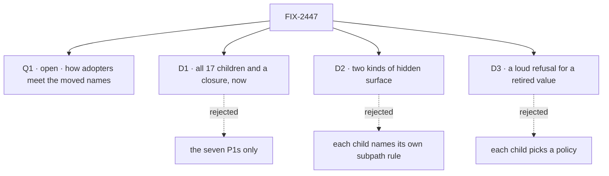

# FIX-2447 · Decisions

[Spec](SPEC.md) · **Decisions**

The calls that sit above any single child: what was chosen, what lost, and what each locks in for
the 17 children and the closure. D1 to D3 are the sign-off. Q1 is open, and it is the owner's.

## The tree

## Q1 · Open · 0.4.0 has shipped: how do adopters meet the names this epic moves?

**In plain terms.** The brief said FIX-2454 must land before 0.4.0 publishes. Core, engine,
client and react 0.4.0 went to npm on Nov 3, and orchestration is at 0.5.0. So every root name
this epic moves is one an adopter can import today, and moving it breaks their code. We choose
how that break reaches them.

**The options.** *Alias, then one removal:* each child adds the new home and keeps the old root
name as a `@deprecated` alias naming the new path and a removal version; one last child removes
every alias in a single minor. *Hold:* the next minor of core, engine, client and react waits
for all seven P1 moves. *Break as each lands:* no alias, each child's move ships in whatever
minor follows it.

**The trade-off.** Alias and hold both break an adopter once; only the alias warns first, and
it is what Mastra, the Vercel AI SDK and LangChain.js each did for the same kind of move. Holding
also holds the 19 changesets already pending on `main`, and every sibling package, because
`workspace:*` publishes exact version pins. Breaking as each lands keeps the cadence and breaks
adopters up to seven times. The alias's price is the goal itself: old names still autocomplete,
struck through, until the removal minor, so the closure runs after it.

**My recommendation: alias, then one removal.** A `FIX-XXX · remove the deprecated aliases`
child joins the set, blocked by every moving child and blocking the closure.

**What would change my mind.** Evidence that almost nobody runs 0.4.0. Then break as each lands
and skip the aliases.

**What being wrong costs.** Alias, wrongly: a minor or two of struck-through names and one more
child. Hold, wrongly: every package's merged work waits for the slowest P1. Break as each lands,
wrongly: adopters pay several breaking upgrades, which is the debt this epic exists to clear.

It comes down to breaking once, warned first: only the alias does both.

## D1 · All 17 children and a closure, now, with collapse triggers on FIX-2463 and FIX-2462

| | |
|---|---|
| **Instead of** | The seven P1s, which alone clear the review's five rows, with P2 and P3 left for later |
| **Because** | The goal says one way to do each thing, and the duplicates are in P2: four output-polling copies, three harnesses with their own error types, two claim orders, a testing package that can't test a suspension. Without them the goal shrinks to the smaller one the spec rejects |
| **Locks in** | An 18-child epic. FIX-2463 leaves the set if its spec can't remove the `*_ENTRY` constants without a second composition unit beside capabilities and the existing `board.entries()` and `markRolePiece` bundles (ER-6). FIX-2462 leaves if its spec finds no export it lets FIX-2459 delete |

**What would change my mind:** the closure's legs passing after the P1s. Then the P2s are polish
and the epic should wrap.

It comes down to the duplicates: they are all in P2, so P1 alone can't meet the goal.

## D2 · Two kinds of hidden surface, and a public subpath is documented

| | |
|---|---|
| **Instead of** | Each child naming its own rule. FIX-2448 asks for a published, undocumented `core/internal`; FIX-2459 asks for an *unpublished* orchestration `./internal` |
| **Because** | Workforce imports orchestration's filing helpers at runtime (`conversation-board/board.ts`), so an unpublished subpath would be missing from workforce's tarball and its first install would fail. Both kinds already exist: `client/./internal` is published and read by our packages; orchestration's `./inbox/check` is hidden by `publishConfig` and read only by repo tests |
| **Locks in** | `/internal` is published, undocumented and outside semver, only `@flow-state-dev/*` packages import it, and a package has at most one (core folds `./items/internal` under it or keeps it as that one). Safe only while sibling packages pin each other exactly, as `workspace:*` publishes today. A `publishConfig`-hidden entry is for repo tests and tools. A named public subpath is documented and semver-covered. The closure's leg b also checks that an adopter's editor does not offer `/internal` names in completions |

It comes down to workforce's tarball: an unpublished `./internal` breaks its first install.

## D3 · A retired value gets a loud refusal with a removal version; only published shapes are dual-read

| | |
|---|---|
| **Instead of** | Each child picking, as the window's three renames did: a throw, a permanent map, and nothing |
| **Because** | A retired runtime value is the silent case. Old code that passes `human_approval` compiles, and the stop becomes a custom reason with no Inbox item. A moved export is not silent; how it reaches adopters is Q1 |
| **Locks in** | FIX-2454 writes it into BP-030: a retired value or config key fails with its replacement named and a removal version, through one shared refusal helper that replaces today's ad-hoc ones (`defineFlow.ts`, `runner.ts`); dual-read only shapes a published version wrote; a refusal past its version fails the lint. BP-034's re-export rule is amended to match Q1's answer. Every child that retires a value follows it |

It comes down to `human_approval`: without a refusal, old code loses its Inbox item silently.

## Who owns what

Each rule has one owner. A *uses* cell is a place where a child must not decide again.

| # | Rule every child obeys | Owner | Checked at |
|---|---|---|---|
| ER-1 | Every root export of a published package has an outside consumer or a README entry. The check lands first, as a ratchet on today's baseline, so the roots stop growing while the set is specced | FIX-2448 builds it, its first PR · FIX-2449 adds collisions | CI; closure leg b |
| ER-2 | Hidden surface is one of D2's two kinds | FIX-2448 | Each spec in the spec set; packed-install |
| ER-3 | Every retired value follows D3; every moved export follows Q1's answer | FIX-2454 | Each spec in the spec set; closure leg b |
| ER-4 | A new check extends what exists: the export check reads `mechanism-exports.mjs` and Fallow's import graph; `ctx as never` is a `no-restricted-syntax` entry; the tracker-id rule is the one custom ESLint rule | FIX-2453 decides the lint shape at spec time | Cross-spec review |
| ER-5 | Nothing that ships carries a tracker id, including each child's own new JSDoc, errors and test titles | FIX-2453 | The lint |
| ER-6 | No second way to do a job. FIX-2463 shows capabilities and the existing bundles can't carry a flow part. FIX-2455's React read builds on `useAction`, and its server read on `withListedResult`; the handle keeps one wait. FIX-2456 extends the registry's `ConversationScrollButton`. FIX-2459 keeps `./tasks` as the one browser-safe entry. FIX-2460's answer helper goes through the engine's answer path | Each child | `reuse-review` in the spec set |
| ER-7 | One changeset per published package a child changes, one line, naming each moved name's new home | FIX-2454 | Implementation review |
| ER-8 | Consumed issues stay where they are: FIX-1804, FIX-2197, FIX-2360, FIX-2367, FIX-2418, FIX-2428 | The coordinator | Each refresh |
| ER-9 | The closure asserts on installed tarballs, never workspace `src` | FIX-2562 | Its own control |

## Coordination seams

| Seam | Between | Rule |
|---|---|---|
| `core/src/index.ts` | FIX-2448, 2449, 2458, 2460, 2463 | FIX-2448 lands first; the others edit its split |
| Core's `Benchmark*` types | FIX-2448, 2460 | FIX-2460 owns them and moves them to `testing/benchmark` |
| `engine/src/index.ts` | FIX-2449, 2452 | FIX-2449 writes the explicit list; FIX-2452 moves store constructors under it |
| `react/src/index.ts` | FIX-2449, 2450, 2455, 2456 | Each removes its own names; none re-adds a root export without ER-1 |
| `client.ts` request handle | FIX-2450, 2455 | FIX-2450 owns the answer verb, FIX-2455 the output read |
| Orchestration's exports | FIX-2459, 2462 | FIX-2459 moves names to `./internal`; FIX-2462 may delete them |
| The quick start | FIX-2451, 2452 | FIX-2451 fixes it now; FIX-2452 updates the snippet when the shorthand ships |
| Kitchen Sink | FIX-2554, 2461, 2458, 2456 | Each edits only its own files; FIX-2461 last |

## Decided, not asked

- **A user's stop is answered through `answer`, in React and the client.** `resume` stays only
  for a developer's own `ctx.suspend`. That is the goal's *one path* row; FIX-2450 builds it.
- **Overlaps:** FIX-2455 and FIX-2043 both read an action's result by request id; FIX-2457 sits
  beside FIX-2197, which scopes this assignability gap out.
- **Linear sequencing:** FIX-2448 blocks FIX-2449 and FIX-2458; FIX-2450 blocks FIX-2460; every
  child blocks FIX-2562. FIX-2454 has no blocks relation; its rule travels as D3.
- **FIX-2451 and FIX-2554 take the direct route** as bugs. FIX-2554 joined the set on Nov 4.
- **The `scheduler` slot** is FIX-2452's to remove or keep. R-11, which would make it real, is
  not in the set.
- **FIX-2479** (public `Row` types renamed to `Item`) is outside the set and follows the same
  rule if it lands first.

## What the end-state POC showed

None built. Recommended against: the children touch separate surfaces, and the one place a
division could fail (D2, a hidden path missing from a tarball) is already proved by the
packed-install check every child runs through.

## Analysis

**2026-11-05 · watermark 2026-11-01 · right approach, with changes.** The analyst ran
`reuse-review` on the Adds and compared Mastra, the Vercel AI SDK, LangChain.js and API
Extractor. Folded: five Adds already existed (the scroll button, `./tasks`, `client/./internal`,
`useAction`, a refusal helper), now named in ER-6 and the Adds table; Q1 re-priced (19 pending
changesets, exact sibling pins) and widened to the alias option, which the three frameworks all
took, so D3 narrowed to retired values; the export check lands first as a ratchet; the client's
answer verb decided here. Recorded: the completions risk on `/internal` (D2, closure leg b) and
D2's dependence on exact pins. Not run: the `adhd` alternatives pass, which needs parallel
sub-agents this session could not start. The strongest other division the analyst found by hand
is the alias option, now Q1's recommendation.

## How it got here

- **Drafted (Nov 4–5).** 17 owner-confirmed children; closure FIX-2562 filed. 0.4.0 had already
  shipped, which opened Q1. D2 came from FIX-2448 and FIX-2459 disagreeing on `/internal`.
- **Analysis (Nov 5).** Q1 widened to three options, D3 narrowed, ER-1 and ER-6 tightened.

**Open:** [Q1](#q1).
