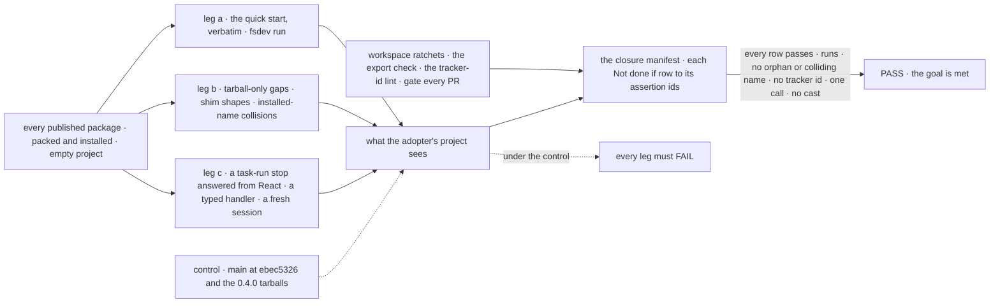
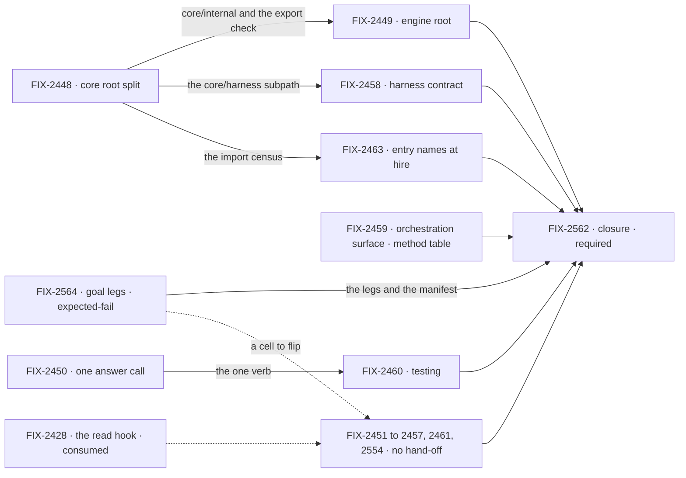

# FIX-2447 · A clean SDK for adopters: clear the debt the Oct 16–31 window put on the public surface

**Spec** · [Decisions](DECISIONS.md)

## Five teams, before and after

| A team that… | Today | After this epic |
|---|---|---|
| **installs FSD from npm and follows the quick start** | `fsdev run` throws. The quick start writes `lib/flowstate.ts`, and the CLI reads only `fsdev.config.*` | Runs as written, and an example copied out of the repo still runs |
| **autocompletes a package root** | 549 names in core and 367 in engine, with harness, wait-gate and PR-parsing vocabulary. Core 0.4.0's `.d.ts` hovers carry 272 `FIX-`/`LAB-` ids | The names an app author needs, and no tracker ids. Framework seams sit behind subpaths that say who they are for |
| **answers a user's stop from React** | React calls `resume`, which refuses a stop raised in a task-board run | One call, in React and the client |
| **reads an action's output, or unit-tests an approval step** | Polls, then lists session requests and searches the pages. `testFlow` has no durability, so it can't test `ctx.suspendForUser` | One client call returns the output. `testFlow` runs a suspension |
| **upgrades across a rename** | Three migration policies. Old code that passes `human_approval` compiles and silently loses its Inbox item | One policy: the old name is gone, and the changeset names its new home. No alias, refusal or reader of an old shape ([D4](DECISIONS.md#d4), the owner's, Nov 6). A retired runtime value such as `human_approval` is still not stopped: that is D4's price |

**Why now.** 0.4.0 of core, engine, client and react went to npm on Nov 3 with this debt on it,
and orchestration is already at 0.5.0. Each minor that ships it turns more internal names into
published surface that adopters build on and BP-030 then has to carry. The same window shows
what good looks like: five client factories became one `createClient`
([FIX-2162](../../issues/FIX-2162/SPEC.md)). Serves Goal 4, *keep the foundation honest*, and
Goal 3's *package boundaries and type contracts solid*.

## The goal, and how we'll know it's met

**An adopter who installs FSD from npm, reads the quick start, imports a package root and
autocompletes it sees only what an app author needs, with one way to do each thing and no
internal process vocabulary. The first-hour path runs as written.**

| Is it the right goal? | |
|---|---|
| **The real need** | Adopters judge the framework in their first hour, from the quick start and from autocomplete. Today both show our process, not their API |
| **Smaller, and rejected** | "The review's five rows clear." The seven P1s alone meet it, and four copies of output polling, two claim orders and a testing package that can't test a suspension stay |
| **Bigger, and not this epic's** | The review's unfiled items (R-08 to R-11, R-14, R-17, R-20 to R-22, R-24, R-25, R-28), a 1.0 API freeze, and cleaning the eleven published roots outside the set (workforce's wider root, memory, contracts, harness-manager, fsdev, workspace, tools, bullmq, mcp, scheduled, voice-openai: 457 names), which the ratchet holds and two follow-up issues take, related to this epic and not its children: [FIX-2568](https://linear.app/fixpoint-labs/issue/FIX-2568) for workforce's wider root and memory, first, since copied teammate and Shift Manager flows import workforce's root, and the umbrella [FIX-2569](https://linear.app/fixpoint-labs/issue/FIX-2569) for the other nine |
| **Not done if** | **Surface** (pending the owner; the recommended reading): a root export of a package the set owns (core, engine, client, react, testing, orchestration, patterns, the three harnesses, both stores, and workforce's entry names) has no outside consumer and no README entry, or any published root has grown past its ratchet baseline · **One path:** React and the client answer a stop through different calls, or an app reads an action's output by listing requests · **First hour:** the quick start, followed verbatim, fails at `fsdev run` · **Leakage:** a `FIX-`/`LAB-` id is in a published `.d.ts` JSDoc, a thrown error or a conformance test title · **Shims:** the next foundation minor ships a shim for a name or shape no published version carried · **Types:** a typed handler needs a cast to call an exported helper, or a fresh session reads a defaulted scope-state field as `undefined` · a closure bug is open |

The review's table had five rows, scoped to core and engine and to 0.4.0. *Surface* now covers
the roots the set owns and holds every other published root at its baseline (narrowed by the spec set, pending the owner), *One path* covers output reads, *Shims* names the next minor (0.4.0 has
shipped; [Q1](DECISIONS.md#q1) answered break, so no alias is exempt), and *Types* is new, for FIX-2457 and FIX-2554.

The control is what shipped: each leg fails today, which is what makes the PASS mean something.

| How we verify | |
|---|---|
| **Goal check** | Built first, by FIX-2564: legs a to c on installed tarballs and a closure manifest, every cell `expect: fail`, run non-gating on `main`. **[FIX-2564's grid](../../issues/FIX-2564/SPEC.md#what-changes) is the one place** each row's assertion ids, checks and flippers are spelled out; this table doesn't restate them. The closure FIX-2562 runs the whole manifest on one `main` commit last, folds the passing legs into `CHECKS` and deletes the manifest ([ER-9](DECISIONS.md#who-owns-what)) |
| **Signal** | Workspace ratchets, gating every PR: the export check (pending the owner, the recommended reading: every root export of a package the set owns has an outside consumer or a README entry, and every other published root is held at its ratchet baseline; no app, example or docs page imports an `/internal` path) and the tracker-id lint. The legs: the quick start runs (a), what only a tarball shows (b), one call, no cast, a fresh session's default (c). `/internal` may appear in an editor's completions; [D2](DECISIONS.md#d2) is held by the exports map, the import census and the path name, not by hiding |
| **Anti-game** | Legs assert on the installed tarballs, never on workspace `src` (the packed-install resolution guard already refuses a workspace link). A child's PR changes only its own cells' expectation in the manifest, never an assertion, and a row whose outcome differs from its expectation in either direction turns the job red. The export check's allow-list is the README and the consumers, never a list the same diff writes |
| **Control that must fail** | `main` at `ebec5326` and the published 0.4.0 tarballs (`run.mjs --control=adopter-goal`; plain `--control` stays the 0.1.1 control): every row fails |

**Lead measure:** *Not done if* rows passing in the manifest, read off the `main` job from the
day FIX-2564 merges. 0 of 6 today.

## What's in the box

![In the box: what an app author imports. Curated package roots, one call per job, a quick start that runs, no tracker ids. Composed in by the adopter who goes further: named public subpaths, documented and semver-covered, such as core/harness, engine/host, testing/benchmark, each store's /host entry, and orchestration/tasks as today. Behind a fence: internal subpaths, published for our own packages only and outside semver, and workspace-only entries for repo tests. Not built: the review's unfiled items](figures/end-state.svg)

The top band is the whole adopter promise. The middle band is opt-in and documented. The fence is
[D2](DECISIONS.md#d2): what sits behind it is ours, and says so in its path.

**Docs:** one page in the docs site, *what each package root is for*: each root's job, its public
subpaths, and why `/internal` is not for apps. FIX-2448 publishes it with a row for every published root;
each child edits the row of the root it changes. FIX-2451 owns the quick start. Each child also documents its own
specifics in its package README.

## The set · as of 2026-11-04

The reviewed snapshot; live state is in [Linear](https://linear.app/fixpoint-labs/issue/FIX-2447).
Bugs take the direct route and get no spec PR. Every spec-route child is specced in one spec-set
PR after this one merges.

| Issue | What it delivers | Why the set needs it | Status |
|---|---|---|---|
| **Builds first** | | | |
| FIX-2564 | The goal's legs on installed tarballs and the closure manifest, every row expected-fail, run non-gating on `main` | Makes the lead measure a CI fact from day one; each cell-owning child's goal check flips its cells | Backlog · spec route · **builds first** · blocks FIX-2562 |
| **P1** | | | |
| FIX-2448 | Core's root split: harness and PR names to `core/harness`, framework seams to `core/internal`; the export check | *Surface*, for the root every adopter imports | Backlog · spec route |
| FIX-2449 | Engine's root as an explicit list, `engine/host` for adapter authors, no cross-root name collisions, no package markers | *Surface*, for engine and the collisions | Backlog · spec route · blocked by FIX-2448 |
| FIX-2450 | React answers a stop with `answer`; `resumedBy` goes | *One path* | Backlog · spec route |
| FIX-2451 | One runtime file in the quick start, the bare route, first snippets that compute something | *First hour* | Backlog · **direct** (Bug) |
| FIX-2452 | Stores shorthand, no no-op slots, a warning for a silent generator, one store factory family | *First hour*: the ceremony comes from defaults | Backlog · spec route |
| FIX-2453 | A lint that keeps tracker ids out of exported JSDoc, error strings and conformance titles, and the sweep | *Leakage* | Backlog · spec route |
| FIX-2454 | The never-published shims deleted (the census's 19), and, under [D4](DECISIONS.md#d4), the published names' refusals with them. No helper, rule or removal version (amended Nov 6) | *Shims* | Backlog · spec route |
| **P2** | | | |
| FIX-2455 | `sent.result()` returns an action's output, and the server read by request id behind it; the polling copies go, workforce's `runIn` among them; a React read | *One path* for output. Overlaps FIX-2043 ([noted](DECISIONS.md#decided-not-asked)) | Backlog · spec route |
| FIX-2456 | The registry Conversation on FIX-2360's scroll rule, one jump button, UI chrome out of the hooks root | *One path*, and *Surface* for react | Backlog · spec route |
| FIX-2457 | Typed handler `ctx` assignable to `BlockContext`; 196 `ctx as never` casts go | *Types* | Backlog · spec route |
| FIX-2458 | Shared harness failure kinds, model list and env base; one naming scheme per harness | *One path* across three harnesses, *Surface* for claude-code | Backlog · spec route · blocked by FIX-2448 |
| FIX-2459 | Orchestration's `./internal`, `./tasks` as its one browser-safe entry, one claim order, fewer collection constructors, and the method table as a follow-on PR ([appendix](../../issues/FIX-2459/appendix-method-table.md), FIX-2462's retained design) | *Surface* and *One path* for orchestration and patterns | Backlog · spec route |
| FIX-2460 | `testFlow` with durability and answer helpers; benchmark and bundle tools on subpaths | *Surface* for testing, and an approval step is testable | Backlog · spec route · blocked by FIX-2450 |
| **P3** | | | |
| FIX-2461 | Examples and Kitchen Sink that run when copied out, and say true things | *First hour*, past the quick start | Backlog · spec route |
| FIX-2462 | Task-collection methods written once over storage primitives, building on FIX-2056's task primitive | *One path* inside orchestration. Trigger fired: no export win, so it folds into FIX-2459, which builds it; its design is retained as [an appendix to FIX-2459](../../issues/FIX-2459/appendix-method-table.md) ([D1](DECISIONS.md#d1)) | Backlog · spec route · **folded into FIX-2459**, closes on the spec-set merge |
| FIX-2463 | Entry names are documented strings, refused at hire; workforce's five `*_ENTRY` constants go private. No new primitive | *Surface*: no `*_ENTRY` constant on a root (core's and orchestration's move with FIX-2448 and FIX-2459). Trigger fired; the narrowed child stays, pending the owner ([D1](DECISIONS.md#d1)) | Backlog · spec route · blocked by FIX-2448 (no longer by FIX-2459) |
| FIX-2554 | Scope state applies its schema's defaults on load; about 20 `?? default` fallbacks and 5 helpers such as `pinnedOf` go | *Types*: the type already promises the default | Backlog · **direct** (Bug) |
| FIX-2562 · closure · **required** | FIX-2564's manifest run whole on one pinned `main`, each team's journey, every child's goal check the manifest doesn't cover, the seam sweep | The only child that proves the goal | Backlog · blocked by every other child |

18 children and the closure FIX-2562: 16 on the spec route, 2 bugs on the direct route. The
owner confirmed the review's 17; FIX-2564 is the goal check's first half, split out so it can
land first. FIX-2463's and FIX-2462's triggers both fired in the spec set: FIX-2462 folds into
FIX-2459, and FIX-2463 stays narrowed, pending the owner ([D1](DECISIONS.md#d1)). Q1 was answered break on
Nov 6, so no alias-removal child joins.

**Sequencing.** FIX-2564 is the first build step: its cells exist before any child flips one, so
the lead measure counts from day one. A child that merges before it finds its cells written
`expect: pass` when the manifest lands, which is why FIX-2564 blocks only the closure. The owner
asked that FIX-2454 land before 0.4.0 publishes. 0.4.0 published on Nov 3, so that can no longer
happen, and since [D4](DECISIONS.md#d4) withdrew its helper no child waits on it. FIX-2448's first
PR is the export check, as a ratchet on today's roots. A moved name breaks in whatever minor
follows its child, with no alias ([Q1](DECISIONS.md#q1), answered Nov 6).

## How the issues flow into each other

An edge is what one issue hands the next; a dashed input is consumed, not owned. FIX-2564's
dashed edge is a cell each cell-owning child flips, not a block: it reaches the P1 and P2 nodes
too. FIX-2454 is in the group: under D4 it hands nothing on and blocks only the closure. Inside the group,
FIX-2455's by-id status read is what FIX-2460's answer helper settles through. Every child also
blocks the closure in Linear.

## What stays as it is

- The review's twelve unfiled items, named in the goal's *bigger* row and the box's bottom strip.
  Each can be its own issue.
- Blocks and resources stay public library API. Workforce's app-level flows are copied
  Shadcn-style and are not root surface, so ER-1 doesn't count them; FIX-2463 respects that split.
- Client-writable resource state (`client.state.write`, a PATCH on resource state,
  `useResource().update`) is outside the set, for a sibling issue.
- The five block kinds, `createClient`, and the HTTP routes. FIX-2450 changes which route React
  calls, not the routes.
- FIX-1804's removal of older compat code, FIX-2197's `ctx.suspend!`, prompt and preset typing,
  FIX-2043, FIX-2367 and FIX-2428. Consumed, not re-parented.

## What's already here, and the debt

| Already here | What the set does with it |
|---|---|
| `scripts/packed-install/run.mjs`: packs every published package, installs the tarballs, runs a pinned control (`--control`, the 0.1.1 control; FIX-2564 adds `--control=adopter-goal` and `--goal`) | **Builds on.** FIX-2564 adds the legs there first; the closure runs them last |
| `scripts/mechanism-exports.mjs`'s `packageExports` (public exports, read from source), and FIX-2162's caller census | **Extended** by FIX-2448 (consumer or README, through an import census) and FIX-2449 (collisions). No third walker; Fallow keeps its dead-code jobs ([ER-4](DECISIONS.md#who-owns-what)) |
| `eslint.config.mjs`, with no custom rules yet | **Extended**: one custom rule (tracker ids) and one `no-restricted-syntax` entry (`ctx as never`) |
| `client/./internal` (published, read by our packages) and orchestration's `./inbox/check` (hidden by `publishConfig`) | **Named** by [D2](DECISIONS.md#d2) as the two kinds of hidden surface |
| Ad-hoc refusal helpers (`defineFlow.ts`, `runner.ts`), the `retired-name-refusal` sites (`core/src/blocks/generator.ts`), FIX-2151's planned `RETIRED` set, and BP-030 | **Removed, not replaced** ([D4](DECISIONS.md#d4), amending [D3](DECISIONS.md#d3)): FIX-2454 deletes the refusals with their names; BP-030 is waived for this epic. Code whose absence would silently corrupt data is raised first. The `RETIRED` vocabulary list stays. The retired-enum coercion in `normalize-resource-state.ts` is untouched unless a child removes it under that guard |
| BP-034: re-export a moved type from every documented path | **Kept as written**: the documented paths are the ones after the move. The old path goes, with no re-export ([Q1](DECISIONS.md#q1), answered break) |
| [FIX-2129 D2](../../issues/FIX-2129/DECISIONS.md): an answer route beside resume | **Kept** for the routes. A user's stop is answered through `answer` in React and the client ([decided](DECISIONS.md#decided-not-asked)) |
| [FIX-2360 D1](../../issues/FIX-2360/DECISIONS.md): the conversation scroll rule | **Kept.** FIX-2456 brings the registry Conversation to it |
| [FIX-2367](../FIX-2367/SPEC.md)'s *not done if*: no two hooks watching one scope | **Kept.** FIX-2455's React read builds on `useAction` |

| Adds | Existing piece considered | Why it doesn't fit / how composed |
|---|---|---|
| Public subpaths: `core/harness`, `engine/host`, `testing/benchmark`, `patterns/benchmark`, `react/workforce`, each store's `./host` | Each package's `exports` map; core already has 13 subpaths. Orchestration's `./tasks`, already the browser-safe entry | Extends the maps. No new package, and no second browser entry for orchestration |
| `/internal` in core, engine, orchestration, react | `client/./internal`; core's `./items/internal` | Reuse of that kind ([D2](DECISIONS.md#d2)); one hidden entry per package |
| An export-surface check (FIX-2448, FIX-2449) | `mechanism-exports.mjs`'s `packageExports`; FIX-2162's caller census | Extends both; not Fallow, whose graph is workspace dead code, not outside consumers |
| A tracker-id rule (FIX-2453), a `ctx as never` ban (FIX-2457) | ESLint's `no-restricted-syntax` | One custom rule; the ban is config |
| `sent.result()` and a read of one request's output (FIX-2455) | `sent.wait()`; the status route, which returns no output; `withListedResult`; `useAction` | Extends the handle, keeping one wait on it; the server read is one request by id from the status route (the owner's answer), sharing only the list's result projection; the React read builds on `useAction` |
| A shared jump button (FIX-2456) | The registry's `ConversationScrollButton`; Shift Manager's `JumpToLatestButton` | Extends the registry's button onto `useJumpToLatest`; the copies go |
| Legs a to c and the closure manifest (FIX-2564) | `scripts/packed-install/run.mjs`, its `runChecks`/`CHECKS` and `--control=<name>` form | Extends them; the manifest is one file beside it, deleted at the wrap |
| Stores shorthand (FIX-2452); harness parity (FIX-2458); `testFlow` durability (FIX-2460); one method table (FIX-2462, built by FIX-2459) | `StoreAdapter` and `warnOnceDev`; `isAbortLike`, harness readiness and codex's `assertTestedSdkVersion`; checkpoint durability, the engine's answer path and FIX-2455's status read; the `apply*` helpers and FIX-2056's task primitive | Each extends the named piece |
| Entry names refused at hire (FIX-2463) | Capabilities; the `board.entries()` and `markRolePiece` bundles | Extends the hire's role table; no flow-part primitive, since the trigger fired ([ER-6](DECISIONS.md#who-owns-what)) |

| The debt | |
|---|---|
| **Removes** | The harness vertical and seams on core's root, engine's `export *`, four output-polling copies, the hand-copied jump buttons, two claim orders, a second copy of 38 collection methods, 196 casts, about 20 default fallbacks and 5 helpers, the never-published shims, four package markers, the hand sync of Kitchen Sink's 43 registry copies, which stay and gain one refresh command (FIX-2461; an adopter's installed components are owned copies by design), the ad-hoc refusal helpers |
| **Adds** | Seven public subpaths (`core/harness`, `engine/host`, `testing/benchmark`, `patterns/benchmark`, `react/workforce`, two stores' `./host`) and four `/internal` ones, each an entry to keep; one export check and one lint rule; three packed-install legs and their manifest, until the wrap; `sent.result()`. No deprecated aliases or refusals ([D4](DECISIONS.md#d4)) |
| **Leaves** | The unfiled review items above, and the eleven published roots outside the set, held at their ratchet baseline |

**Net: down.** The adopter surface shrinks and four duplicated mechanisms become one each. The
price is one breaking round of moves, met with no alias ([Q1](DECISIONS.md#q1), answered break).

## Sign off

**[The goal](#the-goal-and-how-well-know-its-met):** six rows, each mapped to a workspace ratchet or a leg on installed tarballs, the legs landed first as expected-fail. If
wrong: we wrap with a clean repo and an npm package that still shows our process.

**[The debt](#whats-already-here-and-the-debt):** net down, for one round of breaking moves. If
wrong: adopters pay a breaking minor for names they never used.

1. [D1](DECISIONS.md#d1) · All 17 review children and a closure, now, with exit triggers on two;
   the goal's legs land first as expected-fail rows. If wrong: a long epic slot on internal tidying.
2. [D2](DECISIONS.md#d2) · Two kinds of hidden surface. If wrong: a published package imports a
   path its tarball doesn't have.
3. [D3](DECISIONS.md#d3) · A retired value fails loudly with a removal version. **Amended Nov 6
   by D4.**
4. [D4](DECISIONS.md#d4) · No backward-compat code: no alias, refusal, reader of an old shape or
   shim; what would silently corrupt data is raised first. The owner's call, Nov 6. If wrong: an
   adopter's code silently misbehaves after an upgrade, as `human_approval` does today.

**Open:** none. [Q1](DECISIONS.md#q1) was answered on Nov 6: break, no alias.

**Pending the owner, from the spec set:** the *Surface* row narrowed to the roots the set owns
([the goal](#the-goal-and-how-well-know-its-met)), and FIX-2463 staying narrowed after its
trigger fired ([D1](DECISIONS.md#d1)). Both are signed with the spec-set PR.

Epic · 18 children and the closure FIX-2562 · Goal 4, keep the foundation honest, and Goal 3, complete the Phase 1 foundation
