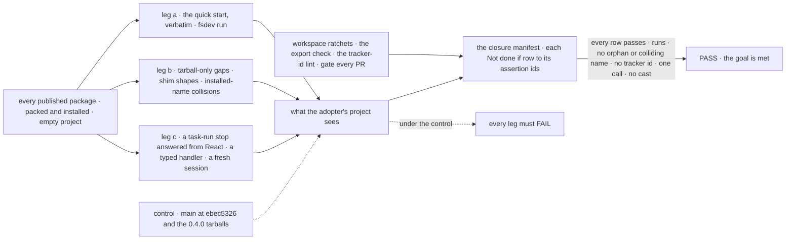
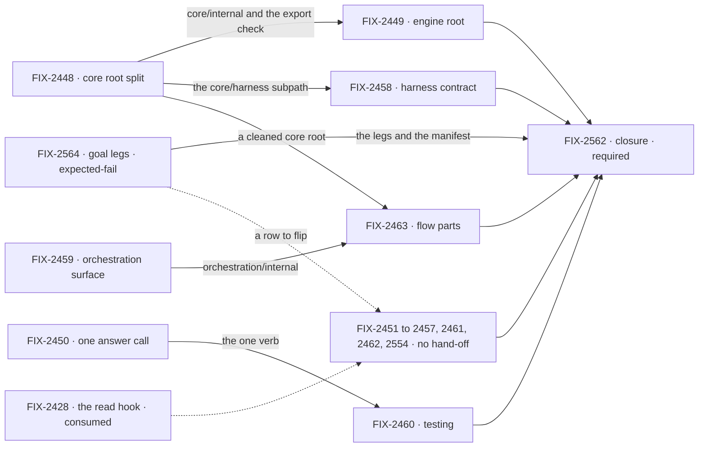

# FIX-2447 · A clean SDK for adopters: clear the debt the Oct 16–31 window put on the public surface

**Spec** · [Decisions](DECISIONS.md)

## Five teams, before and after

| A team that… | Today | After this epic |
|---|---|---|
| **installs FSD from npm and follows the quick start** | `fsdev run` throws. The quick start writes `lib/flowstate.ts`, and the CLI reads only `fsdev.config.*` | Runs as written, and an example copied out of the repo still runs |
| **autocompletes a package root** | 549 names in core and 367 in engine, with harness, wait-gate and PR-parsing vocabulary. Core 0.4.0's `.d.ts` hovers carry 272 `FIX-`/`LAB-` ids | The names an app author needs, and no tracker ids. Framework seams sit behind subpaths that say who they are for |
| **answers a user's stop from React** | React calls `resume`, which refuses a stop raised in a task-board run | One call, in React and the client |
| **reads an action's output, or unit-tests an approval step** | Polls, then lists session requests and searches the pages. `testFlow` has no durability, so it can't test `ctx.suspendForUser` | One client call returns the output. `testFlow` runs a suspension |
| **upgrades across a rename** | Three migration policies. Old code that passes `human_approval` compiles and silently loses its Inbox item | A deprecation or a loud refusal names the new home, never silence |

**Why now.** 0.4.0 of core, engine, client and react went to npm on Nov 3 with this debt on it,
and orchestration is already at 0.5.0. Each minor that ships it turns more internal names into
published surface that adopters build on and BP-030 then has to carry. The same window shows
what good looks like: five client factories became one `createClient`
([FIX-2162](../../issues/FIX-2162/SPEC.md)). Serves Goal 4, *keep the foundation honest*, and
Goal 3's *package boundaries and type contracts solid*.

## The goal, and how we'll know it's met

**An adopter who installs FSD from npm, reads the quick start, imports a package root and
autocompletes it sees only what an app author needs, with one way to do each thing and no
internal process vocabulary. The first-hour path runs as written.**

| Is it the right goal? | |
|---|---|
| **The real need** | Adopters judge the framework in their first hour, from the quick start and from autocomplete. Today both show our process, not their API |
| **Smaller, and rejected** | "The review's five rows clear." The seven P1s alone meet it, and four copies of output polling, two claim orders and a testing package that can't test a suspension stay |
| **Bigger, and not this epic's** | The review's unfiled items (R-08 to R-11, R-14, R-17, R-20 to R-22, R-24, R-25, R-28) and a 1.0 API freeze |
| **Not done if** | **Surface:** a root export of a published package has no outside consumer and no README entry · **One path:** React and the client answer a stop through different calls, or an app reads an action's output by listing requests · **First hour:** the quick start, followed verbatim, fails at `fsdev run` · **Leakage:** a `FIX-`/`LAB-` id is in a published `.d.ts` JSDoc, a thrown error or a conformance test title · **Shims:** the next foundation minor ships a shim for a name or shape no published version carried · **Types:** a typed handler needs a cast to call an exported helper, or a fresh session reads a defaulted scope-state field as `undefined` · a closure bug is open |

The review's table had five rows, scoped to core and engine and to 0.4.0. *Surface* now covers
every published root, *One path* covers output reads, *Shims* names the next minor (0.4.0 has
shipped, [Q1](DECISIONS.md#q1)), and *Types* is new, for FIX-2457 and FIX-2554.

The control is what shipped: each leg fails today, which is what makes the PASS mean something.

| How we verify | |
|---|---|
| **Goal check** | Built first, by FIX-2564: legs a to c in `scripts/packed-install/run.mjs`, and a closure manifest mapping each *Not done if* row to its assertion ids, every row `expect: fail`. It runs as a non-gating job on `main`, never on child PRs. A row-owning child's goal check is to flip its rows to `expect: pass`. The closure FIX-2562 runs the whole manifest on one `main` commit after every other child merges |
| **Signal** | Workspace ratchets, gating every PR: the export check (every foundation root export has an outside consumer or a README entry, and no app imports an `/internal` path) and the tracker-id lint. Leg a: the quick start's own code blocks, run in order, and `fsdev run` returns an answer. Leg b, only what the workspace can't see: no two installed roots share a name for different declarations, and no shim for an unpublished shape. Leg c: `useApproval` answers a `source: "task"` stop through the client's one call; a typed handler calls `payBoardDebts`-style helpers with no cast; a fresh session reads its schema's default. An editor's `/internal` completions are a manual spot-check at the closure |
| **Anti-game** | Legs assert on the installed tarballs, never on workspace `src` (the packed-install resolution guard already refuses a workspace link). A child's PR changes only its own rows' expectation in the manifest, never an assertion, and a row whose outcome differs from its expectation in either direction turns the job red. The export check's allow-list is the README and the consumers, never a list the same diff writes |
| **Control that must fail** | `main` at `ebec5326` and the published 0.4.0 tarballs (`run.mjs --control`): every row fails |

**Lead measure:** *Not done if* rows passing in the manifest, read off the `main` job from the
day FIX-2564 merges. 0 of 6 today.

## What's in the box

![In the box: what an app author imports. Curated package roots, one call per job, a quick start that runs, no tracker ids. Composed in by the adopter who goes further: named public subpaths, documented and semver-covered, such as core/harness, engine/host, testing/benchmark, the stores' advanced entry, and orchestration/tasks as today. Behind a fence: internal subpaths, published for our own packages only and outside semver, and workspace-only entries for repo tests. Not built: the review's unfiled items](figures/end-state.svg)

The top band is the whole adopter promise. The middle band is opt-in and documented. The fence is
[D2](DECISIONS.md#d2): what sits behind it is ours, and says so in its path.

**Docs:** one page in the docs site, *what each package root is for*: each root's job, its public
subpaths, and why `/internal` is not for apps. FIX-2448 publishes it; FIX-2449, FIX-2459 and
FIX-2460 add their rows. FIX-2451 owns the quick start. Each child also documents its own
specifics in its package README.

## The set · as of 2026-11-04

The reviewed snapshot; live state is in [Linear](https://linear.app/fixpoint-labs/issue/FIX-2447).
Bugs take the direct route and get no spec PR. Every spec-route child is specced in one spec-set
PR after this one merges.

| Issue | What it delivers | Why the set needs it | Status |
|---|---|---|---|
| **Builds first** | | | |
| FIX-2564 | The goal's legs on installed tarballs and the closure manifest, every row expected-fail, run non-gating on `main` | Makes the lead measure a CI fact from day one; each row-owning child's goal check flips its rows | Backlog · spec route · **builds first** · blocks FIX-2562 |
| **P1** | | | |
| FIX-2448 | Core's root split: harness and PR names to `core/harness`, framework seams to `core/internal`; the export check | *Surface*, for the root every adopter imports | Backlog · spec route |
| FIX-2449 | Engine's root as an explicit list, `engine/host` for adapter authors, no cross-root name collisions, no package markers | *Surface*, for engine and the collisions | Backlog · spec route · blocked by FIX-2448 |
| FIX-2450 | React answers a stop with `answer`; `resumedBy` goes | *One path* | Backlog · spec route |
| FIX-2451 | One runtime file in the quick start, the bare route, first snippets that compute something | *First hour* | Backlog · **direct** (Bug) |
| FIX-2452 | Stores shorthand, no no-op slots, a warning for a silent generator, one store factory family | *First hour*: the ceremony comes from defaults | Backlog · spec route |
| FIX-2453 | A lint that keeps tracker ids out of exported JSDoc, error strings and conformance titles, and the sweep | *Leakage* | Backlog · spec route |
| FIX-2454 | [D3](DECISIONS.md#d3)'s rule in BP-030 and one refusal helper that absorbs today's retired-name refusals, the never-published shims deleted, a removal version on every refusal | *Shims*, and every child that retires a value follows its rule | Backlog · spec route · **builds first** |
| **P2** | | | |
| FIX-2455 | `sent.result()` returns an action's output, and the server read by request id behind it; the polling copies go, workforce's `runIn` among them; a React read | *One path* for output. Overlaps FIX-2043 ([noted](DECISIONS.md#decided-not-asked)) | Backlog · spec route |
| FIX-2456 | The registry Conversation on FIX-2360's scroll rule, one jump button, UI chrome out of the hooks root | *One path*, and *Surface* for react | Backlog · spec route |
| FIX-2457 | Typed handler `ctx` assignable to `BlockContext`; about 185 `ctx as never` casts go | *Types* | Backlog · spec route |
| FIX-2458 | Shared harness failure kinds, model list and env base; one naming scheme per harness | *One path* across three harnesses, *Surface* for claude-code | Backlog · spec route · blocked by FIX-2448 |
| FIX-2459 | Orchestration's `./internal` and `./browser`, one claim order, fewer collection constructors | *Surface* and *One path* for orchestration and patterns | Backlog · spec route |
| FIX-2460 | `testFlow` with durability and answer helpers; benchmark and bundle tools on subpaths | *Surface* for testing, and an approval step is testable | Backlog · spec route · blocked by FIX-2450 |
| **P3** | | | |
| FIX-2461 | Examples and Kitchen Sink that run when copied out, and say true things | *First hour*, past the quick start | Backlog · spec route |
| FIX-2462 | Task-collection methods written once over storage primitives, building on FIX-2056's task primitive | *One path* inside orchestration. Folds into FIX-2459 unless its spec shows a distinct export win ([D1](DECISIONS.md#d1)) | Backlog · spec route |
| FIX-2463 | A flow-level part, so Layer-2 features stop handing adopters bundles to spread | *Surface*: the 14 `*_ENTRY` constants go. Stays only if its spec shows they can't move to documented subpaths or bundles without a new primitive ([D1](DECISIONS.md#d1)) | Backlog · spec route · blocked by FIX-2448, FIX-2459 |
| FIX-2554 | Scope state applies its schema's defaults on load; about 20 `?? default` fallbacks and 5 helpers such as `pinnedOf` go | *Types*: the type already promises the default | Backlog · **direct** (Bug) |
| FIX-2562 · closure · **required** | FIX-2564's manifest run whole on one pinned `main`, each team's journey, every child's goal check the manifest doesn't cover, the seam sweep | The only child that proves the goal | Backlog · blocked by every other child |

18 children and the closure FIX-2562: 16 on the spec route, 2 bugs on the direct route. The
owner confirmed the review's 17; FIX-2564 is the goal check's first half, split out so it can
land first. FIX-2463 and FIX-2462 each carry a trigger that takes them out of the set
([D1](DECISIONS.md#d1)). If Q1 takes the alias with its own removal child, a 19th joins:
`FIX-XXX · remove the deprecated aliases`, which blocks the closure.

**Sequencing.** FIX-2564 is the first build step: its rows exist before any child flips one, so
the lead measure counts from day one. A child that merges before it finds its rows written
`expect: pass` when the manifest lands, which is why FIX-2564 blocks only the closure. The owner
asked that FIX-2454 land before 0.4.0 publishes. 0.4.0 published on Nov 3, so that can no longer
happen. FIX-2454 still builds early, and its rule is decided here ([D3](DECISIONS.md#d3)) so no
child waits on it. FIX-2448's first PR is the export check, as a ratchet on today's roots. How the moved names reach adopters is [Q1](DECISIONS.md#q1), open.

## How the issues flow into each other

An edge is what one issue hands the next; a dashed input is consumed, not owned. FIX-2564's
dashed edge is a row each row-owning child flips, not a block: it reaches the P1 and P2 nodes
too. FIX-2454 is in the group because its rule travels at spec time, not as a build dependency. Every child also
blocks the closure in Linear.

## What stays as it is

- The review's twelve unfiled items, named in the goal's *bigger* row and the box's bottom strip.
  Each can be its own issue.
- Blocks and resources stay public library API. Workforce's app-level flows are copied
  Shadcn-style and are not root surface, so ER-1 doesn't count them; FIX-2463 respects that split.
- Client-writable resource state (`client.state.write`, a PATCH on resource state,
  `useResource().update`) is outside the set, for a sibling issue.
- The five block kinds, `createClient`, and the HTTP routes. FIX-2450 changes which route React
  calls, not the routes.
- FIX-1804's removal of older compat code, FIX-2197's `ctx.suspend!`, prompt and preset typing,
  FIX-2043, FIX-2367 and FIX-2428. Consumed, not re-parented.

## What's already here, and the debt

| Already here | What the set does with it |
|---|---|
| `scripts/packed-install/run.mjs`: packs every published package, installs the tarballs, runs a pinned control (`--control`) | **Builds on.** FIX-2564 adds the legs there first; the closure runs them last |
| `scripts/mechanism-exports.mjs`'s `packageExports` (public exports, read from source), and FIX-2162's caller census | **Extended** by FIX-2448 (consumer or README, through an import census) and FIX-2449 (collisions). No third walker; Fallow keeps its dead-code jobs ([ER-4](DECISIONS.md#who-owns-what)) |
| `eslint.config.mjs`, with no custom rules yet | **Extended**: one custom rule (tracker ids) and one `no-restricted-syntax` entry (`ctx as never`) |
| `client/./internal` (published, read by our packages) and orchestration's `./inbox/check` (hidden by `publishConfig`) | **Named** by [D2](DECISIONS.md#d2) as the two kinds of hidden surface |
| Ad-hoc refusal helpers (`defineFlow.ts`, `runner.ts`), the `retired-name-refusal` sites (`core/src/blocks/generator.ts`), FIX-2151's planned `RETIRED` set, and BP-030 | **Replaced** by one helper and one rule ([D3](DECISIONS.md#d3)). The retired-enum coercion in `normalize-resource-state.ts` is D3's dual-read case, not a third policy |
| BP-034: re-export a moved type from every documented path | **Amended** to match [Q1](DECISIONS.md#q1)'s answer |
| [FIX-2129 D2](../../issues/FIX-2129/DECISIONS.md): an answer route beside resume | **Kept** for the routes. A user's stop is answered through `answer` in React and the client ([decided](DECISIONS.md#decided-not-asked)) |
| [FIX-2360 D1](../../issues/FIX-2360/DECISIONS.md): the conversation scroll rule | **Kept.** FIX-2456 brings the registry Conversation to it |
| [FIX-2367](../FIX-2367/SPEC.md)'s *not done if*: no two hooks watching one scope | **Kept.** FIX-2455's React read builds on `useAction` |

| Adds | Existing piece considered | Why it doesn't fit / how composed |
|---|---|---|
| Public subpaths: `core/harness`, `engine/host`, `testing/benchmark`, a store `./advanced` | Each package's `exports` map; core already has 13 subpaths. Orchestration's `./tasks`, already the browser-safe entry | Extends the maps. No new package, and no second browser entry for orchestration |
| `core/internal`, `orchestration/internal` | `client/./internal`; core's `./items/internal` | Reuse of that kind ([D2](DECISIONS.md#d2)); one hidden entry per package |
| An export-surface check (FIX-2448, FIX-2449) | `mechanism-exports.mjs`'s `packageExports`; FIX-2162's caller census | Extends both; not Fallow, whose graph is workspace dead code, not outside consumers |
| A tracker-id rule (FIX-2453), a `ctx as never` ban (FIX-2457), a refusal-expiry check (FIX-2454) | ESLint's `no-restricted-syntax`; the ad-hoc refusal helpers | One custom rule; the ban is config; the expiry lives in the shared refusal helper |
| `sent.result()` and a read of one request's output (FIX-2455) | `sent.wait()`; the status route, which returns no output; `withListedResult`; `useAction` | Extends the handle, keeping one wait on it; the server read reuses `withListedResult`; the React read builds on `useAction` |
| A shared jump button (FIX-2456) | The registry's `ConversationScrollButton`; Shift Manager's `JumpToLatestButton` | Extends the registry's button onto `useJumpToLatest`; the copies go |
| Legs a to c and the closure manifest (FIX-2564) | `scripts/packed-install/run.mjs` and its `--control` | Extends it; the manifest is one file beside it |
| Stores shorthand (FIX-2452); harness parity types (FIX-2458); `testFlow` durability (FIX-2460); one method table (FIX-2462) | `StoreAdapter`; `HarnessFailureKind`; checkpoint durability and the engine's answer path; the `apply*` helpers and FIX-2056's task primitive | Each extends the named piece |
| A flow part (FIX-2463) | Capabilities; the `board.entries()` and `markRolePiece` bundles | The one candidate for genuinely new. Its spec must show those don't fit first ([ER-6](DECISIONS.md#who-owns-what)) |

| The debt | |
|---|---|
| **Removes** | The harness vertical and seams on core's root, engine's `export *`, four output-polling copies, the hand-copied jump buttons, two claim orders, a second copy of 38 collection methods, about 185 casts, about 20 default fallbacks and 5 helpers, the never-published shims, four package markers, Kitchen Sink's 37 hand-synced copies of registry files (FIX-2461; an adopter's installed components stay owned copies by design), the ad-hoc refusal helpers |
| **Adds** | Four public subpaths and two `/internal` ones, each an entry to keep; one export check and one lint rule; three packed-install legs and their manifest; `sent.result()`; possibly one flow-part primitive. With Q1's alias option, deprecated aliases for a minor or two |
| **Leaves** | The unfiled review items above |

**Net: down.** The adopter surface shrinks and four duplicated mechanisms become one each. The
price is one breaking round of moves, and how it reaches adopters is [Q1](DECISIONS.md#q1).

## Sign off

**[The goal](#the-goal-and-how-well-know-its-met):** six rows, each mapped to a workspace ratchet or a leg on installed tarballs, the legs landed first as expected-fail. If
wrong: we wrap with a clean repo and an npm package that still shows our process.

**[The debt](#whats-already-here-and-the-debt):** net down, for one round of breaking moves. If
wrong: adopters pay a breaking minor for names they never used.

1. [D1](DECISIONS.md#d1) · All 17 review children and a closure, now, with exit triggers on two;
   the goal's legs land first as expected-fail rows. If wrong: a long epic slot on internal tidying.
2. [D2](DECISIONS.md#d2) · Two kinds of hidden surface. If wrong: a published package imports a
   path its tarball doesn't have.
3. [D3](DECISIONS.md#d3) · A retired value fails loudly with a removal version. If wrong: an
   adopter's code silently misbehaves after an upgrade.

**Open:** [Q1](DECISIONS.md#q1) · 0.4.0 has shipped; how adopters meet the moved names. I
recommend a deprecated alias, then one removal minor.

Epic · 18 children and the closure FIX-2562 · Goal 4, keep the foundation honest, and Goal 3, complete the Phase 1 foundation
