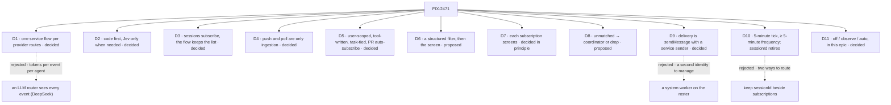

# FIX-2471 · Decisions

[Spec](SPEC.md) · **Decisions**

The owner decided D1–D4 on 2026-11-01. On 2026-11-02 the owner decided D5, D9, D11, D7 in
principle, the poll cadence in D10, and the closure's 5× bar. D6, D8 and the retirement half of
D10 are proposals. Two questions are [open](#open).

## The tree

## D1 · One webhook flow per service is the single routing point · decided 2026-11-01

| | |
|---|---|
| **Instead of** | DeepSeek's long-lived LLM router that sees every event · a binding per app that names a session |
| **Because** | It's a custom flow, not a token-driven agent, and most deliveries are a lookup. DeepSeek spends tokens per event per agent: without pass-through, their run used 31.8M cache-read tokens against 23.2M with it |
| **Locks in** | The flow routes and never decides new work ([D8](#d8)). One per provider, mounted by the app |

## D2 · Deterministic, pluggable checks first; the evaluator is the only model use · decided 2026-11-01

| | |
|---|---|
| **Because** | The fast path runs in code; the slow path runs on Jev only when a subscription's screen gets that far. No generator runs anywhere in routing |
| **Locks in** | The closure counts 0 generator calls in routing |

## D3 · Sessions subscribe and say what they care about; the service flow manages subscriptions · decided 2026-11-01

| | |
|---|---|
| **Locks in** | A session hears only events that pass its subscription. Fan-out is many-to-many: several sessions can follow one PR |

## D4 · Where webhooks are hard, the same flow polls; push and poll are only ingestion · decided 2026-11-01

| | |
|---|---|
| **Because** | Localhost has no public URL. Polling what subscriptions name gives the same normalized event to the same screens |
| **Locks in** | One dedupe key shared by push and poll, on the provider's object id and version (comment id plus `updated_at`, check-run id plus status). `X-GitHub-Delivery` exists only on push, so it can't be the shared key. It's a second key on the same mechanism as [FIX-2199](https://linear.app/fixpoint-labs/issue/FIX-2199) (webhook delivery dedupe and resume, under FIX-2171), which dedupes a repeated delivery id to its original run, and FIX-402 (idempotency). It isn't a second store. Cadence is [D10](#d10) |

## D5 · Subscriptions are a user-scoped resource the service flow owns · decided 2026-11-02

| | |
|---|---|
| **Instead of** | Org scope · session state on each subscriber, which the flow can't query |
| **Because** | A subscription runs with its user's credentials (the user's GitHub or Slack token for polling and for what the delivery may show), so it has to belong to that user (owner, 2026-11-02). The flow looks up "who follows repo#123" in one read. Writes go through tools only, so there's one door |
| **Locks in** | `subscribe` and `unsubscribe` are the service flow's tools, not task tools, so FIX-2056's five-tool bar holds. A subscription tied to a FIX-2056 task ends when the task ends (the claim gate or the drain). A standing subscription, such as a coordinator's, lasts until it's removed. **The GitHub flow subscribes a coding task to its PR automatically when the PR opens** (owner, 2026-11-02). It finds the task from the record the task writes when it opens the PR |

## D6 · A structured filter selects; the screen decides · proposed

| | |
|---|---|
| **Because** | A subscription names at least a provider and a thread or channel, and optionally kinds. That's an index lookup at zero tokens, so the screen ([D7](#d7)) never sees the firehose. A sentence ("review feedback") is compiled into config screens at subscribe time when it can be, with one Jev call then and none per event |
| **Locks in** | A subscription with only a sentence is refused |

## D7 · Each subscription screens what reaches it · decided in principle 2026-11-02; the mechanism is a lean

| | |
|---|---|
| **Because** | Fan-out puts outside text into a session's context. DeepSeek admits prompt injection is unsolved, and their fan-out checks no sender. The owner wants each subscription to screen activity |
| **The lean (owner, 2026-11-02)** | A **router block** runs each subscription's screens in order. First **config screens**: deterministic, zero tokens, the **sender check** among them. Then any **custom screen blocks** the app provides. If neither decides, a basic **Jev check**: "is this noise, or does it carry useful content" (or the subscription's stated interest). Across all subscriptions an event reaches, the Jev questions go in **one evaluator call** |
| **Locks in** | A delivered message carries its sender and an "outside content" mark. A config screen's refusal is final, so no model sees a refused sender's text. **The default policy (who passes, and public-repo outsiders) is [Q1](#open)** |

## D8 · An unmatched event goes to the coordinator or is dropped · proposed

| | |
|---|---|
| **Because** | Deciding new work is the coordinator's job ([FIX-1786 D2](../FIX-1786/DECISIONS.md#d2)). The flow forwards an unmatched event only for the kinds the app's config lists (for example, a mention of the bot) |
| **Locks in** | The service flow never calls `createTask`. Dropped events are counted, not stored. What the coordinator does with them is [D11](#d11) |

## D9 · Delivery is `sendMessage`, which accepts a service-flow sender · decided 2026-11-02

| | |
|---|---|
| **Instead of** | A system worker on the roster · a second delivery path |
| **Because** | `sendMessage` already does owed delivery, the log row and the crash-safe `id` (`packages/workforce/src/messages/send-message.ts`), so there's still one public messaging API |
| **The minimal change** | Today a sender must be a worker session (`not_a_worker`), and each send spends FIX-1989's budget of one per message a user types (`hop.ts`). Add a server-only sender kind, `service: <flowKind>`, that never comes from a model's input. It doesn't touch the hop budget; it has its own cap per subscription per window. It uses the D4 dedupe key as the message `id`, so a redelivery is one message. It never asks for a reply. Recipient checks (the roster, `task_sessions_only`) apply as they do today, read as "the recipient's session belongs to the subscription's user" |
| **Locks in** | No roster worker for the flow. The Messages view shows the service as the sender |

## D10 · Polling: a 5-minute tick polls what's due; `sessionId` retires

| | |
|---|---|
| **Cadence · decided 2026-11-02** | Every 5 minutes, a tick reads the subscriptions and polls the ones due by their own frequency. A subscription's frequency is 5 minutes or longer, never shorter. Each keeps a persisted cursor (last-seen id or `updated_at`). Polls batch by repository or channel |
| **`sessionId` · proposed** | It retires, so there's one public way to route. Today only the guides and `goals/webhook-transport/` use it; no app on `main` declares `webhooks:`. Migration: a binding that sets `sessionId` becomes a subscription the app creates at startup for that thread key. It's deprecated for one minor version, then removed. Existing sessions keep their ids |

## D11 · Explicit vs inferred work: off, observe, auto, in this epic · decided 2026-11-02

| | |
|---|---|
| **Instead of** | Leaving it for a later epic |
| **Because** | So the epic delivers something complete and well built (owner, 2026-11-02). This follows the shape of DeepSeek's prototype: explicit requests are accepted in every mode, and inferred work is accepted only in `auto` |
| **Locks in** | A setting on the coordinator, not the service flow, defaulting to `observe`. `observe` writes a "would accept" item to the FIX-2058 Inbox and files nothing. `auto` files the task. Explicit means the event addresses the agent and passes the config screens' sender rule. It's child 6 |

## Open for the owner

- **Q1.** The default screening policy: who passes by default (org members and listed bots?),
  and what about outsiders on public repos?
- **Q2.** The screen mechanism's contract: the config screens' schema and the custom screen
  block's input and output. D7 records the lean; child 5 drafts the contract for approval.
