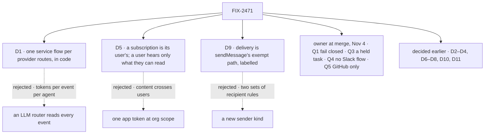

# FIX-2471 · Decisions

[Spec](SPEC.md) · **Decisions**

## The tree

## D1 · One service flow per provider routes, in code · owner, Nov 1

| | |
|---|---|
| **Instead of** | DeepSeek's LLM router that sees every event · a per-app binding that names a session |
| **Because** | Most deliveries are a lookup. DeepSeek's router pays per event per agent: 31.8M cache-read tokens without pass-through, 23.2M with |
| **Locks in** | The flow routes and never decides new work ([D8](#d8)); the app mounts one per provider |

**What would change my mind:** the [kill line](SPEC.md#the-goal-and-how-well-know-its-met).

It comes down to cost: the router's spend grows with every event.

## D5 · A subscription is its user's, who hears only what they can read · owner, Nov 2; EM, Nov 3

| | |
|---|---|
| **Instead of** | One app token at org scope · state on each subscriber, which the flow can't query |
| **Because** | It runs on its user's credentials (owner): checked at subscribe, and an event or a poll reaches only users who can read the thread ([ER-4](#who-owns-what)) |
| **Locks in** | Only `subscribe` and `unsubscribe` write, so FIX-2056's five-tool bar holds. A coding task subscribes to its PR when it opens (owner) |

It comes down to a private repo: on one app token, its content reaches a user who can't read it.

## D9 · Delivery is `sendMessage`'s exempt path, server-labelled · owner, Nov 2; EM, Nov 3

| | |
|---|---|
| **Instead of** | A new sender kind, `service:<flowKind>`, with its own budget · a roster worker |
| **Because** | The `exempt` path (`send-message.ts` ~249) already skips the hop budget and takes a crash-safe `id` ([D4](#d4)). Added: the label in the worker-id slot (~289), a subscriber check, a per-subscription cap |
| **Locks in** | No roster worker, one messaging API, the service as sender (owner). FIX-2070 edits the same function ([seam](#coordination-seams)) |

It comes down to where recipient rules live: a second sender kind keeps a second copy in step.

## Open

None at this altitude. Q2, the screen contract, is settled at FIX-2534's spec gate.

## Decided by the owner at merge, Nov 4

The owner merged #4515 with these four written as recommendations; the merge decided them.

### Q1 · Fail closed: who gets through a screen by default · owner, Nov 4

- **In plain terms:** does a coding task hear an outsider's comment on a public repo? Child 1
  needs the answer.
- **The trade-off:** fail open puts unscreened outside text into a coding task's context.
- **Decided: fail closed.** Members, collaborators and listed bots pass; outsiders need
  an opt-in.
- **What would change my mind:** an app whose core job is triaging outsiders' issues.
- **If wrong:** that app hears nothing until it opts in.

### Q3 · In `observe`, a held task, not an Inbox item with no task · owner, Nov 4

- **In plain terms:** the Inbox lists only task-row holds (`orchestration/src/inbox/check.ts`),
  so a taskless item is a new source.
- **The trade-off:** A adds that source and files nothing (the owner's wording); B files the task
  held on a confirm, and nothing runs until a person says yes.
- **Decided: B.** The Inbox stays as it is; "files nothing" becomes "runs nothing".
- **What would change my mind:** held rows cluttering the board for people who never accept.
- **If wrong:** rows nobody accepts, or under A, a second Inbox source.

### Q4 · No Slack flow; the event shape is proved without it · owner, Nov 4

- **In plain terms:** the Slack child proved the event isn't GitHub-shaped; child 1 checks that
  against Slack's payload, and the closure keeps Slack-shaped fixtures.
- **The trade-off:** that proof with no second flow, against Slack routing at wrap.
- **Decided: Not doing.** The #support journey becomes a GitHub one.
- **What would change my mind:** a committed user needing Slack this quarter (one more child).
- **If wrong:** that user waits for its own epic.

### Q5 · Retire `sessionId` only where a service flow routes · owner, Nov 4

- **In plain terms:** the Stripe and Slack guides and `keeping-a-flow-running.md` also set
  `sessionId`, and no flow replaces them.
- **The trade-off:** a Stripe customer keeps one session, against one way to route.
- **Decided: only where a flow routes.** GitHub loses it; Stripe, Slack and custom
  bindings keep it.
- **What would change my mind:** every provider in the guides getting a flow.
- **If wrong:** two ways to route, or each Stripe event in a fresh session.

<b>Decided earlier, not on the sign-off</b> · D2–D4, D6–D8, D10, D11

**D2 · Deterministic checks first; the evaluator is the only model use** (owner, Nov 1).

**D3 · Sessions subscribe; the service flow keeps the list** (owner, Nov 1). Fan-out is
many-to-many.

**D4 · Push and poll are only ingestion; two dedupe questions** (owner, Nov 1; EM, Nov 3). Seen
by this subscription? Its last-seen version. Got by this recipient? A `sendMessage` id
`<object>@<version>:<session>` on the log's `getOrCreate` (~298, ~394). No new store.

**D6 · A structured filter selects; the screen decides.** Provider, thread and optional kinds
select at zero tokens; a sentence compiles to config screens where it can, and alone is refused.

**D7 · The screen chain is a sequencer, not a router** (order, owner, Nov 2; kind, EM, Nov 3). It
stops at the first refusal: config screens via `.stepIf`, custom screens, then one Jev
evaluator; messages carry their sender and an "outside content" mark. Implementer note:
the one Jev call per event returns a structured verdict per subscription; a failed call refuses
or holds, never falls back to N calls or a generator, and the closure asserts ≤1 evaluator call
per normalized event.

**D8 · An unmatched event goes to the coordinator, or is dropped.** Only kinds the app lists are
forwarded; drops are counted. The service flow never calls `createTask`.

**D10 · Polling runs on per-user schedule rows** (cadence, owner, Nov 2; rows, EM, Nov 3). Each
subscription is a row (`defineScheduleCollection`, `createResourceCollectionScheduleResolver`,
`onOverlap: "skip"`); the 5-minute floor is checked at subscribe. Implementer notes: the poll
walks the resolver's due index, not every subscription; conditional requests, per-repo batching;
check runs on terminal state, comment edits once per object.

**D11 · Explicit vs inferred work** (owner, Nov 2). `off`, `observe`, `auto`: one key beside
`routing`, default `observe`. Explicit work (addresses the agent, passes the sender rule) runs in
every mode; inferred only in `auto`.

## Who owns what

Child 1, the seam, owns six; a *uses* cell is a place a child must not re-decide.

| # | Rule every child obeys | Owner | Checked at |
|---|---|---|---|
| ER-1 | No generator in routing; Jev is one evaluator call per event | Child 4 (D2, D7) | Spec reviews; closure ledger |
| ER-2 | The service flow never files a task | Child 5 (D8) | Closure, leg d |
| ER-3 | One messaging API: `sendMessage`, no roster worker | Child 1 (D9) | Spec reviews |
| ER-4 | Users subscribe to and hear only threads they can read; nothing crosses users | Child 1 (D5) | Children 3, 4; closure's two users |
| ER-5 | Only `subscribe` and `unsubscribe` write subscriptions | Child 1 (D5) | Children 2, 5 |
| ER-6 | One normalized event over `WebhookInboundEvent` | Child 1 (D4) | Children 2, 3 |
| ER-7 | A task's subscription ends with the task | Child 1 (D5) | Closure |
| ER-8 | Seen once per subscription, sent once per session | Child 1 (D4) | Closure, leg c |

## Coordination seams

| Seam | Between | Rule |
|---|---|---|
| `sendMessage` | Child 1, [FIX-2070](https://linear.app/fixpoint-labs/issue/FIX-2070) (In Development) | The second to land rebases onto the other's `exempt` path |
| The subscription row | Children 1, 3 | Child 1 owns it; child 3 adds schedule fields and last-seen version |
| The event shape | Children 1, 2, 3 | Child 1 fixes it; push and poll map into it |
| Coordinator config | Child 5, FIX-1786 | One key beside `routing` |

## Decided in review, recorded so no child reopens them

EM, Nov 3: [D4](#d4)'s two dedupes · [D5](#d5)'s credentials · [D7](#d7)'s sequencer, Q2 at
child 1's gate · [D9](#d9)'s exempt path · [D10](#d10)'s rows · the 5× bar's fixed tokenizer ·
`sessionId`'s retirement in the GitHub child · the reuse calls in
[SPEC](SPEC.md#whats-already-here-and-the-debt)'s Adds table.

Owner, Nov 4, by merging: [Q1](#q1) fail closed · [Q3](#q3) a held task · [Q4](#q4) no Slack
flow · [Q5](#q5) GitHub only.

## What the end-state POC showed

None built.

## How it got here

- **Drafted (Nov 1).** D1–D4, by the owner.
- **Owner (Nov 2).** D5, D7's order, D9, D10's cadence, D11, the 5× bar.
- **Review (Nov 2–3).** The EM calls above. Seven children became five (`sessionId` into the
  GitHub child, Slack out). Q1, Q3, Q4 opened, then Q5 from the guides.
- **Merged (Nov 4).** The owner merged #4515 with Q1, Q3, Q4 and Q5 as recommended, which
  decided them. The set was filed as FIX-2534 to FIX-2539.
