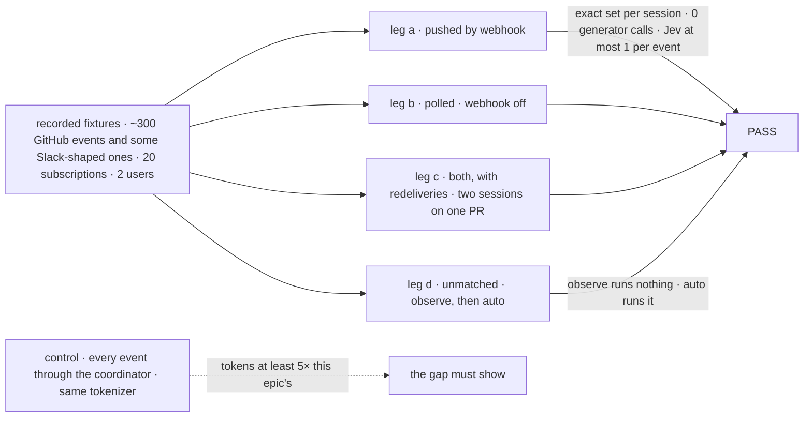
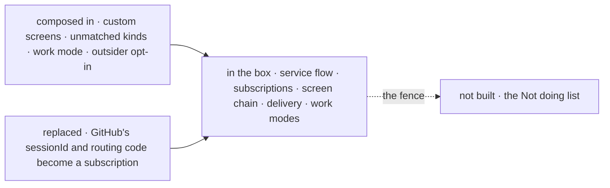
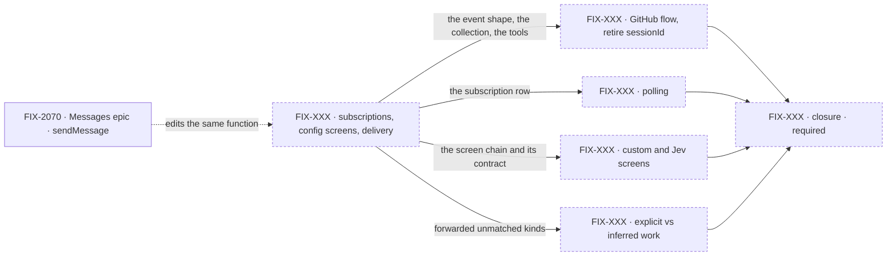

# FIX-2471 · An outside event reaches the sessions that asked for it, and nothing else spends a token on it

**Spec** · [Decisions](DECISIONS.md)

> The owner decided D1–D4 (2026-11-01) and D5, D7's order, D9, D10's cadence, D11 and the 5× bar
> (2026-11-02). The EM made eight engineering calls on 2026-11-03 ([in review](DECISIONS.md#decided-in-review-recorded-so-no-child-reopens-them)).
> Four forks are live: [Q1](DECISIONS.md#q1), [Q3](DECISIONS.md#q3), [Q4](DECISIONS.md#q4), [Q5](DECISIONS.md#q5).

## Five teams, before and after

| A team that… | Today | After this epic |
|---|---|---|
| **has a coding task with a PR open** | A webhook reaches the one session `sessionId(event)` names, not the task's | The task follows its PR from when it opens; a review that passes the screen lands in its session |
| **runs Shift Manager on a laptop** | No public URL, so no webhook arrives | The same flow polls, at most every 5 minutes, through the same screens |
| **cares about something fuzzy** ("tell me if anyone reports a crash in issues on repo X") | Writes a binding and a generator that reads every issue | Subscribes with that sentence. Jev reads only what config screens pass, one call per event |
| **wants the coordinator to notice unasked work** | Only asked-for work gets done | An unmatched event reaches it. `observe` files it held for a yes ([pending](DECISIONS.md#q3)); `auto` runs it |
| **maintains the framework** | A per-binding function returns a session id. Nothing dedupes or fans out | A flow per provider routes, `sessionId` leaves GitHub ([Q5](DECISIONS.md#q5)), `sendMessage` stays the one messaging API |

**Why now.** On Nov 1 DeepSeek's "Super-agent" write-up routed outside events with an LLM router
that sees every event, and its own ablation found passing follow-ups straight to subscribers cut
tokens by 27%. Our coordinator, tasks and messages are on `main`; the code path that decides who
hears an event is not.

## The goal, and how we'll know it's met

**Outcome: a coding task, a coordinator or a lab hears about a PR review, a CI result or a message
it follows, with nobody relaying it and no model reading every event.**

| Is it the right goal? | |
|---|---|
| **The real need** | Sessions act on reviews, CI and chat with no one relaying, and cost stays flat as sessions multiply |
| **Smaller, and rejected** | Keep `sessionId` and derive the task's session. One event still reaches one session, nothing dedupes, nothing works on localhost |
| **Bigger, and not this epic's** | The Not doing list below |
| **Not done if** | A config-screened delivery calls a model · a generator routes · a session gets one event twice · two sessions on one PR don't each get it · a user gets a thread they can't read · a refused event is delivered · a subscription outlives its task or polls under 5 minutes · a GitHub event routes by `sessionId` ([pending](DECISIONS.md#q5)) · the service flow files a task · `observe` runs inferred work ([pending](DECISIONS.md#q3)) · a closure bug is open |

Leg c is the one a single dedupe key fails: the second session on a PR hears nothing. The control
is counted exactly as the epic is, so the gap can't be tuned.

| How we verify | |
|---|---|
| **Goal check** | The closure child, model-free (`mockEvaluationModel`), on one `main` commit after every other child merges |
| **Signal** | Legs a–c: each session's received set equals the fixture's; user B gets nothing from user A's private repo. The spend ledger: 0 generator calls, at most one evaluator call per event. Leg d ([pending](DECISIONS.md#q3)): `observe` files the task held on a confirm and runs nothing; `auto` runs it; explicit requests run in both |
| **The 5× bar** | Both paths count the context tokens they would put before a model: core's `createTiktokenCounter` on `cl100k_base` over delivered messages and Jev prompts, plus one per-call overhead for the control. Both are fixture inputs; the mock's usage is never read |
| **Anti-game** | Assert on each session's stored messages and the board's rows, not on `deliver` calls. Leg c reuses `X-GitHub-Delivery` and polls the same objects |
| **Control that must fail** | `sessionId` on today's `main`: leg a FAILS. Every event through the coordinator: at least 5× the tokens |

**Lead measure:** the set's goal-proven children, named. None today, of children 1–5 (not filed).

**Not doing:** a generator in routing · the service flow filing a task · a second messaging API or
a roster worker · push to screens (FIX-2367) · identity across providers · a Slack service flow
([pending](DECISIONS.md#q4)) · long-term memory or a watchdog.

**Kill line:** if the control comes in under 5× counted the same way, or config screens decide
under half the fixture's deliveries, a coordinator with a filter is the cheaper build and we stop.
Child 1's goal check reports that share before child 4 starts.

## What's in the box

Inside the box is what an app gets by mounting one flow per provider; the fence is the Not doing list.

**Docs:** the GitHub webhook guide teaches subscribe, and `webhook-transport.md` drops `sessionId`.
Child 2 publishes both; each child documents its own specifics.

## The set · as of 2026-11-03

Children are filed after this gate; live state will be in Linear.

| Child | What it delivers | Why the set needs it | Status |
|---|---|---|---|
| FIX-XXX · subscriptions, config screens, delivery | Event shape, collection, tools, the screen chain with the sender check ([Q1](DECISIONS.md#q1)) and screen contract (Q2, at its spec gate), delivery, task endings, both dedupe answers | The seam every child is written against | Not filed |
| FIX-XXX · GitHub flow, retire `sessionId` | The binding, normalization, thread keys, a version policy per kind, PR-open subscribe; `sessionId` removed from GitHub ([Q5](DECISIONS.md#q5)) | The first provider; one way to route it | Not filed |
| FIX-XXX · polling | Per-user schedule rows, the 5-minute floor | Localhost | Not filed |
| FIX-XXX · custom and Jev screens | Custom screen blocks; one evaluator call per event | Fuzzy interests, priced | Not filed |
| FIX-XXX · explicit vs inferred work | `off`, `observe`, `auto` on forwarded unmatched kinds | The one child routing doesn't need; the owner kept it | Not filed |
| FIX-XXX · closure · **required** | The four legs and each team's journey | The only child that runs the set | Not filed |

Five and a closure, down from seven: `sessionId`'s retirement folded into the GitHub child, and
Slack is in Not doing ([pending](DECISIONS.md#q4)). If five is four, child 5 is the one to cut.

## How the issues flow into each other

An edge is what one child hands the next; a dashed node isn't filed yet, and FIX-2070 is another
epic's input. Child 1 goes first, then 2 to 5 in parallel.

## What stays as it is

- `when` on a binding, the signature check, and the Stripe and Slack guides (under [Q5](DECISIONS.md#q5)'s recommendation).
- The coordinator's `routing` policies (FIX-1786), and the Inbox (FIX-2058) under the recommended fork.
- The realtime bus (FIX-2367): it tells screens to read again; this tells sessions what happened.

## What's already here, and the debt

| Already here | What the set does with it |
|---|---|
| Webhook transport (`engine/src/transports/webhook/`) | **Builds on** the signature check, `deliveryId` and `when`; `sessionId` **retires** from GitHub, and elsewhere per [Q5](DECISIONS.md#q5) |
| `runOnce`, keyed by `(requestId, key)`, cross-request out of scope (`core/src/types/block.ts` ~530); [FIX-2199](https://linear.app/fixpoint-labs/issue/FIX-2199) (Backlog) | **Not used:** a push and a poll are different requests. FIX-2199 is related, not a prerequisite ([D4](DECISIONS.md#d4)) |
| `workforce/src/fit-check.ts`, which falls back to a generator | **Fenced off**; the evaluator alone is used |
| Task endings (FIX-2056); the Inbox, reading task-row holds (`orchestration/src/inbox/check.ts`) | **Builds on** both |

| Adds | Existing piece considered | How composed |
|---|---|---|
| The normalized event | `WebhookInboundEvent` (`core/src/types/webhooks.ts`) | **Extends:** the action's input schema over it |
| Subscriptions | The message log (`workforce/src/messages/message-log.ts`) | **Reuses** a user-scoped `defineResourceCollection` |
| `subscribe`, `unsubscribe` | `workforce/src/standing-rules/rules-capability.ts`; `matchTopic` (`patterns/src/eventActors/`) | **Reuses** the tool shape, and the matcher where it fits |
| The screen chain | The router kind (`docs/architecture/blocks.md` ~392) | **Reuses** a sequencer: a screen stops at the first refusal ([D7](DECISIONS.md#d7)) |
| Delivery | `sendMessage`'s `exempt` path (`send-message.ts` ~249) | **Extends** ([D9](DECISIONS.md#d9)) |
| Polling | Static schedules, which run as a system principal (`core/src/types/schedules.ts`) | **Reuses** per-user schedule rows (`workforce/src/schedules/scheduled-work.ts`, [D10](DECISIONS.md#d10)) |
| The work mode | `routing` (`workforce/src/coordinator/coordinator-config.ts`) | **Extends:** one key beside it |
| The GitHub service flow | A per-app binding | **New** |

| The debt | |
|---|---|
| **Adds** | One service flow, one collection, two tools, a screen chain, a label and cap on the exempt send, one coordinator key |
| **Removes** | `sessionId` on GitHub bindings, the GitHub guide's routing code, the "dedupe later" gap |
| **Leaves** | `when` on bindings; `sessionId` for providers with no flow, pending [Q5](DECISIONS.md#q5) |

**Net: up, by one routing layer.** No new store, sender kind or event type.

## Sign off

**[The goal](#the-goal-and-how-well-know-its-met):** no one relays, no model reads every event.
If wrong: a router that saves nothing over a coordinator. **[The debt](#whats-already-here-and-the-debt):**
up one layer. If wrong: a store or sender kind creeps back in a child.

1. **[D1](DECISIONS.md#d1) · One service flow per provider routes, in code.** If wrong: the kill
   line fires, and a filtered coordinator was the build.
2. **[D5](DECISIONS.md#d5) · A subscription is its user's, and a user hears only what they can read.**
   If wrong: one user's private repo reaches another's session.
3. **[D9](DECISIONS.md#d9) · Delivery is `sendMessage`'s exempt path with a source label.** If wrong:
   recipient rules drift between two senders.

**Open:** [Q1 · who passes a screen](DECISIONS.md#q1) (recommend fail closed) ·
[Q3 · what `observe` writes](DECISIONS.md#q3) (recommend a held task) ·
[Q4 · Slack](DECISIONS.md#q4) (recommend Not doing) ·
[Q5 · `sessionId`'s scope](DECISIONS.md#q5) (recommend GitHub only).

Epic · 5 children and a closure · Inbound Transports & Reactive Flows · Webhooks / Workforce
