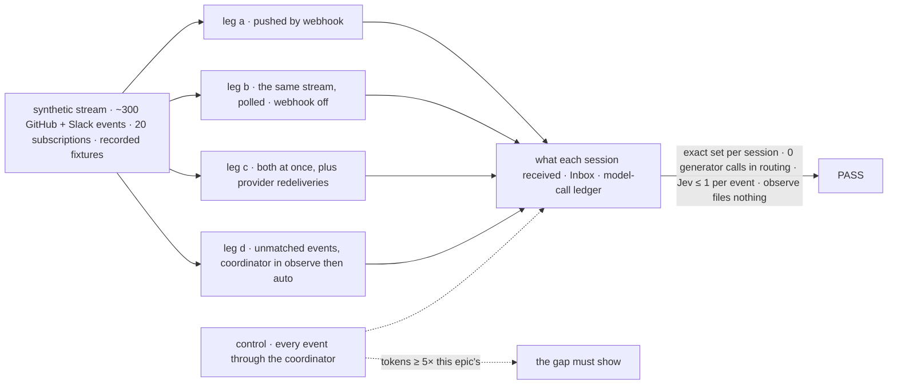

# FIX-2471 · An outside event reaches the sessions that asked for it, and nothing else spends a token on it

**Spec** · [Decisions](DECISIONS.md)

> Proposal for [FIX-2471](https://linear.app/fixpoint-labs/issue/FIX-2471). The owner decided D1–D4 on
> 2026-11-01, and D5, D7, D9, D10's poll cadence, D11 and the closure bar on 2026-11-02.
> D6, D8 and D10 are the architect's shaping. Two questions stay open ([Open](DECISIONS.md#open)).

## Five teams, before and after

| A team that… | Today | After this epic |
|---|---|---|
| **has a coding task with a PR open** | A GitHub webhook runs one binding in the one session that `sessionId(event)` names (`packages/core/src/types/webhooks.ts`; the guide's `` `${repo}#${number}` ``). The task's own session hears nothing unless that string happens to be its id | When the PR opens, the GitHub flow subscribes the task to it. A review comment that passes the subscription's screen lands in the task's session as a message, with no generator involved |
| **runs Shift Manager on a laptop** | No public URL, so no webhook ever arrives | The same GitHub flow polls the subscriptions that are due, on a 5-minute tick, and delivers the same events through the same screens |
| **has a session that cares about something fuzzy** ("tell me if anyone reports a crash in #support") | Writes its own binding, plus a generator that reads every message | Subscribes with a structured filter (Slack, #support) plus that sentence. Jev checks only the messages the filter and config screens pass, in one evaluator call per event |
| **wants the coordinator to notice work nobody asked for** | Only work someone asks for gets done | An unmatched event reaches the coordinator. In `observe` mode it records "would accept" in the Inbox; in `auto` it files the task |
| **maintains the framework** | Routing is a per-binding function that returns a session id. Nothing dedupes (`docs/architecture/webhook-transport.md`: "it does not dedup itself") and nothing fans out | One service flow per provider routes, subscriptions are its resource, one dedupe key covers push and poll, `sessionId` retires, and `sendMessage` is still the one messaging API |

**Why now.** On Nov 1 the DeepSeek Harness "Super-agent" write-up made the case for routing
outside events to the sessions working on them. It routes with a model: an LLM router sees every
event. Its own ablation shows that passing follow-ups straight to subscribed workers cuts tokens
by 27% at the same latency. Our coordinator (FIX-1786), tasks (FIX-2056) and messages (FIX-1989,
FIX-2070) are on `main`. What's missing is the code path that decides who hears an outside event,
without a generator.

## The goal, and how we'll know it's met

**An outside event, pushed or polled, reaches every session subscribed to it, only if it passes
that subscription's screen, and only once. Config screens cost no model calls. Jev, when a
subscription needs it, costs at most one evaluator call per event. No generator routes anything.
Unmatched work goes to the coordinator, which accepts inferred work only in `auto`.**

| Is it the right goal? | |
|---|---|
| **The real need** | Coding tasks, coordinators and labs act on PR reviews, CI and chat without a person relaying them, and cost stays flat as sessions multiply |
| **Smaller, and rejected** | Keep `sessionId` and let the app derive the task's session id. Then one event still reaches one session, nothing dedupes, and nothing works on localhost |
| **Bigger, and not this epic's** | Long-term memory, a watchdog, speculative background work, mapping identities across providers |
| **Not done if** | A config-screened match calls any model · a generator runs in routing · an event reaches a session twice (push plus poll, or a provider redelivery) · an event a subscription's screen refuses reaches its session · a subscription outlives its closed task · a subscription polls more often than every 5 minutes · two public ways to route a webhook remain (`sessionId` beside subscriptions) · two messaging APIs exist · the service flow files a task · inferred work is accepted outside `auto` · a closure bug is open |

| How we verify | |
|---|---|
| **Goal check** | The closure child runs model-free, with a mock evaluation model (`packages/testing/src/mocks/mockEvaluationModel.ts`), on one `main` commit after every other child merges |
| **Signal** | In legs a–c, each session's received set equals the fixture's expected set. The spend ledger (`docs/architecture/blocks.md`, "spend ledger") shows 0 generator calls in routing and evaluator calls ≤ the events that reached a Jev screen. Leg d: `observe` writes "would accept" Inbox items and no tasks; `auto` files exactly the accepted ones; explicit requests are filed in both modes |
| **Anti-game** | Assert on the messages each session's store holds and the rows the Inbox shows, not on calls to `deliver`. Leg c redelivers with the same `X-GitHub-Delivery` and polls the same objects |
| **Control that must fail** | `sessionId` routing on today's `main`: leg a must FAIL, because one session hears the event and the task doesn't. With every event sent through the coordinator, routing must cost **at least 5×** this epic's tokens (owner, 2026-11-02) |

## What's in the box

- **A service flow per provider** (GitHub first, then Slack). The app mounts it once. It owns
  ingestion (push and poll), normalization, subscriptions, screening and delivery ([D1](DECISIONS.md#d1)).
- **One normalized event**: provider, kind, thread (repo#PR, channel plus thread ts), object id
  and version, sender, payload. Push and poll both produce it ([D4](DECISIONS.md#d4)).
- **A user-scoped subscriptions resource**, run with the user's credentials. Sessions change it
  only through `subscribe` and `unsubscribe`. A subscription tied to a task ends when the task ends.
  The GitHub flow subscribes a coding task to its PR when the PR opens ([D5](DECISIONS.md#d5)).
- **A screen per subscription**, run by a router block: config screens first (sender included),
  then the app's custom screen blocks, then a Jev check for noise or for the subscription's
  stated interest ([D6](DECISIONS.md#d6), [D7](DECISIONS.md#d7)).
- **Delivery through `sendMessage`**, which gains a service-flow sender with its own budget
  ([D9](DECISIONS.md#d9)). Unmatched events go to the coordinator or are dropped ([D8](DECISIONS.md#d8)).
- **Polling** on a 5-minute tick that polls the subscriptions that are due. No subscription
  polls more often than every 5 minutes. Each keeps a cursor, and a dedupe key is shared with
  push ([D10](DECISIONS.md#d10)).
- **Explicit vs inferred work** on the coordinator: `off`, `observe` and `auto`, with "would
  accept" in the FIX-2058 Inbox ([D11](DECISIONS.md#d11)).

**Not built, below a fence:** a generator in routing; the service flow filing tasks; a second
message API or a roster system worker; push to screens (FIX-2367's job); cross-provider identity.

**Docs:** `apps/docs/guides/webhooks-github.md` and `webhooks-slack-events.md` are rewritten
around subscribe. `docs/architecture/webhook-transport.md` drops `sessionId` and gains the dedupe key.

## The set · proposed

| Child | What it delivers | Why the set needs it |
|---|---|---|
| **1 · subscriptions, config screens, direct delivery** | The normalized event; the user-scoped resource; `subscribe` and `unsubscribe`; the screen router block with config screens (sender included); `sendMessage`'s service-flow sender; ending with the task; the routing dedupe key, on FIX-2199's mechanism | The seam every other child is written against |
| **2 · GitHub service flow (push)** | The webhook binding; normalization for PR reviews, comments, CI and pushes; thread keys; auto-subscribing a coding task to its PR when the PR opens | The first real provider. Shift Manager's coder needs it |
| **3 · polling ingestion** | The 5-minute tick (`packages/core/src/types/schedules.ts`), per-subscription frequency of 5 minutes or more, cursors | Localhost and hosts with no public URL |
| **4 · Slack service flow** | The same flow for Slack, push and poll | Proves the contract isn't GitHub-shaped |
| **5 · custom screens and the Jev screen** | The custom screen block contract; the Jev fallback (noise, or the stated interest), one evaluator call per event; a sentence compiled into a config screen at subscribe time where possible | Fuzzy interests, priced |
| **6 · explicit vs inferred work** | `off`, `observe` and `auto` on the coordinator for unmatched events; "would accept" items in the Inbox; `auto` files the task | So the epic delivers proactive work, not only routing |
| **7 · retire `sessionId`** | Removes the binding field, moves the guides and `goals/webhook-transport/`, adds a migration note | One way to route |
| **8 · closure · required** | The four legs and each team's journey | The only child that runs the whole set |

Child 1 goes first. 2 and 3 run in parallel, then 4, 5 and 6. Child 7 lands after 2 and 3. Every child blocks 8.

## What's already here, and the debt

| Already here | What the set does with it |
|---|---|
| Webhook transport: the signature check, `eventType`, `deliveryId`, `when`, `sessionId` (`packages/engine/src/transports/webhook/routes.ts`, `createWebhookTransportAdapter.ts`) | **Builds on** the check, the extractors and `when`. **Retires** `sessionId` |
| `deliveryId` is surfaced but nothing dedupes (`webhook-transport.md`: "composes later with FIX-402"). [FIX-2199](https://linear.app/fixpoint-labs/issue/FIX-2199) (Backlog, under FIX-2171) dedupes a repeated delivery id to its original run and makes a crashed webhook run continuable; it may share a mechanism with FIX-2172 | **Aligned, not duplicated.** One dedupe mechanism, FIX-2199's, holding two keys: the delivery id for a redelivered run, and this epic's object id and version ([D4](DECISIONS.md#d4)) for routing, since a polled object has no delivery id. FIX-2199 lands first or child 1 builds the mechanism to its spec |
| Schedules (`types/schedules.ts`, `@flow-state-dev/scheduled`) and recurring work (`packages/workforce/src/schedules/`) | **Builds on** for the tick: one tick runs one action that walks the due subscriptions |
| The router block kind and the evaluator block on Jev, one `experimental_evaluate` call (`docs/architecture/blocks.md`). Best fit already routes on Jev (`packages/shift-manager/teams/devteam/host.mts:986`) | **Builds on** for the screen step and its fallback |
| `sendMessage` (`packages/workforce/src/messages/send-message.ts`): owed delivery, the log row, the crash-safe `id`, `exempt` server messages. It refuses a non-worker sender (`not_a_worker`) and charges the per-user-message budget (`hop.ts`) | **Extended** with a service-flow sender and its own budget ([D9](DECISIONS.md#d9)) |
| The coordinator flow with `routing:` (`packages/workforce/src/coordinator/`, [FIX-1786 D2](../FIX-1786/DECISIONS.md#d2)) | **Extended** with the work modes ([D11](DECISIONS.md#d11)) |
| Task endings, which only the claim gate or the drain records (FIX-2056) | **Builds on**: an ending removes the task's subscriptions |
| The FIX-2058 Inbox | **Builds on** for "would accept". Waiting on a person stays there |
| The realtime bus (FIX-2367, FIX-2426) | **Not used.** It tells screens to read again; this tells sessions what happened. It follows the same pattern: push when possible, poll as the fallback |

| The debt | |
|---|---|
| **Adds** | One normalized event, one resource, two tools, one screen router, one dedupe store, two provider flows, one poll tick, one sender kind on `sendMessage`, one mode setting on the coordinator |
| **Removes** | `sessionId` on bindings, the per-app routing code in two guides, the "dedupe later" gap |
| **Leaves** | `when` on bindings, as the cheapest pre-filter before normalization |

**Net: up**, by one routing layer. It replaces a per-binding function and fills two gaps, fan-out and dedupe.

## Sign off

**The goal:** config-screened matches at zero tokens, dedupe across push and poll, one way to
route, one messaging API, and a routing cost at least 5× below the coordinator control. If this is
wrong, we've built a router that saves nothing over a coordinator.

**The debt: up** by one layer, and it removes `sessionId`.

Decided by the owner: [D1](DECISIONS.md#d1)–[D4](DECISIONS.md#d4) on 2026-11-01; [D5](DECISIONS.md#d5),
[D7](DECISIONS.md#d7) (in principle), [D9](DECISIONS.md#d9), [D10](DECISIONS.md#d10)'s cadence,
[D11](DECISIONS.md#d11) and the 5× bar on 2026-11-02. Proposed: [D6](DECISIONS.md#d6),
[D8](DECISIONS.md#d8), [D10](DECISIONS.md#d10)'s retirement half. **Open:** [two questions](DECISIONS.md#open).

Epic · 7 issues and a closure · Webhooks / Workforce
