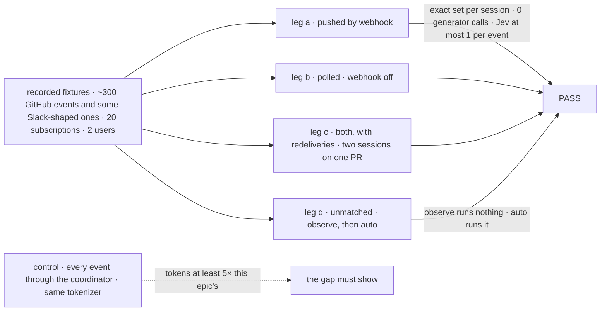
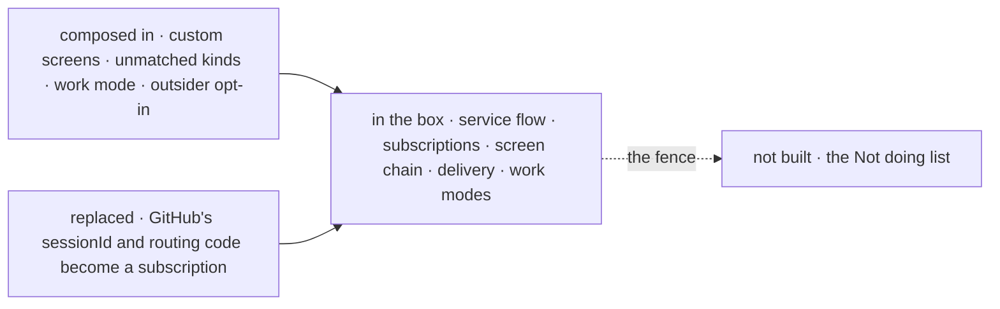
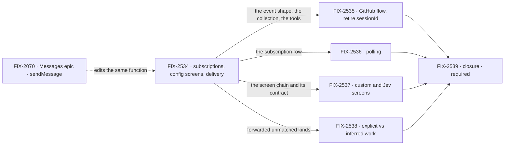

# FIX-2471 · An outside event reaches the sessions that asked for it, and nothing else spends a token on it

**Spec** · [Decisions](DECISIONS.md)

## Five teams, before and after

| A team that… | Today | After this epic |
|---|---|---|
| **has a coding task with a PR open** | A webhook reaches whichever session `sessionId(event)` names | The task follows its PR; a screened review lands in its session |
| **runs Shift Manager on a laptop** | No public URL, no webhook | The same flow polls, at most every 5 minutes |
| **cares about something fuzzy** ("crash reports on repo X") | A generator reads every issue | Subscribes with that sentence; Jev reads only what config screens pass |
| **wants the coordinator to notice unasked work** | Only asked-for work happens | `observe` files it held ([Q3](DECISIONS.md#q3)); `auto` runs it |
| **maintains the framework** | A binding returns a session id; nothing dedupes | A flow per provider routes; `sendMessage` stays the one messaging API |

**Why now.** On Nov 1 DeepSeek's "Super-agent" write-up routed with an LLM that sees every event;
its own ablation found passing follow-ups straight to subscribers cut tokens 27%. Our
coordinator, tasks and messages are on `main`; who hears an event is not.

## The goal, and how we'll know it's met

**Outcome: a coding task, a coordinator or a lab hears about a PR review, a CI result or a message
it follows, with nobody relaying it and no model reading every event.**

| Is it the right goal? | |
|---|---|
| **The real need** | The same, with cost flat as sessions multiply |
| **Smaller, and rejected** | Derive the task's session from `sessionId`: still one session per event, no dedupe, no localhost |
| **Bigger, and not this epic's** | The Not doing list below |
| **Not done if** | A config-screened delivery calls a model, or a generator routes · a session gets an event twice, or misses one on its PR · a user gets a thread they can't read, or a refused event · a subscription outlives its task (per [ER-7](DECISIONS.md#er7) once signed) or polls under 5 minutes · GitHub routes by `sessionId` · the flow files a task, or `observe` runs inferred work · a closure bug is open |

Leg c is the one a single dedupe key fails: the second session on a PR hears nothing.

| How we verify | |
|---|---|
| **Goal check** | The closure child, model-free (`mockEvaluationModel`), on one `main` commit after the rest merge |
| **Signal** | Each session's set equals the fixture's; user B gets nothing of user A's private repo; 0 generator calls, ≤1 evaluator call per normalized event |
| **The 5× bar** | Context tokens each path would put before a model, by `createTiktokenCounter` on `cl100k_base`, plus a per-call overhead for the control |
| **Anti-game** | Assert on stored messages and board rows, not `deliver` calls |
| **Control that must fail** | `sessionId` on today's `main` fails leg a |

**Lead measure:** goal-proven children, named. None yet.

**Not doing:** a generator in routing · a flow that files tasks · a second messaging API or
roster worker · push to screens (FIX-2367) · cross-provider identity · a Slack flow
([Q4](DECISIONS.md#q4)) · long-term memory or a watchdog.

**Kill line:** a control under 5×, or config screens deciding under half the deliveries, means a
filtered coordinator is cheaper, and we stop. Child 1 reports that share before child 4 starts.

## What's in the box

An app gets the box by mounting one flow per provider.

**Docs:** the GitHub webhook guide teaches subscribe and `webhook-transport.md` drops `sessionId`,
both published by child 2.

## The set · as of 2026-11-04

Filed at this gate; live state is in Linear.

| Child | What it delivers | Why the set needs it | Status |
|---|---|---|---|
| [FIX-2534](https://linear.app/fixpoint-labs/issue/FIX-2534) · subscriptions, config screens, delivery | Event shape, collection, tools, the chain with its sender check ([Q1](DECISIONS.md#q1)) and contract (Q2), delivery, task endings ([ER-7](DECISIONS.md#er7), pending), both dedupes | The seam | Ready to Spec |
| [FIX-2535](https://linear.app/fixpoint-labs/issue/FIX-2535) · GitHub flow, retire `sessionId` | Binding, normalization, thread keys, versions, PR-open subscribe ([Q5](DECISIONS.md#q5)) | The first provider | Ready to Spec |
| [FIX-2536](https://linear.app/fixpoint-labs/issue/FIX-2536) · polling | Per-user schedule rows, the 5-minute floor | Localhost | Ready to Spec |
| [FIX-2537](https://linear.app/fixpoint-labs/issue/FIX-2537) · custom and Jev screens | Custom screen blocks; one evaluator call per event | Fuzzy interests, priced | Ready to Spec |
| [FIX-2538](https://linear.app/fixpoint-labs/issue/FIX-2538) · explicit vs inferred work | `off`, `observe`, `auto` on forwarded unmatched kinds | Not routing; the owner kept it | Ready to Spec |
| [FIX-2539](https://linear.app/fixpoint-labs/issue/FIX-2539) · closure · **required** | The four legs, each team's journey | Runs the whole set | Ready to Spec |

Down from [seven](DECISIONS.md#how-it-got-here). If five is four, cut child 5.

## How the issues flow into each other

Child 1 goes first, then 2 to 5 in parallel; FIX-2070 is another epic's input.

## What stays as it is

- `when`, the signature check, the Stripe and Slack guides ([Q5](DECISIONS.md#q5)).
- The coordinator's `routing` (FIX-1786); the Inbox (FIX-2058), under [Q3](DECISIONS.md#q3).
- The realtime bus (FIX-2367), which tells screens to read again.

## What's already here, and the debt

| Already here | What the set does with it |
|---|---|
| Webhook transport (`engine/src/transports/webhook/`) | **Builds on** the signature check, `deliveryId`, `when` |
| `runOnce`, keyed by `(requestId, key)` (`core/src/types/block.ts` ~530); [FIX-2199](https://linear.app/fixpoint-labs/issue/FIX-2199) | **Not used:** push and poll are different requests ([D4](DECISIONS.md#d4)) |
| `workforce/src/fit-check.ts`'s generator fallback | **Fenced off** |
| Task endings (FIX-2056); Inbox holds (`orchestration/src/inbox/check.ts`) | **Builds on** both |

| Adds | Existing piece considered | How composed |
|---|---|---|
| The normalized event | `WebhookInboundEvent` (`core/src/types/webhooks.ts`) | **Extends:** the action's input schema over it |
| Subscriptions | The message log (`workforce/src/messages/message-log.ts`) | **Reuses** a user-scoped `defineResourceCollection` |
| `subscribe`, `unsubscribe` | `workforce/src/standing-rules/rules-capability.ts`; `matchTopic` (`patterns/src/eventActors/`) | **Reuses** the tool shape, and the matcher where it fits |
| The screen chain | The router kind (`docs/architecture/blocks.md` ~392) | **Reuses** a sequencer ([D7](DECISIONS.md#d7)) |
| Delivery | `sendMessage`'s `exempt` path (`send-message.ts` ~249) | **Extends** ([D9](DECISIONS.md#d9)) |
| Polling | Static schedules, a system principal (`core/src/types/schedules.ts`) | **Reuses** per-user schedule rows (`workforce/src/schedules/scheduled-work.ts`, [D10](DECISIONS.md#d10)) |
| The work mode | `routing` (`workforce/src/coordinator/coordinator-config.ts`) | **Extends:** one key beside it |
| The GitHub service flow | A per-app binding | **New** |

| The debt | |
|---|---|
| **Adds** | The eight rows above |
| **Removes** | GitHub's `sessionId` and its guide's routing code; the "dedupe later" gap |
| **Leaves** | `sessionId` where no flow routes ([Q5](DECISIONS.md#q5)) |

**Net: up one routing layer.** No new store, sender kind or event type.

## Sign off

**[The goal](#the-goal-and-how-well-know-its-met).** If wrong: a router that saves nothing.
**[The debt](#whats-already-here-and-the-debt), up one layer.** If wrong: a store or sender kind
creeps back.

1. **[D1](DECISIONS.md#d1) · One flow per provider routes, in code.** If wrong: the kill line fires.
2. **[D5](DECISIONS.md#d5) · A user hears only what they can read.** If wrong: a private repo leaks.
3. **[D9](DECISIONS.md#d9) · Delivery is `sendMessage`'s exempt path.** If wrong: two sets of
   recipient rules.

**Open:** [ER-7](DECISIONS.md#er7).
Decided at merge: [Q1](DECISIONS.md#q1) · [Q3](DECISIONS.md#q3) ·
[Q4](DECISIONS.md#q4) · [Q5](DECISIONS.md#q5).

Epic · 5 children and a closure · Inbound Transports & Reactive Flows · Webhooks / Workforce
