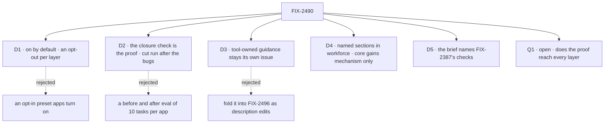

# FIX-2490 · Decisions

[Spec](SPEC.md) · **Decisions**

The calls that sit above any single child: what was chosen, what lost, why, and what each locks
in for the twelve children and the closure. D1 to D3 are the owner's, made before this spec was
written. D4 and D5 are engineering calls. Q1 is open.

## The tree

## D1 · New layers are on by default for every workforce worker, each with its own opt-out

| | |
|---|---|
| **Instead of** | An opt-in preset that our four apps turn on and outside apps never see |
| **Because** | The outcome is "without each app writing that guidance itself". A preset each app must find and switch on is a fifth thing every app writes. Pre-1.0, a behaviour change for existing workforce users is accepted (the owner's call, before this draft) |
| **Locks in** | Every workforce worker, ours or not, gets each section and pays its tokens every turn. Each section needs an opt-out ([ER-1](#who-owns-what)). The skills switches' "zero-configuration costs nothing" rule is reversed for the index |

**What would change my mind:** wanting workforce to stay unopinionated for outside users. Then
it is a preset, and our apps turn it on.

It comes down to who writes it: with a preset, every app still has to turn it on.

## D2 · No eval apparatus: the closure check is the proof, and its cut run decides what is built

| | |
|---|---|
| **Instead of** | A before/after eval of about 10 scripted tasks per app, scored by a judge, before any layer or content change |
| **Because** | The four closure scripts have to exist anyway. Run once after the six bugs merge, they show which asks the wiring alone fixed, which is the question the eval was for. The owner's call, before this draft |
| **Locks in** | Bugs first. The closure's scripts are built early, as its spec POC, so the cut run can happen before the closure is unblocked. Each bug blocks each layer in Linear. A layer whose ask passes on the cut run is cancelled, citing the run ([ER-6](#who-owns-what)). "Smarter" outside the four asks is not measured |

**What would change my mind:** a cut run that can't tell the layers apart, because every ask
passes or fails the same either way. Then the asks are too coarse, and a finer check is worth
its cost.

It comes down to reuse: the cut run is the closure's own scripts, run once earlier.

## D3 · Tool-owned guidance stays its own issue (FIX-2499)

| | |
|---|---|
| **Instead of** | Folding it into FIX-2496 as edits to the search, fetch and project-source descriptions (the coordinator's proposal) |
| **Because** | A description is printed for every tool in the list, so hints about other tools name tools a worker may not hold. A line shown only when the tool is held, and a cross-tool hint only when both are, is what the compared harnesses do. The owner's call, before this draft |
| **Locks in** | A core change, under [D4](#d4)'s rule: a tool with no guidance line prints as it does today. FIX-2499 is still under the kill line: if FIX-2496 alone passes the knowledge ask, it is cut |

**What would change my mind:** the cut run passing the knowledge ask with FIX-2496 alone. Then
the kill line cuts it, and that is the decision working, not reversing.

It comes down to absent tools: a description can't hide a hint about a tool you don't hold.

## D4 · Defaults live in workforce's worker flow as named sections; core gains mechanism only

| | |
|---|---|
| **Instead of** | Defaults in core's generator, so every app gets them, workforce or not · or each layer as its own prompt entry or capability |
| **Because** | [FIX-2369 ER-2](../FIX-2369/DECISIONS.md#who-owns-what) keeps the generator unopinionated, and that holds. The seam in `agent-worker-flow.ts` says an org-wide layer of configurable text is where the seam is re-decided rather than widened; per-layer opt-outs are that point. Named sections fix the "where does TEAM.md end" problem the analysis found |
| **Locks in** | One ordered list of named sections, each a fixed text with an opt-out, owned by FIX-2498. Still no registry and no app-supplied section text. A core change (FIX-2499, and anything FIX-2500 needs) is a no-op for a caller that sets nothing new |

Engineering, not asked: it moves no product outcome, and the sign-off's D1 already fixes who
gets the defaults.

## D5 · The coding brief names FIX-2387's checks; the code decides done, not the report

| | |
|---|---|
| **Instead of** | The brief carrying its own list of checks for the coder to run |
| **Because** | FIX-2387's `commandCheck` already runs a project's commands on the run's checkout and records the result. A second list drifts, and a coder's "tests passed" is a claim ([BP-003](../../../docs/contributing/best-practices.md)) |
| **Locks in** | FIX-2502's brief reads the commands from the same place `commandCheck` does. The closure's coder leg checks the report against that record. FIX-2502 waits for FIX-2387 to merge |

Engineering, not asked: one list of checks is the only answer the compose rule allows.

## Q1 · Open · Should the proof reach every layer the epic builds?

**Plain terms.** The proof has four asks: the date, a multi-file question, a coder's checks, a
cited source. Three things in the set are reached by none of them: answer sizing (half of
FIX-2498), the structured summary (FIX-2500) and the skills index (FIX-2501). Under the kill
line, a layer with no ask can't be cut at the cut run, and can't be proven at the wrap. It
ships unmeasured, which is what D2 exists to stop.

**The trade-off.** Three more asserts in the same scripts is adding to the proof, which is
your call. Moving the two layers out of the epic loses "keeps the thread" and "sees its skills"
from the epic's description, and leaves sizing unproven.

**My recommendation: add three asserts to the same scripts.** A one-line question gets a short
answer. A worker holding a skill that fits loads it without a slash. A decision made before a
summary fold is still used after it, in the two labs, where conversations run long. Still
`fsdev run`, still no eval apparatus.

**What would change my mind:** if you dropped compaction and skills from the outcome on purpose.
Then FIX-2500 and FIX-2501 move to *Not doing*, and sizing is proven by the closure's sweep.

**What being wrong costs.** Recommended and unneeded: three asserts and a seeded long
conversation, about a day. Not taken and needed: two layers ship that every worker pays for and
nobody showed to help.

It comes down to the kill line: it can only cut a layer that some ask reaches.

## Who owns what

Every rule has one owner. Read a row to see where a decision is made and where it is only
consumed; a *uses* cell is a place a child must not re-decide.

| # | Rule every child obeys | Owner | Checked at |
|---|---|---|---|
| ER-1 | Every new layer is a named section of workforce's default layer, on by default, with its own opt-out ([D1](#d1), [D4](#d4)). No section is a capability, a registry entry or app-supplied text | FIX-2498 decides · FIX-2497, 2500, 2501 consume | The spec-set review |
| ER-2 | Core gains mechanism, not defaults. A core change is a no-op for a caller that sets nothing new; workforce's worker flow is where it turns on | FIX-2499 · FIX-2500 consumes | FIX-2499's and FIX-2500's spec review |
| ER-3 | A layer that replaces an app's own patch deletes that patch in the same change: Kitchen Sink's `todaysDate`, an app's length line, a hand-built coding prompt | Each child | The closure's sweep |
| ER-4 | The coding brief's "check before done" names the commands FIX-2387's `commandCheck` runs. No second list; the report is never the verdict ([D5](#d5)) | FIX-2502 · FIX-2494, 2495 consume | FIX-2502's spec review; the closure's coder leg |
| ER-5 | A harness's own preset is appended to, never replaced | FIX-2494 builds · FIX-2502 consumes | FIX-2502's spec review |
| ER-6 | No layer is implemented before the cut run reports on the closure issue. A layer whose ask passes is cancelled, citing the run ([D2](#d2)) | The coordinator | Each wake |
| ER-7 | The closure's scripts assert on the worker's answer through `fsdev run` on a real model, each with a control that fails on today's `main` | FIX-2541 | The closure's spec review |
| ER-8 | Consumed issues keep their parents: FIX-2387 and FIX-2388 (FIX-2369), FIX-2174 (FIX-2171), FIX-2467, FIX-2073 | The coordinator | Each refresh |

## Coordination seams

| Seam | Between | Rule |
|---|---|---|
| `agent-worker-flow.ts` prompt array and `worker-identity.ts` | FIX-2493, 2498, 2497, 2500, 2501, and FIX-2073 | FIX-2493 lands first, so the EM gets every later section. FIX-2498 lands the section shape; each other layer adds one section after it. FIX-2073's line goes in the behaviour section |
| `labs/teammates/src/flows/coder.ts` | FIX-2495, FIX-2502, and FIX-2369's merge order on that file | FIX-2495's local fix first; FIX-2502 replaces the builder. FIX-2369's [build order](../FIX-2369/DECISIONS.md#coordination-seams) row for this file governs the merge order |
| `packages/shift-manager/teams/devteam/harness.mts` | FIX-2494, FIX-2502 | FIX-2494 switches to the preset with appended text; FIX-2502 swaps that text for the brief |
| harness-manager's `buildPrompt` | FIX-2502, FIX-2387, FIX-2388 | The brief composes FIX-2388's issue section and the held-checkout section; it waits for FIX-2387 |
| Search, fetch and project-source tools | FIX-2496, FIX-2499 | FIX-2496 wires them with today's descriptions; FIX-2499 adds their guidance lines |
| Kitchen Sink chat agent's date | FIX-2492, FIX-2497 | FIX-2497 deletes FIX-2492's local fix (ER-3) |

## Decided in review, recorded so no child reopens them

- **FIX-2496 stays on the direct route.** It wires existing tools (`search`, `fetch`, workforce's
  project source) to two workers. Which tool reaches `apps/docs` is its implementer's call.
- **FIX-2500 does not wait for FIX-2174.** It supplies the summary to the existing fold; FIX-2174's
  triggers, overflow retry and manual compact are not needed for the goal.

## What the end-state POC showed

None built. The closure's scripts are built as its own spec POC, for the cut run ([D2](#d2)).

## Analysis

Not run on this draft: this dispatch had no sub-agent tool, so the independent `analysis` and
`reuse-review` pass is owed before the gate. The author's own check found one thing above the
bar, the proof's reach, recorded as [Q1](#q1).

## How it got here

- **Filed (Nov 2)** — epic and twelve children from the harness comparison. D1 to D3 settled
  with the owner, who overruled folding FIX-2499 into FIX-2496.
- **Drafted (Nov 4)** — the closure FIX-2541 filed; bugs wired to block every layer for the cut
  run; Q1 raised.

**Open: [Q1](#q1).**
