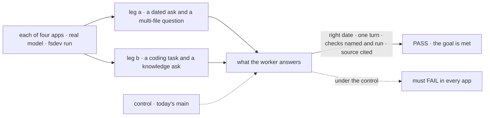
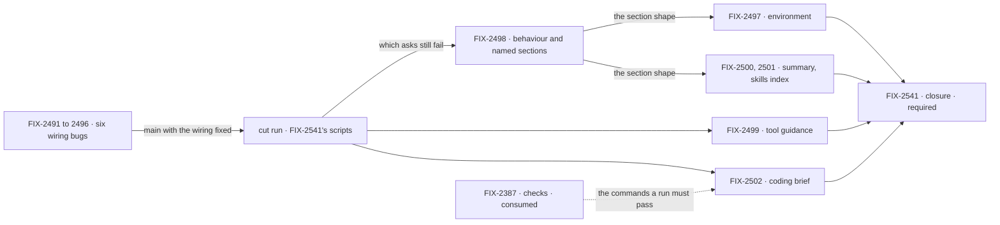

# FIX-2490 · Smarter agents: workers get the scaffolding every good harness ships

**Spec** · [Decisions](DECISIONS.md)

## Five teams, before and after

| A team that… | Today | After this epic |
|---|---|---|
| **asks code questions in the Claude Code-style lab** | The agent stops after 8 tool calls, before it has read enough | Answers a multi-file question in one turn, from what it read |
| **asks a worker anything time-sensitive** | No worker is told the date; Kitchen Sink's chat agent is told the day the server started | Every worker sees today's date, the user, the project and the surface, every turn |
| **hands a coder a task** | Teammates drops the coder's WORKER.md; Shift Manager replaces Claude Code's preset; nobody asks for checks | One brief in every app: the worker's instructions, the task, the conventions, and the checks it ran with their result |
| **asks a knowledge worker** | Kitchen Sink's support specialists and Shift Manager's researcher hold no tools, so they guess | Looks it up and cites what it read |
| **builds the next workforce app** | Writes the date, a "done" rule and an answer length into every WORKER.md | Gets them from workforce, switched on, and turns one off in a line |

**Why now.** [FIX-2369](../FIX-2369/SPEC.md) is making these four apps where FSD gets built,
and their agents are now the weak link. A comparison of seven open-source harnesses on Nov 1
([the analysis](https://claude.ai/artifact/ArK4epJ6po2xdorob6fUwc)) found the gap is scaffolding,
not prompt length. Apps are starting to patch it in WORKER.md ("answer in a sentence or two").
Now it is one layer; later, four copies that disagree.

## The goal, and how we'll know it's met

**Outcome: a user of any of the four apps (Claude Code-style lab, Teammates lab, Kitchen Sink,
Shift Manager) can ask a worker a time-sensitive or multi-file question, or hand it a coding
task, and get a finished answer sized to the ask with the evidence it checked, without each
app writing that guidance itself.**

| Is it the right goal? | |
|---|---|
| **The real need** | Goal 1, validate through real usage. These apps on real models are the proving ground, and an agent that fails for want of a date or a "done" rule makes the framework look weak for reasons that are not its shape |
| **Smaller, and rejected** | "The six bugs ship." That fixes wiring in each app, and still no worker outside Kitchen Sink's chat knows the date, and nothing asks for evidence. Not assumed: the cut run below tests it |
| **Bigger, and not this epic's** | The *Not doing* list below |
| **Not done if** | Every child is Done and the closure has not run · an app passes by writing date, "done" or length guidance in its own WORKER.md · a coder's report names a check that did not run · a closure bug is open |

Four asks, each the job a user actually brings. Today's `main` fails all four somewhere, which
is what makes the PASS mean something.

| How we verify | |
|---|---|
| **Goal check** | The closure issue's goal check (FIX-2541): one scripted `fsdev run` per app on one `main` commit after every other child merges. No separate eval apparatus ([D2](DECISIONS.md#d2)) |
| **Signal** | The worker states today's date · a code question that needs several files is answered in one turn · the coder's report names the checks it ran and their result · a knowledge worker cites a source it looked at |
| **The cut run** | The same scripts, run on `main` after the six bug fixes merge and before any layer is built. A layer whose ask already passes is cut ([D2](DECISIONS.md#d2)) |
| **Anti-game** | Assert on the worker's answer, never on a child's own output. A named check must match what harness-manager's checks recorded for that run |
| **Control that must fail** | Today's `main`: at least one ask fails in every app |

**Lead measure:** the set's goal-proven children, named. None yet.

**Not doing:** each app's content pass (WORKER.md body rewrites, a real Shift Manager reviewer,
the Shift Coordinator rewrite, Codex-style progress lines and planning in the Claude Code-style
lab, Hermes-style memory rules in Teammates) · Teammates self-learning · a before/after eval of
about 10 tasks per app · compaction mechanics (FIX-2174) · lifting harness routing (FIX-2467) ·
a generator-level opt-out of tool guidance (a possible later option).

**Kill line:** the closure check is re-run after the six bug fixes land. Any framework layer whose
ask already passes on that run is cut, not built.

## What's in the box

Everything in the top band is written once and every workforce worker gets it with no code.
An app composes only what is its own, and turns a section off in one line. Below the fence is
what this epic refuses to build.

**Docs:** the workforce guide gains one page, *what every worker is told*: the sections in
order, what each says, and how to turn one off. FIX-2498 publishes it with the section shape;
each layer child adds its own section to that page.

## The set · as of 2026-11-04

The reviewed snapshot; live state is in [Linear](https://linear.app/fixpoint-labs/issue/FIX-2490).
Bugs take the direct route and get no spec PR; an empty cell there is correct. The layer specs
come in one spec-set PR after this one merges.

| Issue | What it delivers | Why the set needs it | Status |
|---|---|---|---|
| **Wiring bugs · direct route, ship first** | | | |
| FIX-2491 | The Claude Code-style lab's agent flow gets a step budget sized for code work | The multi-file ask cannot pass on 8 steps | Todo |
| FIX-2492 | Kitchen Sink's chat agent reads the date each turn | A stale date fails the dated ask today | Todo |
| FIX-2493 | Shift Manager's EM carries the default layer | Without it, no later section reaches the worker that files coding tasks | Todo |
| FIX-2494 | Shift Manager's coder runs on Claude Code's preset with its brief appended, and can search | The coder loses its planning tool and its report | Todo |
| FIX-2495 | Teammates coders' WORKER.md bodies reach the harness | Editing a coder's instructions changes nothing today | Todo |
| FIX-2496 | `support.fsd` and Shift Manager's researcher get existing tools | The knowledge ask has nothing to look anything up with. Labelled Improvement; wiring only, so direct | Todo |
| **Framework layers · spec route, after the cut run** | | | |
| FIX-2497 | An environment section: date, user, project or folder, surface | The dated ask in every app, not one | Ready to Spec |
| FIX-2498 | A behaviour section (finish with evidence, size the answer) and the named-section shape every layer uses | The "finished, with evidence, sized" half of the outcome | Ready to Spec |
| FIX-2499 | A tool carries a when-to-use line, shown only when held | Search and fetch learn to cite; owner kept it ([D3](DECISIONS.md#d3)) | Ready to Spec |
| FIX-2500 | A structured summary for long conversations, on by default | No closure ask reaches it yet ([Q1](DECISIONS.md#q1)) | Ready to Spec |
| FIX-2501 | The skills index on by default | No closure ask reaches it yet ([Q1](DECISIONS.md#q1)) | Ready to Spec |
| FIX-2502 | One coding brief in harness-manager, used by three apps | The coder ask in every app; replaces three hand-built prompts | Ready to Spec |
| FIX-2541 · closure · **required** | The four scripted runs, once as the cut run and once at wrap | The only child that proves the outcome | Ready to Spec · blocked by every other child |

13 children. Each bug blocks each layer in Linear, so no layer is built before the cut run.
Whether six layers is really four is [Q1](DECISIONS.md#q1).

## How the issues flow into each other

An edge is what one issue hands the next; a dashed input is another epic's. Bugs first, then
the cut run, then FIX-2498's section shape before the other sections.

## What stays as it is

- **The identity layer's words** (FIX-2334). It becomes the first section, unchanged.
- **WORKER.md bodies**, each app's persona and voice, until the content pass.
- **harness-manager's verdict.** FIX-2387's checks decide a run; the brief only asks.

## What's already here, and the debt

| Already here | What the set does with it |
|---|---|
| `workerIdentityPrompt` and `TOOL_USE_RULE` (`packages/workforce/src/messages/worker-identity.ts`) | **Builds on.** The first section; FIX-2073's line joins the behaviour section |
| The prompt seam in `agent-worker-flow.ts`: four entries, joined, "re-decide rather than widen" | **Re-decided** by [D4](DECISIONS.md#d4): a fixed list of named sections with an opt-out each, still no registry |
| The skills switches, all off by default (`active`, `activateTool`, `enableLlmClassifier`) | **Amended** by [D1](DECISIONS.md#d1): the index is on. Its per-turn token cost is why it was off |
| Core's `historySummary` fold (FIX-1613), opt-in, used by Teammates only | **Builds on.** FIX-2500 supplies its summary and turns it on for workers |
| Core's `<tools>` list (`buildToolDescriptionContext` in `generator.ts`) | **Superseded or reduced** by FIX-2499 |
| harness-manager's `buildPrompt`, `PromptRunContext.task`, the held-checkout section, FIX-2388's issue section | **Builds on.** The brief composes them |
| FIX-2387's `commandCheck` (FIX-2369, in review) | **Consumed.** The brief names its commands ([D5](DECISIONS.md#d5)) |
| FIX-2369 ER-2: optional behaviour is opt-in, no child changes a default for every app | **Kept** for core and harness-manager. D1 changes workforce worker defaults on the owner's call |

| Adds | Existing piece considered | Why it doesn't fit / how composed |
|---|---|---|
| Named sections with a per-section opt-out (FIX-2498) | The prompt array; capabilities with context | Extends the array's first entry. A capability per section would be a second way in for fixed text |
| An environment section (FIX-2497) | Kitchen Sink's `todaysDate` context slot | A section, current each turn; apps add fields through one option |
| A guidance line on a tool (FIX-2499) | The tool's `description`; the `<tools>` list | Extends the tool definition; shown only when held |
| A structured summary (FIX-2500) | `historySummary`'s `summarize` block | Reuse: a block and its framing, no new mechanism |
| The skills index on (FIX-2501) | The skills library's listing and load tool | Reuse: defaults and description guidance |
| One coding brief (FIX-2502) | Three apps' prompt builders; `buildPrompt` | A helper each app's `buildPrompt` calls; appends to the harness preset |

| The debt | |
|---|---|
| **Removes** | Three hand-built coding prompts, Kitchen Sink's `todaysDate`, apps' length patches, the duplicated tools list |
| **Adds** | Four sections and their opt-outs, one optional tool field, one harness-manager helper. Each section is tokens on every turn of every worker |
| **Leaves** | The per-app content pass, and FIX-2174's compaction mechanics |

**Net: down in app code, up in per-turn tokens.** Each section has to earn its tokens at the cut run.

## Sign off

**[The goal](#the-goal-and-how-well-know-its-met):** four asks in four apps, with nothing
written by the app. If wrong: we wrap with agents that pass a script and still feel dumb.

**[The debt](#whats-already-here-and-the-debt):** app copies go, per-turn tokens grow. If
wrong: every worker pays for sections few of them need.

1. **[D1](DECISIONS.md#d1) · New layers are on by default for every workforce worker, each with
   its own opt-out.** Decided by the owner. If wrong: outside apps change behaviour under them.
2. **[D2](DECISIONS.md#d2) · No eval apparatus: the closure check is the proof, and its cut run
   after the bugs decides which layers are built.** Decided by the owner. If wrong: we build or
   cut a layer on four asks that can't see it.
3. **[D3](DECISIONS.md#d3) · Tool-owned guidance is its own issue, not description edits.**
   Decided by the owner. If wrong: a core change for what a few edits would have done.

**Decided, engineering, not asked:**

- [D4](DECISIONS.md#d4): defaults live in workforce's worker flow as named sections; core gains
  mechanism only.
- [D5](DECISIONS.md#d5): the coding brief names FIX-2387's checks; the code decides done, not
  the report.

**Open: [Q1](DECISIONS.md#q1).** The proof does not reach FIX-2500, FIX-2501 or answer sizing.
Recommended: three more asserts in the same scripts.

Epic · 12 children and a closure · Workforce: Shift Manager · Goal 1, validate through real usage
