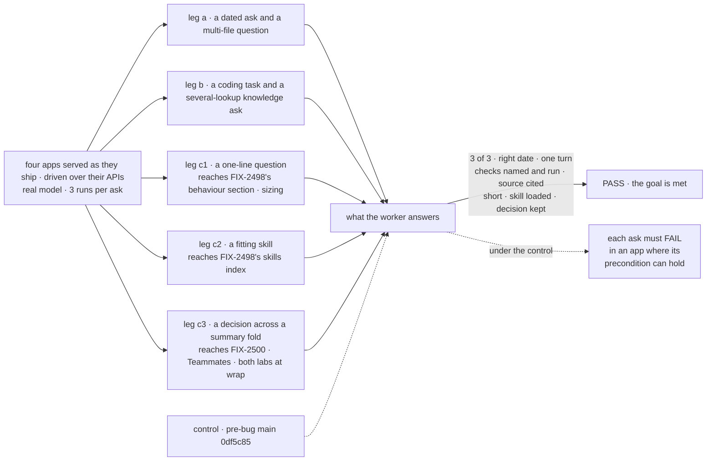
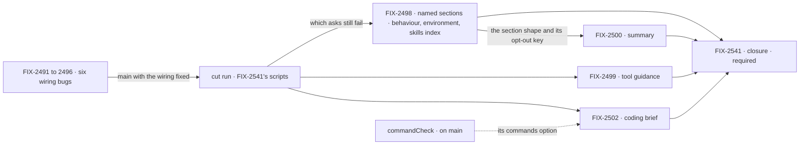

# FIX-2490 · Smarter agents: workers get the scaffolding every good harness ships

**Spec** · [Decisions](DECISIONS.md)

## Five teams, before and after

| A team that… | Today | After this epic |
|---|---|---|
| **asks code or knowledge questions** | Every workforce worker stops after 8 steps, before it has read enough | Answers a multi-file or several-lookup question in one turn, from what it read |
| **asks a worker anything time-sensitive** | No worker is told the date; Kitchen Sink's chat agent is told the day the server started | Every worker sees today's date, the user, the project and the surface, every turn |
| **hands a coder a task** | Teammates drops the coder's WORKER.md; Shift Manager replaces Claude Code's preset; nobody asks for checks | One brief in every app: the worker's instructions, the task, the conventions, and the checks it ran with their result |
| **asks a knowledge worker** | Kitchen Sink's support specialists and Shift Manager's researcher hold no tools, so they guess | Looks it up and cites what it read |
| **builds the next workforce app** | Writes the date, a "done" rule and an answer length into every WORKER.md | Gets them from workforce, switched on, and turns one or all off in a line |

**Why now.** [FIX-2369](../FIX-2369/SPEC.md) is making these four apps where FSD gets built,
and their agents are now the weak link. A comparison of seven open-source harnesses on Nov 1
([the analysis](https://claude.ai/artifact/ArK4epJ6po2xdorob6fUwc)) found the gap is scaffolding,
not prompt length. Apps are starting to patch it in WORKER.md. Now it is one layer; later, four
copies that disagree.

## The goal, and how we'll know it's met

**Outcome: a user of any of the four apps (Claude Code-style lab, Teammates lab, Kitchen Sink,
Shift Manager) can ask a worker a time-sensitive or multi-file question, or hand it a coding
task, and get a finished answer sized to the ask with the evidence it checked, without each
app writing that guidance itself.**

**Smaller, and rejected:** "the six bugs ship". Then no worker outside Kitchen Sink's chat knows
the date, and nothing asks for evidence. **Not done if:** the closure has not run · an app passes
by writing date, "done" or length guidance in its own WORKER.md · a coder's report names a check
that did not run · a closure bug is open.

| How we verify | |
|---|---|
| **Goal check** | The closure FIX-2541: four app scripts, each serving its app as it ships and driving it over its public API, as the existing goals for these apps do; at the wrap, on one `main` commit after every other child merges. Seven asks in each lab, six in Kitchen Sink and Shift Manager, which skip the fold ([Q1](DECISIONS.md#q1)); each ask runs 3 times ([ER-7](DECISIONS.md#who-owns-what)). That is 78 real-model runs at the wrap, and 75 on the control and the cut run, where the Claude Code-style lab skips the fold too (*Switches*). No eval apparatus ([D2](DECISIONS.md#d2)) |
| **Signal** | The worker states today's date · a code question that needs several files is answered in one turn · the coder's report names the checks it ran and their result · a knowledge worker cites a source, on an ask that needs several lookups · a one-line question gets a short answer · a worker holding a skill that fits loads it without a slash · in the two labs, a decision made before a summary fold is still used after it |
| **Sampling** | Each ask runs 3 times and passes only on 3 of 3 ([ER-7](DECISIONS.md#who-owns-what)) |
| **Preconditions** | An ask that needs a mechanism to fire asserts that it fired before it asserts the answer: the fold ask finds a summary fold in the run record, the skill ask a skill the worker holds. A run where it did not fire fails; it never passes, so it never cuts a layer. "Every app where it runs", here and in the cut, means every app where the ask's precondition can hold ([ER-7](DECISIONS.md#who-owns-what)) |
| **Switches** | On the control and the cut run, the scripts turn on what `main` already has but leaves off: the skills listing (`skills.activateTool`) with a fitting skill held. Teammates already folds (its `historySummary`). The Claude Code-style lab has no fold and no switch on `main`, so it runs the fold ask only at the wrap, and FIX-2500's cut is decided on Teammates alone ([decided in review](DECISIONS.md#on-fix-2541s-alignment)). So the two asks measure the layer's content, not the switch. At the wrap the scripts set nothing; the defaults must carry it |
| **The coder leg** | Asserts against the run record's `checks`, which `commandCheck` (on `main`) writes in all four apps; the closure turns on Teammates' checks. Passes when the report names at least one check and each one it names is in `checks` with the outcome it reports. A `null` record fails. On the cut run no brief asks for checks, so this leg is expected to fail there |
| **The cut run, and the kill line** | The same scripts on `main` after the six bugs merge, before any layer is built. A layer, or a section of FIX-2498, whose ask already passes is cut, except the environment section, which is kept regardless. Where a layer turns an existing switch on by default (the skills index, the summary), a cut drops its content and keeps the flip, since the wrap sets no switch ([ER-6](DECISIONS.md#who-owns-what), [D1](DECISIONS.md#d1)) |
| **Anti-game** | Assert on the worker's answer, never on a child's own output |
| **Control that must fail** | `0df5c85`, `main` before the bug fixes, pinned so the control can't drift as children merge: each ask fails, in at least one run of 3, in at least one app where it runs. An ask that never fails there can't show its layer is needed; the closure reports it, and its layer goes to the cut run like any other ([ER-7](DECISIONS.md#who-owns-what)) |

**Lead measure:** the set's goal-proven children, named. None yet.

**Not doing:** each app's content pass (WORKER.md bodies, a real Shift Manager reviewer, the
Shift Coordinator rewrite, Codex-style progress lines and planning in the Claude Code-style lab, Hermes-style
memory rules in Teammates) · Teammates self-learning · an eval of about 10 tasks per app ·
compaction mechanics (FIX-2174) · lifting harness routing (FIX-2467) · a generator-level opt-out
of tool guidance.

## What's in the box

![In the box: workforce's default worker layer as named sections, each on by default with its own opt-out in one worker-config shape: identity, which exists, plus behaviour, environment and skills index from FIX-2498, and the summary from FIX-2500; core's optional guidance field on a tool, in the same tools list; harness-manager's one coding brief with the checks commandCheck runs. Composed in by each app: the persona in WORKER.md, extra environment fields, guidance on its own tools, the checks its repo runs. Replaced in one line: any section turned off, or all of them with defaults: false. Below a fence, not built: the Not doing list](figures/end-state.svg)

The top band is written once and every workforce worker gets it with no code. An app composes
only what is its own, and turns a section, or all of them, off in one line. Below the fence is
what this epic refuses to build.

**Docs:** the workforce guide gains one page, *what every worker is told*: the sections in
order, what each says, and how to turn one or all off. FIX-2498 publishes it; FIX-2500 adds the
summary. FIX-2498, 2499, 2500 and 2502 each add a changeset for every published package whose
default behaviour they change (BP-022); workforce at least.

## The set · as of 2026-11-04

The reviewed snapshot; live state is in [Linear](https://linear.app/fixpoint-labs/issue/FIX-2490).
Bugs take the direct route and get no spec PR. The layer specs come in one spec-set PR after
this one merges.

| Issue | What it delivers | Why the set needs it | Status |
|---|---|---|---|
| **Wiring bugs · direct route, ship first** | | | |
| FIX-2491 | The workforce worker flow's default step budget rises from core's 8 to about 50 | The multi-file and knowledge asks cannot pass on 8 steps | Todo |
| FIX-2492 | Kitchen Sink's chat agent reads the date each turn. Its assistant is a standalone generator, so this stays until it composes FIX-2498's exported environment formatter | A stale date fails the dated ask today | Todo |
| FIX-2493 | Shift Manager's EM carries the default layer | Otherwise no later section reaches the worker that files coding tasks | Todo |
| FIX-2494 | Shift Manager's coder runs on Claude Code's preset with its brief appended, and can search | The coder loses its planning tool and its report | Todo |
| FIX-2495 | Teammates coders' WORKER.md bodies reach the harness | Editing a coder's instructions changes nothing today | Todo |
| FIX-2496 | `support.fsd` and Shift Manager's researcher get existing tools | The knowledge ask has nothing to look up with. Labelled Improvement; wiring only, so direct | Todo |
| **Framework layers · spec route, after the cut run** | | | |
| FIX-2498 | One module, `workerDefaultLayer`: named sections, an opt-out each and `defaults: false` for all, a token ceiling with a failing test. Three sections: behaviour (finish with evidence, size the answer), environment (date, user, project, surface; its formatter exported, and composed by Kitchen Sink's standalone assistant) and the skills index. Reaches workers built without an installation. FIX-2497 and FIX-2501 folded in | The dated ask in every app, and the "finished, with evidence, sized" half of the outcome | Ready to Spec |
| FIX-2499 | An optional guidance field on a tool, in the same tools list | Search and fetch learn to cite; owner kept it ([D3](DECISIONS.md#d3)) | Ready to Spec |
| FIX-2500 | A structured summary for long conversations, on by default | The labs' long-conversation ask: a decision is still used after a summary fold ([Q1](DECISIONS.md#q1)) | Ready to Spec |
| FIX-2502 | One coding brief in harness-manager, used by three apps | The coder ask in every app; replaces three hand-built prompts | Ready to Spec |
| FIX-2541 · closure · **required** | Four app scripts, seven asks (the fold in the labs only, the Claude Code-style lab's at wrap only), 3 runs each; run as the control, the cut run and at wrap | The only child that proves the outcome | Ready to Spec · blocked by every other child |

10 children and the closure FIX-2541. FIX-2497 and FIX-2501 are Duplicate of FIX-2498. Each bug
blocks each layer in Linear, so no layer is built before the cut run.

## How the issues flow into each other

An edge is what one issue hands the next; a dashed input is a piece already on `main`.

## What's already here, and the debt

| Already here | What the set does with it |
|---|---|
| `workerIdentityPrompt` and `TOOL_USE_RULE` (`packages/workforce/src/messages/worker-identity.ts`) | **Builds on.** The first section; FIX-2073's line joins behaviour |
| The prompt seam in `agent-worker-flow.ts`: four entries, identity on an installation only, "re-decide rather than widen" | **Re-decided** by [D4](DECISIONS.md#d4): one `workerDefaultLayer` entry that reaches every worker, still no registry |
| `defineAgentWorkerFlow`'s `maxSteps`, defaulting to core's 8 | **Fixed** by FIX-2491; an app's own `maxSteps` still wins |
| The skills switches in `workerConfigSchema`, off by default; `createSkillsLibrary` | **Amended** by [D1](DECISIONS.md#d1): the index is on. The opt-outs join this bag as one `defaults` key |
| Core's `historySummary` fold and `summarizer`, opt-in, used by Teammates only | **Reused** by FIX-2500 for the summary's shape. No core change |
| Core's `<tools>` list (`buildToolDescriptionContext`), already only the held tools | **Extended** by FIX-2499: an optional guidance field in the same list |
| harness-manager's `buildPrompt`, `heldPromptSection`, `PromptRunContext.task`, FIX-2388's issue section | **Composed** by FIX-2502's brief |
| `commandCheck` (`packages/harness-manager/src/command-check.ts`, on `main`) | **Consumed.** The brief takes its checks from its `commands` option ([D5](DECISIONS.md#d5)) |
| FIX-2369 ER-2: no child changes a default for every app | **Kept** for core and harness-manager. **Given up** for workforce by D1: an outside workforce app sees a changed prompt, and `defaults: false` restores the old one |

| Adds | Existing piece considered | Why it doesn't fit / how composed |
|---|---|---|
| `workerDefaultLayer`: named sections, opt-outs, a master switch and a token ceiling (FIX-2498) | The prompt array; capabilities; `workerConfigSchema` | Replaces the array's first entry; opt-outs are one `defaults` key beside `skills`. A capability per section is a second way in for fixed text |
| Behaviour and environment text (FIX-2498) | `TOOL_USE_RULE`; Kitchen Sink's `todaysDate` | Text beside `TOOL_USE_RULE`; the date is current each turn. The environment formatter is exported for a generator that is not a worker |
| The skills index on (FIX-2498) | `createSkillsLibrary` | Reuse: a default flip |
| A guidance field on a tool (FIX-2499) | `buildToolDescriptionContext`; skill `whenToUse`; the bash capability's `guidance` | Extend: a field travels with the tool into a list of held tools only. A preset prints even when a fence removed the tool |
| A structured summary (FIX-2500) | `historySummary` and `summarizer` | Reuse: its `outputSchema` and `objectives` |
| One coding brief (FIX-2502) | Three apps' builders; `buildPrompt`; `heldPromptSection`; `commandCheck` | A helper each `buildPrompt` calls, appended to the harness preset |

| The debt | |
|---|---|
| **Removes** | Three hand-built coding prompts, apps' length patches, and Kitchen Sink's `todaysDate` once its assistant composes the exported formatter |
| **Adds** | Four sections, their opt-outs and a master switch, one optional tool field, one harness-manager helper, a step budget of about 50. The fixed sections cost tokens every turn, held under a published ceiling; each summary fold costs one extra model call |
| **Leaves** | The per-app content pass and FIX-2174's compaction mechanics. Unchanged: the identity layer's words (FIX-2334), WORKER.md bodies, and harness-manager's verdict |

**Net: down in app code, up in per-turn tokens and model calls.** Each section has to earn them
at the cut run.

## Sign off

**[The goal](#the-goal-and-how-well-know-its-met):** seven asks across four apps, with nothing
written by the app. If wrong: we wrap with agents that pass a script and still feel dumb.

**[The debt](#whats-already-here-and-the-debt):** app copies go, per-turn tokens grow under a
ceiling. If wrong: every worker pays for sections few of them need.

1. [D1](DECISIONS.md#d1) · new layers on by default, an opt-out each. The owner's.
2. [D2](DECISIONS.md#d2) · the closure check is the proof; its cut run decides what is built. The owner's.
3. [D3](DECISIONS.md#d3) · tool-owned guidance is its own issue. The owner's.

**Decided, not asked:** [D4](DECISIONS.md#d4) · [D5](DECISIONS.md#d5) ·
[rounds 1 and 2](DECISIONS.md#decided-in-review-recorded-so-no-child-reopens-them).

**Decided after merge:** [Q1](DECISIONS.md#q1) · [FIX-2541's alignment](DECISIONS.md#on-fix-2541s-alignment).

Epic · 10 children and the closure FIX-2541 · Workforce: Shift Manager · Goal 1, validate through real usage
