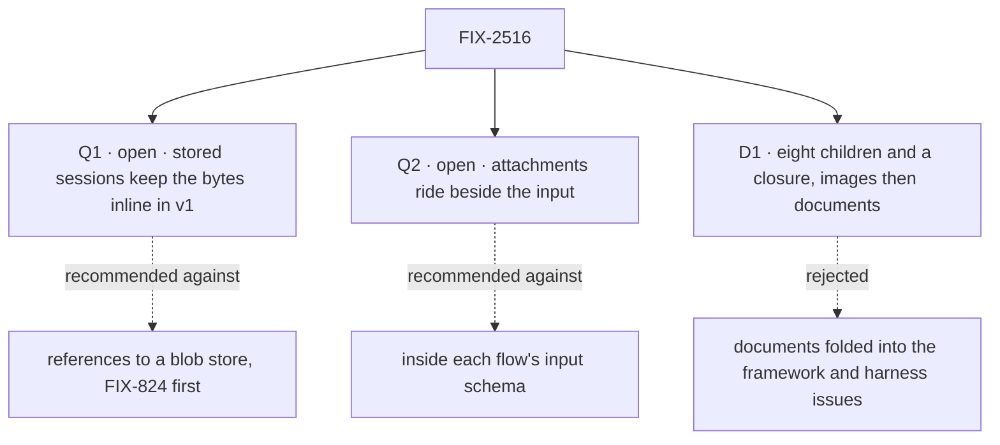

# FIX-2516 · Decisions

[Spec](SPEC.md) · **Decisions**

The calls that sit above any single child: what was chosen, what lost, and what each locks in
for the eight children and the closure. D1 is the sign-off. Q1 and Q2 are open, and they are the
owner's, because each sets a stored format or a public contract. The engineering questions the
brief raised are answered under *Decided, not asked*.

## The tree

## Q1 · Open · In v1, do stored sessions keep each attachment's bytes inside the message?

**In plain terms.** A sent image must live somewhere so a reload can show it and later turns can
see it. Either the message keeps the bytes, or it keeps a pointer to a file store we don't have.

**The options.** *Inline:* the request carries each file as base64, and the stored user line
keeps it in contracts' existing `FileContent.data`. *Reference:* build FIX-824's upload boundary
and FIX-367's binary store first, and store a pointer. *Strip:* mark the bytes `ephemeral`.

**The trade-off.** Inline ships now on a stored shape that exists, and it is what the AI SDK's
chat UI does. Its price is size: a 10-image turn adds about 3 MB to the session and to every
read of it. It also sets the ceiling. Vercel, where Kitchen Sink runs, refuses a request over
4.5 MB, so a message carries at most 3 MB of files after downscaling: enough for 10 screenshots
at 1,568 px, but a PDF caps at 3 MB, not the brief's 20 MB. Reference has neither cost and puts
another epic first. Strip loses the reload leg.

**My recommendation: inline, capped, measured first.** FIX-2517's first PR measures the kill
line: 10 real screenshots through the downscale rule against 4.5 MB, and a session with three
such turns reloaded in under two seconds on a local store.

**What would change my mind.** That measurement failing. Then the kill line trips.

**What being wrong costs.** Inline, wrongly: stored sessions hold bytes, and the later move to
pointers reads both shapes (BP-030). Reference, wrongly: the epic waits an epic for a store that
10 screenshots didn't need.

It comes down to the reload: only inline shows the image without building a store first.

## Q2 · Open · Do attachments ride beside the action's input, or inside it?

**In plain terms.** Either every request gets one framework field for files, or each flow puts
files in its own input and checks them itself.

**The options.** *Beside:* `sendAction(action, input, { attachments })`. The engine checks the
limits and writes the files as `file` parts on the user line the action's `userMessage` writes;
a block reads them there. An action with no `userMessage` refuses files with a named error.
`HarnessRunInput` gains the same list. *Inside:* each flow declares and checks its own field.

**The trade-off.** Beside, every flow, worker door and harness turn takes files with no schema
change, behind one server check. Its price is public surface: a client and React option, a
request field, a block read, a harness input field. Inside adds none, and is FIX-824's problem
again: every app re-implements the field, the check and the rendering.

**My recommendation: beside.** Only there can't a hand-built request skip the limits.

**What would change my mind.** Files that are not part of what the person said, such as a batch
import. That is FIX-137's broader problem; it would sit beside this field.

**What being wrong costs.** Beside, wrongly: a field we deprecate in a minor. Inside, wrongly:
five apps carry their own copy, which FIX-2369 ER-3 forbids.

It comes down to the server check: inside the input, every flow writes its own or skips it.

## D1 · Eight children and a closure: the framework and the composer in parallel, then the harnesses, then the apps; documents after images

| | |
|---|---|
| **Instead of** | Documents folded into FIX-2517 and FIX-2519 · one issue for both labs |
| **Because** | Images reach every target the same way. Documents don't: Codex and Cursor take no documents, so each target needs its own answer, and that answer should not hold images back. Each app has its own composer and its own send path, so an app issue is the unit a reviewer can check in a browser |
| **Locks in** | Nine rows. A collapse trigger on the labs: if both lab specs come out with no decision of their own, the spec set merges them |

**What would change my mind:** the two lab specs being identical. Then they are one issue.

It comes down to Codex and Cursor: with no document input, documents need their own answer.

## Who owns what

Each rule has one owner. A *uses* cell is a place where a child must not decide again.

| # | Rule every child obeys | Owner | Checked at |
|---|---|---|---|
| ER-1 | One attachment shape: contracts' `FileContent` (`type: "file"`, `mediaType`, `data`, `filename`) on the user item and the same parts in the request. No second shape and no `attachment` item type | FIX-2517 | Spec set; cross-spec review |
| ER-2 | One limits set, defined once in core, read by the composer's defaults and by the server. No app sets its own | FIX-2517 | Spec set; the closure's leg c |
| ER-3 | Nothing over a limit is dropped silently. The composer refuses before send with a plain message; the server refuses with a named error before any block runs | FIX-2517 names the refusals · FIX-2518 uses them in the composer | Each child's goal check; leg c |
| ER-4 | A harness or provider that can't take a type says so in the conversation; never a text-only fallback | FIX-2519 | FIX-2519's and FIX-2520's goal checks |
| ER-5 | Attachments ride beside the input ([Q2](#q2)). The worker door's `{ message }` and each flow's input schema stay as they are | FIX-2517 | Spec set |
| ER-6 | Composer pieces come from the `packages/ui` registry through `fsdev ui add`. No app writes its own paste, drop, preview or downscale (FIX-2369 ER-3, FIX-2152 ER-3 and ER-4) | FIX-2518 | Each app's spec; the closure's sweep |
| ER-7 | A task's attachments are part of its brief, on the task row in orchestration, in [Q1](#q1)'s stored form. Every run of the task gets them. No task noun enters core (FIX-2369 ER-1) | FIX-2522 · FIX-2519 uses it to hand them to each run | Both specs; the closure's Shift Manager re-run |
| ER-8 | Files written to disk for a harness live in a per-turn directory outside the checkout, and the adapter that wrote it removes it when the turn ends. Nothing reaches a commit | FIX-2519 | FIX-2519's goal check |
| ER-9 | The kill line is measured in FIX-2517's first PR, before any app child starts. If it trips, the coordinator stops FIX-2521 to 2524 and amends this epic | FIX-2517 · the coordinator uses the result | FIX-2517's first PR |
| ER-10 | Consumed issues keep their own parents: FIX-137, FIX-824, FIX-891, FIX-367, FIX-2152, FIX-2467, FIX-2371 | The coordinator | Each refresh |

## Coordination seams

| Seam | Between | Rule |
|---|---|---|
| The user line's renderer | FIX-2517, 2518 and each app | FIX-2518 owns the thumbnail and chip; apps draw sent files with it |
| `prompt-input.tsx` | FIX-2518, 2520 | FIX-2518 lands the pieces; FIX-2520 only widens `accept` |
| The harness turn and the board run | FIX-2519, 2522 | FIX-2519 builds both paths; FIX-2522 only writes the brief |
| The per-target documents table | FIX-2519, 2520 | FIX-2519 lands the image rows; FIX-2520 adds the document rows |
| Kitchen Sink's harness pages and the lab's harness path | FIX-2521, 2523 | Both consume FIX-2519; neither adapts per app |

## Decided, not asked

- **Limits (brief Q2).** 10 images and 5 documents a message. Images downscaled in the browser to
  1,568 px on the longest side, Claude's recommended size and inside every provider's limits
  (Bedrock's 5 MB too); up to 20 MB before that. 3 MB of files a message after downscaling
  ([Q1](#q1)). PDFs up to 100 pages. PNG, JPEG, WebP, GIF; HEIC refused. One set everywhere (ER-2).
- **Documents per target (brief Q3).** Text-like files go as text headed by the filename, to every
  target. A PDF goes as a file part to a generator whose provider takes PDFs, as a document block
  to Claude Code, and as a file in the turn's directory, named in the prompt, to Codex and
  Cursor. A provider with no PDF input gets ER-4's message; no extraction library in v1.
- **Harness hand-off (brief Q4).** Claude Code: image and document blocks on a streaming-input
  message. Cursor: `images` as base64. Codex: `local_image` paths. Disk files follow ER-8; if a
  sandbox can't read outside its checkout, a directory `.git/info/exclude` hides.
- **History (brief Q5).** A generator replays earlier turns' files, newest first, up to 10 images
  and 5 documents; older ones become a stub naming the file, so a request holds 20 images at
  most. A harness keeps its own transcript, so a turn sends only its own files.
- **Steering.** A line with files sent during a turn takes `harnessSteering`'s next-turn path.
- **Drafts.** A draft's files survive a session switch in the page, never in `localStorage`
  (about 5 MB).
- **A task's files are its brief's.** Settled by the owner, 2026-11-05 (brief Q7): files attached
  while creating a task become part of its brief; the worker sees them, a re-run or hand-off
  keeps them (ER-7).
- **FIX-137 is not folded** (owner, 2026-11-05, brief Q6). FIX-2517 is its chat slice.
- **Word, Excel and PowerPoint are cut** from FIX-2520 (owner, 2026-11-05), to a separate later
  issue this epic does not file.
- **FIX-2520's in-app PDF checks are the closure's leg b.** Its own check proves PDFs at the
  framework and harness level, so it needn't wait for the apps.

## What the end-state POC showed

None built. The one premise that could break the division is the kill line, and FIX-2517's first
PR measures it directly (ER-9); a POC would run the same measurement twice.

## Analysis

**2026-11-05 · watermark 2026-11-05 · right approach, with changes.** Run by hand: this session
could not start sub-agents, so the `adhd` pass did not run. `reuse-review` folded four Adds into
existing pieces: `usePromptInputAttachments` and `PromptInputProvider` for the hook; the
composer's `accept`/`maxFiles`/`maxFileSize` for the limits; `FileContent` for FIX-137's item
type; `harnessSteering`'s next-turn path for a steer with files. Per-turn files stay new, after
the workspace host. Other frameworks: the AI SDK's chat UI sends files as data-URL parts inside
the message (Q1's inline); hosted chat apps upload first (FIX-824). Major concern: the 4.5 MB
limit, now Q1's cap and ER-9. Strongest other division: one issue per layer, no app issues;
rejected, because an app's send path is where today's bug is.

## How it got here

- **Drafted (Nov 5).** From the product brief and its audit, verified on `main` at 9c75ce2.
  Closure FIX-2565 filed. The owner's objective lines, the task-brief call, the FIX-137 call
  and the Word/Excel cut are folded in. The brief's questions 1 to 5 are answered here, and two
  of them became Q1 and Q2.

**Open:** [Q1](#q1), [Q2](#q2).
