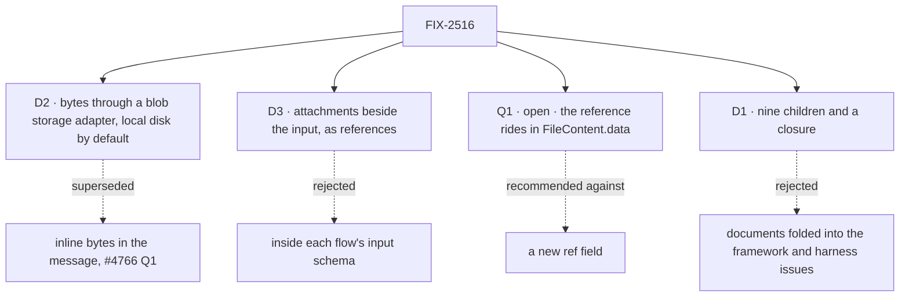

# FIX-2516 · Decisions

[Spec](SPEC.md) · **Decisions**

The calls above any single child: what was chosen, what lost, and what each locks in for the
nine children and the closure. D2 and D3 are the owner's, settled on 2026-11-05, and replace
#4766's open Q1 and Q2. Q1 here is open because it sets a public stored format. The engineering
calls inside the adapter are under *Decided, not asked*.

## The tree

## Q1 · Open · How does a stored message point at its file?

**In plain terms.** Every sent file becomes a small pointer on the user line, and that pointer is
stored in every session forever. Either it goes in the field that already holds a file's data, or
we add a field for it.

**The options.** *In `data`:* `FileContent.data` holds `fsd-blob:<id>`, as it may already hold a
data URL; the type is unchanged. *A new field:* `FileContent` gains `ref: { id }` and `data`
becomes optional.

**The trade-off.** In `data` keeps the published type as it is and matches the AI SDK, whose file
part takes bytes or a URL in the same field. Its price: a reader that assumes `data` is bytes gets
a string it can't decode. No reader exists today, since nothing produces `FileContent`. A new
field fails more plainly for such a reader, and changes a published type in a minor.

**My recommendation: in `data`.** One field, one shape, no type change.

**What would change my mind.** A consumer, ours or an adopter's, already reading `data` as base64.

**What being wrong costs.** In `data`, wrongly: a scheme check in each reader, and a BP-030
dual-read if we later add the field. A new field, wrongly: every reader handles a missing `data`
for nothing.

It comes down to the published type: only `data` leaves it unchanged.

## D1 · Nine children and a closure: storage first, then the framework and the composer, then the harnesses and the apps; documents after images

| | |
|---|---|
| **Instead of** | Documents folded into FIX-2517 and FIX-2519 · one issue for both labs |
| **Because** | Codex and Cursor take no documents, so documents need a per-target answer that should not hold images back. Each app has its own composer and send path, so an app issue is what a reviewer checks in a browser. FIX-824 comes first because every child that touches bytes goes through it |
| **Locks in** | Ten rows. A collapse trigger on the labs: if both lab specs have no decision of their own, the spec set merges them |

**What would change my mind:** the two lab specs being identical. Then they are one issue.

It comes down to Codex and Cursor: with no document input, documents need their own answer.

## D2 · Bytes go through a blob storage adapter, local disk by default; messages carry references

| | |
|---|---|
| **Instead of** | Inline bytes in the stored message, under a 3 MB cap (#4766 Q1) |
| **Because** | Inline breaks the reload on a hosted server: two near-cap turns make a 100-item session read about 8 MB, over Vercel's 4.5 MB response limit (Codex, #4766). A reference makes that read a few hundred bytes a file, whatever the host. The default writes to local disk, so a single-server install needs no new dependency |
| **Locks in** | The `blobs` slot is real, in the same shape as the store adapters. A serverless deploy must configure a hosted adapter; on the local default a hosted deploy refuses attachments by name. No hosted adapter is built here: the closure runs on a local server |

**Settled by the owner, 2026-11-05.** It changes the merged direction, so it needs approval on
this amendment.

It comes down to the hosted reload: inline breaks it past two full turns, references never do.

## D3 · Attachments ride beside the action's input, as references

| | |
|---|---|
| **Instead of** | A field inside each flow's input, checked by that flow |
| **Because** | Beside the input, one server check covers every flow, the worker door and every harness turn, and a hand-built request can't skip it |
| **Locks in** | `attachments: FileContent[]`, in reference form, on the request, the client and React send options, and `HarnessRunInput`. The engine checks the limits once and writes the files as `file` parts on the user line `userMessage` writes; an action with no `userMessage` refuses files by name. A document's extracted text may ride beside them too; v1 needs none, since text-like files are read from the store at model-call time |

**Settled by the owner, 2026-11-05**, after the Architect's note on #4766.

It comes down to the server check: inside the input, every flow writes its own or skips it.

## Who owns what

Each rule has one owner. A *uses* cell is a place where a child must not decide again.

| # | Rule every child obeys | Owner | Checked at |
|---|---|---|---|
| ER-1 | One attachment shape: contracts' `FileContent` in reference form ([Q1](#q1)), in the request, on the user item, on `HarnessRunInput` and on the task brief. No second shape, no `attachment` item type | FIX-824 defines · FIX-2517 writes it | Cross-spec review |
| ER-2 | Bytes live only in the blob store and are reached only through its interface. Nothing writes them into a session, a request, a resource or `localStorage`, and nothing reads the local adapter's files directly | FIX-824 | Spec set; leg a's session read |
| ER-3 | A file is served only to a caller who can read the scope that owns it. Its id is not a key (BP-031) | FIX-824 | FIX-824's goal check |
| ER-4 | One limits set, in `@flow-state-dev/contracts/attachments` with a README entry, read by the composer and the server. Over a limit, the composer refuses before send and the server with a named error; nothing is dropped silently | FIX-824 defines · FIX-2517, 2518 enforce | Leg c |
| ER-5 | A target that can't take a type says so in the conversation; never a text-only fallback | FIX-2519 | FIX-2519's and FIX-2520's checks |
| ER-6 | Composer pieces come from the `packages/ui` registry. No app writes its own paste, drop, preview, downscale or upload (FIX-2152 ER-3 and ER-4) | FIX-2518 | The closure's sweep |
| ER-7 | A task's attachments are part of its brief, on the task row, as references; every run gets them. No task noun enters core | FIX-2522 · FIX-2519 hands them on | The closure's Shift Manager re-run |

## Coordination seams

| Seam | Between | Rule |
|---|---|---|
| A reference's owner | FIX-824, 2517, 2522 | FIX-824 claims an upload into the turn's session; FIX-2522 claims a task's files into the board's scope |
| The `blobs` slot | FIX-824, FIX-2452 | FIX-2452 removes no-op slots; FIX-824 makes `blobs` real and names its factory in FIX-2452's store-factory family |
| `sendAction` and `useSession` | FIX-2517, FIX-2450, FIX-2455 | FIX-2517 adds `attachments` to the send options on whichever handle FIX-2455 leaves |
| `prompt-input.tsx` and the registry `Conversation` | FIX-2518, 2520, FIX-2456 | FIX-2518 lands the pieces; FIX-2520 only widens `accept`; FIX-2456 owns the scroll chrome |
| Core's root | FIX-2517, 2519, FIX-2448 | `HarnessRunInput` moves with FIX-2448 to `core/harness`; nothing new lands on core's root |
| Kitchen Sink's harness pages, the lab's harness path | FIX-2521, 2523 | Both consume FIX-2519; neither adapts per app |
| The board run | FIX-2519, 2522 | FIX-2519 builds the hand-off; FIX-2522 only writes the brief |

## Decided, not asked

- **Limits.** 10 images and 5 documents a message; a file up to 20 MB as picked; images downscaled
  in the browser to 1,568 px on the longest side before upload; PDFs to 100 pages; PNG, JPEG, WebP
  and GIF; HEIC refused. No per-message cap tied to a host's request size. What one model call carries
  stays under its provider's request limit; FIX-2517's history rule owns that.
- **The interface.** A `BlobStore` beside `ContentStore` in `packages/engine/src/stores/types.ts`:
  put, read, delete, and delete everything an owner holds. `StoreRegistry.blobs`, filled from the
  profile's `blobs` slot. An optional direct read URL lets a hosted adapter serve a file without
  the function in the path.
- **The default.** A filesystem adapter in the engine, under `.fsdev/data/blobs` or a given
  rootDir: one directory per file holding its bytes and a metadata file, plus an owner index.
  Used whenever a profile names no `blobs` slot. On a host whose disk doesn't persist (Vercel),
  the engine refuses attachments by name instead of writing there.
- **Ownership and retention.** An upload is pending, held by its uploader, and swept after 24
  hours unless an action claims it into the turn's session. A session's files are deleted with
  it.
- **Resolution.** References resolve to bytes only where bytes leave the server: the engine's
  model-message build and the harness hand-off. Clients draw from the read route.
- **Per-target detail is the children's.** FIX-2517 owns the history rule, FIX-2519 each
  harness's hand-off and its per-turn files, FIX-2518 drafts. The epic fixes only the outcomes.
- **Documents.** Text-like files go as text headed by the filename; a PDF as a file part where
  the provider takes PDFs, else ER-5's message. No extraction library in v1.
- **FIX-367 stays related.** The adapter doesn't need binary resource content; FIX-367 can
  build on the `blobs` slot later.
- **FIX-891 stays related.** FIX-2517 delivers its file-part half; upload-once is not this epic's.
- **Owner calls, 2026-11-05:** a task's files are its brief's; FIX-137 is not folded; Word, Excel
  and PowerPoint are cut.
- **FIX-2520's in-app PDF checks are the closure's leg b.**

## What the end-state POC showed

None built. The premise that could break the division is the kill line, and FIX-824's goal check
measures it directly.

## Analysis

**2026-11-05 · watermark 2026-11-05 · right approach, with changes.** Run by hand; this dispatch
could not start sub-agents, so `adhd` did not run. `reuse-review`, re-run on the amended Adds: the
blob store **extends** the reserved `blobs` slot and follows `createFilesystemStores`; it does not
reuse `ContentStore`, which holds strings per resource; the routes reuse the session read's
access check. #4766's four reuse verdicts stand. Major concern: a hosted deploy has no adapter;
named as debt.

## How it got here

- **Drafted (Nov 5).** From the product brief, verified on `main` at 9c75ce2. Closure FIX-2565
  filed. FIX-2516 had left [FIX-2369](../FIX-2369/DECISIONS.md#decided-recorded-so-no-child-reopens-them)
  on the owner's call on Nov 4 and runs as its own epic.
- **Merged (Nov 5, #4766, head 7012fb8).** Q1 and Q2 open.
- **Amended (Nov 5).** The owner settled storage (D2), the API shape (D3) and FIX-824 joining.
  Folded from #4766's review: the hosted session read (Codex), FIX-2447's seams, the limits off
  core's root, and nine-really-eight (the Architect), and fewer ER rows with per-target detail
  pushed to the child specs (Cursor).

**Open:** [Q1](#q1), and the kill line in SPEC.md.
