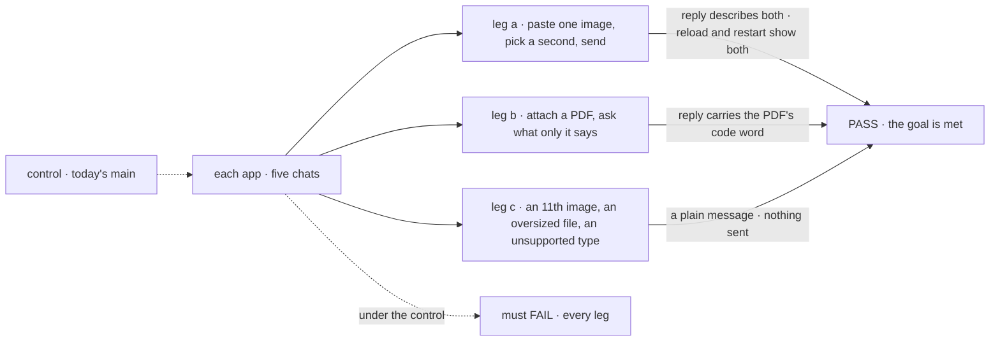
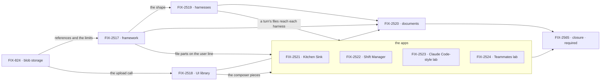

# FIX-2516 · Attachments: paste or upload images and documents in every chat

**Spec** · [Decisions](DECISIONS.md)

## Five teams, before and after

| A team that… | Today | After this epic |
|---|---|---|
| **chats in Kitchen Sink, Shift Manager or a lab** | Kitchen Sink drops a pasted image silently; the rest can't attach | Paste, **+** or drop; see and remove each file; the reply shows the model saw it, after a reload too |
| **runs a coding worker on Claude Code, Codex or Cursor** | Describes the bug in words | The turn's images reach the harness; a type it can't take is said |
| **files a task in Shift Manager with a screenshot** | The worker never sees it | The image is in the task's brief, for every run |
| **builds a flow on FSD** | Hand-rolls base64 input ([FIX-824](https://linear.app/fixpoint-labs/issue/FIX-824)) | Sends `attachments` beside the input; bytes land in a blob storage adapter, local disk by default |
| **builds its own composer** | Rebuilds paste, picker and previews | Installs the registry's pieces with `fsdev ui add` |

**Why now.** The owner asked on 2026-11-03, and much of it is built and unused: `PromptInput`
has the picker, paste and limits, AI SDK 7 takes file parts, and the store profile reserves a
`blobs` slot. Meanwhile Kitchen Sink throws a pasted image away.

## The goal, and how we'll know it's met

**In every chat in our apps, a person can attach images and documents to a message (paste, a +
picker, drag and drop), see and remove them before sending, and the reply shows the model or
harness saw them.** Kitchen Sink (Flow State chat, the Claude Code, Codex and Cursor pages), Shift
Manager, the Claude Code-style lab and the Teammates lab.

| Is it the right goal? | |
|---|---|
| **The real need** | People work by showing: a screenshot of the bug, the PDF of the spec |
| **Smaller, and rejected** | Images in Flow State chat only. The harnesses, where a screenshot matters most, stay blind |
| **Bigger, and not this epic's** | Hosted blob adapters · upload once at the provider ([FIX-891](https://linear.app/fixpoint-labs/issue/FIX-891)) |
| **Not done if** | An app lacks paste, **+** or drop · a reload or a restart loses an image · a session read carries file bytes · a refusal is silent · a re-run loses its brief's images · a closure finding is open |

Leg c is the one a happy-path check skips, and leg a's restart is the one an in-memory store
passes by accident.

| How we verify | |
|---|---|
| **Goal check** | The closure, [FIX-2565](https://linear.app/fixpoint-labs/issue/FIX-2565), on one `main` commit, in each app's browser UI against a running server on persistent stores, real model, real signed-in harness |
| **Signal** | a: the reply names each image; a reload, and a reload after a server restart, show both; the session read carries references, not bytes. b: the reply has the PDF's code word. c: a composer message, and no action request |
| **Input** | Fresh images and a PDF with a random code word, per run |
| **Anti-game** | Assert on what the person sees, never on a child's test or a stubbed model |
| **Control that must fail** | Today's `main`: every leg. A planted strip of `file` parts: legs a and b |

| | |
|---|---|
| **Lead measure** | Children whose goal check passed. **None today** |
| **Not doing** | Files in replies · audio, video · a file library · drive pickers · Word and Excel · a hosted blob adapter: a serverless deploy must configure one, none is built here · folding [FIX-137](https://linear.app/fixpoint-labs/issue/FIX-137) |
| **Kill line** · *proposed, needs the owner's sign-off* | "If FIX-824's goal check can't send 10 images and a 20 MB PDF by reference through a running local server, and show them all after a restart, with no new required dependency and no change to the existing store adapters, stop the app children and amend this epic." |

## What's in the box

Every chat gets what is inside once it installs the composer pieces. The fence is
[D2](DECISIONS.md#d2): messages, session reads and harness hand-offs carry references, so no
host's request or response limit caps an attachment.

**Docs:** one story, "a user turn can carry files", in the guide section FIX-2517 publishes.
FIX-824 adds where bytes live and what a serverless deploy configures; FIX-2519 the harness
table; FIX-2520 documents. FIX-2518 publishes the registry page.

## The set · as of 2026-11-05

A dated snapshot; live state is Linear. Every child is on the spec route, in one spec-set PR.

| Issue | What it delivers | Why the set needs it | Status |
|---|---|---|---|
| [FIX-824](https://linear.app/fixpoint-labs/issue/FIX-824) · blob storage, **joined 2026-11-05** | The adapter, its local default, upload and read routes, the limits set. **Its goal check is the kill line** | Bytes go nowhere else ([ER-2](DECISIONS.md#who-owns-what)) | Backlog |
| [FIX-2517](https://linear.app/fixpoint-labs/issue/FIX-2517) · framework | `attachments` beside the input; `file` parts on the user item and to a generator | Every app uses its shape | Backlog · blocked by 824 |
| [FIX-2518](https://linear.app/fixpoint-labs/issue/FIX-2518) · UI library | Picker, paste, drop, previews, refusals, downscaling, upload | Else each app rebuilds it | Backlog · blocked by 824 |
| [FIX-2519](https://linear.app/fixpoint-labs/issue/FIX-2519) · harnesses | Images to Claude Code, Codex, Cursor; a task's brief files to every run | Where a screenshot matters most | Backlog · blocked by 824, 2517 |
| [FIX-2520](https://linear.app/fixpoint-labs/issue/FIX-2520) · documents | PDF and text-like files | Documents differ per target ([D1](DECISIONS.md#d1)) | Backlog · blocked by 2517–2519 |
| [FIX-2521](https://linear.app/fixpoint-labs/issue/FIX-2521) · Kitchen Sink | Flow State chat, three harness pages; the silent drop fixed | Two of five chats | Backlog · blocked by 2517–2519 |
| [FIX-2522](https://linear.app/fixpoint-labs/issue/FIX-2522) · Shift Manager | Every composer; a new task's files join its brief | Where a file outlives its turn | Backlog · blocked by 2517–2519 |
| [FIX-2523](https://linear.app/fixpoint-labs/issue/FIX-2523) · Claude Code-style lab | Its composer, on the harness path | One chat | Backlog · blocked by 2518, 2519 |
| [FIX-2524](https://linear.app/fixpoint-labs/issue/FIX-2524) · Teammates lab | Its composer, to generator and coding teammates | One chat | Backlog · blocked by 2517–2519 |
| [FIX-2565](https://linear.app/fixpoint-labs/issue/FIX-2565) · closure · **required** | Three legs per app, each team's journey, each child's check, the seams | Proves the whole | Backlog · blocked by every child |

Nine children and a closure. Is nine really eight? The labs send to different flows; **the
collapse trigger is both lab specs having no decision of their own**. FIX-2520 stays because
Codex and Cursor take no documents.

## How the issues flow into each other

An edge is what one issue hands the next. FIX-824 goes first, then FIX-2517 and FIX-2518 in
parallel; the closure waits on all nine.

## What stays as it is

- **The action request stays JSON**; it carries references, and bytes go up the upload route.
- **The existing store adapters**, and `ContentStore`'s strings.
- **The worker door's `{ message }`** and each flow's input schema ([D3](DECISIONS.md#d3)).
- **Steering stays text.** A line with files waits for the next turn.
- **Related, not children:** FIX-137, FIX-891, FIX-367, FIX-2152, FIX-2467, FIX-2371.

## What's already here, and the debt

The predecessor is this epic's merged spec, [#4766](https://github.com/fixpoint-labs/flow-state-dev/pull/4766).

| Already here | What the set does with it |
|---|---|
| #4766's Q1 (inline bytes) and kill line | **Superseded** by [D2](DECISIONS.md#d2) and the kill line above |
| The no-op `blobs` slot (`packages/engine/src/stores/store-adapter.ts`) | **Extends**: FIX-824 backs it |
| `createFilesystemStores` (`packages/engine/src/stores/index.ts`) | **Builds on**: the local default follows its rootDir |
| `FileContent` (`packages/contracts/src/items/content.ts`), never produced | **Reuses**, in reference form ([Q1](DECISIONS.md#q1)) |
| `PromptInput`, `usePromptInputAttachments` | **Builds on** (FIX-2518) |
| `itemToLLMMessages`, `HarnessRunInput { prompt }`, the task row's `context` | **Extends** each to carry references |
| FIX-824 | **Folded in**, rescoped to the adapter |
| FIX-137's `attachment` item type | **Amended**: no item type; it stays open |

| Adds | Existing piece considered | Why it doesn't fit / how composed |
|---|---|---|
| A blob store and its local default | `ContentStore`; the `blobs` slot | Extends the slot; `ContentStore` holds strings per resource |
| Upload and read routes | The action route; the session read's check | The action route stays JSON; both reuse the check ([ER-3](DECISIONS.md#who-owns-what)) |
| `attachments` and one limits set | Input schemas; `PromptInput`'s limit props | Extends the request's parse step; the props default to the set |
| Per-turn files for Codex and Cursor | The workspace host | New and small: it places checkouts, not files |

| The debt | |
|---|---|
| **Removes** | Kitchen Sink's silent drop · hand-rolled base64 chat input |
| **Adds** | The rows above · a slot with only a local adapter, so a hosted deploy refuses attachments by name |
| **Leaves** | Each adapter's own event-to-item helper |

**Net: up, on purpose.** A capability every chat app has; the named debt is the missing hosted adapter.

## Sign off

**[The goal](#the-goal-and-how-well-know-its-met), at that size:** five chats, images and PDFs,
named refusals, proved through a restart. If wrong: the harnesses stay blind.

**[The set's debt](#whats-already-here-and-the-debt), net up:** one capability, one local
adapter. If wrong: a hosted deploy waits on an adapter.

1. **[D1](DECISIONS.md#d1) · Nine children and a closure: storage, images, then documents.**
   If wrong: two lab issues that should have been one.
2. **[D2](DECISIONS.md#d2) · Bytes go through a blob storage adapter, local disk by default.**
   The owner's call, a direction change. If wrong: a store we needn't have built.
3. **[D3](DECISIONS.md#d3) · Attachments ride beside the input, as references.** The owner's
   call. If wrong: a field we deprecate in a minor.

**Open: 1, and the kill line.** [Q1](DECISIONS.md#q1) · a stored file part carries its reference
in `data`. I recommend yes.

Epic · 9 children and a closure · Workforce: Shift Manager · Goal 1, validate through real usage
