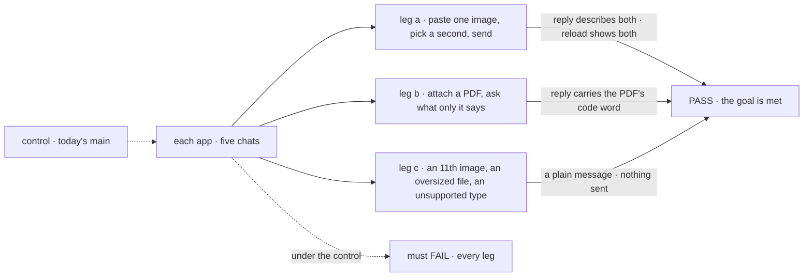
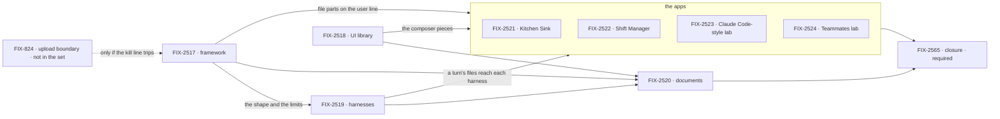

# FIX-2516 · Attachments: paste or upload images and documents in every chat

**Spec** · [Decisions](DECISIONS.md)

## Five teams, before and after

| A team that… | Today | After this epic |
|---|---|---|
| **chats in Kitchen Sink, Shift Manager or a lab** | Kitchen Sink drops a pasted screenshot on send without a word. The others can't attach at all | Paste, **+** or drop; see and remove each file; the reply shows the model saw it, after a reload too |
| **runs a coding worker on Claude Code, Codex or Cursor** | Describes the bug in words: the adapters send a string | The turn's images reach the harness; a type it can't take is said, never dropped |
| **files a task in Shift Manager with a screenshot** | The worker never sees it | The image is in the task's brief, so a re-run or hand-off keeps it |
| **builds a flow on FSD** | Hand-rolls base64 input, limit checks and rendering ([FIX-824](https://linear.app/fixpoint-labs/issue/FIX-824)) | Sends `attachments` beside the input; the engine checks limits and writes them on the user line; a generator gets file parts |
| **builds its own composer** (Shift Manager, the labs) | Rebuilds paste, picker and previews, or goes without | Installs the registry's pieces with `fsdev ui add` |

**Why now.** The owner asked on 2026-11-03, and most of it is built and unused: the registry's
`PromptInput` has the **+** picker, paste, drop, limits and data-URL conversion, and AI SDK 7
takes file parts. Meanwhile Kitchen Sink silently throws a pasted image away. And the labs
([FIX-2152](https://linear.app/fixpoint-labs/issue/FIX-2152)) exist to reproduce chat apps
people know, whose most visible habit ours lack.

## The goal, and how we'll know it's met

**In every chat in our apps, a person can attach images and documents to a message (paste, a +
picker, drag and drop), see and remove them before sending, and the reply shows the model or
harness saw them.** The same in Kitchen Sink (Flow State chat and the Claude Code, Codex and
Cursor pages), Shift Manager, the Claude Code-style lab and the Teammates lab.

| Is it the right goal? | |
|---|---|
| **The real need** | People work by showing: a screenshot of the bug, the PDF of the spec. Every chat app they use takes both; ours take neither |
| **Smaller, and rejected** | "Images reach the model in Flow State chat." FIX-2517, 2518 and 2521 meet it, and leave the coding harnesses, where a screenshot matters most, Shift Manager's tasks and both labs blind |
| **Bigger, and not this epic's** | An upload boundary and blob store ([FIX-824](https://linear.app/fixpoint-labs/issue/FIX-824), [FIX-367](https://linear.app/fixpoint-labs/issue/FIX-367)) · upload once, reference many ([FIX-891](https://linear.app/fixpoint-labs/issue/FIX-891)) · everything under *Not doing* |
| **Not done if** | An app on the list lacks paste, **+** or drop · a reload loses an image · a refused file is dropped without a message · a task's re-run loses its brief's images · a harness or provider drops a type without saying so · the closure check hasn't run · a bug the closure run found is open |

Leg c is the one a happy-path check skips; it is where Kitchen Sink fails today. Today's `main`
must fail every leg, which is what makes the pass mean something.

| How we verify | |
|---|---|
| **Goal check** | The closure issue, [FIX-2565](https://linear.app/fixpoint-labs/issue/FIX-2565), on one `main` commit after every other child merges, through each app's browser UI, with the real model and the real signed-in harness |
| **Signal** | Leg a: the reply names what is in each image, and a reload shows both on the user line. Leg b: the reply contains a code word that appears only in the PDF. Leg c: the composer shows the message and the network log shows no action request |
| **Input** | Two fresh images with distinct, checkable content and a fresh PDF with a random code word, made per run, so a model cannot guess |
| **Anti-game** | Assert on what the person sees, never on a child's test or a stubbed model. A harness that reads the file from disk counts only when the code word reaches the reply |
| **Control that must fail** | Today's `main`: every leg must FAIL. A planted server-side strip of `file` parts must FAIL legs a and b, which proves the reply depends on the bytes |

| | |
|---|---|
| **Lead measure** | The children whose goal check has passed, listed by name. **None today** |
| **Not doing** | Attachments in model replies · audio and video · a file library or reuse across sessions · cloud drive pickers · Word (.docx) and Excel (.xlsx), cut by the owner on 2026-11-05 to a separate later issue · folding [FIX-137](https://linear.app/fixpoint-labs/issue/FIX-137), which stays the broader framework issue, linked as related |
| **Kill line** | "If data URLs inside the message can't carry 10 downscaled images under our host's request-size limit without bloating stored sessions, stop the app work and build the upload boundary (FIX-824) first." |

## What's in the box

![In the box: attachments beside the input, one limits set checked by the server, file parts on the user line, file parts to a generator, a turn's files to Claude Code, Codex and Cursor, a task brief that keeps its files, and the registry's composer pieces. A fence: bytes travel inline, under the host's request limit. Composed in by the app: its composer's look and which actions write a user line. Replaced in one line: text-only submits and sendTurn. Not built: files in replies, audio and video, a file library, drive pickers, Word and Excel, upload once](figures/end-state.svg)

Inside the box is what every chat gets once it installs the composer pieces. The fence is
[Q1](DECISIONS.md#q1): bytes travel inside the request, so one limits set sized to the
strictest host keeps every app the same, and the kill line says when the fence moves.

**Docs:** one story, "a user turn can carry files", taught once in the guide section FIX-2517
publishes; FIX-2519 adds the per-harness table to it and FIX-2520 the documents. FIX-2518
publishes the registry page. Each app documents nothing of its own.

## The set · as of 2026-11-05

A dated snapshot. Live state is Linear and the implementation PRs. Every child is on the
spec route and will be specced together in one spec-set PR after this one merges.

| Issue | What it delivers | Why the set needs it | Status |
|---|---|---|---|
| [FIX-2517](https://linear.app/fixpoint-labs/issue/FIX-2517) · framework | `attachments` beside the input; refusal before any block runs; `file` parts on the user item; generator file parts and history. **Its first PR measures the kill line** | Every other child uses its shape ([ER-1](DECISIONS.md#who-owns-what)) | Backlog · spec route |
| [FIX-2518](https://linear.app/fixpoint-labs/issue/FIX-2518) · UI library | **+**, paste, drop, previews, remove, refusals, downscaling, keyboard access; a piece own-composer apps install | Else each app rebuilds it | Backlog · spec route |
| [FIX-2519](https://linear.app/fixpoint-labs/issue/FIX-2519) · harnesses | Images to Claude Code, Codex and Cursor; **a board-run task hands its brief's files to every run** | Where a screenshot matters most | Backlog · spec route · blocked by 2517 |
| [FIX-2520](https://linear.app/fixpoint-labs/issue/FIX-2520) · documents, **narrowed** | PDF and text-like files (.txt .md .csv .json .yaml .html .xml, source). Word, Excel, PowerPoint cut ([decided](DECISIONS.md#decided-not-asked)) | Documents differ per target ([D1](DECISIONS.md#d1)) | Backlog · spec route · blocked by 2517, 2518, 2519 |
| [FIX-2521](https://linear.app/fixpoint-labs/issue/FIX-2521) · Kitchen Sink | Flow State chat and three harness pages; the silent drop fixed, test first | Two of five chats | Backlog · spec route · blocked by 2517, 2518, 2519 |
| [FIX-2522](https://linear.app/fixpoint-labs/issue/FIX-2522) · Shift Manager | Every composer and `sendTurn`; **files attached while creating a task become part of its brief** | Where a file outlives its turn | Backlog · spec route · blocked by 2517, 2518, 2519 |
| [FIX-2523](https://linear.app/fixpoint-labs/issue/FIX-2523) · Claude Code-style lab | Its composer, through the harness path | One chat | Backlog · spec route · blocked by 2518, 2519 |
| [FIX-2524](https://linear.app/fixpoint-labs/issue/FIX-2524) · Teammates lab | Its composer, to generator and coding teammates | One chat | Backlog · spec route · blocked by 2517, 2518, 2519 |
| [FIX-2565](https://linear.app/fixpoint-labs/issue/FIX-2565) · closure · **required** | The QA run on one `main` commit: three legs per app, each team's journey, each child's check, the seams | Proves the whole | Backlog · blocked by every other child |

Eight children and a closure, all in Backlog. Is eight really six? The labs stay apart because
each sends to a different flow; **the collapse trigger is both lab specs having no decision of
their own**, and then the spec set merges them. FIX-2520 stays because Codex and Cursor take no
documents.

## How the issues flow into each other

An edge is what one issue hands the next; the dashed input is not owned. FIX-2517 and FIX-2518
start in parallel; FIX-2523 takes FIX-2517's shape through FIX-2519. FIX-2520 runs beside the
apps, and the closure waits on all eight.

## What stays as it is

- **Action input stays JSON.** No multipart boundary or blob store; that is FIX-824, which
  enters only through the kill line.
- **The worker door's `{ message }`** and every flow's input schema ([Q2](DECISIONS.md#q2)).
- **Steering a running turn stays text.** A line with files waits for the next turn.
- **Files in model replies**, handled separately.
- **Related, not children:** FIX-137, FIX-824, FIX-891, FIX-367, FIX-2152, FIX-2467, FIX-2371.

## What's already here, and the debt

No retained spec designs attachments; the predecessors are Linear issues.

| Already here | What the set does with it |
|---|---|
| `PromptInput`'s plumbing and `usePromptInputAttachments` (`packages/ui/registry/components/prompt-input.tsx`) | **Builds on.** FIX-2518 draws and exports it |
| `FileContent` (`packages/contracts/src/items/content.ts`), never produced today | **Reuses** as the one stored part ([ER-1](DECISIONS.md#who-owns-what)) |
| `itemToLLMMessages` (`packages/engine/src/context/history.ts`), text only | **Extends** to map `file` parts to AI SDK parts |
| React's optimistic user line (`useSession`) | **Extends** to carry the files |
| `HarnessRunInput { prompt }` (`packages/core/src/types/harness.ts`) | **Extends** with the turn's files |
| `harnessSteering`'s next-turn path | **Reuses** for a line with files |
| The task row's `goal` and `context` (`packages/orchestration/src/tasks/schema/task.ts`) | **Extends**: the brief gains files |
| `ephemeral` content | **Leaves alone**: stripping bytes breaks the reload leg |
| FIX-137: an `attachment` item type, request-scope storage by URL | **Amended**: this epic is its chat slice; no item type ([ER-1](DECISIONS.md#who-owns-what)); storage is [Q1](DECISIONS.md#q1)'s. It stays open |
| FIX-824's upload boundary | **Kept** as the kill line's contingency |

| Adds | Existing piece considered | Why it doesn't fit / how composed |
|---|---|---|
| `attachments` beside the input, checked by the server | Each action's input schema; the transcription route's byte cap | Extends the request and its parse step, where input is refused today ([Q2](DECISIONS.md#q2)). The audio cap guards another route |
| One limits set in core | `PromptInput`'s `accept`, `maxFiles`, `maxFileSize` | Extends: the props default to core's set |
| A registry attachment piece | `usePromptInputAttachments`, `PromptInputProvider` | Extends: lifted for composers without `PromptInput` |
| Per-turn files for Codex and Cursor | The workspace host | New and small: the host places checkouts, not per-turn files ([ER-8](DECISIONS.md#who-owns-what)) |

| The debt | |
|---|---|
| **Removes** | Kitchen Sink's silent drop · hand-rolled base64 chat input |
| **Adds** | The four rows above and files on the task brief · **inline bytes in stored sessions**, paid by FIX-824 if called for |
| **Leaves** | Each adapter's own copy of the event-to-item helper |

**Net: up, on purpose.** A capability every chat app has; the named debt is inline bytes.

## Sign off

**[The goal](#the-goal-and-how-well-know-its-met), at that size:** five chats, images and PDFs,
refusals that say why, proved in the browser. If wrong: we ship it in one app and the coding
harnesses stay blind, or we carry a closure leg nobody needed.

**[The set's debt](#whats-already-here-and-the-debt), net up:** one capability, and inline bytes
in stored sessions until FIX-824. If wrong: sessions grow until a reload is slow, which the kill
line exists to catch first.

1. **[D1](DECISIONS.md#d1) · Eight children and a closure: images first, documents after.** If
   wrong: two lab issues that should have been one.

**Open: 2.**
[Q1](DECISIONS.md#q1) · do stored sessions keep the bytes inline in v1? I recommend yes.
[Q2](DECISIONS.md#q2) · do attachments ride beside the input in the public API? I recommend yes.

Epic · 8 children and a closure · Workforce: Shift Manager · Goal 1, validate through real usage
