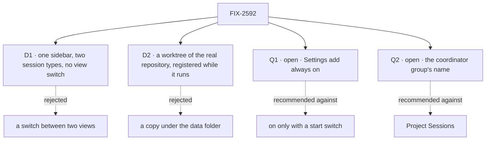

# FIX-2592 · Decisions

[Spec](SPEC.md) · **Decisions**

The calls above any single issue, and what each locks in for the six children and the closure.
D2, Q1 and Q2 are the sign-off. D1 was the owner's call before the draft and is a card because it
is the product's shape. Q1 and Q2 are open and the owner's.

## The tree

## D1 · One sidebar with two session types, and no view switch

| | |
|---|---|
| **Instead of** | The *Sessions* / *Projects* switch (FIX-2153 D1) · or one list with a type filter |
| **Because** | A view hides every session of the other type, and the keys that cross views exist to patch that. A session's type is already the worker it is with, so one list costs nothing the data does not hold |
| **Locks in** | `?view=` leaves the address. ⌘K and Alt+↑/↓ cover all sessions. Two headed groups is the proposed shape; FIX-2594's spec confirms it against one list with a type tag. A session's type stays derived from its main worker, never stored. **Supersedes FIX-2153 D1** |

A **work session** is the main worker doing the work and handing pieces to background tasks (right
pane: *Background tasks*). A **coordinator session** is the lead filing work as tasks on a board
(right pane: *Tasks*). The groups' names are [Q2](#q2).

**What would change my mind:** so many sessions of one type that two groups bury the other. Then
the filter FIX-2402 owns is the fix, not the switch back.

It comes down to sight: with a switch, half a person's sessions are always out of view.

## D2 · A registered repository is a worktree of the real repository, and the package learns to register one while running

| | |
|---|---|
| **Instead of** | A copy under the lab's data folder for any repository added after start (today) · or a fixed list read at start, a restart per repository |
| **Because** | The person chose a repository from a list, so the work should be a branch in it, where their own git tools show it. A copy puts it where nobody looks. Rebuilding the host per repository drops every live run's claim, and FIX-2152 ER-4 sends a need like this to the package |
| **Locks in** | FIX-2593 first, with its own spec and PR; FIX-2594 waits. A worktree lets a run move the repository's branches with the operator's access; a copy never does. So registration is an operator act ([ER-4](#who-owns-what), [Q1](#q1)). **Which default wins over FIX-2251:** the worktree. FIX-2369 ER-5 forbids a run in the developer's checkout, so the opt-out would amend ER-5 first. This epic neither builds it nor blocks it |

**What would change my mind:** an operator who will not let a run touch a repository's branches.
Then the copy stays the default and the dropdown means "a copy of".

It comes down to where the work lands: a copy leaves it where the person must go and fetch it.

## Q1 · Open · Settings add: always on, or on only when the operator starts the lab with it on?

**In plain terms.** Adding a repository lets runs work inside it with the operator's own access.
The lab serves one configured person, who is the operator.

**The options.** *Always on:* Settings adds a repository while the lab runs. *Switch:* it adds
only if the operator started the lab with a flag.

**The trade-off.** Always on is what Settings is for, with nothing to find or set. Its price is
that the lab cannot be put in front of a second person: any user could point runs at any local
repository. The switch is safe to share, and costs every first run the restart this epic removes.

**My recommendation: always on.** The lab already serves one person, and the environment variable
it replaces was as powerful. A host for more people gets its own gate first.

**What would change my mind.** Any plan to show the lab to a second person.

**What being wrong costs.** Low, until someone shares the lab. The switch is one setting.

It comes down to who sits at the page: today it is the operator, so a switch guards no one.

## Q2 · Open · What does the sidebar call the coordinator group: *Project Sessions* or *Workstreams*?

**In plain terms.** The group holds sessions where a lead splits a request into tasks on a board.
It needs a name, and both candidate words already mean something nearby.

**The options.** *Project Sessions* is the owner's first proposal; *Workstreams* is the one being
weighed. Workforce's **workstream** is a project entry with one owner, a lead worker from their
roster, and a lasting session of that lead (`openWorkstream`, `defineWorkstreamBlocks`);
Shift Manager shows them. This lab's coordinator sessions are ordinary sessions of a lead with no
such entry. FIX-2153 chose that on purpose, since a workstream needs a project and a lead and caps
a user at 25. The shape is close, and the word promises an entry the lab does not make.

**The trade-off.** After the rename, *project* is gone from this lab's words, and *Project
Sessions* brings it back beside *Repository* with a third meaning. *Workstreams* clashes only for
someone who also uses Shift Manager, and means something near. Either is one label to change; no
stored data names it.

**My recommendation: *Workstreams*.** The daily confusion is on this lab's own screen; the
cross-app one is rarer and close in meaning. If the lab later adopts real workstreams, the word
is right.

**What would change my mind.** People who use both apps expecting the lab to list Shift Manager's
workstreams. Then another word, or real workstreams.

**What being wrong costs.** Near zero: a label, a README line, goal text. Take your gut.

It comes down to the neighbour word: *Project* returns beside *Repository* with a third meaning.

## Who owns what

Every rule has one owner. Read a row to see where it is decided and where it is only used.

| # | Rule every child obeys | Owner | Checked at |
|---|---|---|---|
| ER-1 | **One list of repositories**: the project rows that have one. The host's registration is derived from it and rebuilt at start. The lab keeps no second list; the environment variable is not a second door | FIX-2594 | FIX-2593's and FIX-2594's spec review; the closure's restart leg |
| ER-2 | A repository added later passes every check one named at start passes, in the same words. Settings asks the host's `checkRepository` and copies none | FIX-2593 | FIX-2594's spec review; the closure |
| ER-3 | Removal never strands or kills a run holding a worktree of the repository: it still finishes, saves, lands, releases. Refuse or retire is FIX-2593's call. It reuses the host's in-use lock and refusal words, adds no second occupancy signal, and keeps FIX-2369 ER-5's one removal path | FIX-2593 | The closure's leg a |
| ER-4 | Registration is an operator act, never decided from a request field (BP-031). The host call is reachable only from the lab's server-side Settings action, which serves the one configured person ([Q1](#q1)) | FIX-2594 | FIX-2594's spec review; the lab's README |
| ER-5 | The lab says *repository*. `project` survives only where it names the workforce row or a package call (`listProjects`, `setWorkProject`, `readProjectSource`), inside the adapter and flow files. *Workspace* is never the person's word for it | FIX-2594 | Each lab child's review; the closure's sweep |
| ER-6 | No default repository; a session's type is read from its main worker, never stored (FIX-2152 ER-8) | FIX-2594 | The closure's leg b |
| ER-7 | Settings' add keeps FIX-2403: the check as the field is left, the *what happens to your repo* line, Create off while the server says no, the server's `repository-unusable` refusal | FIX-2594 | `checks-the-repository-first`, re-run at the closure |
| ER-8 | The working line reads the turn state the thread already reads: no new read, poll or store, and no repository code | FIX-2595 | FIX-2595's spec review; the closure's leg b |
| ER-9 | What a harness offers (models, plan mode) is asked of its package, never a list the lab keeps. Whether it lives on each package, on harness-manager or on core's neutral handle is FIX-2597's call, reconciled with FIX-2369 ER-1 | FIX-2597 | FIX-2598's and FIX-2599's spec review; the closure's legs c and d |
| ER-10 | Consumed issues keep their parents: FIX-2402 under FIX-2430, FIX-2251 under FIX-2440. FIX-2402, 2552, 2340, 2403, 2421 and 2152 are `relates-to` only | The coordinator | Each refresh |

## Coordination seams

| Seam | Between | Rule |
|---|---|---|
| The registration call's shape | FIX-2593 and FIX-2594 | FIX-2593's spec merges first; FIX-2594 is written against its names, and its build starts after FIX-2593's merges. A different shape is FIX-2593's to settle, never a lab workaround |
| `Thread.tsx`, `Entry.tsx`, the feed | FIX-2594 (header, no-repository note), FIX-2595 (end of the feed), FIX-2599 (plan card) | Different lines. FIX-2595 merges first; the others rebase |
| `Composer.tsx`, the harness flow, coder workers, `picks-the-coder` | FIX-2598 and FIX-2599 (and FIX-2523, outside) | FIX-2598 first; FIX-2599 rebases. FIX-2523 rebases whichever lands second |
| The dialog, `adapter.ts`, `test/fake-lab.ts` | FIX-2594, FIX-2598 | Each adds its own rows and verbs. A choice FIX-2598 puts in the dialog lands after FIX-2594 |
| `SessionsList.tsx`, `adapter.ts` | FIX-2594 and FIX-2552 (outside) | Second to merge rebases. FIX-2594 builds no live join; FIX-2552 re-adds no switch |
| `fsdev.config.mts`, `projects.mts`, the README, the lab's goal scripts | FIX-2594, FIX-2598, FIX-2599 | Each edits its own part, and the scripts that drive its own surface. FIX-2152 ER-1's caps hold for the glue |
| Kitchen Sink's Cursor list | FIX-2597 | Deleted in FIX-2597's PR (FIX-2369 ER-3) |

**Pairs that share files:** FIX-2594 with FIX-2595 and FIX-2599 (thread and feed); FIX-2598 with
FIX-2599 (composer, flow, workers, goals); FIX-2594 with FIX-2598 (dialog, adapter, config,
README). FIX-2593, FIX-2597 and FIX-2595 start together.

## Decided in review, recorded so no child reopens them

- **Naming (owner).** *Repository*, not *workspace*. `@flow-state-dev/workspace` uses *workspace*
  for a run's checkout folder and calls the registered thing a repository (`localRepositories`,
  `repositoryIdentity`). The project row stays storage.
- **Settings owns repositories (owner):** list, add, check, remove, plus the harness chips and
  first-run copy. The dialog's list ends with *Add repository…*, which opens Settings' add flow.
- **Remove clears the row's repository** with workforce's `setRepository(null)` and drops it from
  the host. The list is the rows that have a repository. Workforce has no delete verb and gains
  none. Adding again on an id whose row has none sets it, so FIX-2594 changes `refuseExisting`.
- **The coordinator group's name is not decided.** [Q2](#q2) holds it; every document says *work
  session* and *coordinator session* until then.
- **FIX-2402** keeps rename, archive and search. Its *Projects view* rename goes with the view;
  its *project chip* becomes a repository chip, taken by FIX-2594 or FIX-2402. A comment is left there.
- **FIX-2152 is not amended.** Its objective is extended. Two lines read as the old shape: the
  graph edge *the app, its mode switch and its task reads* in its `SPEC.md`, and the *app's mode
  switch* seams row in its `DECISIONS.md`. A wording amendment is the owner's call and blocks nothing.
- **FIX-2421.** Settings' list is a plausible home for the trust flag. Not decided here.
- **Model list source.** The harness package where one lists (Claude Code, Codex); a new list in
  the Cursor package. FIX-2598's spec settles per-session or not, the default, and the fate of the
  `Coder:` line and the worker ids.
- **Plan mode starts from a reproduction.** FIX-2599 names the failure on the real path before it
  designs, and files any package support as a child that blocks it.

## Split line

Six issues and a closure over two outcomes. **Repositories and one sidebar:** FIX-2593, FIX-2594,
FIX-2595. **Harness, model and plan mode:** FIX-2597, FIX-2598, FIX-2599. They share lab files but
no decision. A split gives each half its own closure with the matching legs. Recommended, because
FIX-2599's reproduction takes as long as it takes and the repository half would wait on it. Not
done: the owner placed both in this set.

## What the end-state POC showed

None built. The division is three chains on separate surfaces; a POC would show only a package
call's shape, which FIX-2593's and FIX-2597's specs own.

## Analysis

*(Filled by the analysis pass on this head.)*

## How it got here

- **Drafted (Nov 6)** — repositories and one sidebar from the owner's decisions; the working line added.
- **Name held (Nov 6)** — the coordinator group's name made open; Q2 added.
- **Scope grew (Nov 6)** — harness and model, plan mode and a harness-package child added; the split line recorded.

**Open: 2.** Q1 and Q2.
