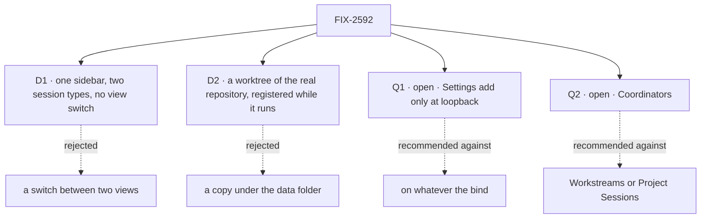

# FIX-2592 · Decisions

[Spec](SPEC.md) · **Decisions**

The calls above any single issue, and what each locks in for the six children and the closure.
D2, Q1 and Q2 are the sign-off. D1 was the owner's call before the draft and is a card because it
is the product's shape. Q1 and Q2 are open and the owner's.

## The tree

## D1 · One sidebar with two session types, and no view switch

| | |
|---|---|
| **Instead of** | The *Sessions* / *Projects* switch (FIX-2153 D1) · or one list with a type filter |
| **Because** | A view hides every session of the other type, and the keys that cross views exist to patch that. A session's type is already the worker it is with, so one list costs nothing the data does not hold |
| **Locks in** | `?view=` leaves the address. ⌘K and Alt+↑/↓ cover all sessions. Two headed groups is the proposed shape; FIX-2594's spec confirms it against one list with a type tag. A session's type stays derived from its main worker, never stored. **Supersedes FIX-2153 D1** |

A **work session** is the main worker doing the work and handing pieces to background tasks (right
pane: *Background tasks*). A **coordinator session** is the lead filing work as tasks on a board
(right pane: *Tasks*). The groups' names are [Q2](#q2).

**What would change my mind:** so many sessions of one type that two groups bury the other. Then
the filter FIX-2402 owns is the fix, not the switch back.

It comes down to sight: with a switch, half a person's sessions are always out of view.

## D2 · A registered repository is a worktree of the real repository, and the package learns to register one while running

| | |
|---|---|
| **Instead of** | A copy under the lab's data folder for any repository added after start (today) · or a fixed list read at start, a restart per repository |
| **Because** | The person chose a repository from a list, so the work should be a branch in it, where their own git tools show it. A copy puts it where nobody looks. Rebuilding the host per repository drops every live run's claim, and FIX-2152 ER-4 sends a need like this to the package |
| **Locks in** | FIX-2593 first, with its own spec and PR; FIX-2594 waits. A worktree lets a run move the repository's branches with the operator's access; a copy never does. So admission follows the transport's bind ([ER-4](#who-owns-what), [Q1](#q1)). **Which default wins over FIX-2251:** the worktree. FIX-2369 ER-5 forbids a run in the developer's checkout, so the opt-out would amend ER-5 first. This epic neither builds it nor blocks it |

**What would change my mind:** an operator who will not let a run touch a repository's branches.
Then the copy stays the default and the dropdown means "a copy of".

It comes down to where the work lands: a copy leaves it where the person must go and fetch it.

## Q1 · Open · Settings add: on whatever the bind, or only while the lab is bound to loopback?

**In plain terms.** Admitting a repository lets runs work inside it with the operator's own
access, and loads its `CLAUDE.md` and skills into every run (the lab reads project settings).
`fsdev dev` binds loopback by default, where the person at the page is the operator. On any
other bind it runs fsdev's authentication guard, which says who a person is, not that they are
the operator.

**The options.** *Loopback only:* Settings adds a repository while the lab is bound to loopback,
and refuses on another bind unless the operator started the lab with a flag. *Whatever the bind:*
Settings always adds.

**The trade-off.** On the one-person loopback lab the two are the same. They differ when the lab
is shared: *whatever the bind* lets any signed-in user point runs at any local repository.
*Loopback only* costs a check of the bind and one flag.

**My recommendation: loopback only.** The transport already makes this decision, so no request
field does (BP-031), and the one-person lab loses nothing.

**What would change my mind.** The lab never being served beyond loopback. Then always on is
simpler and enough.

**What being wrong costs.** Low, until someone shares the lab. Adding the check later is small.

It comes down to a second person: an authenticated user is not thereby the operator.

## Q2 · Open · What does the sidebar call the coordinator group: *Coordinators*, *Workstreams* or *Project Sessions*?

**In plain terms.** The group holds sessions where a lead splits a request into tasks on a board.
It needs a name, and the two words the owner weighed already mean something nearby.

**The options.** *Project Sessions* is the owner's first proposal; *Workstreams* is the one being
weighed. Workforce's **workstream** is a project entry with one owner, a lead worker from their
roster, and a lasting session of that lead (`openWorkstream`, `defineWorkstreamBlocks`). Shift
Manager shows them, and its ⌘K palette already has a *Workstreams* group, on the keys the lab will
use. This lab's coordinator sessions are ordinary sessions of a lead with no such entry. FIX-2153
chose that on purpose, since a workstream needs a project and a lead and caps a user at 25.
*Coordinators* is a third option: the lead runs on the coordinator flow, and Workforce's own
*project coordinator* is the same kind of worker.

**The trade-off.** After the rename, *project* is gone from this lab's words, and *Project
Sessions* brings it back beside *Repository* with a third meaning. *Workstreams* promises an entry
the lab does not make, and clashes with the palette. *Coordinators* clashes with neither, and costs
a line of help for a newcomer. Any of them is one label to change; no stored data names it.

**My recommendation: *Coordinators*.** It names what the lead does and clashes with nothing on
either app's screen.

**What would change my mind.** People who want this lab to list Shift Manager's workstreams. Then
real workstreams, or that word.

**What being wrong costs.** Near zero: a label, a README line, goal text. Take your gut.

It comes down to the neighbour word: *Workstreams* has a palette group and *Project* a third meaning.

## Who owns what

Every rule has one owner. Read a row to see where it is decided and where it is only used.

| # | Rule every child obeys | Owner | Checked at |
|---|---|---|---|
| ER-1 | **One list of admitted repositories**, kept by the host and persisted in its root, as the fetch pins are; `CLAUDE_CODE_STYLE_REPOSITORIES` seeds the same list. A project row only points at one. Nothing is admitted by being named in a row, because anyone can write one (BP-031). The lab keeps no second list | FIX-2593 | FIX-2594's spec review; the closure's restart leg |
| ER-2 | A repository added later passes every check one named at start passes, in the same words. Settings asks the host's `checkRepository` and copies none | FIX-2593 | FIX-2594's spec review; the closure |
| ER-3 | Removal is refused while git lists any worktree of the repository under the host's root, a run waiting for review included, since it still needs `land`. The refusal says how many. No retire state; a restart changes nothing. One removal path stays (FIX-2369 ER-5) | FIX-2593 | The closure's leg a |
| ER-4 | Admitting a repository is decided by the transport, never by a request field (BP-031): Settings' add is on while the lab is bound to loopback, and refused on another bind unless the operator turned it on ([Q1](#q1)) | FIX-2594 | FIX-2594's spec review; the lab's README |
| ER-5 | The lab says *repository*. `project` survives only where it names the workforce row or a package call (`listProjects`, `setWorkProject`, `readProjectSource`), inside the adapter and flow files. *Workspace* is never the person's word for it | FIX-2594 | Each lab child's review; the closure's sweep |
| ER-6 | No default repository; a session's type is read from its main worker, never stored (FIX-2152 ER-8) | FIX-2594 | The closure's leg b |
| ER-7 | Settings' add keeps FIX-2403: the check as the field is left, the *what happens to your repo* line, Create off while the server says no, the server's `repository-unusable` refusal | FIX-2594 | `checks-the-repository-first`, re-run at the closure |
| ER-8 | The working line reads the turn state the thread already reads: no new read, poll or store, no repository code | FIX-2595 | FIX-2595's spec review; the closure's leg b |
| ER-9 | What a harness offers is asked of its package, never a list the lab keeps. Models are FIX-2458's. Plan mode and the model-choice shape lifted from Kitchen Sink are FIX-2597's, reconciled with FIX-2369 ER-1 | FIX-2597 | FIX-2598's and FIX-2599's spec review; the closure's legs c and d |
| ER-10 | The person's harness, model and plan choice is stored once and read by the harness slot. The message text is not the carrier, and `Coder:` goes or is demoted. Where it lives (task input, session state or a harness-manager feed) is FIX-2598's call, and a package change is a child that blocks it. Amends FIX-2152 ER-9 and FIX-2157 D5 | FIX-2598 | FIX-2599's spec review; the closure's legs c and d |
| ER-11 | Consumed issues keep their parents: FIX-2402 under FIX-2430, FIX-2251 under FIX-2440, FIX-2585 under FIX-2369, FIX-2458 under FIX-2447. FIX-2402, 2552, 2340, 2403, 2421 and 2152 are `relates-to` only | The coordinator | Each refresh |

## Coordination seams

| Seam | Between | Rule |
|---|---|---|
| The registration call's shape and its persisted list | FIX-2593 and FIX-2594 | FIX-2593's spec merges first; FIX-2594 is written against its names, and its build starts after FIX-2593's merges. A different shape is FIX-2593's to settle, never a lab workaround |
| `Thread.tsx`, `Entry.tsx`, the feed | FIX-2594 (header, no-repository note), FIX-2595 (end of the feed), FIX-2599 (plan card) | Different lines. FIX-2595 merges first; the others rebase |
| `Composer.tsx`, the harness flow, coder workers, `picks-the-coder` | FIX-2598 and FIX-2599 (and FIX-2523, outside) | FIX-2598 first; FIX-2599 rebases. FIX-2523 rebases whichever lands second |
| The dialog, `adapter.ts`, `test/fake-lab.ts` | FIX-2594, FIX-2598 | Each adds its own rows and verbs. A choice FIX-2598 puts in the dialog lands after FIX-2594 |
| `SessionsList.tsx`, `adapter.ts` | FIX-2594 and FIX-2552 (outside) | Second to merge rebases. FIX-2594 builds no live join; FIX-2552 re-adds no switch |
| `fsdev.config.mts`, `projects.mts`, the README, the lab's goal scripts | FIX-2594, FIX-2598, FIX-2599 | Each edits its own part, and the scripts that drive its own surface. FIX-2152 ER-1's caps hold: the Settings glue goes in `projects.mts` (32 lines), not the config (185 of 300) |
| Kitchen Sink's model picker | FIX-2597 and FIX-2458 (outside) | FIX-2458 deletes the hand-kept Cursor list; FIX-2597 lifts the choice shape the lab would otherwise copy, and deletes Kitchen Sink's copy in its PR (FIX-2369 ER-3) |

**Pairs that share files:** FIX-2594 with FIX-2595 and FIX-2599 (thread and feed); FIX-2598 with
FIX-2599 (composer, flow, workers, goals); FIX-2594 with FIX-2598 (dialog, adapter, config,
README). FIX-2593, FIX-2597 and FIX-2595 start together.

## Decided in review, recorded so no child reopens them

- **Naming (owner).** *Repository*, not *workspace*: `@flow-state-dev/workspace` uses *workspace*
  for a run's checkout folder and calls the registered thing a repository. The project row stays storage.
- **Settings owns repositories (owner):** list, add, check, remove, the harness chips and the
  first-run copy. The dialog's list ends with *Add repository…*, which opens Settings' add flow.
- **Remove unregisters** the repository, refused while a worktree of it exists ([ER-3](#who-owns-what)).
  The project row stays, shown as not admitted. No `setRepository(null)`, no workforce change;
  workforce has no delete verb and gains none.
- **Rows made before this epic are not admitted by it.** Their repository stays a copy until the
  person registers it in Settings. A repository in the environment variable is admitted at start,
  as it is a worktree today (BP-030).
- **The coordinator group's name is not decided.** [Q2](#q2) holds it. Every document says *work
  session* and *coordinator session* until then.
- **FIX-2402** keeps rename, archive and search. Its *Projects view* rename goes with the view; its
  *project chip* becomes a repository chip, taken by FIX-2594 or FIX-2402. A comment is left there.
- **FIX-2152 is not amended.** Its objective is extended. Two lines read as the old shape: the
  graph edge *the app, its mode switch and its task reads* in its `SPEC.md`, and the *app's mode
  switch* seams row in its `DECISIONS.md`. A wording amendment is the owner's call.
- **Model lists** are FIX-2458's. FIX-2598 settles per-session or not, the default and the worker
  ids, inside [ER-10](#who-owns-what).
- **Plan mode starts from a reproduction**, from FIX-2585, and files package support as a child
  that blocks it. Claude Code and Cursor have a plan mode; Codex has none. The sign-off composes an
  existing hold: the tool-approval hold on `ExitPlanMode`, or the review stop.

## Split line

Six issues and a closure over two outcomes. **Repositories and one sidebar:** FIX-2593, FIX-2594,
FIX-2595. **Harness, model and plan mode:** FIX-2597, FIX-2598, FIX-2599. They share lab files but
no decision. A split gives each half its own closure with the matching legs. Recommended: every
input to the harness half is outside the set (FIX-2458 is another project's epic, FIX-2585 is
unscheduled), and FIX-2599's reproduction takes as long as it takes, so the repository half,
buildable now, would wait on it. Not done: the owner placed both in this set.

## What the end-state POC showed

None built. The division is three chains on separate surfaces; a POC would show only a package
call's shape, which FIX-2593's and FIX-2597's specs own.

## Analysis

2026-11-06 · watermark 2026-11-06 (the epic filed) · **Right approach, with folds.** An Opus
analyst ran `reuse-review` and the seven objectives, with the `adhd` frames inline.

1. **Reuse** — registration **extends** `localRepositories` and its pins. Models are
   **FIX-2458's**: FIX-2597 shrank, and FIX-2598 waits for it.
2. **Prior art** — Conductor: an app list of repositories, one worktree per workspace, the
   user's own permissions (D2). VS Code Workspace Trust: trust granted in the UI, which fed Q1.
3. **Other shapes** — a provider callback loses, since `list`, `land` and `remove` run with no
   request context. Registering at app start restores the restart. Strongest other division: two
   epics ([Split line](#split-line)).
4. **New factors** — FIX-2458 and FIX-2585 are named and consumed. FIX-2421 is done, Kitchen Sink's.
5. **Necessity** — right size, slightly over: FIX-2595 could be a quick fix.
6. **Ergonomics** — the start option and the runtime call are one list ([ER-1](#who-owns-what)).
7. **Concerns** — three folded: ER-3 was unsafe across a restart and a review wait; admission
   derived from rows trusts whatever any caller wrote, so the host keeps the list; the chosen
   model had no path to a run ([ER-10](#who-owns-what)).

## How it got here

- **Drafted (Nov 6)** — repositories and one sidebar from the owner's decisions; the working line added.
- **Name held (Nov 6)** — the coordinator group's name made open; Q2 added.
- **Scope grew (Nov 6)** — harness and model, plan mode and a harness-package child added; the split line recorded.
- **Analysis (Nov 6)** — the host keeps the list of admitted repositories; removal is refused while a worktree exists; FIX-2597 shrank behind FIX-2458; the choice's carrier became ER-10; Q1 follows the bind; Q2 gained *Coordinators*.

**Open: 2.** Q1 and Q2.
