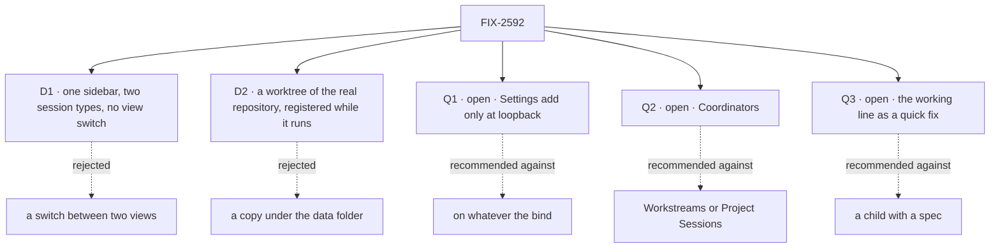

# FIX-2592 · Decisions

[Spec](SPEC.md) · **Decisions**

The calls above any single issue, and what each locks in for the three children and the closure.
D1 and D2 merged in #4873 and stand. Q1, Q2 and Q3 are open and the owner's, and are the sign-off.
The split of the merged set into two epics is the owner's decision of 2026-11-08, recorded in
[The split](#the-split).

## The tree

## D1 · One sidebar with two session types, and no view switch

| | |
|---|---|
| **Instead of** | The *Sessions* / *Projects* switch (FIX-2153 D1) · or one list with a type filter |
| **Because** | A view hides every session of the other type, and the keys that cross views exist to patch that. A session's type is already the worker it is with, so one list costs nothing the data does not hold |
| **Locks in** | `?view=` leaves the address. ⌘K and Alt+↑/↓ cover all sessions. Two headed groups is the proposed shape; FIX-2594's spec confirms it against one list with a type tag. A session's type stays derived from its main worker, never stored. **Supersedes FIX-2153 D1** |

A **work session** is the main worker doing the work and handing pieces to background tasks (right
pane: *Background tasks*). A **coordinator session** is the lead filing work as tasks on a board
(right pane: *Tasks*). The groups' names are [Q2](#q2).

**What would change my mind:** so many sessions of one type that two groups bury the other. Then
the filter FIX-2402 owns is the fix, not the switch back.

It comes down to sight: with a switch, half a person's sessions are always out of view.

## D2 · A registered repository is a worktree of the real repository, and the package learns to register one while running

| | |
|---|---|
| **Instead of** | A copy under the lab's data folder for any repository added after start (today) · or a fixed list read at start, a restart per repository |
| **Because** | The person chose a repository from a list, so the work should be a branch in it, where their own git tools show it. A copy puts it where nobody looks. Rebuilding the host per repository drops every live run's claim, and FIX-2152 ER-4 sends a need like this to the package |
| **Locks in** | FIX-2593 first, with its own spec and PR; FIX-2594 waits. A worktree lets a run move the repository's branches with the operator's access; a copy never does. So admission follows the transport's bind ([ER-4](#who-owns-what), [Q1](#q1)). **Which default wins over FIX-2251:** the worktree. FIX-2369 ER-5 forbids a run in the developer's checkout, so the opt-out would amend ER-5 first. This epic neither builds it nor blocks it |

**What would change my mind:** an operator who will not let a run touch a repository's branches.
Then the copy stays the default and the dropdown means "a copy of".

It comes down to where the work lands: a copy leaves it where the person must go and fetch it.

## Q1 · Open · Settings add: on whatever the bind, or only while the lab is bound to loopback?

**In plain terms.** Admitting a repository lets runs work inside it with the operator's own
access, and loads its `CLAUDE.md` and skills into every run (the lab reads project settings).
`fsdev dev` binds loopback by default, where the person at the page is the operator. On any
other bind it runs fsdev's authentication guard, which says who a person is, not that they are
the operator.

**The options.** *Loopback only:* Settings adds a repository while the lab is bound to loopback,
and refuses on another bind unless the operator started the lab with a flag. *Whatever the bind:*
Settings always adds.

**The trade-off.** The bind is what the process was started with, never a request's address or
`Host` header (BP-031); a port the operator forwards past loopback is their own act. On the
one-person loopback lab the two are the same. They differ when the lab
is shared: *whatever the bind* lets any signed-in user point runs at any local repository.
*Loopback only* costs a check of the bind and one flag.

**My recommendation: loopback only.** The transport already makes this decision, so no request
field does (BP-031), and the one-person lab loses nothing.

**What would change my mind.** The lab never being served beyond loopback. Then always on is
simpler and enough.

**What being wrong costs.** Low, until someone shares the lab. Adding the check later is small.

It comes down to a second person: an authenticated user is not thereby the operator.

## Q2 · Open · What does the sidebar call the coordinator group: *Coordinators*, *Workstreams* or *Project Sessions*?

**In plain terms.** The group holds sessions where a lead splits a request into tasks on a board.
It needs a name, and the two words the owner weighed already mean something nearby.

**The options.** *Project Sessions* is the owner's first proposal; *Workstreams* is the one being
weighed. Workforce's **workstream** is a project entry with one owner, a lead worker from their
roster, and a lasting session of that lead (`openWorkstream`, `defineWorkstreamBlocks`). Shift
Manager shows them, and its ⌘K palette already has a *Workstreams* group, on the keys the lab will
use. This lab's coordinator sessions are ordinary sessions of a lead with no such entry. FIX-2153
chose that on purpose, since a workstream needs a project and a lead and caps a user at 25.
*Coordinators* is a third option: the lead runs on the coordinator flow, and Workforce's own
*project coordinator* is the same kind of worker.

**The trade-off.** After the rename, *project* is gone from this lab's words, and *Project
Sessions* brings it back beside *Repository* with a third meaning. *Workstreams* promises an entry
the lab does not make, and clashes with the palette. *Coordinators* clashes with neither, and costs
a line of help for a newcomer. Any of them is one label to change; no stored data names it. The
sibling epic ([FIX-2616](https://linear.app/fixpoint-labs/issue/FIX-2616)) shows the same word in
its plan-mode and harness copy; both epics say *coordinator session* until this is decided.

**My recommendation: *Coordinators*.** It names what the lead does and clashes with nothing on
either app's screen.

**What would change my mind.** People who want this lab to list Shift Manager's workstreams. Then
real workstreams, or that word.

**What being wrong costs.** Near zero: a label, a README line, goal text. Take your gut.

It comes down to the neighbour word: *Workstreams* has a palette group and *Project* a third meaning.

## Q3 · Open · Does the working line leave this epic and ship as a quick fix, with no spec?

**In plain terms.** FIX-2595 keeps the "Claude is working" line at the bottom of the
conversation. The analysis found its fix is about five lines beside a sticky pattern the lab
already has. A child of this epic gets its own spec and a spec review before any code. A quick
fix gets a ticket and a pull request.

**The options.** *Quick fix:* FIX-2595 leaves this epic, is fixed through `adhoc-quick-fix`, and
still blocks the closure, so leg b sees it. *Stays a child:* the spec route it is on now.

**The trade-off.** A quick fix saves a spec and its review for five lines. It also drops the
direction gate: the pull request review is the only gate, and [ER-8](#who-owns-what) (the line
reads the turn state the thread already reads: no new read, poll or store) is checked there and
at the closure, not at a spec review. Either way leg b still looks for the line in view.

**My recommendation: a quick fix.** The fix is small and sits beside a pattern the lab has, and
ER-8 and leg b still check it.

**What would change my mind.** The fix turning out to need a new read of turn state. Then it is a
child with a spec again.

**What being wrong costs.** Low. A quick fix that grows comes back as a child with the spec it
skipped; a spec for five lines costs one review. If yes, a short amendment drops FIX-2595 from
the set table, and its Linear parent is cleared with its block on the closure kept.

It comes down to size: five lines do not earn a spec, and the closure's leg b still checks them.

## Who owns what

Every rule has one owner. Read a row to see where it is decided and where it is only used.

| # | Rule every child obeys | Owner | Checked at |
|---|---|---|---|
| ER-1 | **One list of admitted repositories**, kept by the host and persisted in its root, as the fetch pins are; `CLAUDE_CODE_STYLE_REPOSITORIES` seeds the same list, or, when it is unset, the repository the lab is started in. A project resource only points at one. Nothing is admitted by being named in a project resource, because anyone can write one (BP-031). The lab keeps no second list | FIX-2593 | FIX-2594's spec review; the closure's restart leg |
| ER-2 | A repository added later passes every check one named at start passes, in the same words. Settings asks the host's `checkRepository` and copies none | FIX-2593 | FIX-2594's spec review; the closure |
| ER-3 | Removal is refused while git lists any worktree of the repository under the host's root, a run waiting for review included, since it still needs `land`. The refusal says how many. A worktree git lists whose directory is gone is pruned first and not counted, so a crashed run cannot block removal for good. No worktree is made in a repository between the check and the unregistering, and a repository being removed takes no new run: one exclusion covers both, whose shape is FIX-2593's. No retire state; a restart changes nothing. One removal path stays (FIX-2369 ER-5) | FIX-2593 | The closure's leg a |
| ER-4 | Admitting a repository is decided by the host's own construction and the transport, never by a request field (BP-031). **The package:** registration refuses unless the host was built to allow it, default off, so no host app gains the door by upgrading. **The lab:** builds the host to allow it only while bound to loopback, or when the operator turned it on ([Q1](#q1)), read from the bind the process started with | FIX-2593 | FIX-2594's spec review, which sets it; the lab's README |
| ER-5 | The lab says *repository*. `project` survives only where it names the workforce resource or a package call (`listProjects`, `setWorkProject`, `readProjectSource`), inside the adapter and flow files. *Workspace* is never the person's word for it. The sibling epic's lab children obey this and do not own it | FIX-2594 | Each lab child's review, the sibling's included; the closure's sweep |
| ER-6 | No default repository; a session's type is read from its main worker, never stored (FIX-2152 ER-8) | FIX-2594 | The closure's leg b |
| ER-7 | Settings' add keeps FIX-2403: the check as the field is left, the *what happens to your repo* line, Create off while the server says no, the server's `repository-unusable` refusal | FIX-2594 | `checks-the-repository-first`, re-run at the closure |
| ER-8 | The working line reads the turn state the thread already reads: no new read, poll or store, no repository code | FIX-2595 | FIX-2595's spec review (or its pull request review, if [Q3](#q3) is yes); the closure's leg b |
| ER-9 | Consumed issues keep their parents: FIX-2402 under FIX-2430, FIX-2251 under FIX-2440. FIX-2402, 2552, 2340, 2403, 2421 and 2152 are `relates-to` only, and so is the sibling epic FIX-2616 | The coordinator | Each refresh |

## Coordination seams

Seams between this epic's own issues. The seams with the sibling epic's issues are in
[Between the two epics](#between-the-two-epics).

| Seam | Between | Rule |
|---|---|---|
| The registration call's shape and its persisted list | FIX-2593 and FIX-2594 | FIX-2593's spec merges first; FIX-2594 is written against its names, and its build starts after FIX-2593's merges. A different shape is FIX-2593's to settle, never a lab workaround |
| `Thread.tsx`, `Entry.tsx`, the feed | FIX-2594 (header, no-repository note), FIX-2595 (end of the feed) | Different lines. FIX-2595 merges first; FIX-2594 rebases |
| `SessionsList.tsx`, `adapter.ts` | FIX-2594 and FIX-2552 (outside) | Second to merge rebases. FIX-2594 builds no live join; FIX-2552 re-adds no switch |

**Pairs that share files:** FIX-2594 with FIX-2595 (thread and feed). FIX-2593 and FIX-2595 start
together.

**A cap note, not a seam.** FIX-2152 ER-1 caps a lab's configuration at 300 lines and its small
flows at three, each under 200. It counts `fsdev.config.mts` (85 lines), `host.mts` (158) and the
`workforce/**` Markdown (157) as configuration: about 400 on 2026-11-08, where the merged text
counted `fsdev.config.mts` alone (185). `workforce/flows/harness-thread.mts` is 346 lines, and the
three flows are `harness-thread`, `pins` and `projects` (32). The lab has no inventory script today.
FIX-2594's spec re-counts, keeps the Settings glue in `projects.mts` rather than the config, and
settles the cap through ER-1's own route if it must move.

## Between the two epics

This epic and [FIX-2616](https://linear.app/fixpoint-labs/issue/FIX-2616) share lab files and no
decision. **The rule: this epic's lab issues land first on the shared surfaces, and the sibling's
two lab issues rebase on them. The second issue to merge on a surface rebases; nothing is
blocked in Linear.**

| Surface | This epic | The sibling's | Order |
|---|---|---|---|
| The new-session dialog, `adapter.ts`, `test/fake-lab.ts` | FIX-2594 | FIX-2598 (a choice it puts in the dialog) | FIX-2594 first. Each adds its own rows and verbs |
| `Thread.tsx`, `Entry.tsx`, the feed | FIX-2594, FIX-2595 | FIX-2599 (the plan card) | FIX-2595, then FIX-2594, then FIX-2599. Different lines |
| `fsdev.config.mts`, `host.mts`, `projects.mts`, the README | FIX-2594 | FIX-2598, FIX-2599 | Each edits its own part. FIX-2594 rewrites the README for the sidebar and Settings; the sibling's issues update its *Coder* and plan sections, after FIX-2594 where one section moves |
| `Composer.tsx`, the harness flow, the coder workers | none | FIX-2598, FIX-2599 | The sibling's alone |
| The lab's goal scripts: `picks-the-coder` and the helper `lab.mts` (`openSessionOn`), which click the *Projects* tab and the *Choose a project* picker | FIX-2594 | FIX-2598, FIX-2599 | FIX-2594 moves their session-start steps to the dialog first and keeps them green; the sibling's issues then rewrite the chip legs |

**Why a stated order and not a Linear block.** The overlap is the same files, not a behaviour one
issue needs from the other. The harness choice lives in the composer and needs nothing from
Settings or the dialog. A block from FIX-2594 to FIX-2598 would also chain the sibling's lab
leg to FIX-2593, a package issue it does not need, and FIX-2598 already waits on FIX-2597. If
FIX-2598's own spec puts a choice in the dialog, that is a real dependency; the coordinator wires
the block then. **Neither closure waits on the other.** This closure uses the scripted coder.
The sibling's closure uses the repository the environment variable names, which [ER-1](#who-owns-what)
keeps as a seed, so it needs no Settings. A closure script that picks a coder follows
whichever chip is on `main` that day.

Two things bind both epics. [ER-5](#who-owns-what) (*repository*, not *project*) is this epic's rule
and the sibling's lab children obey it. [Q2](#q2) holds the coordinator group's name for both.

## Decided in review, recorded so no child reopens them

- **Naming (owner).** *Repository*, not *workspace*: `@flow-state-dev/workspace` uses *workspace*
  for a run's checkout folder and calls the registered thing a repository. The project resource
  stays storage.
- **Settings owns repositories (owner):** list, add, check, remove, the harness chips and the
  first-run copy. The dialog's list ends with *Add repository…*, which opens Settings' add flow.
- **Remove unregisters** the repository, refused while a worktree of it exists ([ER-3](#who-owns-what)).
  The project resource stays, shown as not admitted. No `setRepository(null)`, no workforce change;
  workforce has no delete verb and gains none.
- **Projects made before this epic are not admitted by it.** Their repository stays a copy until the
  person registers it in Settings. A repository in the environment variable is admitted at start,
  as it is a worktree today (BP-030).
- **The coordinator group's name is not decided.** [Q2](#q2) holds it. Every document says *work
  session* and *coordinator session* until then.
- **FIX-2402** keeps rename, archive and search. Its *Projects view* rename goes with the view; its
  *project chip* becomes a repository chip, taken by FIX-2594 or FIX-2402. A comment is left there.
- **FIX-2152 is not amended.** Its objective is extended. Two lines read as the old shape: the
  graph edge *the app, its mode switch and its task reads* in its `SPEC.md`, and the *app's mode
  switch* seams row in its `DECISIONS.md`. A wording amendment is the owner's call.
- **The gate sits in the package, the decision in the lab (review).** A published call that grants
  operator access should not depend on every host app remembering to gate it, so the option is the
  package's and defaults off; the lab only turns it on.

## The split

**Decided by the owner in session on 2026-11-08.** The merged set (#4873, merge commit
`5ff99605fc17dba2bfd76c832fd8ef92dab5951a`) held six issues and a closure over two outcomes, and
its *Split line* recommended a split without deciding one. **Repositories and one sidebar:**
FIX-2593, FIX-2594, FIX-2595, which stay here. **Harness, model and plan mode:** FIX-2597,
FIX-2598, FIX-2599, which went to [FIX-2616](https://linear.app/fixpoint-labs/issue/FIX-2616).
The reasons the merged text gave: every input to the harness half is outside the set (FIX-2458
belonged to another epic and is Done as of 2026-11-08; FIX-2585 is unscheduled), and FIX-2599's
reproduction takes as long as it takes, so the repository half, buildable now, would wait on it.
A split gives each half its own closure with the matching legs, so a leg that needs a signed-in
Claude Code never holds the other. They share lab files but no decision.

| What | Where it went |
|---|---|
| Children FIX-2597, FIX-2598, FIX-2599 | Parent changed to FIX-2616 in Linear; each stays in Backlog. FIX-2598 keeps its FIX-2458 block |
| The closure | FIX-2596 stays here, blocked by FIX-2593, FIX-2594, FIX-2595 only. FIX-2617 is the sibling's, blocked by its three |
| Rules | The merged ER-9 and ER-10 are FIX-2616's ER-1 and ER-2. The merged ER-11 is this epic's ER-9 and FIX-2616's ER-3. ER-1 to ER-8 keep their numbers |
| Legs | The merged legs a and b stay a and b. The merged c and d are FIX-2617's a and b |
| Figures | The box and the ownership matrix are redrawn for each epic. D1, D2, Q1 and Q2 and their figures stay here |
| Open holds | Q1 and Q2 stay here, and Q2 also shows in the sibling's copy. **Q3 is new:** the merged text said a second review recommended FIX-2595 as a quick fix and left it undecided |

The merged text in #4873 stays the record of the original direction. No child changed status,
no issue spec was written and nothing was dispatched by the split.

## What the end-state POC showed

None built. The division is two chains on separate surfaces; a POC would show only a package
call's shape, which FIX-2593's spec owns.

## Analysis

Inherited from the merged set, 2026-11-06 · watermark 2026-11-06 (the epic filed). An Opus
analyst ran `reuse-review` and the seven objectives, with the `adhd` frames inline. The
points that are this epic's:

1. **Reuse** — registration **extends** `localRepositories` and its pins.
2. **Prior art** — Conductor: an app list of repositories, one worktree per workspace, the
   user's own permissions (D2). VS Code Workspace Trust: trust granted in the UI, which fed Q1.
3. **Other shapes** — a provider callback loses, since `list`, `land` and `remove` run with no
   request context. Registering at app start restores the restart.
4. **Necessity** — right size, slightly over: FIX-2595 could be a quick fix ([Q3](#q3)).
5. **Ergonomics** — the start option and the runtime call are one list ([ER-1](#who-owns-what)).
6. **Concerns** — ER-3 was unsafe across a restart and a review wait; admission derived from
   project resources trusts whatever any caller wrote, so the host keeps the list.

Split pass, 2026-11-08 · an Opus analyst ran `analysis` and `reuse-review` on both drafted sets.
**Right approach, with folds.** Nothing is dropped or duplicated against the merged text, and the
code supports a stated merge order with no Linear block. Folded: FIX-2594 is a party to the goal
scripts `picks-the-coder` and `lab.mts`, which still click the *Projects* tab; the config count
follows ER-1's own definition (about 400 of 300, `host.mts` and the workforce Markdown counted);
ER-1's seed names the started-in default; the sibling edge reaches FIX-2595 on the graph; a stale
*row* in the Q2 figure. Recorded: no open item.

## How it got here

- **Drafted (Nov 6)** — repositories and one sidebar from the owner's decisions; the working line added.
- **Name held (Nov 6)** — the coordinator group's name made open; Q2 added.
- **Scope grew (Nov 6)** — harness and model, plan mode and a harness-package child added; the split line recorded.
- **Analysis (Nov 6)** — the host keeps the list of admitted repositories; removal is refused while a worktree exists; Q1 follows the bind; Q2 gained *Coordinators*.
- **Review (Nov 6)** — ER-4's owner moved to FIX-2593, the package refusing unless built to allow it; ER-3 prunes a crashed run's worktree and excludes a concurrent add; the closure reports each leg by itself; the debt read slightly up.
- **Merged (Nov 7)** — #4873 merged by the owner.
- **Split (Nov 8)** — the owner split the set; this epic kept the repository leg, the harness leg went to FIX-2616; Q3 added; the config count corrected against ER-1.

**Open: 3.** Q1, Q2 and Q3.
