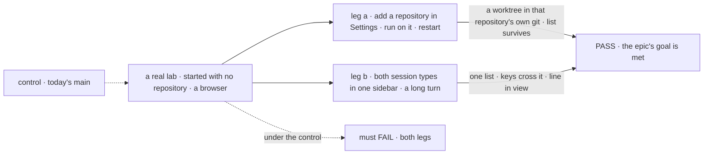
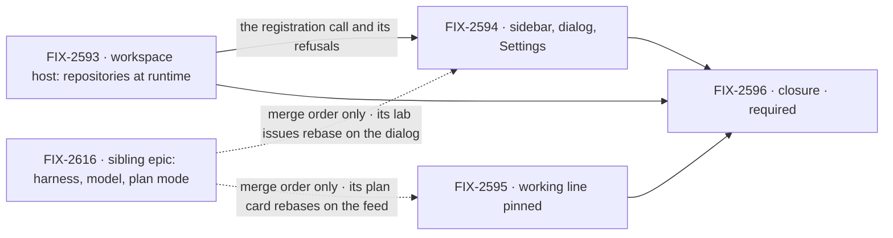

# FIX-2592 · Claude Code-style lab: repositories, one sidebar and a pinned working line

**Spec** · [Decisions](DECISIONS.md)

> **Amended 2026-11-08: split in two.** The set merged in #4873 (merge commit `5ff99605`) held
> six issues over two outcomes. The owner split it. This epic keeps the repository leg:
> FIX-2593, FIX-2594, FIX-2595 and the closure FIX-2596. Harness choice, model choice and plan
> mode (FIX-2597, FIX-2598, FIX-2599) moved to its own epic,
> [FIX-2616](https://linear.app/fixpoint-labs/issue/FIX-2616), with its own closure
> ([FIX-2617](https://linear.app/fixpoint-labs/issue/FIX-2617)). Why, and where each part went:
> [DECISIONS → The split](DECISIONS.md#the-split). The merged text stays the record of the
> original direction.

## Four teams, before and after

| A team that… | Today | After this epic |
|---|---|---|
| **works in the lab every day** | Two views behind a switch hide half the sessions | One sidebar of work sessions and coordinator sessions; the keys cross both; the address names the session, not a view |
| **starts a session on a repository** | Picks a "project", a word that means something else in two packages. A repository comes from an environment variable and a restart, or a form that makes a clone | Picks a session type and a repository, with nothing chosen for them. Adds a repository in Settings while the lab runs; its runs work in a git worktree of the real repository |
| **waits on a long turn** | Scrolls down to learn whether Claude is still working | The working line stays in view at the bottom |
| **builds an app on the workspace package** | Names repositories once, at host start | Adds and removes repositories while the host runs |

**Why now.** The lab is the app we use to build FSD, and the owner's pass over it found these
gaps together. The pieces exist: FIX-2403's repository checks are merged and FIX-2369 ER-5
already puts a coding run in a worktree. Nothing outside this set gates it: the harness half
had inputs outside its set, so it went to its own epic.

## The goal, and how we'll know it's met

**In the Claude Code-style lab, a person registers a repository once in Settings while the lab
runs, and starts either kind of session on it from one sidebar with the working line in view;
every run works in a git worktree of the real repository.**

| Is it the right goal? | |
|---|---|
| **The real need** | An app we can live in, which FIX-2369 asks of the labs. Today it teaches a wrong word, hides half its sessions, cannot add a repository without a restart and loses its status line |
| **Smaller, and rejected** | "Rename and one sidebar." It meets the look, but the list cannot take a repository added later, so it misleads |
| **Bigger, and not this epic's** | Harness, model and plan mode: the sibling epic [FIX-2616](https://linear.app/fixpoint-labs/issue/FIX-2616) · workstreams, members, MCP or checks in any screen · the lab's own trusted-repository flag · sessions joining live (FIX-2552) · rename, archive, search (FIX-2402) · a live-checkout opt-out (FIX-2251) |
| **Not done if** | The closure check has not run · a run lands in a repository nobody chose · Settings accepts a repository the server refuses · a host not built to allow it accepts a registration · removal strands a held worktree · a second list of repositories exists · *project* still names a repository in the lab · `?view=` is still read · the line scrolls out of view · a closure bug is open |

Leg a is the one the smaller goal would skip. Each leg is read from what the person sees or the
repository's own git, never from the lab's state.

| How we verify | |
|---|---|
| **Goal check** | The closure issue, [FIX-2596](https://linear.app/fixpoint-labs/issue/FIX-2596), on one `main` commit after every other child merges, in the browser. Both legs use the scripted coder, so neither needs a signed-in harness. **Each leg is reported by itself.** The goal is met only when both pass |
| **Signal** | **a:** the run's worktree is in the new repository's own `git worktree list` and the operator's own checkout is unchanged; an unusable repository is refused with its reason; removal with a run holding a worktree leaves it intact; the list survives a restart. **b:** both types in one list, ⌘K and Alt+↑/↓ cross them, `?session=` reopens one, and in a conversation taller than the view the working line is inside it |
| **Input** | A lab started with no repository (the variable empty, started outside a git repository). A repository made per run and left dirty on a branch, as an operator leaves one; a held-out prompt long enough to overflow the view |
| **Anti-game** | Read the repository's git and the browser's geometry. Never the chip, the adapter or a stubbed package call |
| **Control that must fail** | Today's `main`: both legs. A host that ignores runtime registration: leg a |

**Lead measure:** legs passing on `main`, of 2. **0 today.**

## What's in the box

![In the box: the lab's sidebar, dialog, Settings, repository wording and working line; the workspace package's runtime registration. A fence: the package refuses registration unless the host is built to allow it, and the lab allows it by the bind. Composed in by the app: which repositories the host admits. Replaced: the view switch and the environment variable as the only door. Not built: workstreams and members in any screen, the trust flag, live join, rename and search, a live-checkout opt-out, any workforce package change, and the sibling epic's harness, model and plan mode](figures/end-state.svg)

The fence is the cost of the worktree: a run in an admitted repository acts with the operator's
own access to it, so only the operator's door admits one: the package refuses unless the host is built
to allow it, and the lab allows it by the bind ([ER-4](DECISIONS.md#who-owns-what)).

**Docs:** no `apps/docs` page. FIX-2594 publishes the story in the lab's README (one sidebar,
Settings, *repository*). FIX-2593 writes a changeset; user pages follow at release.

## The set · as of 2026-11-08

The reviewed snapshot; live state is in Linear.

| Issue | What it delivers | Why the set needs it | Status |
|---|---|---|---|
| [FIX-2593](https://linear.app/fixpoint-labs/issue/FIX-2593) · package | The workspace host registers and removes repositories while it runs, with start-up's checks, and refuses unless it was built to allow it | Without it a repository added later gets a clone | Backlog · spec in the spec set |
| [FIX-2594](https://linear.app/fixpoint-labs/issue/FIX-2594) · lab | One sidebar, the new-session dialog, Settings, *repository* for *project* | The visible half of the repository goal | Backlog · blocked by FIX-2593 |
| [FIX-2595](https://linear.app/fixpoint-labs/issue/FIX-2595) · lab | The working line pinned at the bottom while a turn runs | Independent; the one the set could cut ([Q3](DECISIONS.md#q3)) | Backlog |
| [FIX-2596](https://linear.app/fixpoint-labs/issue/FIX-2596) · closure · **required** | The QA run on one `main` commit | Finds what falls between the others | Backlog · blocked by the three above |

All three children take the spec route; none is a bug. Three issues and a closure. Whether three
is two: FIX-2595 is the cut. The analysis found its fix is five lines beside a sticky pattern the
lab already has, so it could ship as a quick fix with no spec. The owner placed it as a child, and
it stays one until [Q3](DECISIONS.md#q3) is answered.

## How the issues flow into each other

An edge is what one issue hands the next. The dashed edge is not a block: the sibling epic's two
lab issues share files with FIX-2594 and FIX-2595 and merge after them, as
[DECISIONS → Between the two epics](DECISIONS.md#between-the-two-epics) says. FIX-2593 and
FIX-2595 start together. The closure waits on all three. Which lab issues share files, and how
their merges order, is in [DECISIONS](DECISIONS.md#coordination-seams).

## What stays as it is

- **Workforce.** No package change. A project resource stays the storage for a repository.
- **FIX-2402** (rename, archive, search) stays under FIX-2430. Its *rename the Projects view* and
  *project chip* parts are superseded here.
- **FIX-2552** and **FIX-2251** stay as filed. **FIX-2421** is done and is Kitchen Sink's; the lab
  loads a repository's `CLAUDE.md` and skills in every run. A lab flag, perhaps in Settings, is
  not decided here.
- **FIX-2340's overlay**: a neighbour.
- **The composer's *Coder* chip, the harness flow and plan mode** are the sibling epic's
  ([FIX-2616](https://linear.app/fixpoint-labs/issue/FIX-2616)); nothing here edits them.
- **Shift Manager**, **Kitchen Sink** and the **Teammates lab**.

## What's already here, and the debt

| Already here | What the set does with it |
|---|---|
| FIX-2153 D1: the mode comes from the view (`specs/issues/FIX-2153/DECISIONS.md#d1`); FIX-2157's *Projects view* wording | **Superseded** by [D1](DECISIONS.md#d1). A session's mode is still read from its main worker |
| FIX-2152's objective, and the *mode switch* in its graph edge and seams row | **Extended, not contradicted.** Not amended here |
| [FIX-2152 ER-8](../FIX-2152/DECISIONS.md#who-owns-what) and [FIX-2369 ER-5](../FIX-2369/DECISIONS.md#who-owns-what) (a run works in a project's worktree, never the developer's checkout) | **Kept.** The dialog's list carries the first; ER-5 is why the worktree wins over FIX-2251 ([D2](DECISIONS.md#d2)) |
| FIX-2403: the picker's repository check, disclosure and harness chips | **Moved** to Settings, behaviour kept ([ER-7](DECISIONS.md#who-owns-what)) |
| `localRepositories` and its start-up pins (`packages/workspace/src/local-host.ts`) | **Extends** (FIX-2593) |
| `checkRepository`, `repositoryIdentity`; git's own worktree list under the host's root | **Reuses**: the one check, the one identity rule, and git's worktree list as the occupancy signal that refuses *Remove* ([ER-3](DECISIONS.md#who-owns-what)). *Remove* unregisters from the host's list; no `setRepository(null)`. The in-use lock is not the signal: it does not survive a restart or a review wait |

| Adds | Existing piece considered | Why it doesn't fit / how composed |
|---|---|---|
| Register and remove a repository on a running host (FIX-2593) | `localRepositories`, `pinFetchSettings`, `checkRepository`, git's worktree list | Extends the same set and guards. A second host per repository drops live claims; an app-side list is a second list ([ER-1](DECISIONS.md#who-owns-what)) |
| Settings and the new-session dialog (FIX-2594) | `ProjectPicker`, `HarnessReadiness`, the ⌘K `Dialog` | Moves and recomposes them; adds the list and *Remove* |

| The debt | |
|---|---|
| **Removes** | The view switch and `?view=` · the environment variable as the only door, and `listed()` in the lab's config · the centre-screen picker · *project* as the lab's word |
| **Adds** | Runtime registration, kept across restarts, behind a host option that is off by default, on a published package. Permanent by design |
| **Leaves** | A project resource for every repository ever added, since workforce has no delete verb: a workforce issue if wanted, not filed. Two stale lines in FIX-2152 |

**Net: slightly up.** The lab sheds a switch, a private list and a hand-kept list; the package
gains one public registration call with a persisted list. A public call is permanent, so the
package side outweighs what the lab sheds.

## Sign off

**[The goal](#the-goal-and-how-well-know-its-met), at that size:** two legs, in the browser.
If wrong: a lab that adds repositories and still hides half its sessions, or the reverse.

**[The set's debt](#whats-already-here-and-the-debt), slightly up.** If wrong: project
resources nobody can delete, which workforce's own issue would pay.

**The objective, at its size.** It serves goal 1 of `docs/objectives.md` (validate through real
usage) and goal 4 (keep the foundation honest), narrowly: the lab is a proof app made coherent,
and the repository gap goes to the package, not into the lab. It does not move the Phase 1 finish
line (`goal:all` green, wave 1.n) except by the closure's check becoming one more defined goal.

**Decided before this amendment and standing:** [D1](DECISIONS.md#d1) (one sidebar) and
[D2](DECISIONS.md#d2) (a worktree of the real repository, registered while it runs) merged in
#4873. The split is the owner's call, recorded in [DECISIONS](DECISIONS.md#the-split), not asked.

1. **[Q1](DECISIONS.md#q1) · Open · Settings add: on whatever the bind, or only while the lab is
   bound to loopback?** I recommend loopback only.
2. **[Q2](DECISIONS.md#q2) · Open · What does the sidebar call the coordinator group?** I
   recommend *Coordinators*, over *Workstreams* and *Project Sessions*.
3. **[Q3](DECISIONS.md#q3) · Open · Does the working line leave this epic and ship as a quick
   fix?** I recommend yes.

**Open: 3.**

Epic · 3 issues and a closure · Workforce: Shift Manager · goals 1 and 4 of `docs/objectives.md`, narrowly
