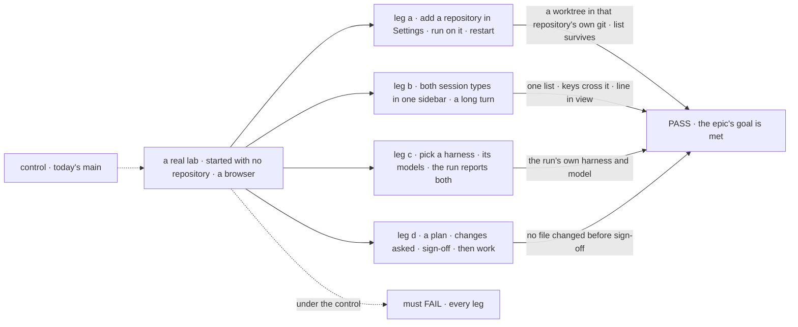
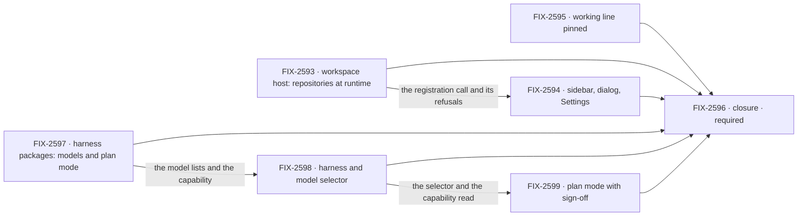

# FIX-2592 · Claude Code-style lab refinements: repositories, one sidebar, a status line, a harness and plan mode

**Spec** · [Decisions](DECISIONS.md)

## Five teams, before and after

| A team that… | Today | After this epic |
|---|---|---|
| **works in the lab every day** | Two views behind a switch hide half the sessions | One sidebar of work sessions and coordinator sessions; the keys cross both; the address names the session, not a view |
| **starts a session on a repository** | Picks a "project", a word that means something else in two packages. A repository comes from an environment variable and a restart, or a form that makes a clone | Picks a session type and a repository, with nothing chosen for them. Adds a repository in Settings while the lab runs; its runs work in a git worktree of the real repository |
| **waits on a long turn** | Scrolls down to learn whether Claude is still working | The working line stays in view at the bottom |
| **asks for a code change** | A *Coder* chip picks a worker, not a harness or a model. *Plan first* is a worker, and plan mode is broken | Picks a harness, then one of its models. Where the harness has a plan mode, signs the plan off before work starts |
| **builds an app on the workspace or harness packages** | Names repositories once, at host start. Kitchen Sink keeps a Cursor model list by hand | Adds and removes repositories while the host runs. Each harness package says its models and whether it has a plan mode |

**Why now.** The lab is the app we use to build FSD, and the owner's pass over it found these
gaps together. The pieces exist: FIX-2403's repository checks are merged, FIX-2369 ER-5 already
puts a coding run in a worktree, and two of three harness packages already list their models.

## The goal, and how we'll know it's met

**In the Claude Code-style lab, a person registers a repository once in Settings while the lab
runs, starts either kind of session on it from one sidebar with the working line in view, and
chooses a harness and one of its models; where that harness has a plan mode, the person signs
the plan off before work starts; every run works in a git worktree of the real repository.**

| Is it the right goal? | |
|---|---|
| **The real need** | An app we can live in, which FIX-2369 asks of the labs. Today it teaches a wrong word, hides half its sessions, cannot add a repository without a restart, loses its status line and cannot pick a model |
| **Smaller, and rejected** | "Rename and one sidebar." It meets the look, but the list cannot take a repository added later, so it misleads. **Two epics**, repositories and sidebar apart from harness, model and plan, is a real smaller goal; the owner's scope puts them in one set. The split line is in [DECISIONS](DECISIONS.md#split-line) |
| **Bigger, and not this epic's** | Workstreams, members, MCP or checks in any screen · the trusted-repository flag (FIX-2421) · sessions joining live (FIX-2552) · rename, archive, search (FIX-2402) · a live-checkout opt-out (FIX-2251) |
| **Not done if** | The closure check has not run · a run lands in a repository nobody chose · Settings accepts a repository the server refuses · removal strands a held worktree · a second list of repositories exists · *project* still names a repository in the lab · `?view=` is still read · the line scrolls out of view · the lab keeps a model list a package could give · plan mode is offered on a harness without one, or work starts before sign-off · a closure bug is open |

Leg a is the one the smaller goal would skip. Each leg is read from what the person sees or the
repository's own git, never from the lab's state.

| How we verify | |
|---|---|
| **Goal check** | The closure issue, [FIX-2596](https://linear.app/fixpoint-labs/issue/FIX-2596), on one `main` commit after every other child merges, in the browser: the scripted coder where a leg needs no model, a real signed-in harness where it does |
| **Signal** | **a:** the run's worktree is in the new repository's own `git worktree list`; an unusable repository is refused with its reason; removal with a run holding a worktree leaves it intact; the list survives a restart. **b:** both types in one list, ⌘K and Alt+↑/↓ cross them, `?session=` reopens one, and in a conversation taller than the view the working line is inside it. **c:** a harness change swaps the model list, and the run's tag shows what was chosen. **d:** a plan shows, a request for changes revises it, sign-off starts work; a harness without plan mode does not offer it |
| **Input** | A repository made per run, a held-out prompt long enough to overflow the view, models read from the list at run time |
| **Anti-game** | Read the repository's git, the run's own report and the browser's geometry. Never the chip, the adapter or a stubbed package call |
| **Control that must fail** | Today's `main`: every leg. A host that ignores runtime registration: leg a. A plan that does not wait for sign-off: leg d |

**Lead measure:** legs passing on `main`, of 4. **0 today.**

## What's in the box

![In the box: the lab's sidebar, dialog, Settings, repository wording, working line, harness and model choice and plan mode; the packages' runtime registration and each harness's models and plan mode. A fence: registering is an operator act. Composed in by the app: the list of repositories. Replaced: the view switch and the environment variable as the only door. Not built: workstreams and members in any screen, the trust flag, live join, rename and search, a live-checkout opt-out, any workforce package change](figures/end-state.svg)

The fence is the cost of the worktree: a run in a registered repository acts with the operator's
own access to it, so only the operator's door adds one ([ER-4](DECISIONS.md#who-owns-what)).

**Docs:** no `apps/docs` page. FIX-2594 publishes the story in the lab's README (one sidebar,
Settings, *repository*); FIX-2598 and FIX-2599 update its *Coder* and plan sections. FIX-2593 and
FIX-2597 each write a changeset; user pages follow at release.

## The set · as of 2026-11-06

The reviewed snapshot; live state is in Linear.

| Issue | What it delivers | Why the set needs it | Status |
|---|---|---|---|
| [FIX-2593](https://linear.app/fixpoint-labs/issue/FIX-2593) · package | The workspace host registers and removes repositories while it runs, with start-up's checks | Without it a repository added later gets a clone | Backlog · spec in the spec set |
| [FIX-2594](https://linear.app/fixpoint-labs/issue/FIX-2594) · lab | One sidebar, the new-session dialog, Settings, *repository* for *project* | The visible half of the repository goal | Backlog · blocked by FIX-2593 |
| [FIX-2595](https://linear.app/fixpoint-labs/issue/FIX-2595) · lab | The working line pinned at the bottom while a turn runs | Independent; the one the set could cut | Backlog |
| [FIX-2597](https://linear.app/fixpoint-labs/issue/FIX-2597) · package | Each harness package says its models and whether it has a plan mode; Cursor gains the list | The selector cannot list Cursor's models, or offer plan mode per harness, without it | Backlog |
| [FIX-2598](https://linear.app/fixpoint-labs/issue/FIX-2598) · lab | *Coder* becomes *Harness*, with that harness's models | The model half of the goal | Backlog · blocked by FIX-2597 |
| [FIX-2599](https://linear.app/fixpoint-labs/issue/FIX-2599) · lab | Plan mode as a harness option, signed off before work; reproduces the failure first | The plan half of the goal | Backlog · blocked by FIX-2598 |
| [FIX-2596](https://linear.app/fixpoint-labs/issue/FIX-2596) · closure · **required** | The QA run on one `main` commit | Finds what falls between the others | Backlog · blocked by the six above |

All six children take the spec route; none is a bug. Six issues and a closure. Whether six is
five: FIX-2595 is the cut, kept because it is independent and small. The collapse trigger is its
spec finding the fix is a few lines in a file FIX-2594 already edits. FIX-2599 may grow a package
child that blocks it.

## How the issues flow into each other

An edge is what one issue hands the next. The set consumes only merged work, so no input is
dashed. FIX-2593, FIX-2597 and FIX-2595 start together. The closure waits on all six. Which lab
issues share files, and how their merges order, is in
[DECISIONS](DECISIONS.md#coordination-seams).

## What stays as it is

- **Workforce.** No package change. A project row stays the storage for a repository.
- **FIX-2402** (rename, archive, search) stays under FIX-2430. Its *rename the Projects view* and
  *project chip* parts are superseded here.
- **FIX-2552**, **FIX-2421** (Settings' list is a plausible home for its flag; not decided here)
  and **FIX-2251** stay as filed.
- **FIX-2340's overlay** and **FIX-2523's attachments**: neighbours. FIX-2523 shares the composer
  with FIX-2598 and FIX-2599.
- **Shift Manager**, **Kitchen Sink** and the **Teammates lab**, except one Kitchen Sink file
  FIX-2597 changes.

## What's already here, and the debt

| Already here | What the set does with it |
|---|---|
| FIX-2153 D1: the mode comes from the view (`specs/issues/FIX-2153/DECISIONS.md#d1`); FIX-2157's *Projects view* wording | **Superseded** by [D1](DECISIONS.md#d1). A session's mode is still read from its main worker |
| FIX-2152's objective, and the *mode switch* in its graph edge and seams row | **Extended, not contradicted.** Not amended here |
| FIX-2152 ER-8 and FIX-2369 ER-5 (a run works in a project's worktree, never the developer's checkout) | **Kept.** The dialog's list carries the first; ER-5 is why the worktree wins over FIX-2251 ([D2](DECISIONS.md#d2)) |
| FIX-2403: the picker's repository check, disclosure and harness chips | **Moved** to Settings, behaviour kept ([ER-7](DECISIONS.md#who-owns-what)) |
| `localRepositories` and its start-up pins (`packages/workspace/src/local-host.ts`) | **Extends** (FIX-2593) |
| `checkRepository`, `repositoryIdentity`, the host's in-use lock; `setRepository` on a project | **Reuses**: the one check, the one identity rule, the one occupancy signal, and *Remove* |
| `listClaudeModels`, `listCodexModels`; Kitchen Sink's hand-kept Cursor list | **Builds on** the first two; **replaces** the third (FIX-2597) |
| The lab's *Plan first* worker and plan manager | **Replaces** with plan as a harness option (FIX-2599) |
| The review stop (*Resolve*, *Request changes*) and harness-manager's tool-approval hold | **Considered** as the sign-off; FIX-2599's spec picks one, with no new kind of hold |

| Adds | Existing piece considered | Why it doesn't fit / how composed |
|---|---|---|
| Register and remove a repository on a running host (FIX-2593) | `localRepositories`, `pinFetchSettings`, `checkRepository`, the in-use lock | Extends the same set and guards. A second host per repository drops live claims; an app-side list is a second list ([ER-1](DECISIONS.md#who-owns-what)) |
| Models and plan mode asked of each harness package (FIX-2597) | `listClaudeModels`, `listCodexModels`, `harnessReadiness` | Extends the same ask-with-no-run shape; only Cursor's list and the plan question are new |
| Settings and the new-session dialog (FIX-2594) | `ProjectPicker`, `HarnessReadiness`, the ⌘K `Dialog` | Moves and recomposes them; adds the list and *Remove* |
| A harness and model selector (FIX-2598) | The *Coder* chip | Extends it: the same chip, a different choice |
| A plan sign-off (FIX-2599) | The review stop, the tool-approval hold | Composes one; the spec picks |

| The debt | |
|---|---|
| **Removes** | The view switch and `?view=` · the environment variable as the only door, and `listed()` in the lab's config · the centre-screen picker · *project* as the lab's word · Kitchen Sink's Cursor list · the *Plan first* worker |
| **Adds** | Runtime registration on a published package; a models-and-plan question on three more. Permanent by design |
| **Leaves** | A removed repository leaves a project row with no repository, since workforce has no delete verb: a workforce issue if wanted, not filed. Two stale lines in FIX-2152 |

**Net: about flat.** The lab sheds a switch, a private list, a hand-kept list and a plan worker;
the packages gain two entries.

## Sign off

**[The goal](#the-goal-and-how-well-know-its-met), at that size:** four legs, in the browser.
If wrong: a lab that adds repositories and still cannot pick a model, or the reverse.

**[The set's debt](#whats-already-here-and-the-debt), about flat.** If wrong: a project row
nobody can delete, which workforce's own issue would pay.

**The objective, at its size.** It serves goal 1 of `docs/objectives.md` (validate through real
usage) and goal 4 (keep the foundation honest), narrowly: the lab is a proof app made coherent,
and the repository gap goes to the package, not into the lab. It does not move the Phase 1 finish
line (`goal:all` green, wave 1.n) except by the closure's check becoming one more defined goal.

1. **[D2](DECISIONS.md#d2) · A registered repository is a worktree of the real repository, and
   the package learns to register one while running.** If wrong: a run moves a branch the
   operator did not expect, or the dropdown means "a copy of".
2. **[Q1](DECISIONS.md#q1) · Open · Settings add: always on, or only with a start switch?** I
   recommend always on.
3. **[Q2](DECISIONS.md#q2) · Open · What does the sidebar call the coordinator group?** I
   recommend *Workstreams*, over *Project Sessions*.

**Open: 2.**

Epic · 6 issues and a closure · Workforce: Shift Manager · goals 1 and 4 of `docs/objectives.md`, narrowly
