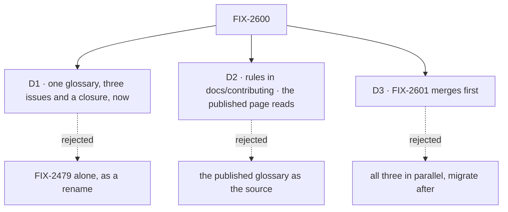

# FIX-2600 · Decisions

[Spec](SPEC.md) · **Decisions**

The calls above any single issue, and what each locks in for the three children and the
closure. D1 to D3 are the sign-off. The owner's naming decisions came before the draft and are
recorded as given, not reopened.

## The tree

## D1 · One glossary is worth three issues and a closure run, now

| | |
|---|---|
| **Instead of** | FIX-2479 alone, as a standalone rename · or a glossary page with no check reading it |
| **Because** | The epic started with a decision that contradicted an earlier one, found only by searching Linear. A rename fixes today's names, and a page nobody's check reads drifts the way `goal.md` did. Only one source that the checks read stops the next contradiction |
| **Locks in** | An epic slot and a closure run for work that is mostly plumbing. FIX-2354's collapse trigger ([SPEC](SPEC.md#the-set--as-of-2026-11-07)) |

**What would change my mind:** evidence that vocabulary decisions are rare enough that six
homes never disagree in practice. The 2026-11-02 and 2026-11-06 decisions, four days apart,
say they aren't.

It comes down to the next decision: a rename alone leaves nothing to stop it drifting again.

## D2 · The glossary for rules lives in `docs/contributing/`; the published page reads from it and is never a source

| | |
|---|---|
| **Instead of** | Making the published `apps/docs/docs/glossary.md` the source. It exists, and the guard already counts its rows |
| **Because** | A rule changes in the PR that coins the word. A normal PR cannot edit `apps/docs` (CI fails it); that page changes only at release. And user docs carry no retired words or decision links ([`user-docs.md`](../../../docs/contributing/user-docs.md), the outsider rule) |
| **Locks in** | Two pages titled "glossary". `GLOSSARY_TERMS`, the list of terms the published page must define, moves into the contributor glossary as a flag on each entry, so the page is checked against it. FIX-2601 picks the format: a document the checks parse, or a data module the document is generated from |

**What would change my mind:** release docs that can change in the same PR as the code. Then
one page could serve both readers.

It comes down to timing: the published page can't change in the PR that coins the word.

## D3 · FIX-2601 merges first; FIX-2354 and FIX-2479 write their rules into the glossary

| | |
|---|---|
| **Instead of** | All three building and merging in parallel, each editing `rules.mjs` and the guard, with the glossary migrating their rules afterwards |
| **Because** | `rules.mjs` and `check-retired-terms.mjs` are the one surface all three touch. In parallel, the resource rule is written twice (once in the old files, once in the glossary) and the migration reads rules that are changing under it |
| **Locks in** | FIX-2479, the largest child, merges only after FIX-2601. All three are specced together in the spec-set PR, so nothing waits to be specced, and FIX-2354 and FIX-2479 build in parallel with each other |

It comes down to the shared files: in parallel, the resource rule is written twice.

## Who owns what

Every rule has one owner; read a row to see where it is built and where it is only used. A
*uses* cell is a place a child must not decide again.

| # | Rule every child obeys | Owner | Checked at |
|---|---|---|---|
| ER-1 | A vocabulary rule (a term, the words it retires, its exemptions) is written only in the glossary. A check, skill, goal or script reads it and never restates it | FIX-2601 builds · FIX-2354, FIX-2479 use | The spec set's cross-spec review; closure leg a |
| ER-2 | The PR that coins or retires a public term edits its glossary entry in the same PR. Retiring happens nowhere else, by construction. CI refuses a new name built on a retired word, and a published glossary term with no entry; coining a new term is held by the naming skills and review, since no check can tell a new term from a new name | FIX-2601 builds · FIX-2479 uses | Each child's PR; the closure's journey A |
| ER-3 | Every vocabulary check reads every contributor tree: `packages`, `apps`, `labs`, `examples`, `docs/architecture`, `docs/contributing`, `.agents`, `goals`, the root `CLAUDE.md`, `AGENTS.md` and `CONTRIBUTING.md`, and the pending notes in `.changeset`. Every tracked file is read or excluded by a named rule; history (specs, `CHANGELOG.md`, `docs/internal/`) is excluded so. A retired *name* is refused in every tree; a retired English *meaning* only in code and published pages | FIX-2354 builds · FIX-2601 uses | FIX-2354's control; closure leg a |
| ER-4 | No new checker. The sweep, the Workforce guard and the side-chain check read the glossary, or merge; nothing is added beside them | FIX-2601 | The spec set's reuse review |
| ER-5 | The resource entry is the owner's 2026-11-06 table as written. A child that finds it wrong comments up on the epic rather than deciding | FIX-2601 builds · FIX-2479 uses | FIX-2479's spec review |
| ER-6 | Once the tree is renamed, the resource rule reads the whole tree at zero open, not only added lines | FIX-2479 | Closure leg b |
| ER-7 | A published page (`apps/docs`, a package README) changes only through `/release-docs` from a changeset, or a `docs-fix` PR for a page already released | FIX-2479 builds (its changeset) · FIX-2354 uses (its three page lines) | Each child's PR checks |

## Coordination seams

| Seam | Between | Rule |
|---|---|---|
| The glossary's tree map and entries (today's `rules.mjs`: `ROOTS`, each rule's `files`, `COLLECTION_ITEM`) | FIX-2601, FIX-2354, FIX-2479 | FIX-2601 moves them into the glossary first (D3), with each entry's name-or-meaning reach. FIX-2354 widens the map; FIX-2479 turns the resource entry to the whole tree |
| The guard's `process` area, which excludes `docs/contributing/` and `.agents/` | FIX-2354, FIX-2601 | FIX-2354 brings them into scope. FIX-2601's glossary reading must not exclude them again |
| The resource entry | FIX-2601, FIX-2479 | FIX-2601 writes it for added lines; FIX-2479 turns it to the whole tree in its own PR (ER-6) |
| `docs/contributing/architecture-reference.md` | FIX-2354, FIX-2479 | FIX-2354 renames `isInProcessDispatcher`; FIX-2479 changes "row" to "resource". The one that lands second rebases |
| The published glossary's term list | FIX-2601, `/release-docs` | FIX-2601 moves the list into the glossary; the page itself is written only at release |

## Decided before the draft, and in review

**The owner's decisions, 2026-11-06,** recorded as given. They supersede the 2026-11-02 "item"
decision.

- **A resource in a collection is a resource.** `collection.get()` returns a `ResourceRef`.
- **Type names:** `xResourceStateSchema` (zod value), `XResourceState` (stored data),
  `XResourceRef = ResourceRef<XResourceState>` (an instance), `XCollectionRef` (a collection's
  handle). Name the noun for what is stored.
- **Definitions keep their names** (`janitorResource`, `worktreesCollection`).
- **Lifecycle enums are Status** (`WorktreeStatus`), with no `…Type` suffix.
- **"State"** means scope state or resource state, nothing else.
- **`Task<I, O>` keeps its name** as the typed view over `TaskResourceState`.
- **"Row" stays** only in store adapters and visual UI list rows.

**Decided while drafting (engineering calls, under the EM posture):**

- **`RowHold`'s new name is FIX-2479's call, under the *ask* rule as it stands.** The draft
  ruled out `AskHold` / `"ask"`, reading the sweep's `ask-symbol` rule as refusing every
  `…Ask…` identifier. It doesn't: FIX-1876 D3 keeps *ask* for a question to a person, and `KEEP`
  already exempts those names (`MidwayAsk`, `AskDeclineReason`, all of `tasks/schema/hold.ts`).
  A row hold is a question or a `confirm`, so an *ask* name can qualify. Withdrawn in review
  (Codex, PR #4883); the epic sets no name.
- **FIX-2601's scope includes the side-chain check and `GLOSSARY_TERMS`.** Its issue lists four
  rule homes; there are six. Without both, the *not done if* line fails at the closure.
- **The glossary's format is FIX-2601's call.** A parsed document or a generated one; ER-1
  holds either way.

## What the end-state POC showed

None was built. The division's one risk is FIX-2354 folding into FIX-2601, and the spec set
answers that when both specs are written side by side. The assembled whole has no surface a
sketch would show that the closure's leg a doesn't.

## Analysis

### Analysis — FIX-2600 epic spec · 2026-11-07 · watermark 2026-11-07

Run inline by the author: the dispatch had no sub-agent tool, so this is not the fresh,
independent analyst the skill asks for. A fresh pass in the spec-set review covers that gap.

**Verdict:** Right approach, with changes. Two scope findings folded.

1. Reuse — the reuse review found the published glossary and the side-chain check. Both were
   missing from the issues. Glossary file: **genuinely new** as a rule source, because the
   published page can't change per PR. Checks: **reuse** all three (ER-4).
2. Prior art — [Vale vocabularies](https://docs.vale.sh/keys/vocabularies): one accept/reject
   file per vocabulary, which the rules read. [Kubernetes glossary](https://kubernetes.io/docs/reference/glossary/):
   one data file per term, rendered into the page. Both put the data first and the page second,
   which supports FIX-2601 generating the document from data. Not decided here.
3. Other shapes — two issues (the collapse trigger); FIX-2479 as direct-route renames by
   table, like FIX-2071 D2 (loses: `RowHold`'s new name is a decision); the published page as
   the source (D2).
4. New factors — FIX-2391 is done, so `HarnessReadinessRow` is on `main` and in FIX-2479's scope.
5. Necessity — yes, at this size. The leaner version is D1's rejected option.
6. Ergonomics — about twenty renames on one pattern, learned once. `InboxItem` still means
   something else; it is under *Bigger*.
7. Concerns — none.

| Finding | Objective | Changes the approach? | Disposition |
|---|---|---|---|
| The side-chain check and the published glossary are rule homes the issues miss | 1 | Yes: the goal's *not done if* | Folded into SPEC and DECISIONS |
| FIX-2479's `AskHold` breaks FIX-1876 D3 | 7 | No: the check exempts a person's question | Withdrawn in review; FIX-2479's call |
| Data-first glossary format | 2 | No | Recorded for FIX-2601 |

## How it got here

- **Drafted (2026-11-07)** — three issues and a closure under one glossary. The owner's
  2026-11-06 decisions are recorded as given. Analysis folded two rule homes the issues missed,
  and the `AskHold` collision.
- **Review round 1 (2026-11-07)** — two misreadings of today's sweep corrected. ER-3 keeps the
  pending changesets it already reads (Gitar). The `AskHold` ban is withdrawn: the *ask* rule
  exempts a person's question, so `RowHold`'s name is FIX-2479's (Codex).
- **Amended by the spec set (2026-11-07)** — ER-2's CI half narrowed to what a check can see
  (FIX-2601). ER-3 adds `labs`, `examples` and the root contributor files, requires every
  tracked file to be read or excluded by name, and reaches names everywhere and English meanings
  in code and pages only (FIX-2354). The collapse trigger did not fire: FIX-2601 moves the tree
  map without widening it, so FIX-2354 stays. FIX-2479's count is about eighty names, not twenty.

**Open: none.**
