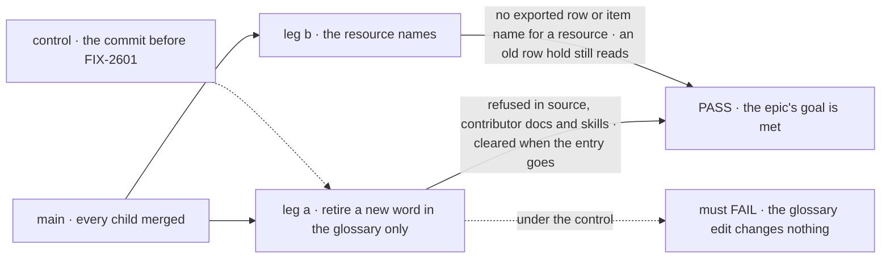
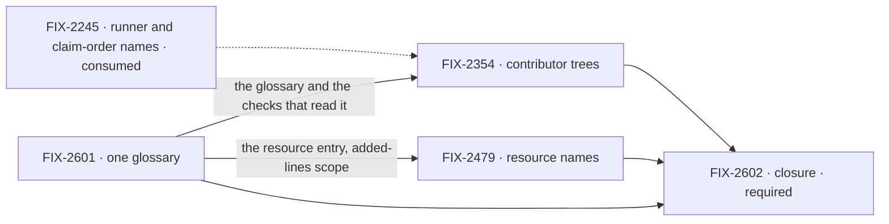

# FIX-2600 · Vocabulary: one word per thing, kept in one glossary

**Spec** · [Decisions](DECISIONS.md)

## Four teams, before and after

| A team that… | Today | After this epic |
|---|---|---|
| **names a new thing** (a contributor or an agent) | Has nowhere to check. Vocabulary rules sit in six places, and none says it is current | Looks the word up in one glossary. The PR that coins a public term adds its entry, and CI says so when it doesn't |
| **decides a word** (the owner) | Edits a goal file, a script header and a Linear issue, and hopes they agree. The 2026-11-06 "resource" call reversed a 2026-11-02 "item" call that CI still enforces | Changes one glossary entry. Every check enforces the new word from that one edit |
| **builds on the packages** | Meets a resource in a collection as `WorkerRow`, `ProjectRow`, `CollectionItemHandle`, and a lifecycle enum as `WorktreeState` | Meets `WorkerResourceState`, `WorkerResourceRef`, `WorktreeStatus`. *Item* means a stream item, *state* means scope or resource state |
| **reads contributor docs and skills** | The contracts page teaches the retired `isInProcessDispatcher`, and both vocabulary checks pass because neither reads `docs/contributing/` or `.agents/` | Those trees are read. A retired word fails CI there, as it does in package source |

**Why now.** The owner settled the resource convention on 2026-11-06, and it supersedes a
decision CI already enforces: `rules.mjs` → `COLLECTION_ITEM` still tells every PR to say
"collection item". The reversal was found only by searching Linear. FIX-2479 is about to rename
about twenty exported names, and with no single source the next decision can contradict this
one in the same way.

## The goal, and how we'll know it's met

**Each framework concept has one word, written in one glossary, and CI refuses a retired word
wherever a contributor reads it: package source, contributor docs and skills.**

| Is it the right goal? | |
|---|---|
| **The real need** | Tenet 1, one name for one thing, kept true over time. A word decision must not be able to contradict an earlier one without anyone seeing it |
| **Smaller, and rejected** | "FIX-2479's renames ship." The code conforms for a week, and the next decision lands in a seventh place. Or "a glossary page exists": a page that no check reads drifts, as `goal.md` did |
| **Bigger, and not this epic's** | Renaming words that collide but are not retired (*kind*, *worker*, *stream*, `InboxItem`); a naming-style linter; rewriting the published glossary page, which `/release-docs` writes |
| **Not done if** | A rule is still written outside the glossary (`goal.md` prose, a script's term list, `GLOSSARY_TERMS`, the side-chain check's list) · a check skips `docs/contributing/`, `.agents/` or a pending changeset · an exported name outside the store adapters and UI list rows uses *row* or *item* for a resource in a collection · a stored `kind: "row"` hold no longer reads · a bug the closure run found is open |

Leg a is the one the smaller goal skips: it proves the glossary is the only lever. Under the
control the same edit must change nothing, which is what makes its PASS mean something.

| How we verify | |
|---|---|
| **Goal check** | The closure issue's goal check (FIX-2602), on one `main` commit after every other child merges. Its clean run is the epic's wrap condition |
| **Signal** | Leg a: one glossary edit retires a word, and CI reports a planted use under `packages/`, `docs/contributing/` and `.agents/`. Removing the entry clears all three. Leg b: the resource rule reads the whole tree at zero open, and a task stored with a `kind: "row"` hold is answered |
| **Input** | A word chosen at run time that no check knows today, so no rule can already match it |
| **Anti-game** | The glossary is the only file the leg-a run edits. Don't assert on a check's own fixture tests: they pass while the CI step reads a different list |
| **Control that must fail** | The commit before FIX-2601 merges: the glossary edit changes nothing. The commit before FIX-2354: the plant under `.agents/` passes |

## What's in the box

![In the box: one glossary under docs/contributing with term, meaning, the words it replaces, exemptions and the decision; the three existing checks read it; every contributor tree is read; the package names follow the resource convention; skills and orientation point to it. Fence: a word is coined or retired only in the glossary, in the PR that names it. Composed in: the published glossary page, written by release-docs from the changesets. Replaced in one line: the rule lists in goal.md, rules.mjs, the guard header, GLOSSARY_TERMS and the side-chain check. Not built: colliding words that are not retired, a naming-style linter, store-adapter and UI rows, storage keys](figures/end-state.svg)

Inside the box is one place to write a rule and the three checks that read it. The fence is the
decision that keeps it one place ([D2](DECISIONS.md#d2)). The bottom strip is what the set
refuses to build.

**Docs:** the contributor story is "before you name a thing, check the glossary". FIX-2601
publishes it in `CLAUDE.md` and `AGENTS.md`. User docs change at release: FIX-2479's changeset
tells `/release-docs` what the published glossary and the collections pages rename
([ER-7](DECISIONS.md#who-owns-what)).

## The set · as of 2026-11-07

The reviewed snapshot. Live state is on [FIX-2600 in Linear](https://linear.app/fixpoint-labs/issue/FIX-2600).

| Issue | What it delivers | Why the set needs it | Status |
|---|---|---|---|
| [FIX-2601](https://linear.app/fixpoint-labs/issue/FIX-2601) | One glossary; the three checks, the naming skills and orientation read it | The substance. Without it every other child writes its rule into a file that can drift | Backlog · spec in the spec set |
| [FIX-2354](https://linear.app/fixpoint-labs/issue/FIX-2354) | The checks read `docs/contributing/` and `.agents/`; the six "dispatcher" leftovers renamed | The glossary's rules don't reach where agents read. Today's PASS reads wider than it is | Backlog · spec in the spec set |
| [FIX-2479](https://linear.app/fixpoint-labs/issue/FIX-2479) | The packages' names follow the resource convention; the resource rule covers the whole tree | The owner's 2026-11-06 decision, applied. Without it the glossary says one thing and the code another | Backlog · spec in the spec set |
| [FIX-2602](https://linear.app/fixpoint-labs/issue/FIX-2602) · closure · **required** | The QA run on one `main` commit: the goal check, each team's journey, every child's goal check, the seams | The only child that proves the glossary is the one lever | Backlog · blocked by FIX-2601, FIX-2354, FIX-2479 |

0 done · 4 open. Three are substance and one is the closure issue. Whether three is really two:
FIX-2354 is the one to fold, into FIX-2601, since both edit the sweep's file scope. It stays,
because it also renames six lines in released pages and code. **Collapse trigger:** if
FIX-2601's spec makes every check read every tracked tree by construction, FIX-2354 shrinks to
the six renames and goes direct.

## How the issues flow into each other

An edge is what one issue hands the next. A dashed input is consumed, not owned, and never
re-parented. FIX-2601 merges first ([D3](DECISIONS.md#d3)); all three are specced together in
one spec-set PR, and FIX-2354 and FIX-2479 can build in parallel once it lands. The closure
waits on all three.

## What stays as it is

- **Store-adapter rows and UI list rows.** `VersionedRow`, `ResourceStateRow`, SQL rows,
  `ToolRow`, `TaskRowActions`. They are rows.
- **Stream items.** `OutputItem`, `getItems`. *Item* keeps that one meaning.
- **History.** Specs, released notes in `CHANGELOG.md`, `docs/internal/`, verdict logs. Not
  rewritten, not read by the checks. A pending `.changeset/*.md` is not history: `/release-docs`
  turns it into published pages, so the sweep reads it today and keeps reading it ([ER-3](DECISIONS.md#who-owns-what)).
- **Collection storage keys** (`projects/<id>`). Moving one breaks stores that hold data.
- **Words that collide but are not retired.** Their own decision, if ever.

## What's already here, and the debt

| Already here | What the set does with it |
|---|---|
| `goals/vocabulary/one-word-per-thing` (FIX-1876): `RETIRED`, `KEEP`, `COLLECTION_ITEM`, `ROOTS`, run in CI | **Builds on.** It becomes a reader of the glossary |
| `scripts/check-retired-terms.mjs`: Workforce's retired words, `GLOSSARY_TERMS`, the added-lines collection-row rule | **Builds on.** Its term lists move to the glossary; its `process` area stops excluding `docs/contributing/` and `.agents/` |
| `scripts/validate-side-chain-vocabulary.mjs` (FIX-766): the retired `work` / `background` names | **Builds on.** A sixth rule home FIX-2601's issue doesn't list; its words join the glossary |
| `apps/docs/docs/glossary.md`, the published glossary, its rows counted by the guard | **Leaves as a reader** ([D2](DECISIONS.md#d2)). It still says "one row" for a project, which FIX-2479's changeset hands to `/release-docs` |
| FIX-2071 ER-3: each rename adds its identifiers to `RETIRED` in the same PR | **Amended:** the same PR edits the glossary instead, and `RETIRED` is read from it |
| FIX-1876 D3: *ask* is only a question to a person | **Kept.** The sweep refuses other *ask* names and exempts a person's question by `KEEP` (`MidwayAsk`, `AskDeclineReason`, `tasks/schema/hold.ts`). FIX-2479 names `RowHold` under that rule ([decided below](DECISIONS.md#decided-before-the-draft-and-in-review)) |
| The 2026-11-02 "collection item" decision | **Superseded** by the owner's 2026-11-06 resource convention |

| Adds | Existing piece considered | Why it doesn't fit / how composed |
|---|---|---|
| One glossary file (FIX-2601) | The published glossary; `goal.md` | Extends neither. The published page is written only at release and carries no retired words or decision links; `goal.md` is one goal's notes. The new file replaces six lists, so the count goes down |
| No new check | The sweep, the Workforce guard, the side-chain check | **Reuse.** All three read the glossary ([ER-4](DECISIONS.md#who-owns-what)) |

| The debt | |
|---|---|
| **Removes** | Six places a rule is written, down to one; about twenty off-convention exported names; the superseded `COLLECTION_ITEM` wording |
| **Adds** | One glossary file, permanent by design |
| **Leaves** | Two pages titled "glossary", one for contributors and one for users. The published one lags until the next release |

**Net: down.** Six rule homes become one, and no check is added.

## Sign off

**[The goal](#the-goal-and-how-well-know-its-met), at that size:** one glossary that every
check reads, and the code following it. If wrong: we ship the renames and the next decision
drifts again, or we carry a closure leg nobody needed.

**[The set's debt](#whats-already-here-and-the-debt), net down:** six rule homes become one. If
wrong: two pages named glossary confuse a contributor about which one to edit.

1. **[D1](DECISIONS.md#d1) · One glossary is worth three issues and a closure run, now.** If
   wrong: a cycle on vocabulary plumbing that a rename alone would have covered.
2. **[D2](DECISIONS.md#d2) · The glossary for rules lives in `docs/contributing/`; the published
   page reads from it and is never a source.** If wrong: rules split again between a page CI
   counts and a file CI reads.
3. **[D3](DECISIONS.md#d3) · FIX-2601 merges first; the others write into the glossary.** If
   wrong: FIX-2479 waits a few days it didn't need to.

**Open: none.** The owner's 2026-11-06 decisions are recorded as given, and the rules every
child obeys are in [DECISIONS.md](DECISIONS.md).

Epic · 4 issues · Framework simplification & cleanup · Goal 4, keep the foundation honest (the
vocabulary-drift slice)
