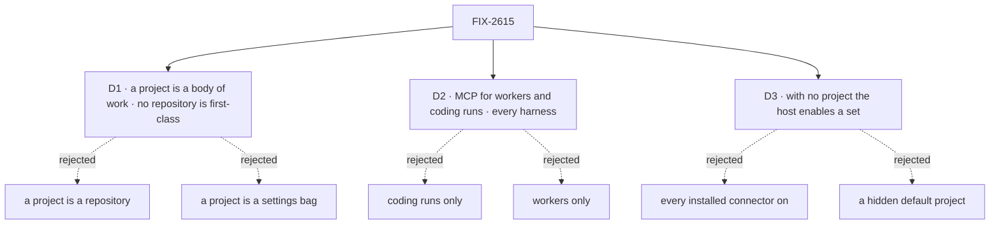

# FIX-2615 · Decisions

[Spec](SPEC.md) · **Decisions**

The calls that sit above any single issue: what is recommended, what loses, why, and what each
locks in for the issues under it. D1 to D3 are the three questions the epic was filed to settle.
They are the owner's, and each carries a recommendation. The engineering calls below them are
decided and recorded so no child reopens them.

## The tree

## D1 · What is a project: a body of work that may have no repository, or a repository with people on it?

**Plain terms.** Today a project is one stored record: a name and a brief, an owner and members,
a repository or none, the MCP servers it names, and the commands that check its work. A project
with no repository already works: its runs start from the project's own files and save back to
them. The question is whether that is the definition, or a stopgap until every project has a
repository.

| | |
|---|---|
| **Recommendation** | A project is a body of work: **what** it is (title, brief), **who** is in it (owner, members, private or shared), **what it works on** (a repository, or its own files when it has none), **what it may reach** (the connectors it enables, from the host's set) and **how its work is checked**. A project with no repository is first-class |
| **Instead of** | A project is a repository: no repository, no project · a project is a settings bag for runs (connectors, checks), with the work defined somewhere else |
| **Because** | Work without code is real work in the labs: research, a launch post, a plan. The owner already chose, on 2026-10-04, that a no-repository project starts from a clean set of files and keeps them ([FIX-1762](../../issues/FIX-1762/DECISIONS.md#decided-by-jake-2026-10-04)). A settings bag cannot answer who may work on it, which every run asks first |
| **Locks in** | Every coding path supports two sources, a checkout or the project's files, for good. A connector is something a project enables, never something it defines (ER-1). The row stays the project's one record ([FIX-1650 D2](../FIX-1650/DECISIONS.md#d2)) |

**What would change my mind:** if no app we plan has work without code. Then a repository
becomes required, and the project-files source is retired.

**What being wrong costs:** medium. The row is stored data, so a later change to it needs a
migration path, but no field moves under this recommendation.

![D1, what a project is. Recommended: a body of work, which may have no repository. Instead of: a project is a repository, or a project is a settings bag. It comes down to the first row, work without code: a body of work keeps it, a repository refuses it, a settings bag cannot say who may work on it. The cost of the recommendation is the second row: two sources for every coding path. Third row: what changes in stored data, nothing for the recommendation, a refusal for no-repository rows if a repository were required. Locks in a five-part row with connectors enabled, never defined. Flips if no planned app has work without code](figures/d1-what-a-project-is.svg)

It comes down to work without code: a repository-only project refuses it, and the owner has already chosen to keep it.

## D2 · Does MCP go to workers' models, coding runs or both, and does a worker need a project to reach it?

**Plain terms.** Two kinds of agent can use an MCP tool. A worker's model talks to a person and
files work (the lead). A coding run does the work in a checkout, on Claude Code, Codex or Cursor.
Today both can reach a project's servers, but only Claude Code among the coding runs, and only
inside a project.

| | |
|---|---|
| **Recommendation** | Both, through one path. A worker's model gets connectors when its worker file turns them on. A coding run gets them on all three harnesses. A worker needs no project to reach one: [D3](#d3) says how a host supplies them without one |
| **Instead of** | Coding runs only, which was FIX-1905's first shape · workers only, where the lead reads the issue and pastes it into the coder's brief |
| **Because** | Work that names an issue needs both sides. The lead reads the issue to file the right task, and the coder reads it and comments on it while it works. With one side only, a person or a model pastes text across, which goes stale and loses the link |
| **Locks in** | One resolution for every route (ER-2). Codex needs a local endpoint FSD serves, a design of its own inside FIX-1986. Supersedes [FIX-1905 D3](../../issues/FIX-1905/DECISIONS.md#d3), Claude Code only |

**What would change my mind:** if nobody runs Codex on project work. Then FIX-1986 keeps only
Cursor and Codex runs say they go without connectors, as they do today.

**What being wrong costs:** low to medium. The worst case is one harness design that nobody uses.

![D2, where MCP belongs. Recommended: workers' models and coding runs, on every harness, with no project needed. Instead of: coding runs only, or workers only. It comes down to the first row, work that names an issue: both sides read it with the recommendation; with one side only, a person or a model pastes text across. The cost of the recommendation is the second row: Codex needs a local endpoint FSD serves. Third row: workers and Claude Code runs already reach a project's servers in every option. Locks in one resolution for every route. Flips if nobody runs Codex on project work](figures/d2-where-mcp-belongs.svg)

It comes down to work that names an issue: with one side only, someone pastes the issue across.

## D3 · With no project, does the host enable connectors itself, or does every app need a project to reach one?

**Plain terms.** The Teammates lab has no projects, on purpose. Its operator already supplies the
Linear key through an environment variable. Something has to say which connectors a worker or a
run gets when no project is there to say it.

| | |
|---|---|
| **Recommendation** | The host enables a set for work outside a project: names drawn from its installed connectors, nothing else. Each run uses its own user's key; the operator's environment variable stands in only for the operator, and only while the operator has no stored key. A host that enables nothing behaves as today |
| **Instead of** | Every installed connector is on wherever there is no project · each host gets a hidden default project that every unprojected run belongs to |
| **Because** | It changes nothing for a host that has projects until it opts in. "All on" would give every conversation outside a project in Shift Manager Linear, silently. A hidden project is a second meaning of the word, and the Teammates lab made projects optional on purpose (FIX-2335) |
| **Locks in** | Two places enable a connector: the host's set and a project's list, with the same names and the same check. Work in a project gets the project's list only, never the host's set added to it. Outside a project, every user of the host gets the same set |

**What would change my mind:** if a host needs a connector on for some users and off for
others outside any project. Then enablement becomes per user, which is a bigger model than this
epic's.

**What being wrong costs:** low. It is one host option, and it can be widened later without
breaking anything.

![D3, how a host supplies connectors without a project. Recommended: the host enables a set for work outside a project. Instead of: every installed connector on wherever there is no project, or a hidden default project. It comes down to the first row, what changes for a host that already has projects: nothing until it opts in, against every conversation outside a project gaining Linear silently, against a second meaning of project. The cost of the recommendation is the second row: two places enable a connector. Third row: the key rule is the same in all three. Locks in one set for every user outside a project. Flips if a host needs per-user enablement outside projects](figures/d3-no-project.svg)

It comes down to a host that already has projects: "all on" widens its reach without anyone asking.

## Who owns what

![Who owns what: six rules across FIX-2645 connectors, FIX-1986 Codex and Cursor runs, FIX-2012 one redaction rule, FIX-2646 the closure and the coordinator. Each rule has exactly one owner. ER-1 a connector is installed only at the host: owned by FIX-2645. ER-2 one resolution and one client: owned by FIX-2645. ER-3 a key goes into the connection only: owned by FIX-2645. ER-4 one redaction rule: owned by FIX-2012. ER-5 core, engine and harness packages learn no connector: owned by FIX-1986. ER-6 FIX-2331 stays a separate epic: owned by the coordinator. The closure checks ER-1 to ER-5](figures/ownership.svg)

Every rule has one owner. A cell that says *uses* is a place a child must not decide again.

| # | Rule every child obeys | Owner | Checked at |
|---|---|---|---|
| ER-1 | A connector is installed only at the host. A project, a run or a task names it, and never holds its address or key. The public word is **connector**; "MCP server" means the remote endpoint only | FIX-2645 (D1) | FIX-1986's spec review · the closure |
| ER-2 | One resolution and one client: every route (a worker's model, each harness, with or without a project) plans through the same function and connects through `createMcpManager`. No child adds a second MCP client or key reader | FIX-2645 | FIX-1986's spec review |
| ER-3 | A key is read on the server for the run's own user, the one the engine resolved, never a field a caller sends. The operator's environment variable stands in only for the operator. The key goes into the connection's headers and nowhere else: no command line, environment, config file, prompt, item or response | FIX-2645 (keeps FIX-1905 D2, D4) | Every child's review · the closure's scan |
| ER-4 | One redaction rule removes a key of any length from everything that leaves the server | FIX-2012 | The closure's scan |
| ER-5 | Core, engine and the harness packages learn no connector and no project. A harness package takes relayed tools through its own generic option, as `claudeCodeAgent`'s `mcpTools` does | FIX-1986 | FIX-1986's implementation review |
| ER-6 | FIX-2331 (FSD as an MCP server) and FIX-567 stay outside this set and keep their parents. Nothing here makes workforce an MCP server | The coordinator | Each refresh |

## Coordination seams

| Seam | Between | Rule |
|---|---|---|
| The resolution (`planProjectMcp` and its connect step) | FIX-2645 and FIX-1986 | FIX-2645 reshapes it and lands first; FIX-1986 calls it for each harness and adds no branch for "no project" |
| The list of keys a failure is cleaned of | FIX-2645 and FIX-2012 | FIX-2645's plan produces the list; FIX-2012's single rule cleans it. Either can land first |
| The Teammates lab's host | FIX-2645 and FIX-1986 | FIX-2645 installs Linear there; FIX-1986 makes its default Cursor runs reach it. Neither adds a lab-only MCP path |
| MCP in both directions | This epic and FIX-2331 | They meet only at the MCP protocol. If one FSD host installs another's workforce server as a connector, that is an ordinary connector. FIX-2331's caller sign-in is not a connector key, and its `workforce_*` tool names do not collide with the `mcp__<connector>__` prefix |

## Decided before review, recorded so no child reopens them

Engineering calls, decided under the EM posture and not asked:

- **The word.** "Connector" for what a host installs; FIX-2645 adds its glossary entry. The
  project row's `mcpServers` becomes `connectors`, and a row with the old key still reads
  (BP-030). Renamed exports drop their old names, no alias (BP-034).
- **Allowed tools live on the connector**, so a coding run obeys the limit a worker does. A
  worker's file may narrow it, never widen it.
- **The set for work with no project is a host option on the same factory**, not a project row
  or a new collection.
- **The Teammates lab is wired inside FIX-2645**: a few lines in one host file, and the package
  slice needs a real consumer.
- **FIX-1986 keeps its title**; a comment widens it to runs with no project.
- **FIX-2331 is related, not absorbed and not reparented.**

## Decided in review

- **Leg a checks a second user's key** (review, 2026-11-10). With one user, a lab-only
  environment-key wiring passed leg a, so the check could not fail for the rejected smaller
  goal (BP-003). Leg a now has a second Teammates user whose calls must carry that user's
  stored key, and the lab-only wiring is a control that must fail. Enforces ER-3; no decision
  moved.

## What the end-state POC showed

None built. The pieces exist and run today (FIX-1905, FIX-2388), so the open question was the
model, not whether the parts compose.

## Analysis

### Analysis — FIX-2615 epic spec · 2026-11-10 · watermark 2026-11-10

Run in the author's own context, not by an independent analyst; the coordinator may dispatch one.

**Verdict:** Right approach — a small set that widens two shipped mechanisms instead of adding a third.

1. Reuse — every Adds item extends an existing piece; only Codex's local endpoint is new, and FIX-1986 weighs `@flow-state-dev/mcp`'s transport for it. Kitchen Sink's environment-keyed chat agent is named in *Leaves*.
2. Prior art — Claude's connectors (an owner installs once, each member connects their own account, [support.claude.com](https://support.claude.com/en/articles/11176164-use-connectors-to-extend-claude-s-capabilities)) and Mastra's per-request `getToolsets()` ([mastra.ai](https://mastra.ai/docs/mcp/overview)) both match ER-1 and ER-3. Neither ties a connector to a project.
3. Other shapes — splitting by direction ("no project", "every harness") makes two children edit one resolution. Next variant (GitHub): one host entry, nothing copied.
4. New factors — FIX-2388 (#4415) and FIX-2421 merged; FIX-2331 filed, reconciled as a seam.
5. Necessity — should exist; the leaner version is the rejected smaller goal.
6. Ergonomics — one map of connectors, and one list without projects; the rename removes two names for one thing.
7. Concerns — Codex's endpoint is the one unknown cost; the collapse trigger bounds it.

| Finding | Objective | Changes the approach? | Disposition |
|---------|-----------|-----------------------|-------------|
| `allow` sits on the worker capability, so coding runs ignore it | 1 | Yes | Folded: moved onto the connector |
| Kitchen Sink chat agent keeps an environment-keyed MCP route | 1 | No | Recorded in *Leaves* |
| Codex endpoint may reuse `@flow-state-dev/mcp` | 1 | No | Recorded for FIX-1986's spec |

## How it got here

- **Drafted (Nov 10)** — two features, one bug and a closure. FIX-1986 and FIX-2012 reparented
  from no parent; FIX-2645 and the closure FIX-2646 filed. FIX-2331 related, not absorbed.
- **Analysis (Nov 10)** — `allow` moved onto the connector so both routes obey it.
- **Review round 1 (Nov 10)** — leg a gained a second user and the lab-only control.

**Open: none.**
