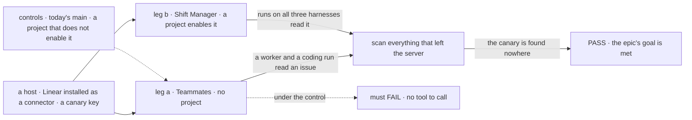
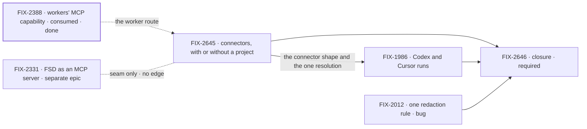

# FIX-2615 · MCP for workforce: connectors, and what a project is

**Spec** · [Decisions](DECISIONS.md)

## Four teams, before and after

| A team that… | Today | After this epic |
|---|---|---|
| **runs a host with no projects** (the Teammates lab) | No worker and no coding run can reach Linear or any MCP server: every route asks for a project first | The host installs Linear once, enables it for work outside a project, and every worker and run can use it |
| **works in projects** (Shift Manager, the Claude Code-style lab) | A project names MCP servers, and a Claude Code run gets them. A Codex or Cursor run on the same project gets nothing | A project enables connectors from the host's set, and a run gets them on any of the three harnesses |
| **keeps its own key** | The key stays server-side on the MCP path, but the error report keeps a short key in clear text (FIX-2012) | One rule takes a key out of everything that leaves the server, and a check proves it on every route |
| **builds the next workforce feature** | "Project" and "MCP server" are defined only by code comments and a user page | One contributor reference defines a project and a connector, and the next epic reads that |

**Why now.** The Teammates lab is the first app that needs a tracker and has no projects. FIX-2335 made projects optional on purpose, and FIX-1905 and FIX-2388 then shipped MCP only through a project. Every new app now picks a side of that gap. FIX-2331 (FSD as an MCP server) waits on a clear answer to "what is a connector, and what is a project" before it starts.

## The goal, and how we'll know it's met

**A host installs a connector once, and a worker or a coding run reaches it with its own user's key, with or without a project, and no key reaches a run, a prompt or a response.**

| Is it the right goal? | |
|---|---|
| **The real need** | A lab with no projects needs Linear, and a lab with projects needs it on every harness. Both need the same answer to whose key a run uses and where that key can go |
| **Smaller, and rejected** | "The Teammates lab gets Linear." A lab-only wiring of `createMcpCapability` with an environment key meets it, and it gives every user the operator's key and starts a second MCP route beside workforce's |
| **Bigger, and not this epic's** | FSD as an MCP server for outside agents ([FIX-2331](https://linear.app/fixpoint-labs/issue/FIX-2331)) · per-user OAuth sign-in · servers other than Linear · a change to how MCP tools reach a model |
| **Not done if** | The closure check has not run · a run with no project still needs a project row to reach a connector · a Codex or Cursor run on a project that enables Linear runs without it, with no reason given · two redaction rules remain · the reference is not written · a closure bug is open |

Leg a is the one the smaller goal would also pass, so its check reads which user's key the server received. The scan is the leg every route shares, and a canary planted in a status line must make it fail.

| How we verify | |
|---|---|
| **Goal check** | The closure issue, [FIX-2646](https://linear.app/fixpoint-labs/issue/FIX-2646), on one `main` commit after every other child merges. It uses a local MCP test server that records each call and the key it got, so the check needs no Linear account |
| **Signal** | **a:** in the Teammates lab, a worker and a Claude Code coding run each call the connector's tool, with the operator's key. **b:** in Shift Manager, runs on Claude Code, Codex and Cursor on a project that enables the connector each call it with the run owner's key. **Scan:** the canary key is in no request record, stream item, client response, log line or filed error report |
| **Input** | A held-out prompt that names an issue id; a canary key of seven characters, which FIX-2012's bug lets through today |
| **Anti-game** | Read the test server's own record of calls and keys, never a child's output or a stub. Scan the store and the wire, not one function's return |
| **Control that must fail** | Today's `main`: leg a (no project gets no connector) and the scan (the short key is in the error report). A project that does not enable the connector: its run must not call it. A planted canary: the scan must find it |

**Lead measure:** legs passing on `main`, of 3 (a, b and the scan). **0 today:** leg a has no route, leg b has no Codex or Cursor path, and the scan fails on the short key.

## What's in the box

![In the box: the host installs a connector once, with its address, how its key is supplied and which of its tools a user may use; a project enables connectors by name from that set; the host enables a set for work with no project; workers' models and coding runs on all three harnesses resolve through one path; one redaction rule; one contributor reference. A fence: a key is read on the server for the run's own user and goes into the connection only. Composed in by the app: which connectors it installs, which it enables outside a project, and its key-entry screen. Replaced in one line: the project-only gate, the second redaction rule, and the Claude Code-only relay. Not built: FSD as an MCP server, OAuth sign-in, servers beyond Linear, any change in core or engine](figures/end-state.svg)

Everything inside the box is the one model a host gets. The fence is the key rule: a run receives tools, never a key ([ER-3](DECISIONS.md#who-owns-what)). The strip at the bottom is what the set will not build.

**Docs:** one contributor reference, `docs/architecture/workforce-projects-and-connectors.md`, defines a project and a connector. [FIX-2645](https://linear.app/fixpoint-labs/issue/FIX-2645) writes it, and its changeset tells the release what the workforce *Projects* page must say. Each child records its own specifics in its changeset.

## The set · as of 2026-11-10

The reviewed snapshot. Live state is in Linear.

| Issue | What it delivers | Why the set needs it | Status |
|---|---|---|---|
| [FIX-2645](https://linear.app/fixpoint-labs/issue/FIX-2645) · package · spec | The connector: installed at the host with its address, key route and allowed tools. A project enables connectors from that set; the host enables a set for work with no project. One resolution for workers and runs. The glossary entry, the reference, and the Teammates lab as first consumer | The substance: leg a, and the model the others build on | Backlog |
| [FIX-1986](https://linear.app/fixpoint-labs/issue/FIX-1986) · package · spec | Codex and Cursor coding runs get connectors the way Claude Code runs do, with FSD still holding the key | Leg b on every harness. The Teammates lab's default harness is Cursor | Backlog · blocked by FIX-2645 |
| [FIX-2012](https://linear.app/fixpoint-labs/issue/FIX-2012) · **bug** · direct | One redaction rule: a short key is removed from error reports too | The scan fails without it | Backlog |
| [FIX-2646](https://linear.app/fixpoint-labs/issue/FIX-2646) · closure · **required** | The QA run on one `main` commit: legs a, b and the scan, each with its control | Proves the whole and finds what falls between the children | Backlog · blocked by the three above |

Two features, one bug and a closure. FIX-2012 is on the direct route, so it has no spec PR, and that empty cell is correct. Can it be fewer? Folding FIX-1986 into FIX-2645 makes one issue that changes three harness packages and the workforce model at once. Codex needs its own design, a local endpoint FSD serves ([FIX-1905 D3](../../issues/FIX-1905/DECISIONS.md#d3)). The collapse trigger: if FIX-1986's spec finds Cursor needs only one line, Cursor folds into FIX-2645 and FIX-1986 keeps only Codex.

## How the issues flow into each other

An edge is what one issue hands the next. A dashed input is consumed or a neighbour, never reparented; a heavy border is done. FIX-2645 and FIX-2012 start now, in parallel. FIX-1986 waits for the connector shape. The closure waits for all three. FIX-2331 is not an input: the seam is in [DECISIONS → Coordination seams](DECISIONS.md#coordination-seams).

## What stays as it is

- **FSD as an MCP server.** [FIX-2331](https://linear.app/fixpoint-labs/issue/FIX-2331) stays its own epic in its own project, related to this one and not reparented ([D2](DECISIONS.md#d2), ER-6).
- **The MCP client and the MCP transport.** `@flow-state-dev/tools/mcp` stays the one client; `@flow-state-dev/mcp` stays the server transport. Core and engine gain nothing.
- **Kitchen Sink's chat agent** keeps its environment-keyed `createMcpCapability`. It is not a workforce worker. Its harness modes keep the operator's own harness MCP config on a trusted repository ([FIX-2421](https://linear.app/fixpoint-labs/issue/FIX-2421)).
- **A project's repository and files** ([FIX-1762](../../issues/FIX-1762/DECISIONS.md#d1)), its members and visibility (FIX-1793), its workstreams and checks.
- **Which servers we support:** Linear only.

## What's already here, and the debt

| Already here | What the set does with it |
|---|---|
| [FIX-1905 D1](../../issues/FIX-1905/DECISIONS.md#d1), D2, D4: a project names servers from the host's set; FSD holds the connection and the key; each user sets their own key, with `seedEnv` for the operator | **Kept**, as [ER-1](DECISIONS.md#who-owns-what) and ER-3 |
| [FIX-1905 D3](../../issues/FIX-1905/DECISIONS.md#d3): Claude Code runs only | **Superseded** by [D2](DECISIONS.md#d2), through FIX-1986 |
| [FIX-2388 D4](../../issues/FIX-2388/DECISIONS.md#d4) (#4415): `projectMcpCapability` gives a worker's model the project's servers | **Builds on.** FIX-2645 widens it to work with no project and moves its `allow` onto the connector |
| [FIX-1650 D2](../FIX-1650/DECISIONS.md#d2): a project is a row in the org resource plane, nothing in L1 | **Kept** by [D1](DECISIONS.md#d1) |
| [FIX-1762 D1](../../issues/FIX-1762/DECISIONS.md#d1): a project with no repository runs on its own files | **Kept**, and named first-class by [D1](DECISIONS.md#d1) |
| FIX-2335: the Teammates lab has no projects | **Kept.** [D3](DECISIONS.md#d3) serves it without a project |
| FIX-1955, FIX-2436: stored keys are `secret` and not model-readable | **Builds on** |

| Adds | Existing piece considered | Why it doesn't fit / how composed |
|---|---|---|
| The connector entry: address, key route, allowed tools (FIX-2645) | `ProjectMcpServers` (`{ url, seedEnv }`) and `projectMcpCapability`'s `allow` option | **Extends** both: the same map, renamed, with `allow` moved onto the entry so the coding relay obeys it too |
| The host's set for work with no project (FIX-2645) | `planProjectMcp`, which stops when `runProjectOf` finds no project | **Extends** the plan: one list the host passes, read when there is no project. Same key rule, same client |
| Codex and Cursor relays (FIX-1986) | `projectMcpTools`' resolver; Cursor's `local.customTools`; `@flow-state-dev/mcp`'s server transport for Codex's local endpoint | **Extends** the resolver. Codex's endpoint is the one new piece, and its spec weighs serving it with the existing transport |
| The contributor reference (FIX-2645) | `apps/docs/docs/workforce/projects.md`, code comments | **New**: no contributor doc defines a project today |

| The debt | |
|---|---|
| **Removes** | The second redaction rule (FIX-2012) · the project-only gate on MCP · the Claude Code-only relay |
| **Adds** | One host option (the set for work with no project) · the `connectors` name on the project row with a read of the old `mcpServers` key (BP-030) · Codex's local endpoint |
| **Leaves** | Kitchen Sink's chat agent's environment-keyed MCP capability: a second way to install a server, outside workforce. Named here, not paid |

**Net: about flat.** The set removes a gate, a relay gap and a rule, and adds one option, one renamed field and one endpoint.

## Sign off

**[The goal](#the-goal-and-how-well-know-its-met), at that size:** with or without a project, on every harness, and a key scan on every route. If wrong: the Teammates lab gets Linear and Codex or Cursor runs still do not, or a key leaks on a route nobody checked.

**[The set's debt](#whats-already-here-and-the-debt), about flat.** If wrong: Kitchen Sink's second MCP route is copied by the next app.

1. **[D1](DECISIONS.md#d1) · A project is a body of work: what, who, what it works on and what it may reach. A project with no repository is first-class.** If wrong: a project model the next epic has to redraw.
2. **[D2](DECISIONS.md#d2) · MCP belongs to both workers' models and coding runs, on every harness, and a worker needs no project to reach a connector.** If wrong: one more harness design (Codex's endpoint) that nobody uses.
3. **[D3](DECISIONS.md#d3) · With no project, the host itself enables a set of connectors.** If wrong: a host gives every user a connector it meant for one project.

**Open: none.** The three calls are recommended and wait for the owner's sign-off on this PR. The rules every child obeys are in [DECISIONS.md](DECISIONS.md).

Epic · 4 issues · MCP · Goal 1, validate through real usage (the labs on real models need a tracker), and Goal 4, keep the foundation honest (one model, written down)
