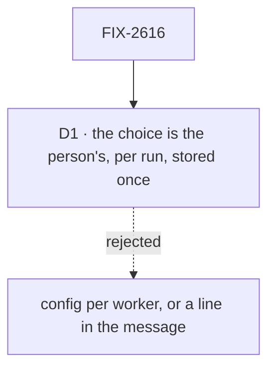

# FIX-2616 · Decisions

[Spec](SPEC.md) · **Decisions**

The calls above any single issue, and what each locks in for the three children and the closure.
D1 stands: it is the owner's rule ER-10, approved when #4873 merged, written here as a card because
it amends an approved rule, FIX-2152 ER-9. Its *what would change my mind* line is the only new text.
This epic has no open question of its own.

## The tree

## D1 · The harness, model and plan choice is the person's, per run, stored once and read by the harness slot

| | |
|---|---|
| **Instead of** | The harness chosen in config, per worker (FIX-2152 ER-9, FIX-2157 D5) · or a `Coder: X` line in the message text, relayed by the main session (today) |
| **Because** | The person knows which harness and model this change wants; a worker's config is fixed before the request. A message line has no path to a harness block's model resolver, so a chosen model never reached a run. Stored once and read by the slot, one choice has one reader |
| **Locks in** | Worker config stays the *default*; the person's pick overrides it for a run. The message text is not the carrier, and `Coder:` goes or is demoted. Where the choice lives (task input, session state or a harness-manager feed) is FIX-2598's call, and a package change is a child that blocks it. **Amends FIX-2152 ER-9 and FIX-2157 D5** |

**What would change my mind:** the path from the task to the harness slot needing more package
change than one child. Then the choice stays a worker default for now and a per-run choice is its
own epic.

It comes down to who knows: the person asking, at the moment of asking, not a worker's config.

## Who owns what

Every rule has one owner. Read a row to see where it is decided and where it is only used.

| # | Rule every child obeys | Owner | Checked at |
|---|---|---|---|
| ER-1 | What a harness offers is asked of its package, never a list the lab keeps. Models are FIX-2458's. Plan mode and the model-choice shape lifted from Kitchen Sink are FIX-2597's, reconciled with FIX-2369 ER-1 | FIX-2597 | FIX-2598's and FIX-2599's spec review; the closure's legs a and b |
| ER-2 | The person's harness, model and plan choice is stored once and read by the harness slot, as [D1](#d1) locks in. The message text is not the carrier, and `Coder:` goes or is demoted. Where it lives (task input, session state or a harness-manager feed) is FIX-2598's call, and a package change is a child that blocks it. Amends FIX-2152 ER-9 and FIX-2157 D5 | FIX-2598 | FIX-2599's spec review; the closure's legs a and b |
| ER-3 | Consumed issues keep their parents: FIX-2585 under FIX-2369, FIX-2458 under FIX-2447. FIX-2152 and FIX-2523 are `relates-to` only, and so is the sibling epic FIX-2592 | The coordinator | Each refresh |

Rules this epic's lab children obey and do not own: [FIX-2592 ER-5](../FIX-2592/DECISIONS.md#who-owns-what)
(the lab says *repository*, never *project*, in copy a person reads), checked in each lab child's
review and by the closure's sweep of the words it adds.

## Coordination seams

Seams between this epic's own issues. The seams with the sibling epic's issues are in
[Between the two epics](#between-the-two-epics).

| Seam | Between | Rule |
|---|---|---|
| `Composer.tsx`, the harness flow, coder workers, `picks-the-coder` | FIX-2598 and FIX-2599 (and FIX-2523, outside) | FIX-2598 first; FIX-2599 rebases. FIX-2523 rebases whichever lands second |
| Kitchen Sink's model picker | FIX-2597 and FIX-2458 (outside, Done) | FIX-2458 moved the model lists to the packages; FIX-2597 lifts the choice shape the lab would otherwise copy, and deletes Kitchen Sink's copy in its PR (FIX-2369 ER-3) |
| The choice's carrier (ER-2) | FIX-2598 and FIX-2599 | FIX-2598 settles where it lives; FIX-2599 reads the same choice for plan mode and adds no second store |

**Pairs that share files:** FIX-2598 with FIX-2599 (composer, flow, workers, goal scripts).
FIX-2597 starts first; FIX-2598 waits for it.

## Between the two epics

This epic and [FIX-2592](https://linear.app/fixpoint-labs/issue/FIX-2592) share lab files and no
decision. **The rule: FIX-2592's lab issues land first on the shared surfaces, and FIX-2598 and
FIX-2599 rebase on them. The second issue to merge on a surface rebases; nothing is blocked in
Linear.** The full table is in
[FIX-2592 → Between the two epics](../FIX-2592/DECISIONS.md#between-the-two-epics). From this side:

- **FIX-2598** shares the new-session dialog, `adapter.ts`, `test/fake-lab.ts`, `fsdev.config.mts`,
  `host.mts`, `projects.mts` and the README with FIX-2594, and the goal scripts `picks-the-coder`
  and `lab.mts`, which FIX-2594 first moves to the dialog. It lands after FIX-2594 on any of them. If its spec puts a choice
  in the dialog, that is a real dependency and the coordinator wires FIX-2598 as blocked by
  FIX-2594 then.
- **FIX-2599** shares `Thread.tsx` and `Entry.tsx` with FIX-2594 and FIX-2595 (the plan card
  against the header and the end of the feed), and the goal scripts with FIX-2594. It rebases on both.
- **Why no Linear block:** the overlap is the same files, not a behaviour. The harness choice
  lives in the composer and needs nothing from Settings or the dialog. A block from FIX-2594
  would also chain this epic's lab leg to FIX-2593, a package issue it does not need.
- **Neither closure waits on the other.** This closure uses the repository the environment
  variable names, or the one the lab is started in when it is unset; FIX-2592 ER-1 keeps both as
  seeds, so it needs no Settings. FIX-2592's
  closure uses the scripted coder, so it needs no harness choice.
- **[Q2](../FIX-2592/DECISIONS.md#q2)** holds the coordinator group's name for both. This epic's
  plan-mode and harness copy says *coordinator session* until it is answered.

## Decided in review, recorded so no child reopens them

- **Model lists** are FIX-2458's. FIX-2598 settles per-session or not, the default and the worker
  ids, inside [ER-2](#who-owns-what).
- **Plan mode starts from a reproduction**, from FIX-2585, and files package support as a child
  that blocks it. Claude Code and Cursor have a plan mode; Codex has none. The sign-off composes an
  existing hold: the tool-approval hold on `ExitPlanMode`, or the review stop.
- **FIX-2152 is not amended.** Its ER-9 is read as amended by [D1](#d1); its text stays.
- **The closure reports each leg by itself.** Leg b's need for a signed-in Claude Code never
  hides a pass of leg a.

## The split

Split out of FIX-2592 by the owner on 2026-11-08; the reasons and the full list of what moved are
in [FIX-2592 → The split](../FIX-2592/DECISIONS.md#the-split). Renumbered from the merged text in
#4873: ER-1 here was ER-9 and ER-2 was ER-10. ER-3 is the consumed-issues rule, whose merged
number was ER-11. Legs a and b here were c and d. D1 here was the rule ER-10 only. No child
changed status and nothing was dispatched by the split.

## What the end-state POC showed

None built. The division is a package issue and two lab issues in one chain; a POC would show
only a package call's shape, which FIX-2597's spec owns.

## Analysis

Inherited from the merged set, 2026-11-06 · watermark 2026-11-06 (the epic filed). An Opus
analyst ran `reuse-review` and the seven objectives, with the `adhd` frames inline. The points
that are this epic's:

1. **Reuse** — models are **FIX-2458's**: FIX-2597 shrank, and FIX-2598 waits for it. FIX-2458 is
   Done as of 2026-11-08.
2. **New factors** — FIX-2458 and FIX-2585 are named and consumed.
3. **Concerns** — the chosen model had no path to a run ([ER-2](#who-owns-what), [D1](#d1)).

Split pass, 2026-11-08 · an Opus analyst ran `analysis` and `reuse-review` on both drafted sets.
**Right approach, with folds.** Reuse: no Adds item is treated as new against an existing piece;
the set extends `harness-models.ts`'s `ModelChoices` and `harnessReadiness` and composes an
existing hold for the sign-off. Other shapes: plan mode as a harness option, not a worker, is a
subtraction. Necessity: three children and no clean cut. Prior art was not run for this epic. Folded:
D1 is marked standing, as ER-10 merged, not a fresh sign-off; the set table, the Adds row and the
matrix no longer pre-decide where the choice lives; leg a needs a real harness, since the scripted
coder reports no model; the started-in seed and the shared files and scripts are named.

## How it got here

- **Scope grew (Nov 6)** — harness and model, plan mode and a harness-package child added to FIX-2592.
- **Analysis (Nov 6)** — FIX-2597 shrank behind FIX-2458; the choice's carrier became ER-10 (now ER-2).
- **Review (Nov 6)** — the closure reports each leg by itself; FIX-2597's graph edge and figure no longer carry model lists.
- **Split (Nov 8)** — the owner split the set; this epic took the harness half; FIX-2458 found Done; D1 written as the card ER-10 never got.

**Open: none here.**
