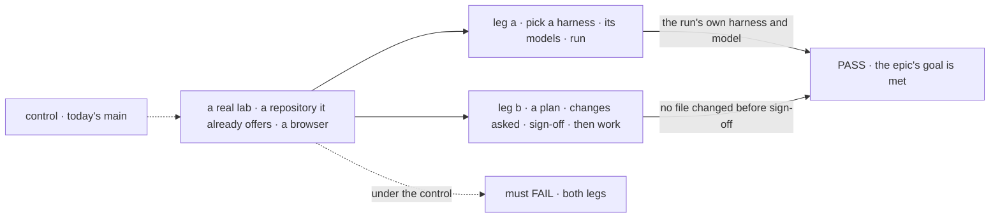
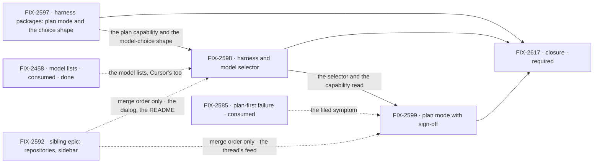

# FIX-2616 · Claude Code-style lab: choose a harness and a model, and sign off a plan

**Spec** · [Decisions](DECISIONS.md)

> **Split out of FIX-2592 on 2026-11-08.** The set merged in #4873 held this work beside the
> repository, sidebar and working-line work. The owner split it. [FIX-2592](https://linear.app/fixpoint-labs/issue/FIX-2592)
> keeps repositories, one sidebar, the new-session dialog, Settings and the working line. This
> epic takes the harness choice, the model choice and plan mode (FIX-2597, FIX-2598, FIX-2599)
> and has its own closure ([FIX-2617](https://linear.app/fixpoint-labs/issue/FIX-2617)). Where each
> part went: [FIX-2592 → The split](../FIX-2592/DECISIONS.md#the-split).

## Three teams, before and after

| A team that… | Today | After this epic |
|---|---|---|
| **asks for a code change** | A *Coder* chip picks a worker, not a harness or a model, and the choice travels as a `Coder:` line in the message | Picks a harness, then one of its models. The run reports both |
| **wants the plan before the work** | *Plan first* is a worker, and plan mode is broken: FIX-2585 is the filed symptom | Where the harness has a plan mode, reads the plan, asks for changes and signs it off before work starts |
| **builds an app on the harness packages** | Each package lists its models (FIX-2458), and none says whether it has a plan mode. Kitchen Sink keeps the model-choice shape an app would copy | Each package says whether it has a plan mode, and the model-choice shape is one shared piece |

**Why now.** The lab is the app we use to build FSD, and the owner's pass over it found these
gaps beside the repository ones. FIX-2458 is Done as of 2026-11-08, so all three harness
packages already give a model list. This half has its own epic because every input to it sat
outside the merged set and its plan leg needs a signed-in Claude Code, which the repository half
does not.

## The goal, and how we'll know it's met

**In the Claude Code-style lab, a person chooses a harness and one of its models for a code
change, and where that harness has a plan mode, signs the plan off before work starts.**

| Is it the right goal? | |
|---|---|
| **The real need** | An app we can ask for a code change in without writing `Coder:` lines, which FIX-2369 asks of the labs. Today it cannot pick a model, and plan mode is broken |
| **Smaller, and rejected** | "A model dropdown." It meets the look and leaves the *Plan first* worker and the broken plan mode (FIX-2585) where they are |
| **Bigger, and not this epic's** | Repositories, the sidebar and Settings: the sibling epic [FIX-2592](https://linear.app/fixpoint-labs/issue/FIX-2592) · attachments in the composer (FIX-2523) · a plan mode the lab builds for a harness that has none (Codex has none) · any workforce package change |
| **Not done if** | The closure check has not run · the lab keeps a model list a package could give · plan mode is offered on a harness without one, or work starts before sign-off · the choice still travels as message text · a closure bug is open |

Leg b is the one the smaller goal would skip. Each leg is read from the run's own report or the
repository's own git, never from the chip.

| How we verify | |
|---|---|
| **Goal check** | The closure issue, [FIX-2617](https://linear.app/fixpoint-labs/issue/FIX-2617), on one `main` commit after every other child merges, in the browser. The scripted coder reports no model today, so leg a needs a real signed-in harness unless FIX-2598 adds the model id to the scripted report; leg b needs a real signed-in Claude Code. **Each leg is reported by itself**, so a leg b that cannot run names its environment and does not hide a pass of leg a. The goal is met only when both pass |
| **Signal** | **a:** a harness change swaps the model list, and the run's tag shows what was chosen. **b:** a plan shows, a request for changes revises it, sign-off starts work; a harness without plan mode does not offer it |
| **Input** | The repository the lab already offers (the environment variable's, or the one the lab is started in; [FIX-2592 ER-1](../FIX-2592/DECISIONS.md#who-owns-what) keeps both as seeds), so this epic needs no Settings; a held-out prompt; models read from the list at run time |
| **Anti-game** | Read the repository's git and the run's own report. Never the chip, the adapter or a stubbed package call |
| **Control that must fail** | Today's `main`: both legs. A plan that does not wait for sign-off: leg b |

**Lead measure:** legs passing on `main`, of 2. **0 today.**

## What's in the box

![In the box: the lab's harness choice with the models of that harness only, and plan mode as an option of a harness that has one, signed off before work; the packages' plan-mode answer from each harness and the shared model-choice shape (its models are FIX-2458's). A fence: what a harness offers is asked of its package and the lab keeps no list. Composed in by the app: the person's choice, stored once and read by the harness slot. Replaced: the Coder chip and its message line, the Plan first worker, Kitchen Sink's copy of the choice shape. Not built: repositories and the sidebar, attachments, a plan mode for a harness that has none, any workforce package change](figures/end-state.svg)

The fence keeps the lab from becoming a second list: the packages say what a harness offers, and
the lab shows it ([ER-1](DECISIONS.md#who-owns-what)).

**Docs:** no `apps/docs` page. FIX-2598 publishes the story in the lab's README (the *Harness*
choice and its models); FIX-2599 adds the plan section. FIX-2597 writes a changeset; user pages
follow at release.

## The set · as of 2026-11-08

The reviewed snapshot; live state is in Linear.

| Issue | What it delivers | Why the set needs it | Status |
|---|---|---|---|
| [FIX-2597](https://linear.app/fixpoint-labs/issue/FIX-2597) · package | Each harness package says whether it has a plan mode; the model-choice shape (default, reason) lifts out of Kitchen Sink | Plan mode cannot be offered per harness without it, and the lab would copy Kitchen Sink's picker shape | Backlog |
| [FIX-2598](https://linear.app/fixpoint-labs/issue/FIX-2598) · lab | *Coder* becomes *Harness*, with that harness's models; the choice is stored once and read by the harness slot, not carried in the message | The model half of the goal | Backlog · blocked by FIX-2597 and FIX-2458 (Done) |
| [FIX-2599](https://linear.app/fixpoint-labs/issue/FIX-2599) · lab | Plan mode as a harness option, signed off before work; reproduces the failure first (FIX-2585 is the filed symptom) | The plan half of the goal | Backlog · blocked by FIX-2598 |
| [FIX-2617](https://linear.app/fixpoint-labs/issue/FIX-2617) · closure · **required** | The QA run on one `main` commit | Finds what falls between the others | Backlog · blocked by the three above |

All three children take the spec route; none is a bug. Three issues and a closure. Whether three
is two: no cut is clean. FIX-2597 already shrank when FIX-2458 took the model lists, and the
other two are the goal's two halves. FIX-2598 and FIX-2599 may each grow a package child that
blocks them. If FIX-2599's reproduction stalls, leg a can still pass and is reported alone.

## How the issues flow into each other

An edge is what one issue hands the next. A dashed input is consumed, not owned, and keeps its
parent; the heavy border is done. The dashed edges from FIX-2592 are not blocks: its lab issues
land first on the files they share, as
[DECISIONS → Between the two epics](DECISIONS.md#between-the-two-epics) says. FIX-2597 starts
now; FIX-2458's build is merged, so FIX-2598 waits only for FIX-2597. The closure waits on all
three. Which issues share files, and how their merges order, is in
[DECISIONS](DECISIONS.md#coordination-seams).

## What stays as it is

- **Workforce.** No package change.
- **Repositories, the sidebar, Settings and the working line** are
  [FIX-2592](https://linear.app/fixpoint-labs/issue/FIX-2592)'s.
- **FIX-2152 ER-9 and FIX-2157 D5** stay as written and are read as amended by
  [D1](DECISIONS.md#d1); FIX-2152 itself is not rewritten.
- **FIX-2523's attachments**: a neighbour. FIX-2523 shares the composer with FIX-2598 and
  FIX-2599.
- **Shift Manager**, **Kitchen Sink** and the **Teammates lab**, except one Kitchen Sink file
  FIX-2597 changes.

## What's already here, and the debt

| Already here | What the set does with it |
|---|---|
| [FIX-2152 ER-9](../FIX-2152/DECISIONS.md#who-owns-what) and `specs/issues/FIX-2157/DECISIONS.md#d5`: a harness is chosen in config, per worker | **Amended** by [D1](DECISIONS.md#d1) and [ER-2](DECISIONS.md#who-owns-what): it is the person's per-run choice. Worker config stays the default |
| FIX-2458: `HarnessModelList` on `core/harness`, each package's model-list function (`listCursorModels` and its siblings), Kitchen Sink's hand-kept Cursor list removed | **Builds on.** Done as of 2026-11-08. FIX-2458 owns the model lists; this set consumes them |
| [FIX-2585](https://linear.app/fixpoint-labs/issue/FIX-2585), a Linear bug with no spec: a plan-first task cannot exit plan mode | **Consumed** as FIX-2599's filed symptom; it keeps its parent |
| The lab's *Plan first* worker and plan manager | **Replaces** with plan as a harness option (FIX-2599) |
| The review stop (*Resolve*, *Request changes*) and harness-manager's tool-approval hold | **Considered** as the sign-off; FIX-2599's spec picks one, with no new kind of hold |

| Adds | Existing piece considered | Why it doesn't fit / how composed |
|---|---|---|
| Plan mode asked of each harness package; the model-choice shape lifted from Kitchen Sink (FIX-2597) | FIX-2458's lists, `harnessReadiness`, `apps/kitchen-sink/lib/harness-models.ts` | Extends the same ask-with-no-run shape. Models are FIX-2458's; only the plan question and the shape lift are new |
| A harness and model selector (FIX-2598) | The *Coder* chip; the block-level `model` resolver on all three harness blocks | Extends the chip. The choice is stored once and read by the harness slot, which feeds the resolver; no structured path does today |
| A plan sign-off (FIX-2599) | The review stop, the tool-approval hold | Composes one; the spec picks |

| The debt | |
|---|---|
| **Removes** | The *Plan first* worker · the `Coder:` line as the carrier of the choice, or demotes it · Kitchen Sink's copy of the model-choice shape |
| **Adds** | A plan-mode question on the three harness packages and the shared model-choice shape, on published packages. Permanent by design |
| **Leaves** | The worker ids (`desk.coder` and its siblings), which FIX-2598's spec may keep. Codex has no plan mode and the lab builds none |

**Net: slightly up.** The lab sheds a worker, a text carrier and Kitchen Sink's copy of a shape;
the packages gain a published question on three harnesses and one shared shape. A public entry is
permanent, so the package side outweighs what the lab sheds.

## Sign off

**[The goal](#the-goal-and-how-well-know-its-met), at that size:** two legs, in the browser.
If wrong: a lab that picks a model and still has a broken plan mode, or the reverse.

**[The set's debt](#whats-already-here-and-the-debt), slightly up.** If wrong: a published
plan-mode question we keep answering for a harness whose plan mode changes.

**The objective, at its size.** It serves goal 1 of `docs/objectives.md` (validate through real
usage) and goal 4 (keep the foundation honest), narrowly: the lab is a proof app made coherent,
and what a harness offers goes to its package, not into the lab. It does not move the Phase 1
finish line (`goal:all` green, wave 1.n) except by the closure's check becoming one more defined
goal.

**Decided before and standing:** [D1](DECISIONS.md#d1), the person's per-run choice, is the owner's
rule ER-10, approved when #4873 merged. The split is the owner's call, recorded in
[FIX-2592 → The split](../FIX-2592/DECISIONS.md#the-split), not asked. Nothing is open for sign-off
here beyond the goal and the debt.

**Open: none here.** The coordinator group's name ([FIX-2592 Q2](../FIX-2592/DECISIONS.md#q2))
is the sibling's hold; this epic's copy says *coordinator session* until it is answered.

Epic · 3 issues and a closure · Workforce: Shift Manager · goals 1 and 4 of `docs/objectives.md`, narrowly
