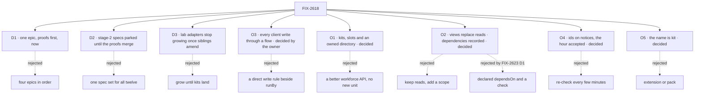

# FIX-2618 · Decisions

[Spec](SPEC.md) · **Decisions**

The calls above any single issue, and what each locks in for the twelve children. D1 to D3 are
the sign-off. O1 to O5 were the owner's holds, each revisiting or extending an earlier sign-off
with its reason kept, and all are decided: O3 in review, O1, O2, O4 and O5 in session on
2026-11-10. O2's dependency half was amended on 2026-11-11 by FIX-2623 D1, merged by the owner. The rest were decided while drafting and are recorded so no child reopens them.

## The tree

## D1 · Four changes in one epic, the proofs first, now

| | |
|---|---|
| **Instead of** | Four epics in dependency order (views, resource addressing, notice ids, kits), as the design review first proposed · or views and resources alone, with kits never |
| **Because** | Each change leans on the others. A kit installs and composes; the views and resources ride on the flows it installs and the package it ships ([FIX-2626 D1](../../issues/FIX-2626/DECISIONS.md#d1)). `defineKit` needs neither, but the kits it is built against do: the workforce kit ships the roster view and the workers collection on `runBy` (FIX-2627), so in four epics the kit epic would meet names and seams it never chose. The objective needs the adapter gone: views and direct reads remove the read model, a package's exports ship its views, hooks and components, and a kit's slots compose packages, the 42 of 1,642 lines nothing else removes ([FIX-2626 D1](../../issues/FIX-2626/DECISIONS.md#d1)). The owner has put kits in scope as FSD's own composition unit |
| **Locks in** | A large epic (twelve children) and one closure over four mechanisms. A collapse trigger, the owner's to pull now that [O1](#o1) is decided: if FIX-2622 shows the wiring pain is workforce's own API, FIX-2626 and FIX-2627 leave for a follow-up epic, and FIX-2628 narrows to moving claude-code-style onto views and direct reads with no kits, so leg a still has an owner |

**What would change my mind:** the teammates proof (FIX-2622) showing that a better
`createWorkerInstallation` removes the wiring with no new unit. Then the objective is met by
views and resources alone, and kits wait for a second feature that needs them. Outcome: [FIX-2622's entry](#fix-2622-result).

It comes down to the kit: designed last in its own epic, it inherits a model it never shaped.

## D2 · The build children are specced after the proofs merge, each on its own spec PR

| | |
|---|---|
| **Instead of** | One spec set for all twelve children, written as soon as this spec merges (the standard [spec-set](../../../docs/contributing/orchestration.md#the-spec-set-one-pr-for-the-epics-issue-specs) path) · or stage 2 as a follow-up epic |
| **Because** | Three of the build children rest on claims nobody has checked: a view can run with no session (`runRead.ts:33` takes a `sessionId`), declared dependencies can be checked, and a kit removes the host's wiring. A refuted premise after approval redraws up to six approved specs, the kit spec most of all |
| **Locks in** | **Stage 1:** FIX-2619 to FIX-2622, in the one spec-set PR. **Stage 2:** FIX-2551 and FIX-2623 to FIX-2628, specced after FIX-2620 to FIX-2622 merge, each on its own spec PR, with each proof's result recorded below. **The closure** (FIX-2629): its QA plan is this spec's goal check; its issue spec is written with stage 2, once the proofs say which legs it runs |

**How the hold works, with no script change.** The wake has one grouped spec dispatch and no
second one: once the spec-set PR exists, a child still at `NEEDS_SPEC` gets its own `spec`
dispatch (`epic-wake.js`, `awaitsSpecSet`), and blocked-by gates implementation only. So:

1. The stage-1 spec-set dispatch leaves the seven stage-2 children and the closure out of
   `specSetMembers`, naming D2, the path a set already has for a child it shouldn't spec.
2. When the coordinator records that PR, before the next wake, it parks each stage-2 row and the
   closure's with a `blocker`: "held until stage 1's proofs merge, D2". A row with a `blocker` is
   not dispatched, and the closure's blocked-by relations don't hold its spec.
   Parked any earlier, the rows would pause the stage-1 set itself (`specSetPaused`).
3. When FIX-2620 to FIX-2622 have merged, the coordinator records that as the resolution and
   clears the blockers, FIX-2625's included ([O4](#o4) is decided). Stage 2 then takes the
   out-of-set path: per-issue spec PRs, held by the cross-spec hold until one cross-spec review
   runs over them and the stage-1 members.

**The alternative:** stage 2 as a follow-up epic. The hold is then structural, but it costs a
second epic spec and its approval, and the rules here would bind children in another epic.

It comes down to a refuted proof: before the build specs it costs a note, after them six redraws.

## D3 · Lab adapters stop growing, once the sibling epics' specs agree

| | |
|---|---|
| **Instead of** | Letting FIX-2592, FIX-2616 and FIX-2369's stacks 2 to 4 add verbs and rows to the labs' `adapter.ts` files until kits land |
| **Because** | Every verb added now is one more this epic deletes, and three open epics are about to add them. A need a screen has is already the package's to serve under FIX-2152 ER-4; this makes it a package read (a view once FIX-2623 lands), never an adapter verb |
| **Locks in** | [ER-8](#who-owns-what), with a release condition. Merged sibling specs say the opposite today: [FIX-2592 → Between the two epics](../FIX-2592/DECISIONS.md#between-the-two-epics) gives FIX-2594 and FIX-2598 "Each adds its own rows and verbs" in `adapter.ts` and `test/fake-lab.ts`; FIX-2616 points at that table; FIX-2369's stack 3 "adds a function" per issue. Reads already in a package (FIX-2374 `sessionFeed`, FIX-2379's task-row view, FIX-2412 `watchRoster`) become views by rename, not by rewrite |

**The release condition.** ER-8 binds only once three amendments have merged, each its own
follow-up PR from `main`, owned by the sibling epic and approved by the owner: FIX-2592's surface
table, FIX-2616's matching line, and FIX-2369's stack plan. Asking for them is the coordinator's
task. Until they merge, ER-8 is advisory: a sibling may add a verb, and FIX-2628 counts it and
deletes it.

**Confirmed by the owner, in session, 2026-11-10, scoped "until that adapter is deleted":**
claude-code-style's freeze ends when FIX-2628 lands; teammates' lasts until the follow-up epic
deletes it. The owner skipped the project spec, so this cross-epic agreement is recorded here,
not at project scope: FIX-2592, FIX-2616 and FIX-2369 sit in Workforce: Shift Manager, and their
amendments cite this section.

**What would change my mind:** those epics landing before stage 2 starts. Then their verbs are
counted into FIX-2628's estimate, and the amendments aren't worth asking for.

It comes down to the delete count: each sibling verb added now is one more to remove later.

## O1 · Decided · Kits: an installable unit above a flow, with slots and an optional owned directory

Decided by the owner, in session, 2026-11-10: kits, yes, in the shape below. It confirms round
1's library/copied split, now concretely the scaffolded directory. **Amended 2026-11-11 by
[FIX-2626](../../issues/FIX-2626/DECISIONS.md)** (#5064, approved by the owner as written).
[D1](../../issues/FIX-2626/DECISIONS.md#d1): no kit client runtime, so no `client` field and no
manifest; screens import a kit package's views, hooks and components from its browser entry and
`/react`. Of claude-code-style's 1,642 adapter lines, 42 need a kit, through slots.
[D2](../../issues/FIX-2626/DECISIONS.md#d2): a stray file in a kit's folder stops the app starting.

| | |
|---|---|
| **Instead of** | No new unit: fix workforce's own installation API so the host's wiring goes, and keep each app's read model |
| **Because** | Composition: a kit lets one package reach another through a slot, which a better install API can't. Views and direct reads remove the read model; a kit removes the joins between packages (42 of claude-code-style's 1,642 adapter lines, [FIX-2626 D1](../../issues/FIX-2626/DECISIONS.md#d1)) and the host's wiring. A capability can't do the job: it installs into one block and can't add flows or views (`define-capability.ts`) |
| **Locks in** | A new public unit and a slot contract, built last against two kits (FIX-2626, FIX-2627): **workforce**, the base, and **harnesses**, a workforce extension kit (harness-manager, with Claude Code, Codex and Cursor as its config), the owner, 2026-11-11. Workforce converts fully into a kit: its library half, its `workforce/` file convention and its slots (`workerFlows` among them). `createWorkerInstallation` and `hireWorkforce` become internals of its install; no app calls them. Harnesses contributes through workforce's slots: a coder worker flow, readiness context, usage readers and the `harness:` worker setting |

**The shape** ([a kit](examples/kit.md), [an app installing kits](examples/app-install.md)):

- **Slots** are typed, named extension points that only the owning kit declares, each with its
  schema and merge policy: a keyed map refuses a duplicate key, a list appends. At install the
  framework orders kits by `requires`, collects and validates contributions, and hands them to
  the owning kit's setup. That replaces the circular `workerFlows: () => flows` callback. A kit
  never patches another kit's pieces and can't reach anything a kit doesn't publish. "Slot"
  already names block config fields (`ToolsSlot`, `UsesSlot`); FIX-2619 defines it with that in mind.
- **The library half** is the kit's package, imported and versioned: its views, blocks,
  capabilities, hooks and components, from its browser entry and `/react`. `defineKit` has no
  `resources`, `views` or `client` field: resources and views live on the flows its install
  returns. No flow is offered both imported and copied.
- **The copied half is a directory the kit owns in the app, optional per kit.** Its loader reads
  it at install through shared walk primitives, under workforce's rule today: every authored file
  is consumed or refused loudly, never skipped, and any refusal stops the app starting (FIX-2626 D2). The kit's `init` scaffolds starter files there,
  Shadcn-style; from then on the app owns them and the kit only reads them. A kit's folder
  claims only the files that kit configures: workforce's, the flows workforce runs. An app's own
  resources and flows go in its kit or in `flows:`, never in another kit's folder. Scaffolded files never
  auto-update: the loader tolerates old shapes (BP-030) or refuses loudly. A kit whose users
  author content (workforce, a future mission kit) has one; an infra-only kit (harness readiness)
  has none. It is [FIX-1477 D1](../../issues/FIX-1477/DECISIONS.md#d1)'s rule read from the other
  side: what a user is meant to change is copied, because there drift is the point.
- **React components follow the two halves** (the owner, in session, 2026-11-10). Components
  bound to the kit's views and actions go in the kit's own package behind a React subpath
  (`@flow-state-dev/workforce/react`), absorbing today's `@flow-state-dev/react/workforce`
  panels (FIX-2456 moved them there); behavior is never copied, so it never drifts (FIX-1477
  D1's reason). Styled, presentational pieces the app restyles are published as shadcn-style
  registry items (the `packages/ui` `registry.json` pattern), and `init` copies them into the
  app's components folder; the app owns them after that. **The rule:** behavior or a data
  contract is library; look-and-feel the app will restyle is copied. React is an optional peer
  dependency, used only behind `/react` and never at the kit's root, so a server-only app
  doesn't pull it in; `react` still wraps `client`.
- **Placement: no new package.** `defineKit` and the slot types go in `core`, beside the other
  definers. Install and resolution go in the `engine`, through `createFlowState({ kits })`. **`flows` is
  an array** (the owner, 2026-11-11, [on #5064](https://github.com/fixpoint-labs/flow-state-dev/pull/5064#issuecomment-6784683769)):
  `createFlowState({ flows: [a, b] })`. The record's key is dead today (`createFlowState.ts`
  registers `Object.values`; the registry keys by `flow.id`, which defaults to `kind`), so the
  keyed form is removed with no alias. The
  generic walk primitives in `packages/workforce/src/loader` (`openRoot`, `classify`,
  `validateSegment`, the refusal wording, `IGNORED_ENTRIES`) lift to a Node-only engine subpath;
  workforce keeps only its own schema (`teams/`, `workers/`, `WORKER.md`, `PACKAGE.md`, `resources/`).
- **Folders** (the owner, in session, 2026-11-10). Each kit owns at most one directory in the
  app, a sibling of other kits' directories, never nested in one. A kit that requires another
  (a workforce extension kit) contributes only through the slots that kit publishes, never by
  putting files in its directory. Install order comes from `requires`, not folder placement.
- **Which kits** (the owner, in session, 2026-11-11). Harnesses, because the hosts rebuild it:
  the coding worker flow three times (teammates `src/flows/coder.ts`, ccs
  `workforce/flows/harness-thread.mts`, shift-manager `teams/devteam/workforce/flows/workers/coder.mts`),
  the readiness map in four hosts, the readiness chip byte-copied into both labs. **Projects is
  not a workforce default**: it builds in too many opinions we may want to replace, so the
  workforce kit installs no projects flows. Harnesses doesn't require it: harness-manager takes a
  workspace source (`localWorkspaceHost({ source })`), which a later projects kit could
  contribute (`workforce | projects | harnesses`). Until then ccs and shift-manager keep calling
  the project blocks directly (a note for FIX-2627). **Later candidates, not children or scope:**
  MCP, voice, projects. **Not kits:** memory (a workforce install option or slot), orchestration
  (workforce's foundation library), tools, patterns, thought-fabric, scheduled (workforce's install
  may mount it), ui (how kits publish copied React), shift-manager (an app). Skills becomes one
  only if a second app needs an app-owned `skills/` folder outside workforce. **The harness
  shape** (the owner, 2026-11-11): harness-manager is the kit (checkouts, runs, verdicts,
  readiness, usage, the coder flow) and publishes one keyed slot, `harnesses`.
  A harness is a plain value filling it, `{ id, agent, readiness, pass, usage, models }`: the
  pieces each harness package already exports and hosts assemble by hand (an agent block
  returning core's `HarnessRunHandle`, a readiness check, a `*_PASS` list, a usage reader, a model
  list). A harness is its own small kit only when it installs pieces of its own (Claude Code's
  `work-collections` and `workspace-collections`); it then `requires` harness-manager and fills
  the same slot. A duplicate id is refused; a host can switch a harness off. Why: a third party
  implements one interface, not kit machinery, and FIX-2626 and FIX-2627 get a keyed slot with
  three real contributors, which FIX-2622 never tested. Price: the harness value is a public
  contract, narrow because the run handle already fixes most of it. **Readiness is one view in
  `harness-manager`:** FIX-2627 installs it through the harness kit, and FIX-2624's last PR
  imports it (writing it there first if FIX-2627 hasn't).
- **Notes for the implementers, not gates:** FIX-2626's spec showed, on a real app, what
  only a kit removes (42 lines, its D1); the workforce dead-cast
  and callback cleanup B0 found is worth doing now, kits or not. Workforce's folder claims only
  flows workforce configures: claude-code-style's `workforce/flows/` holds the projects and
  user-marks flows too, which need a home in its kit or in `flows:` (FIX-2627, FIX-2628).

**What would change my mind.** FIX-2622 tested this; outcome: [FIX-2622's entry](#fix-2622-result).

It comes down to the adapters: a better install API removes the wiring, never the read model.

## O2 · Decided · Views replace flow reads, their dependencies recorded · revisits FIX-2286 D1

Decided by the owner, in session, 2026-11-10: views replace reads. **Amended 2026-11-11** by
[FIX-2623 D1 and D2](../../issues/FIX-2623/DECISIONS.md#d1), which the owner merged (#5063): a
view's dependencies are recorded from what each run read, not declared, and a view can't call a
model. This supersedes the declared `dependsOn` and drift check decided on 2026-11-10.

| | |
|---|---|
| **Instead of** | Keeping reads and adding a scope · declared `dependsOn` with a development- and test-time drift check, the 2026-11-10 answer |
| **Because** | With a view, a client stops knowing topics and sessions, and "view" is the word people already reach for. FIX-2286 D1's rule is kept: one hook, storing nothing, refusing writes. Its condition ("nothing that does the same job is added beside it") is why this is a rename and not a second definer. Recording costs under 1% of a read (FIX-2621), the mind-changer the 2026-11-10 answer named, and a declared list drifts: the board's obvious one missed three of its four dependencies |
| **Locks in** | A view has a scope (no session at user or org) and keyed rows ([example](examples/view.md)). `defineView` has no `dependsOn`; adding one later is additive. The recorder runs on every view in production. **Publishing is host-wide:** once any registered flow declares a view, every user or org resource write publishes a notice, whichever flow writes it (the default write flow and `runBy: { flow }` included), not only the writer's own flow as `derived` decides it today. An extra notice is allowed; a missed one is the failure ([FIX-1506](../../issues/FIX-1506/DECISIONS.md#decided-not-asked)). A model call in a view is refused at every scope. `reads` and scope `derived` go, with no alias (FIX-2447's rule), and "read" retires as the hook's name ([ER-9](#who-owns-what)) |

**What would change my mind.** The extra notices measurably loading the Postgres bus before
[FIX-2625](https://linear.app/fixpoint-labs/issue/FIX-2625)'s ids narrow the re-reads, or the
engine's recorder missing a path FIX-2621's probe reaches. Then `dependsOn` is declared, the same
recorder runs only in tests and `fsdev dev`, and only listed resources publish.

It comes down to what the client must know: with a view, nothing but the view.

## O3 · Decided · Every client write goes through a flow; plain data takes the default write flow · generalizes FIX-1788, keeps FIX-1945 D1

Decided by the owner in review ([6742479932](https://github.com/fixpoint-labs/flow-state-dev/pull/4964#issuecomment-6742479932): "no separate direct-write path… the simple
case needs to feel like editing a file"), with the architect's follow-up ([6742490134](https://github.com/fixpoint-labs/flow-state-dev/pull/4964#issuecomment-6742490134)).
Round 1's two-path fork and its declared write rule are gone.

| | |
|---|---|
| **Instead of** | A declared write rule that writes the resource directly, beside `runBy` · or a hand-written flow per writable resource, as the labs' pins flow is today |
| **Because** | A second write path is a second place to keep the validators, and a write that skips them is the defect FIX-1945 D1 exists to prevent. The default write flow makes the plain case one line, so a second path buys nothing |
| **Locks in** | `runBy` is the only way a client writes a user or org resource; with none, it can't. Schema, owner fence and optional `canWrite` run inside the flow, never as a route of their own. A request per write. `client.content.*` stays for session-scope collections; its user and org writes (the skills drawer) are a leftover, [FIX-2633](https://linear.app/fixpoint-labs/issue/FIX-2633) |

**One mechanism, two kinds of flow** ([example](examples/resource-runBy.md)):

- **`runBy: "default"`** names the framework's default write flow: actions that set, patch and
  delete fields at the version the client read, under the resource's schema, owner fence (owner
  from the verified principal, [ER-3](#who-owns-what)) and optional `canWrite`. A stale version
  is refused with the current state and version (`resource-cas`), so no write is lost. It replaces the labs' pins flow and `listPins`.
  A field rather than a `client: { write: true }` flag: one field says who writes, and a flag
  would read as the direct write this removes.
- **`runBy: { flow }`** names the app's own flow where it does real work: the dashboard takes
  data in and builds the resource. Same route, same send.
- **Client helpers** reach either: `fsd.resource(ref).update(updater)`, `.set`, `.delete`,
  `useResource(ref)` with the same setters, and `.send("refresh", input)` for a flow's own
  actions. `update` runs the updater on the state it read and sends the result with that
  version; on a refusal it re-runs the updater on the returned state. A pin toggles in one line:
  `pins.update((s) => ({ pinned: toggle(s.pinned, id) }))`.

**Its session:** one per resource per caller, server-owned, found or made from the resource and
the verified caller, and shared by a collection's entries. A session belongs to one user
(`assertSessionAdmitted` refuses any other), so for a user resource it is the owner's own, the
one `ownSession("pins")` makes by hand today; for an org resource each writing user gets their
own, and the write lands in the org-scoped resource. Sessions stay user-owned (FIX-1788) with no
ownership change. The effect: an org resource's write history is spread across its writers'
sessions, and its audit trail is the union of their requests, which a view can read. **Its
request:** yes, like any action, attributed to the caller: per pin click a request row, a trace
and an action's latency. It buys an audit trail of who changed what, and the same path, notices
and checks as a rich flow. Accepted.

**FIX-1945 D1 holds as written.** Its rules record allows client reads only, so no write skips
the validator holding the cap and the stale-edit check. Nothing here adds a route: the record
takes no `runBy`, so it stays read-only.

**What would change my mind.** Request rows proving costly. Then the default flow records less,
never a direct path. **What being wrong costs:** low, slower plain writes, tunable in one path.

It comes down to validators: in one path they can't be skipped; in two, one path forgets them.

## O4 · Decided · Ids on notices, with the one-hour window accepted · amends FIX-2428 D2 and FIX-2367 D2

Decided by the owner, in session, 2026-11-10: accept the hour, with a per-scope opt-out.

| | |
|---|---|
| **Instead of** | Re-checking the socket every few minutes instead of every hour (never a check per notice) |
| **Because** | Targeted re-reads and much less traffic, against a small leak: a user whose access is revoked could see which opaque ids change for up to an hour, but never read them. Ids are optional, so turning them off is a config change |
| **Locks in** | A notice may say which ids changed, never what changed; a scope where timing alone is sensitive turns ids off. FIX-2428 D2 (the hour, accepted when notices were empty) and FIX-2367 D2 (no rows) are amended by this answer with their reasons kept: no rows, every byte through a checked read, no store read per notice per viewer. FIX-2625 is unblocked on the decision side and stays parked by [D2](#d2) until the proofs merge |

**What would change my mind.** A real tenant for whom ids or timing are themselves
confidential: then shorten the re-check window to minutes.

It comes down to what leaks: opaque ids for an hour, and never a row.

## O5 · Decided · The installable unit is called "kit"

Decided by the owner, in session, 2026-11-10.

| | |
|---|---|
| **Instead of** | *extension* (file extensions, every editor's word, and the objectives' "Plugin/extension ecosystem": it promises the third-party ecosystem the owner ruled out) · *pack* (`harness-manager`'s git pack, npm's `pack`) · *add-on* (reads as optional and third-party). *Plugin*, *package* and *module* were rejected outright |
| **Because** | The cheapest word to adopt with the clearest promise: pieces that go together, no store implied. Its one collision is FIX-2246's glossary retire ("Session factory… never a kit"), whose check refuses `the kit` and `kit.x` |
| **Locks in** | `defineKit` and `createFlowState({ kits })`. FIX-2619 adds the entry and narrows FIX-2246's retire to the session-factory sense in one PR. Once FIX-2626 merges, a rename is public, under FIX-2447's no-alias rule |

It comes down to the promise: *extension* invites the third-party ecosystem we ruled out.

## Who owns what

Every rule has one owner; read a row to see where it is built and where it is only used. A
*uses* cell is a place a child must not decide again. The three proofs own no rule: they feed
the stage-2 specs.

| # | Rule every child obeys | Owner | Checked at |
|---|---|---|---|
| ER-1 | One hook computes an answer for a screen: the view. `reads` and scope `derived` go with no alias; nothing that does the same job is added beside views | FIX-2623 builds · FIX-2551, FIX-2627, FIX-2628 use | The stage-2 cross-spec review; the closure |
| ER-2 | A view never writes (its context refuses writes and dispatch, as a read's does today) and never calls a model. Every byte a client sees comes through a checked read or view; a notice carries ids, never rows | FIX-2623 builds · FIX-2624, FIX-2625 use | Each child's spec review; the closure |
| ER-3 | A session-free read or view takes user and org from the verified principal, resolved through the declaring flow's effective resolver (FIX-2522's governing-flow path, `pickPrincipalResolver`), never a host fallback and never the body, query or headers (BP-031). The push mint's path user id is not that principal | FIX-2624 builds · FIX-2623 uses | FIX-2623's and FIX-2624's spec review |
| ER-4 | No direct client-write path is added. A client writes a user or org resource by scope only through a flow: an action on its `runBy` session, the default write flow or the app's own; with no `runBy`, it can't. Schema, owner fence and `canWrite` run inside the flow ([O3](#o3)). `client.content.*` stays for session-scope collections. The content routes' user and org writes answer 501 today (`resource-routes.ts`); the skills collection's grants that reach them are the one leftover, exempt by name until [FIX-2633](https://linear.app/fixpoint-labs/issue/FIX-2633) moves them | FIX-2624 builds · FIX-2627, FIX-2628 use | The stage-2 cross-spec review |
| ER-5 | A kit holds only existing pieces (flows carrying their views and resources, capabilities, blocks, workers, config, slots), with no client runtime: screens import its package. It reaches another kit only through slots that kit publishes, never patches one, and a host can turn off what it contributes. Slots are few, typed, and declared only by the kit that owns the concept, each with its merge policy (a keyed map refuses duplicates, a list appends). A kit's owned directory is read through the shared walker: every file consumed or refused loudly, and a refusal stops the app starting. What a user configures is scaffolded there, never also exported. Folders: [O1](#o1) § Folders | FIX-2626 builds · FIX-2627, FIX-2628 use | FIX-2627's spec review; closure leg b |
| ER-6 | Data the server computes is typed by its view's output schema (`ViewOutput`). An app hand-writes only what its screen computes | FIX-2623 builds · FIX-2627, FIX-2628 use | FIX-2628's spec review; closure leg a |
| ER-7 | One live read in the client: the coalescer and the path rule live in one place, and `useView` and every package watch sit on it | FIX-2551 builds · FIX-2623, FIX-2627 use | The stage-2 reuse review |
| ER-8 | No lab adapter grows once the sibling amendments merge. A screen's new need is then a package read or view, never a new adapter verb or hand-written row type. Until FIX-2592, FIX-2616 and FIX-2369's amendments merge it is advisory, and FIX-2628 deletes what was added. It holds until that adapter is deleted ([D3](#d3)) | The coordinator (it asks for the amendments) · FIX-2628 uses | FIX-2592, FIX-2616 and FIX-2369's spec reviews, after the amendments |
| ER-9 | Every public name the set fixes is in the glossary in the PR that coins it. The holds that fix the names are answered ([O1](#o1), [O2](#o2), [O5](#o5)), so "view", "kit" and "slot" land with FIX-2619, with the narrowed FIX-2246 retire and the objectives non-goal line. "Read" retires as the hook's name: FIX-2619's entry says so, and the check that refuses it lands in FIX-2623's PR, the one that removes `reads` | FIX-2619 builds · FIX-2623, FIX-2626 use | Each child's PR checks |
| ER-10 | Ids on notices are hints. No ids means read everything; a full read runs on connect, reconnect, resync, a poll tick and wherever the bus doesn't cross processes; a notice that drops the resource name carries no ids | FIX-2625 builds · FIX-2623 uses (keys) | FIX-2625's spec review; the closure |

## Coordination seams

| Seam | Between | Rule |
|---|---|---|
| `defineFlow`'s config (`reads` → `views`) and the export ratchet | FIX-2623, FIX-2626, FIX-2447 | FIX-2623 removes `reads` with no alias; `defineView`, `useView`, `fsd.resource` and `defineKit` enter FIX-2447's ratchet in the PR that adds them |
| The client's live read and `client.subscribe` | FIX-2551, FIX-2623, FIX-2625, FIX-2367 | FIX-2551 lands the coalescer; FIX-2623 builds `useView` on it; FIX-2625 adds keys to it. None adds a topic or a poll (FIX-2367 ER-2, ER-3) |
| The engine's read routes and the endpoint table | FIX-2623, FIX-2624, FIX-2619 | The view route and the scope-addressed resource routes land in their children; FIX-2619's table is updated by whichever lands second |
| The resource definition (`client` config, `runBy`) | FIX-2624, FIX-2627, FIX-2628 | FIX-2624 owns the fields and the default write flow; FIX-2627 (the workers collection) and the app kit only declare them. `defineKit` needs no resource field of its own |
| The workforce roster watch | FIX-2412, FIX-2623, FIX-2627 | FIX-2623 moves it onto a view; FIX-2627 ships that view in the workforce kit |
| Harness readiness | FIX-2624, FIX-2627, `harness-manager` | One view in `harness-manager`; FIX-2627 installs it through the harness kit; FIX-2624's last PR imports it ([O1](#o1)) |
| `createFlowState({ flows })` | FIX-2626, FIX-2628, every host | An array; the keyed record goes with no alias ([O1](#o1) § Placement) |
| The coding worker flow | FIX-2627, FIX-1907, teammates' `coder.ts` | FIX-2627 merges the two labs' routing into one flow; FIX-1907's harness session flow factory feeds it, and lands first |
| The loader's walk primitives (`openRoot`, `classify`, `validateSegment`, `IGNORED_ENTRIES`) | FIX-2626, FIX-2627, `packages/workforce/src/loader` | FIX-2626 lifts them to a Node-only engine subpath for every kit's owned directory; FIX-2627 leaves workforce only its own schema ([O1](#o1)) |
| The glossary | FIX-2619, FIX-2623, FIX-2626, FIX-2600 | FIX-2619 adds the entries and narrows FIX-2246's; later children edit their own entry in their PR (FIX-2600 ER-2) |
| `runBy` and per-service sessions | FIX-2624, FIX-2471 | FIX-2471's webhook subscriptions are a candidate consumer. Coordinate, don't fold |
| Connectors and project scope keys | FIX-2627, FIX-2615 | A connector looks like kit config; FIX-2615 defines what a project is. FIX-2627 reads FIX-2615's answer and doesn't define one. MCP is a later kit candidate ([O1](#o1)) |

## Decided while drafting, recorded so no child reopens them

Engineering calls, carried from the design review where they were decided without asking:

- **No separate view definer beside reads.** A view is the rename of a read, never a second hook.
- **Notice ids are hints.** A full read is always the fallback.
- **No generic client writes.** Every client write goes through a flow ([O3](#o3)); FIX-296's
  `client.content.*` routes stay for session-scope collections (the skills drawer's user and org
  writes move in [FIX-2633](https://linear.app/fixpoint-labs/issue/FIX-2633)), and FIX-1945's rules record keeps client writes off.
- **The concept doc comes first,** and names wait for the glossary.
- **FIX-2551 is a child, not absorbed.** It already says what it delivers; FIX-2623's `useView`
  builds on it.
- **FIX-2036's deferred "Workforce browser contract for Shift Manager reads"** (overlapping
  FIX-1672) is this epic's workforce package views and hooks. It is folded, not filed again.
- **Out of the set, as follow-up epics filed at wrap:** moving Teammates' and Shift Manager's
  remaining adapters onto the kit packages' views, and serving each answer on one route only (session
  expose and collection `clientData` served twice; the manifest against the snapshot; four React
  resource hooks no app calls).
- **Sequenced after this epic:** FIX-2430. **Unrelated:** FIX-2490, FIX-1637, FIX-2331,
  FIX-2440, FIX-2273, and FIX-2092 apart from its loose use of "view".
- **Related, not parented:** FIX-844, FIX-1672, FIX-1698 (the workaround FIX-2624 removes),
  FIX-1454, FIX-2065, FIX-2043 (already under FIX-2036), FIX-2326 (goes away with
  `readerSessionId`, which FIX-2624 removes), FIX-2556 (mostly absorbed: FIX-2624 takes its usage
  and schedules views; it keeps delegates), FIX-2633 (smaller than filed: the user and org
  content routes already answer 501, so it moves the skills collection's grants, not live writes).

## What the end-state POC showed

None built at create. The three proofs that the division rests on are children (FIX-2620 to
FIX-2622), and [D2](#d2) puts them before any build spec. Each one's result is recorded here, in
four lines, by the amendment that lands it.

**FIX-2620 · a user-scoped view answers with no session (2026-11-10): CONFIRMED, past a small change.**

- **Built:** one read block at user and org scope, run on `createExecutionContext` with only
  `userId` and `orgId` and a 61-line opt-in no-session mode, against a control of today's
  `runRead` with no session id.
- **See it:** `bash specs/issues/FIX-2620/poc/no-session-read/run.sh` (add
  `POC_STRICT_CONTROL=1` to see the control red); [README](../../issues/FIX-2620/poc/no-session-read/README.md).
- **Showed:** the control dies in session birth, refused `read_only`; the no-session path reads
  the user's pins and the org's note, a write throws `read_only`, `ctx.session` throws
  `NoSessionError`, and the session store is never called. Only execution metadata reached for
  the session past the context; generators in a view would too (their history), not exercised.
- **Changed:** nothing in the division. FIX-2623 specs `scope: "user" | "org"` views on this
  context, and its first piece of work is the no-session mode and the metadata change the patch
  names. The context is views-only (amended 2026-11-11): FIX-2624's direct reads are store reads
  and the client projection, and build no execution context.

**FIX-2621 · `dependsOn` is checkable, from inside the engine (merged #5023): CONFIRMED, with a condition.**

- **Built:** store, in-place and proxy recorders over three real reads (the board, pins, a
  `taskBoard()` handle).
- **See it:** `bash specs/issues/FIX-2621/poc/dependency-check/run.sh`.
- **Showed:** every one-left-out control fails, naming it, for at most 0.3 ms, under 1% of a
  read; only a recorder inside the engine has no gap ([README](../../issues/FIX-2621/poc/dependency-check/README.md)).
- **Changed:** O2 stands (the owner approved the direction by merging #5023). FIX-2623 records
  inside the engine where each block's context is built (state getter, resource registry), and
  its D1 then inferred dependencies instead of declaring them ([O2](#o2), amended).

**FIX-2622 · kit or install API (merged #5038): the better API removes the same host wiring, install half only.**

- **Built:** the teammates host as A (workforce as a kit), B (a better install API) and B0
  (today's API), each passing parity and the lab's tests.
- **See it:** `bash specs/issues/FIX-2622/poc/kit-or-api/run.sh`.
- **Showed:** the "A only" row is empty; B0 removes 5 lines and 18 casts on `main` today; the
  kit's 145 package lines to B's 34 are an upper bound. The client half and more than one kit
  were not tested ([README](../../issues/FIX-2622/poc/kit-or-api/README.md)).
- **Changed:** FIX-2622 fired D1's mind-changer; the owner kept O1 on the client half and the
  copied conventions (2026-11-10). FIX-2626 D1 later moved O1's case to composition ([O1](#o1)).

## Analysis

### Analysis — FIX-2618 epic spec · 2026-11-08 · watermark 2026-11-08

Run inline by the author with the reuse review: this dispatch had no sub-agent tool, so it is not
the fresh, independent analyst the skill asks for. The stage-1 spec-set review runs a fresh one.

**Verdict:** right approach, with one finding recorded for FIX-2621 and O2. No fold changed the
objective or the division.

1. **Reuse.** Views **extend** reads; `derived` is removed. `runBy` **extends** FIX-1788's worker,
   and a send is an ordinary action, so no write route. Session-free identity **reuses** the
   principal push topics already use. Ids **extend** the notice. The coding worker flow
   **merges** two copies. `defineKit` is **genuinely new**: a capability installs into one block.
2. **Prior art.** [Django apps](https://docs.djangoproject.com/en/5.1/ref/applications/) and
   [Rails engines](https://guides.rubyonrails.org/engines.html): one installable unit carrying
   models, views, routes and config, the kit's shape. [Fastify plugins](https://fastify.dev/docs/latest/Reference/Plugins/)
   declare `dependencies` and expose decorators, as `requires` and slots do. [NestJS modules](https://docs.nestjs.com/modules)
   export only what others may use. [Convex queries](https://docs.convex.dev/realtime) infer the
   read set at run time instead of declaring it.
3. **Other shapes.** Four epics in order ([D1](#d1)); no kit, a better install API ([O1](#o1),
   FIX-2622 tests it); inferred dependencies (the Convex shape, recorded below); a write rule on
   the resource, rejected by the owner in [O3](#o3).
4. **New factors.** FIX-2466 is building on no-row notices now, so [O4](#o4) is time-bound.
   FIX-2447's export ratchet and FIX-2600's glossary are live; both are seams above.
5. **Necessity.** Yes at this size, with FIX-2622's collapse trigger. The leaner set drops
   FIX-2625; it is gated instead.
6. **Ergonomics.** Four new words (view, kit, slot, `runBy`) and one retired (read as a hook).
   A resource gains a second field about clients (`runBy` beside `client`), which a newcomer must
   learn are read and write halves.
7. **Concerns.** `runBy` session lifecycle; slots freezing early, held by building them last
   against two kits; the size of one closure run.

| Finding | Objective | Changes the approach? | Disposition |
|---|---|---|---|
| Convex infers a query's read set; FIX-2621's recording could make `dependsOn` inferred, not declared | 2, 3 | Not the objective; it may change FIX-2623's design | Recorded in O2 and for FIX-2621 |
| FIX-2551 should stay its own child rather than be absorbed by FIX-2623 | 1 | No | Folded into the set |
| FIX-2036's deferred Shift Manager browser contract is the workforce kit's client | 1 | No | Recorded above |

## How it got here

- **Design review (2026-11-08)** — the read-and-write surface review mapped eight read paths and
  problems A to F, and proposed views, resource addressing, notice ids and kits together. Its code
  sketches are carried as [`examples/`](examples/).
- **Owner scope (2026-11-08)** — kits are in scope as FSD's own composition unit; a third-party
  ecosystem stays out. Sign-offs on FIX-2286, FIX-2367 and FIX-2428 may be reopened.
- **Drafted (2026-11-08)** — one epic in two spec stages; twelve children; five open holds.
- **Review round 1 (2026-11-08)** — Codex: stage 2 had no gate the wake honours ([D2](#d2) now
  parks the rows); ER-8 contradicted FIX-2592's merged surface table ([D3](#d3) now waits on
  amendments); the collapse dropped claude-code-style's migration (FIX-2628 narrows instead).
  The architect review: kits split into a library half and a copied half ([O1](#o1)), and pins
  take a write rule, not a flow ([O3](#o3), now a two-path fork). Both went to the owner.
- **Review round 2 (2026-11-09)** — the owner decided [O3](#o3): every write through a flow, with
  a default write flow and one-line client helpers ([6742479932](https://github.com/fixpoint-labs/flow-state-dev/pull/4964#issuecomment-6742479932)); the architect asked for
  the goal check to fail on any direct write path ([6742490134](https://github.com/fixpoint-labs/flow-state-dev/pull/4964#issuecomment-6742490134)). The write rule is gone.
- **Stage-1 spec set (2026-11-09)** — two amendments from the set's review. [ER-9](#who-owns-what):
  a glossary entry lands once its hold is answered, and the "read" retire's check lands with
  FIX-2623, which removes `reads` (found by FIX-2619). [D2](#d2): the closure is out of stage 1
  and parked with stage 2, since its blocked-by relations don't hold a spec dispatch.
- **Owner decisions (2026-11-10, in session)**, recorded in a follow-up PR from `main` (the
  epic merged in #4964, the stage-1 specs in #4986). [O1](#o1): kits, with slots, an optional
  owned directory read by a shared walker, React components split by the same two halves, and
  no new package; [O2](#o2), [O4](#o4) and
  [O5](#o5) as recommended; [ER-8](#who-owns-what) confirmed until each adapter is deleted; the
  project spec skipped, so cross-epic agreements live here ([D3](#d3)). FIX-2619, FIX-2621 and
  FIX-2622 are amended to match.
- **Stage-1 results (2026-11-10)** — FIX-2621 (#5023) and FIX-2622 (#5038) recorded under
  [What the end-state POC showed](#what-the-end-state-poc-showed); the owner's calls of 2026-11-10
  and 11 are in [O1](#o1). No banner on FIX-2619's Reads section (#5036), at the owner's word.
- **Wave-A amendments (2026-11-11)**, a follow-up PR from `main` after FIX-2623 (#5063) and
  FIX-2624 (#5065, aligned in #5073) merged, with the wave-A cross-spec review. [O2](#o2): recorded
  dependencies, a host-wide publish rule, no model calls. [ER-3](#who-owns-what): the declaring
  flow's resolver, not the push mint's path user. The no-session context is views-only. Views and
  resources feed FIX-2627, not FIX-2626. `createFlowState({ flows })` is an array. Harness
  readiness is one view. FIX-2633, FIX-2556 and FIX-2326 are smaller than filed. FIX-2626
  (#5064) merged: no kit client runtime and a stray folder file refuses start, so O1's case is
  composition and the examples import from kit packages.

**Open:** none. **Decided by the owner:** [O3](#o3) in review; [O1](#o1), [O2](#o2), [O4](#o4) and [O5](#o5) in session.
