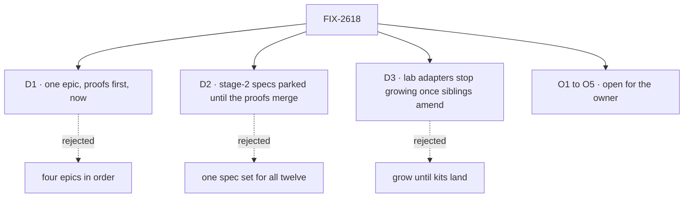

# FIX-2618 · Decisions

[Spec](SPEC.md) · **Decisions**

The calls above any single issue, and what each locks in for the twelve children. D1 to D3 are
the sign-off. O1 to O5 are open holds for the owner: each revisits or extends an earlier
sign-off, which the owner has said may be reopened, and each keeps the earlier decision's reason
in view. The rest were decided while drafting and are recorded so no child reopens them.

## The tree

## D1 · Four changes in one epic, the proofs first, now

| | |
|---|---|
| **Instead of** | Four epics in dependency order (views, resource addressing, notice ids, kits), as the design review first proposed · or views and resources alone, with kits never |
| **Because** | Each change leans on the others. A kit packages views and resources, so its shape is decided by theirs; in four epics the kit epic inherits names and seams it never chose. The objective needs the adapter gone, and only the kit's client half does that at the root. The owner has put kits in scope as FSD's own composition unit |
| **Locks in** | A large epic (twelve children) and one closure over four mechanisms. A collapse trigger: if FIX-2622 shows the wiring pain is workforce's own API, FIX-2626 and FIX-2627 leave for a follow-up epic, and FIX-2628 narrows to moving claude-code-style onto views and direct reads with no kits, so leg a still has an owner |

**What would change my mind:** the teammates proof (FIX-2622) showing that a better
`createWorkerInstallation` removes the wiring with no new unit. Then the objective is met by
views and resources alone, and kits wait for a second feature that needs them.

It comes down to the kit: designed last in its own epic, it inherits a model it never shaped.

## D2 · The build children are specced after the proofs merge, each on its own spec PR

| | |
|---|---|
| **Instead of** | One spec set for all twelve children, written as soon as this spec merges (the standard [spec-set](../../../docs/contributing/orchestration.md#the-spec-set-one-pr-for-the-epics-issue-specs) path) · or stage 2 as a follow-up epic |
| **Because** | Three of the build children rest on claims nobody has checked: a view can run with no session (`runRead.ts:33` takes a `sessionId`), declared dependencies can be checked, and a kit removes the host's wiring. A refuted premise after approval redraws up to six approved specs, the kit spec most of all |
| **Locks in** | **Stage 1:** FIX-2619 to FIX-2622 and the closure's QA plan, in the one spec-set PR. **Stage 2:** FIX-2551 and FIX-2623 to FIX-2628, specced after FIX-2620 to FIX-2622 merge, each on its own spec PR, with each proof's result recorded below |

**How the hold works, with no script change.** The wake has one grouped spec dispatch and no
second one: once the spec-set PR exists, a child still at `NEEDS_SPEC` gets its own `spec`
dispatch (`epic-wake.js`, `awaitsSpecSet`), and blocked-by gates implementation only. So:

1. The stage-1 spec-set dispatch leaves the seven stage-2 children out of `specSetMembers`,
   naming D2, the path a set already has for a child it shouldn't spec.
2. When the coordinator records that PR, before the next wake, it parks each stage-2 row with a
   `blocker`: "held until stage 1's proofs merge, D2". A row with a `blocker` is not dispatched.
   Parked any earlier, the rows would pause the stage-1 set itself (`specSetPaused`).
3. When FIX-2620 to FIX-2622 have merged, the coordinator records that as the resolution and
   clears the blockers (FIX-2625's stays until [O4](#o4) is answered). Stage 2 then takes the
   out-of-set path: per-issue spec PRs, held by the cross-spec hold until one cross-spec review
   runs over them and the stage-1 members.

**The alternative:** stage 2 as a follow-up epic. The hold is then structural, but it costs a
second epic spec and its approval, and the rules here would bind children in another epic.

It comes down to a refuted proof: before the build specs it costs a note, after them six redraws.

## D3 · Lab adapters stop growing, once the sibling epics' specs agree

| | |
|---|---|
| **Instead of** | Letting FIX-2592, FIX-2616 and FIX-2369's stacks 2 to 4 add verbs and rows to the labs' `adapter.ts` files until kits land |
| **Because** | Every verb added now is one more this epic deletes, and three open epics are about to add them. A need a screen has is already the package's to serve under FIX-2152 ER-4; this makes it a package read (a view once FIX-2623 lands), never an adapter verb |
| **Locks in** | [ER-8](#who-owns-what), with a release condition. Merged sibling specs say the opposite today: [FIX-2592 → Between the two epics](../FIX-2592/DECISIONS.md#between-the-two-epics) gives FIX-2594 and FIX-2598 "Each adds its own rows and verbs" in `adapter.ts` and `test/fake-lab.ts`; FIX-2616 points at that table; FIX-2369's stack 3 "adds a function" per issue. Reads already in a package (FIX-2374 `sessionFeed`, FIX-2379's task-row view, FIX-2412 `watchRoster`) become views by rename, not by rewrite |

**The release condition.** ER-8 binds only once three amendments have merged, each its own
follow-up PR from `main`, owned by the sibling epic and approved by the owner: FIX-2592's surface
table, FIX-2616's matching line, and FIX-2369's stack plan. The agreement is recorded at project
scope, in Framework simplification & cleanup's project spec, and names that FIX-2592, FIX-2616
and FIX-2369 sit in Workforce: Shift Manager. Asking for the amendments is the coordinator's task.
Until they merge, ER-8 is advisory: a sibling may add a verb, and FIX-2628 counts it and deletes it.

**What would change my mind:** those epics landing before stage 2 starts. Then their verbs are
counted into FIX-2628's estimate, and the amendments aren't worth asking for.

It comes down to the delete count: each sibling verb added now is one more to remove later.

## O1 · Open · Should FSD have kits: an installable unit above a flow?

**In plain terms.** A new top-level piece that bundles flows, views, resources, capabilities,
workers and a client half, configures itself through one config object, and plugs into other
kits through the slots they publish. Workforce becomes the first one, the coding harnesses the
second. An app installs them with `createFlowState({ kits: [...] })`
([example](examples/app-install.md)).

**The options.** *Kits:* the unit above, built last (FIX-2626). *No new unit:* fix workforce's own
installation API so the host's wiring goes, and keep each app's read model.

**The trade-off.** Kits turn FSD from parts an app assembles into features it installs, and they
are the only change that removes the adapters at the root: the client half ships with the kit.
But a kit is a new concept, slots are a contract that is hard to change later, and it touches
every app's setup. A capability can't do this job: it installs into one block and can't add
flows or views (`define-capability.ts`).

**What a kit imports and what it copies.** A kit has two halves, and never offers one flow both
ways (a copy beside a still-importable export is two ways to do the same thing):

- **The library half,** imported and versioned: resources, views, blocks, capabilities and the
  client hooks. This is the public API.
- **The copied half:** the app-level flows a user installs and then configures (teammates, Shift
  Manager), copied into the project through the same registry-style copy-in the UI uses
  (FIX-1655's registry). It is [FIX-1477 D1](../../issues/FIX-1477/DECISIONS.md#d1)'s rule read
  from the other side: what consumers hold unchanged ships from a package, because a copy that
  drifts is the defect there; what a user is meant to change is copied, because there drift is
  the point.

The split is the owner's stated direction (2026-11-04), relayed by the architect review on this
PR and **pending the owner's confirmation**; nothing in the repository records copy-in for flows
yet. If it isn't the direction, kits ship their flows as library imports, and the teammates and
Shift Manager flows stay importable.

**My recommendation: yes, with the split,** after the teammates proof (FIX-2622) and after views
and resource addressing land, so a kit packages things that exist. Slots stay few, typed and
published only by the kit that owns the concept ([ER-5](#who-owns-what)).

**What would change my mind.** The proof showing the pain is mostly workforce's own API (the
circular callback), so a better `hireWorkforce` fixes it. Then fix workforce and wait for a
second kit.

**What being wrong costs.** Building kits first, with slots designed before a second kit exists,
freezes the wrong contract. Doing it last, against two kits, keeps that cheap.

It comes down to the adapters: a better install API removes the wiring, never the read model.

## O2 · Open · Should views replace flow reads? · revisits FIX-2286 D1

**In plain terms.** Rename `reads` to views and give them a scope (no session at user or org),
declared dependencies (the screen stays current without knowing topics) and keyed rows (a notice
can say which rows changed) ([example](examples/view.md)). `reads` and scope `derived` go, with
no alias (FIX-2447's rule).

**The options.** *Views, with a development-time check* that a view reads only what it declared.
*Keep reads and add a scope.*

**The trade-off.** With views, a client stops knowing topics and sessions, and "view" is the word
people already reach for. But `dependsOn` is declared by hand and can drift from what the block
really reads, and a drifted view silently misses changes. FIX-2286 D1's rule is kept either way:
one hook, storing nothing, refusing writes. Its condition ("nothing that does the same job is
added beside it") is why this is a rename and not a second definer.

**My recommendation: views,** with the check FIX-2621 proves. One word, with "read" retired as
the hook's name in the glossary.

**What would change my mind.** The check proving too costly to keep on. Then views without
`dependsOn` are reads with a scope, and the name "read" should stay. If FIX-2621 shows reads can
be recorded cheaply enough to run in production, dependencies could be inferred rather than
declared (as Convex's reactive queries do); that changes FIX-2623's design, not this answer.

**What being wrong costs.** Moderate. Four call sites and three read declarations exist today,
so the rename is cheap now and dearer with each app.

It comes down to what the client must know: with a view, nothing but the view.

## O3 · Open · How does a client write a user or org resource: directly under a write rule, or through a flow? · generalizes FIX-1788, revisits FIX-1945 D1

**In plain terms.** Reading is settled either way: a user or org resource is read by scope and
key, with no session. Writing has two paths, and the question is which resources get which
([example](examples/resource-runBy.md)):

- **Path 1, a declared write rule.** For plain CRUD such as pins, the client writes the resource
  directly, like a file. The server runs the resource's validators first: its schema, the owner
  fence, and an optional `canWrite` hook. No flow exists for it.
- **Path 2, `runBy`.** For a resource where a flow does real work (a dashboard, one session per
  artifact), the resource names the flow that runs it and the client sends that session an
  action. It is the general form of FIX-1788's worker.

**The options.** *Both, each where it fits.* *`runBy` only:* pins keep a per-user flow session.
*A write rule only:* the dashboard's refresh becomes a write that something else notices.

**The trade-off.** A flow used as a CRUD system for pins is ceremony: a session, a flow and two
actions to toggle a list. But a write that skips its validators is the defect FIX-1945 D1 exists
to prevent (the skills drawer's generic client write skipped the cap and the stale-edit check).
A write rule keeps that reason, since the validators run server-side on every write, and it
narrows the earlier line "no generic client writes" to "no *unvalidated* client writes". `runBy`
brings new lifecycle (creation races, deletes, a resource whose flow is gone); the write rule
brings a second write path to keep in step with the first. Today's session-scope
`client.content.*` routes (FIX-296) stay either way.

**My recommendation: both paths, each where it fits.** A write rule for plain CRUD; `runBy` where
a flow does work. A resource with neither cannot be written from a client. The owner has said
both that pins through a flow is the wrong design and that some resources do need their flow, so
this is **awaiting the owner**.

**What would change my mind.** A validator a write rule can't express (one that needs other
resources, or a run) turning out to be common. Then those resources take `runBy`, and the rule
stays small or goes.

**What being wrong costs.** Low for reads, which are additive. Moderate for writes: a write rule
too weak for its resource lets bad data in, and a wrong `runBy` lifecycle shows as duplicate
sessions, as it does today.

It comes down to validators: a write rule that runs them is safe; one that skips them is not.

## O4 · Open · Ids on notices: accept the one-hour window? · revisits FIX-2428 D2, extends FIX-2367 D2

**In plain terms.** Notices say which ids changed, never what changed. A user whose access is
revoked could see which opaque ids change for up to an hour, but never read them.

**The options.** *Accept the hour,* and let any scope where timing alone is sensitive turn ids
off. *Re-check the socket every few minutes* instead of every hour (never a check per notice).

**The trade-off.** Targeted re-reads and much less traffic, against a small leak of timing and
ids. FIX-2428 D2 accepted the hour because notices were empty; FIX-2367 D2's rule (no rows, every
byte through a checked read) still holds. The reason a check per notice was refused (a store read
per notice per viewer) is kept.

**My recommendation: accept,** with the per-scope opt-out. FIX-2367 D2 and FIX-2428 D2 are
amended by this answer, before FIX-2466 builds further on no-row notices.

**What would change my mind.** A real tenant for whom ids or timing are themselves confidential.
Then shorten the re-check window to minutes.

**What being wrong costs.** Small: ids are optional, so turning them off anywhere is a config
change.

It comes down to what leaks: opaque ids for an hour, and never a row.

## O5 · Open · What is the installable unit called?

**In plain terms.** Every candidate collides with something already in the repo or in readers'
heads. The word goes into the glossary, the API (`defineX`, `createFlowState({ xs })`) and the
published docs.

**The options, each with its collision.**

- **kit.** The glossary retires it in one sense only: FIX-2246's "Session factory… never a kit",
  whose check refuses `the kit` and `kit.x` in code and published pages. That entry narrows to the
  session-factory sense. FIX-1651 ("Eng workstream kit") and FIX-1649 D3 (a rejected "chrome kit
  each Lab imports") use it loosely in Linear and specs. Five files in packages, apps and labs
  use the word today.
- **extension.** File extensions (94 files mention the word), every editor's extension, and the
  objectives line "Plugin/extension ecosystem". It promises the third-party ecosystem the owner
  has ruled out.
- **pack.** `harness-manager` already holds a git pack of a run's work ("write the pack, then
  switch the record to it"), and npm has `pack`.
- **add-on.** Few collisions (three files), but it reads as optional and third-party, and
  `defineAddOn` is awkward.
- Rejected outright: *plugin* (the repo's Claude Code plugin in `plugins/`, build-tool plugins),
  *package* (npm, worker `PACKAGE.md`), *module* (JS modules, `resource-modules.ts`).

**The trade-off.** The cheapest word to adopt against the clearest promise. *Kit* costs one
narrowed glossary entry and promises "pieces that go together", with no store implied.

**My recommendation: kit.** FIX-2619 narrows the FIX-2246 entry and adds the new one in the same
PR, and the epic keeps "kit" as its working name until you answer.

**What would change my mind.** You reading *kit* as a starter template (a "starter kit"). Then
*pack*, whose one collision is internal.

**What being wrong costs.** Near zero now: a rename before any code ships. After FIX-2626 merges
it is a public rename under FIX-2447's no-alias rule.

It comes down to the promise: *extension* invites the third-party ecosystem we ruled out.

## Who owns what

Every rule has one owner; read a row to see where it is built and where it is only used. A
*uses* cell is a place a child must not decide again. The three proofs own no rule: they feed
the stage-2 specs.

| # | Rule every child obeys | Owner | Checked at |
|---|---|---|---|
| ER-1 | One hook computes an answer for a screen: the view. `reads` and scope `derived` go with no alias; nothing that does the same job is added beside views | FIX-2623 builds · FIX-2551, FIX-2627, FIX-2628 use | The stage-2 cross-spec review; the closure |
| ER-2 | A view never writes (its context refuses writes and dispatch, as a read's does today). Every byte a client sees comes through a checked read or view; a notice carries ids, never rows | FIX-2623 builds · FIX-2624, FIX-2625 use | Each child's spec review; the closure |
| ER-3 | A session-free read or view takes user and org from the verified principal, never from the body, query or headers (BP-031) | FIX-2624 builds · FIX-2623 uses | FIX-2623's and FIX-2624's spec review |
| ER-4 | No unvalidated client write is added. A client writes a user or org resource only under its declared write rule (schema, owner fence, optional `canWrite`, all run server-side) or by sending an action to its `runBy` session; with neither, it can't. Session-scope `client.content.*` stays as it is. Wording waits for [O3](#o3) | FIX-2624 builds · FIX-2626, FIX-2628 use | The stage-2 cross-spec review |
| ER-5 | A kit holds only existing pieces (flows, views, resources, capabilities, blocks, workers, a client half, config, slots). It reaches another kit only through slots that kit publishes, never patches one, and a host can turn off what it contributes. Slots are few, typed, and published only by the kit that owns the concept. A flow a user installs and configures is copied, never also exported ([O1](#o1)) | FIX-2626 builds · FIX-2627, FIX-2628 use | FIX-2627's spec review; closure leg b |
| ER-6 | Data the server computes is typed by its view's output schema (`ViewOutput`). An app hand-writes only what its screen computes | FIX-2623 builds · FIX-2627, FIX-2628 use | FIX-2628's spec review; closure leg a |
| ER-7 | One live read in the client: the coalescer and the path rule live in one place, and `useView` and every package watch sit on it | FIX-2551 builds · FIX-2623, FIX-2627 use | The stage-2 reuse review |
| ER-8 | No lab adapter grows once the sibling amendments merge. A screen's new need is then a package read or view, never a new adapter verb or hand-written row type. Until FIX-2592, FIX-2616 and FIX-2369's amendments merge it is advisory, and FIX-2628 deletes what was added ([D3](#d3)) | The coordinator (it asks for the amendments) · FIX-2628 uses | FIX-2592, FIX-2616 and FIX-2369's spec reviews, after the amendments |
| ER-9 | Every public name the set fixes is in the glossary in the PR that coins it; "read" retires as the hook's name; the unit's name waits for [O5](#o5) | FIX-2619 builds · FIX-2623, FIX-2626 use | Each child's PR checks |
| ER-10 | Ids on notices are hints. No ids means read everything; a full read runs on connect, reconnect, resync, a poll tick and wherever the bus doesn't cross processes; a notice that drops the resource name carries no ids | FIX-2625 builds · FIX-2623 uses (keys) | FIX-2625's spec review; the closure |

## Coordination seams

| Seam | Between | Rule |
|---|---|---|
| `defineFlow`'s config (`reads` → `views`) and the export ratchet | FIX-2623, FIX-2626, FIX-2447 | FIX-2623 removes `reads` with no alias; `defineView`, `useView`, `fsd.resource` and `defineKit` enter FIX-2447's ratchet in the PR that adds them |
| The client's live read and `client.subscribe` | FIX-2551, FIX-2623, FIX-2625, FIX-2367 | FIX-2551 lands the coalescer; FIX-2623 builds `useView` on it; FIX-2625 adds keys to it. None adds a topic or a poll (FIX-2367 ER-2, ER-3) |
| The engine's read routes and the endpoint table | FIX-2623, FIX-2624, FIX-2619 | The view route and the scope-addressed resource routes land in their children; FIX-2619's table is updated by whichever lands second |
| The resource definition (`client` config, `runBy`) | FIX-2624, FIX-2626, FIX-2628 | FIX-2624 owns the fields; a kit and the app kit only declare them |
| The workforce roster watch | FIX-2412, FIX-2623, FIX-2627 | FIX-2623 moves it onto a view; FIX-2627 ships that view in the workforce kit |
| The coding worker flow | FIX-2627, FIX-1907, teammates' `coder.ts` | FIX-2627 merges the two labs' routing into one flow; FIX-1907's harness session flow factory feeds it, and lands first |
| The glossary | FIX-2619, FIX-2623, FIX-2626, FIX-2600 | FIX-2619 adds the entries and narrows FIX-2246's; later children edit their own entry in their PR (FIX-2600 ER-2) |
| `runBy` and per-service sessions | FIX-2624, FIX-2471 | FIX-2471's webhook subscriptions are a candidate consumer. Coordinate, don't fold |
| Connectors and project scope keys | FIX-2627, FIX-2615 | A connector looks like kit config; FIX-2615 defines what a project is. FIX-2627 reads FIX-2615's answer and doesn't define one |

## Decided while drafting, recorded so no child reopens them

Engineering calls, carried from the design review where they were decided without asking:

- **No separate view definer beside reads.** A view is the rename of a read, never a second hook.
- **Notice ids are hints.** A full read is always the fallback.
- **No unvalidated client writes.** Phrased precisely: every client write runs its validators,
  under a write rule or through `runBy` ([O3](#o3)); the existing session-scope
  `client.content.*` routes (FIX-296, with grants) stay, and FIX-1945's rules record keeps client
  writes off.
- **The concept doc comes first,** and names wait for the glossary.
- **FIX-2551 is a child, not absorbed.** It already says what it delivers; FIX-2623's `useView`
  builds on it.
- **FIX-2036's deferred "Workforce browser contract for Shift Manager reads"** (overlapping
  FIX-1672) is this epic's workforce kit client. It is folded, not filed again.
- **Out of the set, as follow-up epics filed at wrap:** moving Teammates' and Shift Manager's
  remaining adapters onto kit clients, and serving each answer on one route only (session
  expose and collection `clientData` served twice; the manifest against the snapshot; four React
  resource hooks no app calls).
- **Sequenced after this epic:** FIX-2430. **Unrelated:** FIX-2490, FIX-1637, FIX-2331,
  FIX-2440, FIX-2273, and FIX-2092 apart from its loose use of "view".
- **Related, not parented:** FIX-844, FIX-1672, FIX-1698 (the workaround FIX-2624 removes),
  FIX-1454, FIX-2065, FIX-2043 (already under FIX-2036), FIX-2326, FIX-2556.

## What the end-state POC showed

None built at create. The three proofs that the division rests on are children (FIX-2620 to
FIX-2622), and [D2](#d2) puts them before any build spec. Each one's result is recorded here, in
four lines, by the amendment that lands it.

## Analysis

### Analysis — FIX-2618 epic spec · 2026-11-08 · watermark 2026-11-08

Run inline by the author with the reuse review: this dispatch had no sub-agent tool, so it is not
the fresh, independent analyst the skill asks for. The stage-1 spec-set review runs a fresh one.

**Verdict:** right approach, with one finding recorded for FIX-2621 and O2. No fold changed the
objective or the division.

1. **Reuse.** Views **extend** reads; `derived` is removed. `runBy` **extends** FIX-1788's worker,
   and a send is an ordinary action, so no write route. Session-free identity **reuses** the
   principal push topics already use. Ids **extend** the notice. The coding worker flow
   **merges** two copies. `defineKit` is **genuinely new**: a capability installs into one block.
2. **Prior art.** [Django apps](https://docs.djangoproject.com/en/5.1/ref/applications/) and
   [Rails engines](https://guides.rubyonrails.org/engines.html): one installable unit carrying
   models, views, routes and config, the kit's shape. [Fastify plugins](https://fastify.dev/docs/latest/Reference/Plugins/)
   declare `dependencies` and expose decorators, as `requires` and slots do. [NestJS modules](https://docs.nestjs.com/modules)
   export only what others may use. [Convex queries](https://docs.convex.dev/realtime) infer the
   read set at run time instead of declaring it.
3. **Other shapes.** Four epics in order ([D1](#d1)); no kit, a better install API ([O1](#o1),
   FIX-2622 tests it); inferred dependencies (the Convex shape, recorded below); a write rule on
   the resource ([O3](#o3)), now one of O3's two paths.
4. **New factors.** FIX-2466 is building on no-row notices now, so [O4](#o4) is time-bound.
   FIX-2447's export ratchet and FIX-2600's glossary are live; both are seams above.
5. **Necessity.** Yes at this size, with FIX-2622's collapse trigger. The leaner set drops
   FIX-2625; it is gated instead.
6. **Ergonomics.** Four new words (view, kit, slot, `runBy`) and one retired (read as a hook).
   A resource gains a second field about clients (`runBy` beside `client`), which a newcomer must
   learn are read and write halves.
7. **Concerns.** `runBy` session lifecycle; slots freezing early, held by building them last
   against two kits; the size of one closure run.

| Finding | Objective | Changes the approach? | Disposition |
|---|---|---|---|
| Convex infers a query's read set; FIX-2621's recording could make `dependsOn` inferred, not declared | 2, 3 | Not the objective; it may change FIX-2623's design | Recorded in O2 and for FIX-2621 |
| FIX-2551 should stay its own child rather than be absorbed by FIX-2623 | 1 | No | Folded into the set |
| FIX-2036's deferred Shift Manager browser contract is the workforce kit's client | 1 | No | Recorded above |

## How it got here

- **Design review (2026-11-08)** — the read-and-write surface review mapped eight read paths and
  problems A to F, and proposed views, resource addressing, notice ids and kits together. Its code
  sketches are carried as [`examples/`](examples/).
- **Owner scope (2026-11-08)** — kits are in scope as FSD's own composition unit; a third-party
  ecosystem stays out. Sign-offs on FIX-2286, FIX-2367 and FIX-2428 may be reopened.
- **Drafted (2026-11-08)** — one epic in two spec stages; twelve children; five open holds.
- **Review round 1 (2026-11-08)** — Codex: stage 2 had no gate the wake honours ([D2](#d2) now
  parks the rows); ER-8 contradicted FIX-2592's merged surface table ([D3](#d3) now waits on
  amendments); the collapse dropped claude-code-style's migration (FIX-2628 narrows instead).
  The architect review: kits split into a library half and a copied half ([O1](#o1)), and pins
  take a write rule, not a flow ([O3](#o3), now a two-path fork). Both are pending the owner.

**Open:** [O1](#o1) · [O2](#o2) · [O3](#o3) · [O4](#o4) · [O5](#o5).
