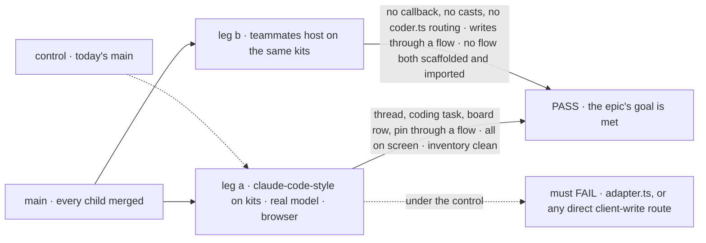
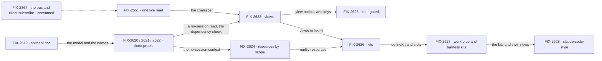

# FIX-2618 · An app installs a feature and reads it back without an adapter

**Spec** · [Decisions](DECISIONS.md)

## Five teams, before and after

| A team that… | Today | After this epic |
|---|---|---|
| **builds an app on workforce** (a lab, Shift Manager) | Writes 1,100 to 1,800 lines of adapter to read workforce back: watch loops, caches, row assembly, and types that copy what the server computes | Installs workforce and the coding harness, calls their hooks, and gets types from the views. What's left is the app's own screens and renderer |
| **shows user- or org-level data** (pins, projects, a dashboard) | Makes a session only so it can read (`ownSession`, `labSession`, the roster session, `readerSessionId`) | Reads by scope and key with no session. Writes in one line through the resource's flow: the default write flow for plain data like a pin, its own flow where the flow does the work |
| **installs workforce into a host** | Passes a circular `workerFlows: () => flows` callback, spreads the flows map by hand, casts with `as never`, adds a flow per read | Puts one config object per kit in `kits: [...]`, and owns the files a kit scaffolds into its directory (`workforce/`), which the kit reads at install |
| **keeps a screen current** | Learns which topics to watch and copies the re-read logic (three copies, FIX-2551) | Watches a view. A notice says which rows changed |
| **maintains the framework** | Two hooks compute a screen's answer (flow `reads`, scope `derived`); eight client read paths | One hook, the view. Nothing is added beside it |

**Why now.** The objective's kill line has fired. The labs and Shift Manager are the first real
apps on workforce, and each composes it only through a large adapter: Shift Manager's
`lib/reads.ts` is 1,109 lines, claude-code-style's `adapter.ts` 1,498, teammates' 1,788. That is
what the composition model costs today, and FIX-2592, FIX-2616 and FIX-2369 are about to add to
it. FIX-2152 ER-1 already says an app is configuration, UI and small flows; nothing in the
framework lets an app meet it.

## The goal, and how we'll know it's met

**An app on workforce is configuration, UI and small flows: it installs workforce and the
coding harness as kits and reads everything it shows through their views and direct resource
reads, with no hand-written read model and no session made only to read.**

| Is it the right goal? | |
|---|---|
| **The real need** | The kill line: the block kinds compose into real apps only through per-app glue. The need is to stop writing the glue, not to write it faster |
| **Smaller, and rejected** | "Views and direct reads ship." The adapter shrinks, but every host still assembles workforce by hand, and the next feature is wired the same way. Or "kits ship with workforce as the only one": slots designed for one consumer freeze the wrong contract |
| **Bigger, and not this epic's** | A third-party ecosystem (publishing, discovery, versioning, a registry). Moving Teammates' and Shift Manager's remaining adapters onto kit clients. Serving each answer on one route only. Each its own epic |
| **Not done if** | claude-code-style keeps a file that assembles server data by hand · any of the four own-session helpers survives · a host keeps `workerFlows: () =>` or `as never`, or calls `createWorkerInstallation` or `hireWorkforce` · a client can write a user or org resource by scope other than through a flow (exempt until [FIX-2633](https://linear.app/fixpoint-labs/issue/FIX-2633), the skills drawer's user and org `client.content.*` writes, as below) · `reads` or scope `derived` is still exported · a view reads something it did not declare and no test fails · ids reach a client in a scope that turned them off ([O4](DECISIONS.md#o4)) · a bug the closure run found is open |

Leg b is the one the smaller goal skips: a second app on the same kits is what shows the slots
are not shaped for one consumer. Per [O1](DECISIONS.md#o1), it imports the kits' library half,
and its `workforce/` tree is files it owns, read through the workforce kit's install.
Under today's `main` the inventory must refuse the adapter, and a direct write route
must fail the run, which is what makes the PASS mean something.

| How we verify | |
|---|---|
| **Goal check** | The closure issue's goal check (FIX-2629), real model, in a browser, on one `main` commit after every other child merges. Its clean run is the epic's wrap condition |
| **Signal** | Leg a: a thread, a delegated coding task, its board row changing, and a pin written in one line through the default write flow, all seen on screen, with FIX-2152 ER-1's inventory passing and no file that assembles server data. Leg b: the teammates host installs workforce and the harness kit, its own routing flow is gone, its `workforce/` tree is read through the kit's install, and no flow is both scaffolded and importable ([O1](DECISIONS.md#o1)). **Both legs:** every client write to a user or org resource by scope that the run makes is an action whose request is recorded in a flow's session (exempt until [FIX-2633](https://linear.app/fixpoint-labs/issue/FIX-2633), the skills drawer's user and org `client.content.*` writes, as in the row below); such a write with no request fails the leg |
| **Must fail: a direct write path** | The closure lists the engine's client routes that change a user or org resource and fails if any is not the action route, and it writes a resource with no `runBy` from the client and fails unless that is refused ([ER-4](DECISIONS.md#who-owns-what)). One temporary exemption, by name: the skills drawer's `client.content.*` create, update and delete on its user or org collection (`skills/collection.ts`), the only such writer today. It is deleted when [FIX-2633](https://linear.app/fixpoint-labs/issue/FIX-2633) moves it onto the default write flow. FIX-296's routes on session-scope collections are not resource-by-scope writes and stay |
| **Input** | A held-out coding prompt in a scratch repository, chosen at run time |
| **Anti-game** | Don't assert on a view's own output or a kit's unit tests: they pass while a screen still reads through a hand-rolled session. Assert on the screen and on the inventory |
| **Control that must fail** | Today's `main`: the inventory refuses `adapter.ts` and the own-session helpers. A view with one dependency left out: the development-time check fails |

## What's in the box

![In the box: views, one live read, resources by scope, writes through runBy with a default write flow, ids on notices, kits, and the workforce and harness kits. Fence: a view never writes, every new client write goes through a flow, a notice carries ids not rows, a kit reaches another only by slots. Composed in: the app's local kit, its copied flows, its screens, one config per kit. Replaced in one line: reads and derived by a view, own sessions by a direct read, host wiring by kits, row types by ViewOutput. Not built: a third-party ecosystem, a direct client-write path, the other two adapters, one route per answer](figures/end-state.svg)

Inside the box is what an app on workforce gets for one line of config. The fence is what keeps
it safe: every byte a client sees still comes through a checked read, and every new write goes
through a flow, the default write flow or the resource's own ([ER-2, ER-4](DECISIONS.md#who-owns-what)). The bottom strip is what the set
refuses to build.

**Docs:** the shared story is "a feature installs as a kit; a screen reads its views". FIX-2619
writes it as a concept doc first, and the architecture docs it names. FIX-2626's changeset
carries the published story to `/release-docs`; each child documents its own specifics. Worked
code for every piece is in [`examples/`](examples/), each marked proposed.

## The set · as of 2026-11-08

The reviewed snapshot. Live state is on [FIX-2618 in Linear](https://linear.app/fixpoint-labs/issue/FIX-2618).
Stage 1 is specced in the spec-set PR. Stage 2 is parked until the proofs merge, then specced issue by issue ([D2](DECISIONS.md#d2)).

| Issue | What it delivers | Why the set needs it | Status |
|---|---|---|---|
| [FIX-2619](https://linear.app/fixpoint-labs/issue/FIX-2619) · stage 1 | The concept doc; glossary entries for view, kit and slot; the narrowed objectives line; the architecture doc debt | Every spec reads one written model; the names land before code | Backlog |
| [FIX-2620](https://linear.app/fixpoint-labs/issue/FIX-2620) · stage 1 | Proof: a user-scoped view answers with no session | `runRead` takes a `sessionId` today; views and direct reads rest on this | Backlog |
| [FIX-2621](https://linear.app/fixpoint-labs/issue/FIX-2621) · stage 1 | Proof: `dependsOn` checked against what a view reads | The name "view" is earned only if declared dependencies can't drift silently ([O2](DECISIONS.md#o2)) | Backlog |
| [FIX-2622](https://linear.app/fixpoint-labs/issue/FIX-2622) · stage 1 | Proof: the teammates host with workforce as a kit, its `workforce/` tree read through the kit's install, beside a better workforce API | The collapse trigger for the kit children ([D1](DECISIONS.md#d1), [O1](DECISIONS.md#o1)) | Backlog |
| [FIX-2551](https://linear.app/fixpoint-labs/issue/FIX-2551) · stage 2 | One live read in the client: the coalescer and the path rule | `useView` and every package watch sit on it | Backlog · existing issue, now parented |
| [FIX-2623](https://linear.app/fixpoint-labs/issue/FIX-2623) · stage 2 | Views replace reads; `useView`, `ViewOutput`; `derived` folds in; board and roster move | The read half of the goal | Backlog |
| [FIX-2624](https://linear.app/fixpoint-labs/issue/FIX-2624) · stage 2 | Direct user and org reads; every write through `runBy`, with the default write flow and one-line client helpers ([O3](DECISIONS.md#o3)); a session-free identity read; the four workarounds deleted | The session half of the goal | Backlog |
| [FIX-2625](https://linear.app/fixpoint-labs/issue/FIX-2625) · stage 2 · **gated** | Ids on notices | Re-reads only what changed. [O4](DECISIONS.md#o4) is decided; parked with stage 2 under [D2](DECISIONS.md#d2) | Backlog |
| [FIX-2626](https://linear.app/fixpoint-labs/issue/FIX-2626) · stage 2 | `defineKit` and slots in `core`; install in the engine; an owned directory read by the walker lifted from workforce; config, the client half | The install half of the goal | Backlog |
| [FIX-2627](https://linear.app/fixpoint-labs/issue/FIX-2627) · stage 2 | Workforce fully a kit (library half, `workforce/` convention, slots) and the harnesses as kits; one shared coding worker flow | Two kits, so slots meet a second consumer before they freeze | Backlog |
| [FIX-2628](https://linear.app/fixpoint-labs/issue/FIX-2628) · stage 2 | claude-code-style on kits | The worked example made real; it measures the estimates. Kept, narrowed, if the kits collapse | Backlog |
| [FIX-2629](https://linear.app/fixpoint-labs/issue/FIX-2629) · closure · **required** | The QA run on one `main` commit: both legs, each team's journey, every child's goal check, the seams | The only child that proves an app sheds its adapter | Backlog · blocked by every other child |

0 done · 12 open. Three proofs, one doc, seven build children, one closure. Whether twelve is
really fewer: FIX-2625 is the one to cut, since the goal is met without it; it stays because the
re-read cost lands on every view, and it is gated rather than dropped. **Collapse trigger,** the
owner's to pull since [O1](DECISIONS.md#o1) is decided: if
FIX-2622 shows the wiring pain is workforce's own API, FIX-2626 and FIX-2627 leave for a
follow-up epic, FIX-2628 narrows to moving claude-code-style onto views and direct reads with no
kits, so leg a still passes, and FIX-2629 drops leg b. FIX-2622 showed it for the install half;
the owner kept kits on 2026-11-10, so it is not pulled ([O1](DECISIONS.md#o1)).

## How the issues flow into each other

An edge is what one issue hands the next. A dashed input is consumed, not owned, and never
re-parented. Every child blocks the closure FIX-2629, which is left off to keep the graph
readable. The doc goes first; the proofs run in parallel; views and resources build in parallel
once the proofs land; kits come last because they package everything before them ([D2](DECISIONS.md#d2)).

## What stays as it is

- **Session-scope content writes.** FIX-296's `client.content.*` routes stay for session-scope
  collections. Their user and org writes (the skills drawer) are a listed leftover, not a fence
  exemption: [FIX-2633](https://linear.app/fixpoint-labs/issue/FIX-2633) moves them onto the default write flow. The epic adds no direct client write;
  every new one goes through a flow ([ER-4](DECISIONS.md#who-owns-what)).
- **Session items, streams and the transcript.** A transcript belongs to one session; those
  routes keep their session address.
- **Capabilities.** Still the unit a block uses. A kit carries them; it doesn't replace them.
- **The push channel itself.** FIX-2367's bus, socket and `client.subscribe` are consumed as built.
- **FIX-2471's webhook routing, FIX-1907's harness mode, FIX-2615's connectors.** Coordinated,
  not folded ([DECISIONS → seams](DECISIONS.md#coordination-seams)).

## What's already here, and the debt

| Already here | What the set does with it |
|---|---|
| Flow `reads` ([FIX-2286 D1](../../issues/FIX-2286/DECISIONS.md#d1)): "the one hook for watching a computed view" | **Amended, revisited by the owner's leave.** The rule is kept (one hook, no writes); the hook is renamed to view and gains scope, `dependsOn` and `key` ([O2](DECISIONS.md#o2)) |
| Scope `derived` (two kitchen-sink flows) | **Superseded.** Folds into views (FIX-2623) |
| A notice carries no rows ([FIX-2367 D2](../FIX-2367/DECISIONS.md#d2)) | **Amended by the owner** ([O4](DECISIONS.md#o4)): a notice may carry ids. Ids are not rows; every byte still comes through a checked read |
| One hour of notices after revocation ([FIX-2428 D2](../../issues/FIX-2428/DECISIONS.md#d2)) | **Amended by the owner** ([O4](DECISIONS.md#o4)): the hour is accepted with ids, which it leaks, with a per-scope opt-out. Its reason (a check per notice is a store read per viewer) is kept |
| Client writes off on the rules record ([FIX-1945 D1](../../issues/FIX-1945/DECISIONS.md#d1)) | **Kept** ([O3](DECISIONS.md#o3)): no generic client write is added; every client write goes through a flow, which runs the validators. The rules record has no `runBy`, so it stays read-only |
| A worker is a private resource run by the flow it names ([FIX-1788](../../issues/FIX-1788/SPEC.md)) | **Generalized.** `runBy` is that pattern for any resource that needs a flow ([O3](DECISIONS.md#o3)) |
| The copy-in registry for UI ([FIX-1655](../../issues/FIX-1655/SPEC.md)); the chrome shipped from a package, not copied ([FIX-1477 D1](../../issues/FIX-1477/DECISIONS.md#d1)) | **Reused** for a kit's copied half: `init` scaffolds starter files, app flows among them, into the directory the kit owns, Shadcn-style. D1's rule holds for the library half ([O1](DECISIONS.md#o1)) |
| Workforce's loader: `openRoot`, `classify`, `validateSegment`, the refusal wording, `IGNORED_ENTRIES` (`packages/workforce/src/loader`), consume or refuse every authored file | **Lifted** to a Node-only engine subpath as every kit's walker (FIX-2626); workforce keeps only its own schema ([O1](DECISIONS.md#o1)) |
| One adapter per lab, fixtures first ([FIX-2152 D4](../FIX-2152/DECISIONS.md#d4), ER-5) | **Superseded for claude-code-style** by FIX-2628; its ER-1 is this epic's goal |
| "Session factory… never a kit" ([FIX-2246](https://linear.app/fixpoint-labs/issue/FIX-2246), glossary) | **Narrowed** to the session-factory sense by FIX-2619 ([O5](DECISIONS.md#o5)) |
| A plugin system ([FIX-147](https://linear.app/fixpoint-labs/issue/FIX-147), canceled) and the objectives non-goal "Plugin/extension ecosystem" | **Kept out.** A kit is FSD's own composition unit; the third-party ecosystem stays a non-goal, and FIX-2619 narrows the line to say so |
| FIX-2369's FIX-2374 `sessionFeed`, FIX-2379 task-row view, FIX-2412 `watchRoster` | **Builds on.** Re-expressed as views, not duplicated |
| FIX-2036's deferred "Workforce browser contract for Shift Manager reads" (overlaps FIX-1672) | **Absorbed.** The workforce kit's views and client half are that contract |

| Adds | Existing piece considered | Why it doesn't fit / how composed |
|---|---|---|
| Views (FIX-2623) | Flow `reads`, scope `derived` | **Extends** reads; removes `derived`. Still one hook ([ER-1](DECISIONS.md#who-owns-what)) |
| `runBy` and `fsd.resource(ref).send` (FIX-2624) | FIX-1788's worker; `client.content.*`; actions | **Extends** the worker pattern; a send is an ordinary action on the resource's session, so no write route is added |
| The default write flow and the client helpers (FIX-2624, [O3](DECISIONS.md#o3)) | `runBy`; the action route; the labs' hand-written pins flow and `listPins`; `resource-cas` | **Reuse:** a stock flow behind `runBy` on the existing action path, so no write route is added. It replaces the labs' pins flows; the helpers are `send` with field patches |
| A session-free identity read (FIX-2624) | The principal resolver, push topics | **Reuse:** the same verified principal the push topics use |
| Ids on notices (FIX-2625) | FIX-2367's notice shape | **Extends** the notice with an optional field |
| `defineKit` and slots (FIX-2626) | `defineCapability`, `defineFlow`, workforce's `createWorkerInstallation` | **Genuinely new.** A capability installs into a block and can't add flows or views; a kit holds only those existing pieces ([ER-5](DECISIONS.md#who-owns-what)). It lands in `core` and the engine, no new package. Its owned directory reuses workforce's walker, lifted, and the UI registry's scaffolding |
| One shared coding worker flow (FIX-2627) | claude-code-style's `harness-thread.mts`, teammates' `coder.ts`, `harness-manager` | **Reuse and merge:** two copies of the same routing become one |

| The debt | |
|---|---|
| **Removes** | About 1,250 lines of claude-code-style's adapter (estimate); three of its flows; four own-session helpers; two read-only flows in each lab host; scope `derived`; three coalescer copies; one duplicated coding flow |
| **Adds** | Kits and slots: a new concept and a public contract, permanent by design. `runBy` session lifecycle (creation races, deletes, a flow that's gone) |
| **Leaves** | Teammates' and Shift Manager's remaining adapters, and the same data served on two routes. Both named as follow-up epics, filed at wrap. The skills drawer's user and org `client.content.*` writes, the last direct client writes to a resource by scope: filed as [FIX-2633](https://linear.app/fixpoint-labs/issue/FIX-2633), related, not a child |

**Net: down.** Each app sheds its read model; the framework gains one concept and one contract.

## Sign off

**[The goal](#the-goal-and-how-well-know-its-met), at that size:** claude-code-style sheds its
adapter on kits, and teammates installs the same kits. If wrong: we ship views and direct reads,
and every app still hand-wires the next feature.

**[The set's debt](#whats-already-here-and-the-debt), net down:** apps shed their read models; the
framework gains kits and slots. If wrong: a slot contract that is hard to change, which
[D1](DECISIONS.md#d1)'s collapse trigger and FIX-2627's second kit exist to catch.

1. **[D1](DECISIONS.md#d1) · Four changes in one epic, proofs first, now.** If wrong: a large
   epic where four smaller ones would have shipped sooner.
2. **[D2](DECISIONS.md#d2) · The build children are parked until the proofs merge, then specced
   issue by issue.** If wrong: the build waits a few weeks it didn't need to.
3. **[D3](DECISIONS.md#d3) · Lab adapters stop growing once the three sibling epics amend their
   specs.** Advisory until then. If wrong: sibling lab epics write package reads a little early.

**Decided by the owner, in session, 2026-11-10:** [O1](DECISIONS.md#o1) kits, with typed slots,
an optional owned directory the kit scaffolds and reads, `defineKit` in `core` and install in the
engine · [O2](DECISIONS.md#o2) views replace reads, with the `dependsOn` check ·
[O4](DECISIONS.md#o4) ids on notices, the hour accepted with a per-scope opt-out ·
[O5](DECISIONS.md#o5) "kit". If O1 is wrong: a slot contract that is hard to change.

**Decided in review: [O3](DECISIONS.md#o3).** Every client write goes through a flow; a pin is
one line through the default write flow. If wrong: a request row per plain write.

Epic · 12 issues · Framework simplification & cleanup · the objective's kill line (the
composition model changes), with Goal 4 (keep the foundation honest) and Goal 1 (validate
through real usage)
