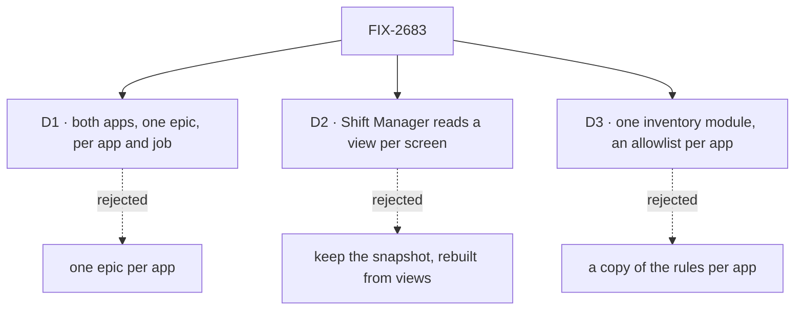

# FIX-2683 · Decisions

[Spec](SPEC.md) · **Decisions**

The calls above any single child: what was chosen, what lost, and what each locks in for the
children of both apps. D1 records what the owner decided before drafting. D2, D3 and
Teammates' config cap are the sign-off.

## The tree

## D1 · Both apps in one epic, cut per app and per job, after FIX-2755 and before FIX-2756 · decided by the owner

| | |
|---|---|
| **Instead of** | One epic per app · or folding the work into FIX-2756, which pulls what the starters share into packages |
| **Because** | Both apps read the same kit views, so a view one app finds wrong is wrong for the other: one cross-spec review catches it. FIX-2755 splits Teammates' adapter by job, so each job is a child that deletes its own files. FIX-2756 can only see what is shared once both starters read through views |
| **Locks in** | One closure for both apps: a slow Shift Manager child holds Teammates' wrap. The job split follows FIX-2755's files, so a child may be re-cut when FIX-2755 merges ([ER-8](#who-owns-what)) |

**What would change my mind:** Shift Manager's children taking a release longer than
Teammates'. Then Shift Manager leaves for its own epic, and this closure drops leg s.

It comes down to the shared views: one review over both consumers finds a misfit once.

## D2 · Shift Manager's snapshot goes: each screen reads its own view, and one workforce view on a new pending-asks read answers the Inbox and its count

| | |
|---|---|
| **Instead of** | Keep the snapshot, rebuilt in the client from views: the worker sessions view, then one board read and one ask read per session |
| **Because** | That rebuild is the stitching the owner ruled out: separate lookups on the client for one answer (comment on this epic, 2026-11-16). No server read answers "this user's pending asks" today: the session list has no dispatch-runs option (`SessionListQuery`), and `deriveSuspensions` runs in `react` over one session's items. The engine's `SuspensionStore` already holds each ask with its user, session, flow, status and expiry, moved out of pending under a fence, so one read over it is the source. The rule the snapshot existed for, that the Inbox count and the Inbox list never disagree ([FIX-1662 PLAN S3](../../issues/FIX-1662/PLAN.md)), holds when both draw from one view |
| **Locks in** | A user-scoped pending-asks read in core and the engine, and a workforce Inbox view on it. Shift Manager's "moving around costs no reads" ([FIX-2409](../../issues/FIX-2409/SPEC.md)) is retired: opening a screen reads its view. Its explicit refresh (R, *as of*) becomes a re-read of what is on screen. A suspension store with no tenant field must not leak an ask across tenants ([ER-6](#who-owns-what)) |

**What would change my mind:** the Inbox view costing more than a second for a user with dozens
of worker sessions, or re-running on every streamed chunk rather than on suspension changes.
Then the view pages or narrows its topics, or the snapshot stays for the Inbox alone.

It comes down to stitching: a rebuilt snapshot is the client stitching the owner ruled out.

## D3 · One inventory module, with an allowlist per app that only shrinks; Teammates meets all of it, Shift Manager the content rules

| | |
|---|---|
| **Instead of** | A copy of claude-code-style's rules in each app · per-rule `it.fails` markers · or holding Shift Manager to the path classes and caps too |
| **Because** | [FIX-2629 D1](../../issues/FIX-2629/DECISIONS.md#d1): an app has one inventory, which its test and the closure both run. Three copies would drift. A per-rule `it.fails` can only flip when the last of six children lands, so it can't measure one child. An allowlist of findings keyed `{file, symbol, kind}`, the symbol being the enclosing exported function, gives the jobs disjoint entries even in Teammates' one big adapter. Shift Manager is a published app over another host's Lab: it has no `host.mts` of its own, and `teams/devteam/` is a test fixture. The path classes and caps (L1, L2, H) describe a starter; the content rules (L3, L4, own sessions) describe any screen |
| **Locks in** | Each app's test fails on a new finding, on a stale allowlist entry, and when its allowlist is not a subset of the merge-base's. A child is done when its entries are gone; the closure needs both allowlists empty. What is left of each read model may not grow in lines past the merge-base ([ER-4](#who-owns-what)). Shift Manager's L4 covers `src/components/` and `src/surfaces/` too. The module lives outside the apps, in one repo-internal place the inventory child picks; it is never a published package export |

**What would change my mind:** review finding server logic in Shift Manager's `cli/` or
`scripts/`, which L3 doesn't scan. Then L3 scans them too. `kindOf` classes every
`src/**/*.ts(x)` file as UI, so L1 was never the fallback for `src/`.

It comes down to one inventory: three copies would let the closure and a test disagree.

## Who owns what

Every rule has one owner; read a row to see where it is built and where it is only used. A
*uses* cell is a place a child must not decide again. Short names: **inv** is
`FIX-2769 · one inventory`; **asks** is `FIX-2770 · a user's pending asks`; **t1** to **t3** are
Teammates' people, conversations and task cards; **s1** to **s4** are Shift Manager's Inbox and
boards, directory, conversations, and the snapshot's deletion.

| # | Rule every child obeys | Owner | Checked at |
|---|---|---|---|
| ER-1 | A screen reads what the server computes only through a kit package's view, a direct read, or a package hook. A missing hook is added to `react` or the kit package that owns the data, never written in the app ([FIX-2757](https://linear.app/fixpoint-labs/issue/FIX-2757)'s rule) | inv builds the check · every job child uses | Each child's spec review; L3 |
| ER-2 | Each app has one inventory, run by its `pnpm test` and by the closure, with a checked-in allowlist that only shrinks ([D3](#d3)). Teammates: L1 to L4, H, own sessions, no `src/adapter.ts` or fake app. Shift Manager: L3, L4 (with `src/components/` and `src/surfaces/`), own sessions, no `reads.ts` and no snapshot type. A child's done-state is its deleted entries plus a green run of the goals its screens touch. A stitcher moved outside the scanned folders rests on review | inv builds · every job child uses | Each child's PR checks; the closure |
| ER-3 | No legacy path. A child that moves a job deletes what it replaces in the same PR: no alias, no dual read, no flag, no fallback to the old module | The coordinator · every job child uses | Each child's spec review; the closure |
| ER-4 | Neither read model grows: no new verb in Teammates' `src/app/`, no new section in Shift Manager's `reads.ts`, and each such file's line count never passes its merge-base's. A screen's new need is a package view or hook. Carries [FIX-2618 ER-8](../FIX-2618/DECISIONS.md#who-owns-what), and ends when each file goes | inv builds the ratchet · FIX-2369's children use | Each PR's checks; sibling epics' spec reviews |
| ER-5 | An answer across sessions is one read on the server, never stitched in the client from per-session reads. Shift Manager's Inbox and boards are one workforce user view ([D2](#d2)) | s1 builds · asks, s2, s4 use | s1's spec review; leg s |
| ER-6 | Pending asks are read for the verified user in **one store query** that joins each suspension to its request and predicates, inside the query: the user; the tenant and the organization, exact-matched as `matchesTenantFilter` and `matchesOrgFilter` match them when the key is present; the flow, limited to the worker flows Shift Manager's Inbox walks today (`workerFlowNames` in `reads.ts`), never widened to every flow on the host; pending status and `expiresAt`; and `isUserSuspension`, so a wait gate or a raw `ctx.suspend` row never comes back (BP-033). Never a filter run after `SuspensionStore.list`, which filters only on the user in Postgres, and never `principalOwnsRequest`, which treats a request with no organization as every organization's. A row with no request drops inside the query. Scope never comes from the caller. **It returns a projection, never the `SuspensionRecord`:** ids, the suspension address, kind, title, message or prompt, `expiresAt`, and the session and worker link, the fields today's Inbox shows; `stepInput` and `resumeData` never leave the server. It is heard only on suspension changes. **Tests where the read returns nothing:** the same user in another tenant; the same user in another organization; a second user in the same organization; a request with a null `orgId`; the same user's ask in another flow; a suspension whose request is missing; an expired ask; an ask resolved in a dispatch-run session, gone in the same update; a wait gate. Also: a sessionless ask is listed only through its request's scope, and a user ask's projection has no `stepInput` or `resumeData` key | asks builds · s1 uses | asks' spec review; leg s |
| ER-7 | Nothing here pulls code the starters share into a new package or kit. A copy both keep stays a copy; the child names it for FIX-2756 | The coordinator · every job child uses | The cross-spec review |
| ER-8 | Deletion lands file by file. The coordinator maps each `src/app/` file to one Teammates child once FIX-2755 merges. Shift Manager's three jobs each move their screens off the snapshot; s4 alone deletes `lab-data.tsx`'s snapshot, its re-read, `reads.ts` and the snapshot types | The coordinator · every job child uses | Each wake after FIX-2755 merges; the closure |

**How the checks divide the work.** The allowlist tracks findings: each child deletes its own
entries, and the test fails on a new or stale one. The ER-4 line limit tracks files: a read-model
file can't grow past its merge-base length until it is deleted. "No new verb or section" is one
case of ER-4.

## Coordination seams

| Seam | Between | Rule |
|---|---|---|
| `src/app/` files | FIX-2755, t1, t2, t3 | FIX-2755 lands the split; no child renames or re-splits it. FIX-2755's notes on Threads mode's per-card reads go to t3 if they recur |
| `useSessionFeed`, `useRequestStream` and their siblings in `react` | t2, s3, FIX-2757 | Whichever child finds a hook missing adds it; the other uses it. Neither keeps an app copy |
| The coding board and recorded work views (harness-manager) | t3, claude-code-style | t3 reads the views claude-code-style reads. A row Teammates needs extends that view; no second board view |
| The ask predicate | asks, s1, `react`, the ui registry | asks moves the predicate behind `suspensionShape` to core, beside `isUserSuspension` and `suspendForUserKindOf`. `react` keeps exporting `suspensionShape` as public package surface (ER-3's no-alias rule covers app read paths, not this), and the ui registry's suspension card is unchanged. A change to a published export carries a changeset. `deriveSuspensions` stays in `react` for one chat |
| The pending-asks read and the Inbox view | asks, s1, s2, FIX-2756 | asks builds the read beside `RequestSessions.read`/`history`; s1 composes it with `inboxItems`' task holds; s2's sidebar counts read the view; FIX-2756 may serve Teammates' "needs you" from it later |
| Answering an ask | s1, s3, [FIX-2743](https://linear.app/fixpoint-labs/issue/FIX-2743) | The Inbox lists what FIX-2743's unauthenticated answer path can answer. Related, not parented |
| Views over a sequencer | t1 to t3, s1 to s3, [FIX-2684](https://linear.app/fixpoint-labs/issue/FIX-2684) | A child whose view comes out untyped uses FIX-2684's fix or names its hand-written type on the allowlist, never in a new module |
| The inventory module | inv, claude-code-style's test, FIX-2629's closure goal | inv moves the rules and updates both importers in one PR, after FIX-2629 merges |
| Teammates goals needing a second user | FIX-2763, the closure | FIX-2763 lands before the closure; leg t runs all 13 goals |
| Shift Manager's `reads.ts` and `lib/` | s1 to s4, FIX-2369's children | ER-4: a FIX-2369 child that needs a read asks for a view |

## Decided while drafting, recorded so no child reopens them

- **Teammates' config cap holds at 300 lines, prompts included (for sign-off).** With
  `fsdev.config.mts` (66) and the six `WORKER.md` prompts (145) as they are, `host.mts` has about
  89 lines left against its 397. t1 removes about 310: the context flow moves to `flows/`, and the
  host imports the packages' `operatorGitHub`, `sqliteScheduleIndex` and `checkCommandsFrom`
  instead of its own copies. A child that can't meet the cap comments up.
- **The fake app goes when the last Teammates child merges.** Each of t1, t2 and t3 cuts its own
  scenarios (14 test files use the fake) into its ledger, mapping each to a view test or to
  "dropped, because …". Whichever merges last deletes the fake, its `gone` entry and the shared
  plumbing types. t1 owns `workers.ts`; t2 owns `steps.ts`. Amended by the cross-spec review below.
- **A size ratchet on the read models is worth its cost** ([ER-4](#who-owns-what)): the allowlist
  stops new findings, but not logic growing inside an allowlisted function.
- **Defaults for the division.** Teammates' people and conversations children stay separate unless
  their allowlist entries share files once FIX-2755 lands. The snapshot child stays separate.
- **Delegates:** the conversations child's spec settles the shape before code: a workforce view if
  the list is read across sessions, a package hook if it is read per session.
- **`readEveryScopeEntry` goes**; its callers use the scope client's `listAll()` (s2).
- **Teammates' `App.tsx` imports `ClientHttpError`** (an L3 finding): t2's.
- **The dropped-attachments edge** (a project Stream's files lost when its session opens) is s3's
  acceptance, not a separate bug.
- **Parented here but related to the set, not a gate of it:** [FIX-2766](https://linear.app/fixpoint-labs/issue/FIX-2766)
  (claude-code-style's task screens read the coding board row directly).
- **Related, not parented:** FIX-2764 (claude-code-style), FIX-2743, FIX-2684, FIX-2633,
  FIX-2592, FIX-2616, FIX-2369.
- **FIX-2756 stays parented but outside the set.** The coordinator decides at the gate whether to
  re-parent it to the project; it stays blocked by this epic.
- **The closure was filed after the gate** (FIX-2778), with the rest of the set, at the owner's word.

## Considered and dropped

- **Asks as task-board rows.** A write to a second store that isn't atomic with the suspension,
  and only the asks that opt in are covered.
- **Asks mirrored into a user resource.** It drifts outside the suspension's fence.
- **A view folded from events.** A second source of truth beside the store.
- **Merging the two apps.** Different products; FIX-2756 shares what is shared.
- **The Inbox as push notifications.** A product change, not a read.
- **One server read action per screen.** Not live: it needs its own re-read loop.

## What the end-state POC showed

None built. The pattern was proven end to end on claude-code-style (FIX-2628, FIX-2757, and
FIX-2629's runs); this epic applies it. The baseline is measured: claude-code-style's rules run on
today's `main` against Teammates (L2 1, L3 5, L4 32, H 0) and Shift Manager (L3 19 findings in
14 files under `src/lib/`, L4 68). Of those 14, `connection.ts` is the client entry, whose
`createClient` is allowed, and `routines.ts` and `usage.ts` import only `ClientHttpError`.

## Analysis

### Analysis — FIX-2683 epic spec · 2026-11-17 · watermark 2026-11-17

The first pass ran inline by the author, with no sub-agent tool. The coordinator then ran
`adhd`'s frames (5 diverge, 3 deepen) and verified the reuse claims. No cross-family judge was
available (the Codex CLI isn't installed there), so the coordinator scored against the rubric.

**Verdict:** right approach, with changes: the Inbox stands on the suspension store, and the
inventory is a ratchet.

1. **Reuse.** Inventory: **extend** claude-code-style's rules. Pending asks: **extend**
   `SuspensionStore.list`; the first draft's "extends existing views" was false, since no server
   session list includes dispatch runs and `deriveSuspensions` is client-side. Inbox view:
   **compose** that read with `inboxItems`. Hooks: **extend** `react`. `readEveryScopeEntry`:
   **reuse** `listAll()`.
2. **Prior art.** [Relay](https://relay.dev/docs/principles-and-architecture/thinking-in-relay/):
   each screen declares what it reads, and no hand-written store sits between. [Convex](https://docs.convex.dev/client/react):
   `useQuery` keeps a server query live per component. Both read per screen, as D2 does.
3. **Other shapes.** One epic per app (D1); a client-rebuilt snapshot (D2); the shapes under
   *Considered and dropped*. `adhd`'s graft: the allowlist ratchet (D3).
4. **New factors.** FIX-2755 in development; FIX-2757 and FIX-2760 merged today; FIX-2763 and
   FIX-2764 filed from the closure; #5313 waiting for merge.
5. **Necessity.** Yes: both adapters are the named follow-up, and ER-8's freeze holds siblings.
6. **Ergonomics.** One new read and the Inbox view's name. A starter user meets hooks, not an
   adapter.
7. **Concerns.** Tenant scoping of the pending-asks read ([ER-6](#who-owns-what)); the Inbox
   view's re-run frequency (D2); Teammates' config cap.

| Finding | Objective | Changes the approach? | Disposition |
|---|---|---|---|
| The Inbox can't extend existing views; it needs a read over `SuspensionStore` | 1 | Yes | Folded: a new child, D2, ER-6 |
| `SuspensionRecord` has no tenant; the read must enforce the principal | 7 | Yes | Folded: ER-6, scoped through the request, and its tests |
| Per-rule `it.fails` can't measure one of six children | 3 | Yes | Folded: the allowlist ratchet (D3, ER-2) |
| `readEveryScopeEntry` duplicates `listAll()` | 1 | No | Recorded for s2 |

## How it got here

- **Filed (2026-11-11)** at the owner's request during FIX-2618.
- **Owner scope (2026-11-17)** — Teammates reaches claude-code-style's condition; plan against
  FIX-2755's layout; FIX-2756 follows; no legacy support ([D1](#d1)).
- **Drafted (2026-11-17)** — ten rows, six job children, D2 and D3 for sign-off.
- **Review round 1 (2026-11-17)** — the analysis and `adhd`: the Inbox reads the suspension
  store through a new child, with tenant scoping ([ER-6](#who-owns-what)); the inventory became an
  allowlist ratchet. Codex: Shift Manager's snapshot goes in an ordered final child, and the
  delegate list is s3's. Gitar: the inventory child waits on FIX-2629; D3's fallback now names
  the folders L3 doesn't scan.
- **Review round 2 (2026-11-17)** — Gitar: `react` keeps exporting `suspensionShape` while the
  predicate moves to core; ER-6 scopes through the request record, which carries tenant and
  organization, since a suspension's session is optional.
- **Security review (2026-11-17)** — Cursor: ER-6 became one store query that joins the request
  and exact-matches user, tenant, organization and today's worker flows, never
  `principalOwnsRequest`; the read returns a projection, never the record. Wording: the measured
  baseline, the delegate shape, how the checks divide the work, the division's defaults.

- **Cross-spec review (2026-11-17)** — the Teammates children run in parallel, so no one child
  can delete the shared fake app. Each cuts its own scenarios into its ledger; whichever of
  FIX-2771, FIX-2772 and FIX-2773 merges last deletes the fake, its `gone` entry and the shared
  plumbing types (`AppCalls`, `AppState`, `Unsubscribe`, `Item`). FIX-2772 owns `steps.ts`;
  FIX-2771 owns `workers.ts`. A coordinator call, recorded in each child spec.

**Open:** none.
