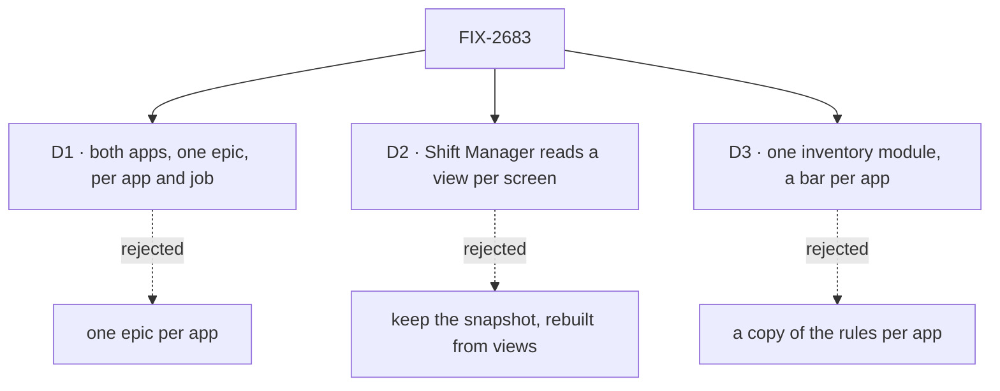

# FIX-2683 · Decisions

[Spec](SPEC.md) · **Decisions**

The calls above any single child: what was chosen, what lost, and what each locks in for the
children of both apps. D1 records what the owner decided before drafting. D2 and D3 are the
sign-off.

## The tree

## D1 · Both apps in one epic, cut per app and per job, after FIX-2755 and before FIX-2756 · decided by the owner

| | |
|---|---|
| **Instead of** | One epic per app · or folding the work into FIX-2756, which pulls what the starters share into packages |
| **Because** | Both apps read the same kit views, so a view one app finds wrong is wrong for the other: one cross-spec review catches it. FIX-2755 splits Teammates' adapter by job, so each job is a child that deletes its own files. FIX-2756 can only see what is shared once both starters read through views |
| **Locks in** | One closure for both apps: a slow Shift Manager child holds Teammates' wrap. The job split follows FIX-2755's files, so a child may be re-cut when FIX-2755 merges ([ER-7](#who-owns-what)) |

**What would change my mind:** Shift Manager's children taking a release longer than
Teammates'. Then Shift Manager leaves for its own epic, and this closure drops leg s.

It comes down to the shared views: one review over both consumers finds a misfit once.

## D2 · Shift Manager's snapshot goes: each screen reads its own view, and one workforce view answers the Inbox and its count

| | |
|---|---|
| **Instead of** | Keep the snapshot, rebuilt in the client from views: the worker sessions view, then one coding board read and one ask read per session |
| **Because** | That rebuild is the stitching the owner ruled out: separate lookups on the client for one answer (comment on this epic, 2026-11-16). A view per screen is what claude-code-style does. The rule the snapshot existed for, that the sidebar's Inbox count and the Inbox list never disagree ([FIX-1662 PLAN S3](../../issues/FIX-1662/PLAN.md)), holds when both draw from one view |
| **Locks in** | A new workforce user view, read once per screen that shows it, kept current by its notices. Shift Manager's "moving around costs no reads" ([FIX-2409](../../issues/FIX-2409/SPEC.md)) is retired: opening a screen reads its view. Its explicit refresh (R, *as of*) becomes a re-read of what is on screen |

**What would change my mind:** the Inbox view costing more than a second for a user with dozens
of worker sessions. Then the view pages, or the snapshot stays for the Inbox alone.

It comes down to stitching: a rebuilt snapshot is the client stitching the owner ruled out.

## D3 · One inventory module holds all three apps; Teammates meets all of it, Shift Manager the content rules

| | |
|---|---|
| **Instead of** | A copy of claude-code-style's rules in each app · or holding Shift Manager to the path classes and caps too |
| **Because** | [FIX-2629 D1](../../issues/FIX-2629/DECISIONS.md#d1): an app has one inventory, which its test and the closure both run. Three copies would drift. Shift Manager is a published app over another host's Lab: it has no `host.mts` of its own, and its `teams/devteam/` is a test fixture. The path classes and caps (L1, L2, H) describe a starter; the content rules (L3, L4, own sessions) describe any screen |
| **Locks in** | Each app passes its own entry, screen types and rule set to the module. A new screen type goes on its list in a reviewed PR. The module lives outside the apps, in one repo-internal place the inventory child picks, so a starter's test reaches a shared file; it is never a published package export |

**What would change my mind:** logic growing in Shift Manager's `src/` outside `lib/` that L3
and L4 can't see. Then it takes L1's classes for `src/`.

It comes down to one inventory: three copies would let the closure and a test disagree.

## Who owns what

Every rule has one owner; read a row to see where it is built and where it is only used. A
*uses* cell is a place a child must not decide again. Short names: **inv** is
`FIX-XXX · one inventory`; **t1** to **t3** are Teammates' people, conversations and task
cards; **s1** to **s3** are Shift Manager's Inbox and boards, directory, and conversations.

| # | Rule every child obeys | Owner | Checked at |
|---|---|---|---|
| ER-1 | A screen reads what the server computes only through a kit package's view, a direct read, or a package hook. A missing hook is added to `react` or the kit package that owns the data, never written in the app ([FIX-2757](https://linear.app/fixpoint-labs/issue/FIX-2757)'s rule) | inv builds the check · every job child uses | Each child's spec review; L3 |
| ER-2 | Each app has one inventory, run by its `pnpm test` and by the closure. Teammates: L1 to L4, H, own sessions, no `src/adapter.ts` or fake app. Shift Manager: L3, L4, own sessions, no `reads.ts` and no snapshot type. A rule an app doesn't meet yet is an `it.fails`; the PR that meets it makes it an `it` ([D3](#d3)) | inv builds · every job child uses | Each child's PR checks; the closure |
| ER-3 | No legacy path. A child that moves a job deletes what it replaces in the same PR: no alias, no dual read, no flag, no fallback to the old module | The coordinator · every job child uses | Each child's spec review; the closure |
| ER-4 | Neither app's read model grows: no new verb in Teammates' `src/app/`, no new section in Shift Manager's `reads.ts`. A screen's new need is a package view or hook. Carries [FIX-2618 ER-8](../FIX-2618/DECISIONS.md#who-owns-what), and ends when each file goes | The coordinator · FIX-2369's children use | Sibling epics' spec reviews |
| ER-5 | An answer across sessions is one view on the server, never stitched in the client from per-session reads. Shift Manager's Inbox and boards are one workforce user view ([D2](#d2)) | s1 builds · s2, t3 use | s1's spec review; leg s |
| ER-6 | Nothing here pulls code the starters share into a new package or kit. A copy both keep stays a copy; the child names it for FIX-2756 | The coordinator · every job child uses | The cross-spec review |
| ER-7 | Deletion lands file by file on FIX-2755's `src/app/` layout. The coordinator maps each file to one Teammates child once FIX-2755 merges; whichever child of an app lands last deletes that app's emptied files | The coordinator · every job child uses | Each wake after FIX-2755 merges; the closure |

## Coordination seams

| Seam | Between | Rule |
|---|---|---|
| `src/app/` files | FIX-2755, t1, t2, t3 | FIX-2755 lands the split; no child renames or re-splits it. FIX-2755's notes on Threads mode's per-card reads go to t3 if they recur |
| `useSessionFeed`, `useRequestStream` and their siblings in `react` | t2, s3, FIX-2757 | Whichever child finds a hook missing adds it; the other uses it. Neither keeps an app copy |
| The coding board and recorded work views (harness-manager) | t3, claude-code-style | t3 reads the views claude-code-style reads. A row Teammates needs extends that view; no second board view |
| The workforce Inbox view | s1, s2, FIX-2756 | s1 builds it and names it in the glossary if it coins a term; s2's sidebar counts read it; FIX-2756 may serve Teammates' "needs you" from it later |
| The inventory module | inv, claude-code-style's test, FIX-2629's closure goal | inv moves the rules and updates both importers in one PR, after FIX-2629 merges |
| Teammates goals needing a second user | FIX-2763, the closure | FIX-2763 lands before the closure; leg t runs all 13 goals |
| Shift Manager's `reads.ts` and `lib/` | s1 to s3, FIX-2369's children | ER-4: a FIX-2369 child that needs a read asks for a view |

## Decided while drafting, recorded so no child reopens them

- **The config cap holds for Teammates** (300 lines; 608 today, its six `WORKER.md` files
  included). The context flow moves out of `host.mts` into `flows/`. A child that can't meet the
  cap comments up; it is never raised in a child's PR.
- **The fake app goes with the adapter.** Teammates' 14 test files on `test/fake-lab.ts` move to
  a real host, as claude-code-style's did.
- **`readEveryScopeEntry` goes**; its callers use the scope client's `listAll()` (s2).
- **The dropped-attachments edge** (a project Stream's files lost when its session opens) is s3's
  acceptance, not a separate bug.
- **Related, not parented:** FIX-2764 (claude-code-style), FIX-2633, FIX-2592, FIX-2616, FIX-2369.
- **FIX-2756 stays parented but outside the set.** The coordinator decides at the gate whether to
  re-parent it to the project; it stays blocked by this epic.
- **The closure is filed after the gate**, with the other placeholders, at the owner's word.

## What the end-state POC showed

None built. The pattern was proven end to end on claude-code-style (FIX-2628, FIX-2757, and
FIX-2629's runs); this epic applies it. The baseline is measured: claude-code-style's rules run on
today's `main` against Teammates (L2 1, L3 5, L4 32, H 0) and Shift Manager (L3 19, L4 68).

## Analysis

### Analysis — FIX-2683 epic spec · 2026-11-17 · watermark 2026-11-17

Run inline by the author with the reuse review: this dispatch had no sub-agent tool, so it is not
the fresh analyst the skill asks for, and `adhd` did not run. The spec-set review runs a fresh one.

**Verdict:** right approach, with one fold (the Inbox view composes existing pieces).

1. **Reuse.** Inventory: **extend** claude-code-style's rules. Inbox view: **extend**, composing
   `inboxItems` across sessions as the coding board view does for one; not a new mechanism.
   Hooks: **extend** `react`. `readEveryScopeEntry`: **reuse** `listAll()`.
2. **Prior art.** [Relay](https://relay.dev/docs/principles-and-architecture/thinking-in-relay/):
   each screen declares what it reads, and no hand-written store sits between. [Convex](https://docs.convex.dev/client/react):
   `useQuery` keeps a server query live per component. Both read per screen, as D2 does.
3. **Other shapes.** One epic per app (D1); a client-rebuilt snapshot (D2); merging Teammates'
   people and conversation jobs (the set's paragraph).
4. **New factors.** FIX-2755 in development; FIX-2757 and FIX-2760 merged today; FIX-2763 and
   FIX-2764 filed from the closure. Each is a row or a seam.
5. **Necessity.** Yes: both adapters are the named follow-up, and ER-8's freeze holds siblings.
6. **Ergonomics.** No new public word but the Inbox view's name. A starter user meets hooks,
   not an adapter.
7. **Concerns.** The Inbox view's cost per user (D2's mind-changer); Teammates' config cap.

| Finding | Objective | Changes the approach? | Disposition |
|---|---|---|---|
| The Inbox view first read as genuinely new; it composes `inboxItems` and the sessions list | 1 | Yes, its Adds row | Folded into SPEC's Adds |
| `readEveryScopeEntry` duplicates `listAll()` | 1 | No | Recorded for s2 |
| Teammates' config cap may need its six prompts | 7 | No | Recorded above |

## How it got here

- **Filed (2026-11-11)** at the owner's request during FIX-2618.
- **Owner scope (2026-11-17)** — Teammates reaches claude-code-style's condition; plan against
  FIX-2755's layout; FIX-2756 follows; no legacy support ([D1](#d1)).
- **Drafted (2026-11-17)** — ten rows, six job children, D2 and D3 for sign-off.

**Open:** none.
