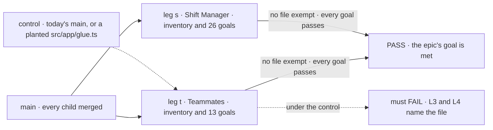
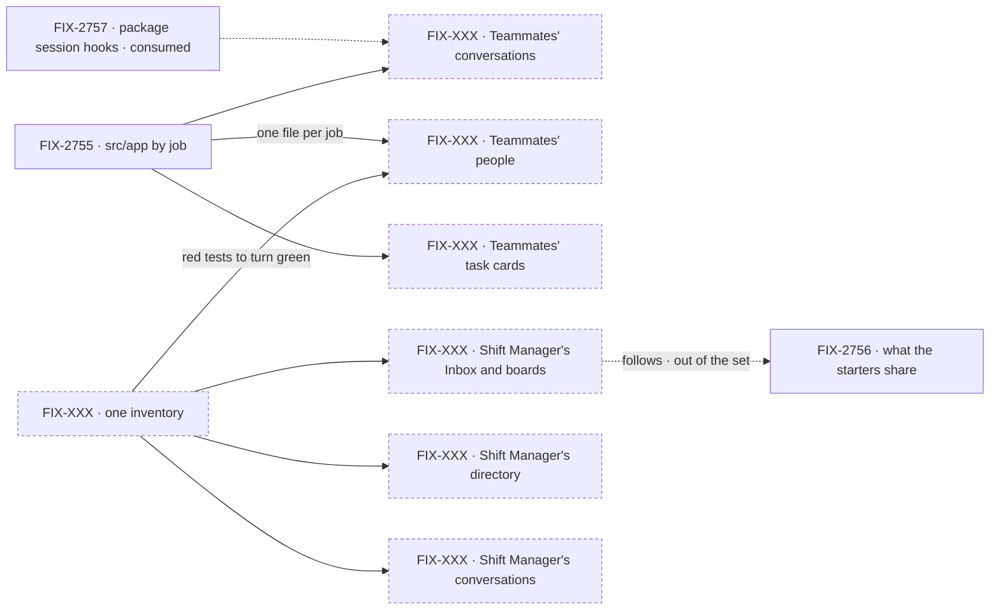

# FIX-2683 · Teammates and Shift Manager read through kit views, and their adapters go

**Spec** · [Decisions](DECISIONS.md)

## Four teams, before and after

| A team that… | Today | After this epic |
|---|---|---|
| **starts an app from Teammates** | Copies a 1,813-line adapter, 32 hand-written types and a 900-line fake of it | Copies screens and thin hooks over the kit packages' views. A row's type comes from its view |
| **works a Lab through Shift Manager** | Sees one snapshot, read again on set events; a 1,014-line module stitches it from per-session reads | Sees each screen kept current on its own. The Inbox count and the Inbox list still come from one answer |
| **adds a screen need to either app** | Adds an adapter verb or a snapshot section, and a fake for it | Calls a package hook or view. A missing one goes into the package, never the app |
| **maintains the framework** | Has views proven on one app, claude-code-style | Has three apps on the same views, and can see what the two starters share ([FIX-2756](https://linear.app/fixpoint-labs/issue/FIX-2756)) |

**Why now.** Every piece FIX-2618 built has merged (FIX-2623 to FIX-2628), and FIX-2757 added
the package hooks an app needs to drive a session. Teammates' adapter is frozen by [FIX-2618
ER-8](../FIX-2618/DECISIONS.md#who-owns-what) until it is deleted, which holds sibling work in
FIX-2592, FIX-2616 and FIX-2369. [FIX-2755](https://linear.app/fixpoint-labs/issue/FIX-2755) is
splitting each starter's server module into `src/app/` by job now, so deletion can land one file
at a time. FIX-2756 waits for both starters to read through views.

## The goal, and how we'll know it's met

**Teammates and Shift Manager read everything the server computes through the kit packages'
views, direct reads and package hooks, held there by an inventory test that runs on every
`pnpm test`; Teammates meets claude-code-style's whole inventory, and every goal of both apps
passes.**

| Is it the right goal? | |
|---|---|
| **The real need** | FIX-2618's goal, for the two apps it left out: an app on workforce is configuration, UI and small flows. Its Leaves row named both adapters as this follow-up |
| **Smaller, and rejected** | "Teammates only." Shift Manager keeps a client that stitches one answer from per-session reads, which the owner ruled out (comment on this epic, 2026-11-16). Or "both adapters shrink" with no inventory: nothing stops them growing back |
| **Bigger, and not this epic's** | Pulling what the starters share into packages or a kit (FIX-2756, after this epic). Serving each answer on one route. Any new feature in either app |
| **Not done if** | a file in either app imports a client value other than `createClient` in its entry, or calls `.subscribe(` or `.flow(` · Teammates keeps a fake app or breaks a cap · Shift Manager keeps `reads.ts` or a snapshot type · a goal of either app fails or is skipped without a stated retirement · claude-code-style's inventory goes red · a bug the closure found is open |

Today's `main` must fail both inventories by name, which is what makes the PASS mean something.

| How we verify | |
|---|---|
| **Goal check** | The closure's goal check (`FIX-XXX · closure`), on one `main` commit after every other child merges. Its clean run is the wrap condition |
| **Signal** | Leg t: Teammates' inventory test passes with no `it.fails` and no exempt file, and every goal in `goals/teammates-lab/` passes, the three of [FIX-2763](https://linear.app/fixpoint-labs/issue/FIX-2763) included. Leg s: Shift Manager's inventory passes the same way, and every goal in `goals/shift-manager/` passes. Both legs: claude-code-style's inventory still passes |
| **Input** | Each goal's own held-out input; real models where the goal names one |
| **Anti-game** | Don't assert on a hook's return or a view's unit test: both pass while a screen still reads through glue. The inventory reads the source; the goals read the page and the store |
| **Control that must fail** | Today's `main`: Teammates fails L2, L3 and L4 (608 config lines; 5 L3 findings; 32 types), Shift Manager fails L3 and L4 (19; 68). A planted `src/app/glue.ts` with a client import and a row type fails L3 and L4 in either app |

## What's in the box

Inside the box is what both apps end up reading through. The fence is the owner's: no new kit or
shared package in this epic ([ER-6](DECISIONS.md#who-owns-what)), and no old path kept beside
a new one ([ER-3](DECISIONS.md#who-owns-what)).

**Docs:** the shared story is "a screen reads a kit's views", already told by FIX-2618.
Shift Manager is published, so the child that changes when its screens read
(`FIX-XXX · Shift Manager's Inbox and boards`) carries that to `/release-docs` in its changeset.
Teammates is private: the last Teammates child rewrites its README.

## The set · as of 2026-11-17

The reviewed snapshot. Live state is on [FIX-2683 in Linear](https://linear.app/fixpoint-labs/issue/FIX-2683).
Unfiled rows are filed after the direction gate.

| Issue | What it delivers | Why the set needs it | Status |
|---|---|---|---|
| [FIX-2755](https://linear.app/fixpoint-labs/issue/FIX-2755) | Labs named starters; each starter's server module split into `src/app/` by job | The layout the Teammates children delete from, one file at a time | In development · owner-decided |
| `FIX-XXX · one inventory for every app` | claude-code-style's rules as one module each app's test calls with its own list; Teammates' and Shift Manager's inventory tests, each finding an `it.fails` | Every later child turns its findings green; the closure runs the same rules ([D3](DECISIONS.md#d3)) | Not filed |
| `FIX-XXX · Teammates' people, context and talk` | Roster, hire and edits, the context strip, harness readiness, messages between workers; the host within the caps | One job of the adapter | Not filed |
| `FIX-XXX · Teammates' conversations` | Feed, send, files, stop, approvals, retry, window, activity on the package's session hooks; `session-feed.ts` goes | One job | Not filed |
| `FIX-XXX · Teammates' task cards` | Board, run, review, recorded work, holds, actions, working now on the coding board and recorded work views; the fake app goes | One job; the second consumer of claude-code-style's task views | Not filed |
| `FIX-XXX · Shift Manager's Inbox and boards` | One workforce user view for every pending ask and board row; the snapshot and its re-read go | The cross-session answer [D2](DECISIONS.md#d2) decides | Not filed |
| `FIX-XXX · Shift Manager's directory` | Organization, inventory, roster, projects, documents, routines, usage, rules, messages by direct reads and existing views, through `listAll()`; `reads.ts` goes | One job | Not filed |
| `FIX-XXX · Shift Manager's conversations and runs` | Run, task, send, conversation and ask reads on the session hooks; a project Stream's files survive its session opening | One job, and the dropped-attachments edge (comment on this epic, 2026-11-17) | Not filed |
| [FIX-2763](https://linear.app/fixpoint-labs/issue/FIX-2763) · bug | Three Teammates goals pass, or each is retired with a reason | Leg t runs every Teammates goal | Backlog · no spec PR, by design |
| `FIX-XXX · closure` · **required** | The QA run on one `main` commit: both legs, every goal, the seams | The only child that proves both adapters are gone | Not filed · blocked by every other child |

1 in development · 1 bug · 8 to file. Six job children, three per app. Whether ten is really
fewer: Teammates' people and conversation jobs could merge, at the cost of one large PR on the
busiest file. [FIX-2756](https://linear.app/fixpoint-labs/issue/FIX-2756) is parented here but
follows the epic and is not in the set ([D1](DECISIONS.md#d1)).

## How the issues flow into each other

An edge is what one issue hands the next. The inventory child also feeds T2 and T3, and every
child, FIX-2763 included, blocks the closure; those edges are left off to keep the graph
readable. FIX-2755 and the inventory child go first. Then all six job children run in parallel,
and whichever child of an app lands last deletes that app's emptied files
([ER-7](DECISIONS.md#who-owns-what)).

## What stays as it is

- **Claude Code-style.** Done by FIX-2628 and FIX-2757; this epic only moves its rules into the
  shared module, and its inventory stays green. [FIX-2764](https://linear.app/fixpoint-labs/issue/FIX-2764) is its bug, related, not parented.
- **What the starters share.** Copies stay copies until FIX-2756.
- **Teammates' "needs you" and unread** (`attention.ts`, `unread.ts`). Screen-computed from views
  here; a server view for them is FIX-2756's kit candidate.
- **Shift Manager's DevTeam fixture host** (`teams/devteam/`). It is a test host, not the app.
- **Every screen's behaviour**, apart from when Shift Manager's screens read ([D2](DECISIONS.md#d2)).

## What's already here, and the debt

| Already here | What the set does with it |
|---|---|
| FIX-2618's views, direct reads, ids on notices and kits ([its SPEC](../FIX-2618/SPEC.md)) | **Builds on**, unchanged |
| FIX-2618 Leaves: "Teammates' and Shift Manager's remaining adapters" | **Delivers** it |
| [FIX-2618 ER-8](../FIX-2618/DECISIONS.md#who-owns-what): no lab adapter grows until deleted | **Kept** as [ER-4](DECISIONS.md#who-owns-what), and it ends here |
| [FIX-2629 D1](../../issues/FIX-2629/DECISIONS.md#d1): the inventory reads the code; "Teammates is not held to the content rules" until this epic | **Amended**: Teammates is held to them, Shift Manager to the content rules ([D3](DECISIONS.md#d3)) |
| FIX-2152 ER-1's path classes and caps ([its DECISIONS](../FIX-2152/DECISIONS.md#who-owns-what)) | **Kept** for Teammates; not applied to Shift Manager ([D3](DECISIONS.md#d3)) |
| Shift Manager's snapshot: one read per refresh, never on a route change ([FIX-1662 PLAN S3](../../issues/FIX-1662/PLAN.md), [FIX-2409](../../issues/FIX-2409/SPEC.md)) | **Superseded** by per-screen views ([D2](DECISIONS.md#d2)). The rule that a count and its list never disagree is kept |
| FIX-2757's hooks: the lab reaches the server only through package hooks | **Builds on**; a missing hook is added there ([ER-1](DECISIONS.md#who-owns-what)) |

| Adds | Existing piece considered | Why it doesn't fit / how composed |
|---|---|---|
| A workforce user view of every pending ask and board row (`FIX-XXX · Shift Manager's Inbox and boards`) | The coding board view (one conversation); `inboxItems`; the worker sessions view | **Extends**: composes the worker sessions view's sessions with `inboxItems` per board, as the coding board view does for one. New only as one answer across sessions ([D2](DECISIONS.md#d2)) |
| One inventory module (`FIX-XXX · one inventory`) | claude-code-style's `test/inventory-rules.ts` | **Extends**: the same rules, parameterized by app. No second inventory |
| Hooks missing from `react` or a kit package | FIX-2757's `useSessionFeed`, `useRequestStream`, `useView`, `useResource` | **Extends** those packages; never an app-local copy |

| The debt | |
|---|---|
| **Removes** | Teammates' adapter (1,813 lines today), its fake (900), `session-feed.ts` (108); Shift Manager's `reads.ts` (1,014), its snapshot plumbing and the re-read loop; about 100 hand-written types across both apps (an estimate) |
| **Adds** | One workforce view; one shared test module; any package hook a child finds missing |
| **Leaves** | The copies between the two starters (FIX-2756). The same data served on two routes (FIX-2618's follow-up). Teammates' "needs you" computed on the screen |

**Net: down.** Two read models go; the framework gains one view.

## Sign off

**[The goal](#the-goal-and-how-well-know-its-met), at that size:** both apps, held by an
inventory, every goal passing. If wrong: we pay for Shift Manager's move while only Teammates
needed it, or we skip it and the stitching stays.

**[The set's debt](#whats-already-here-and-the-debt), net down:** two read models go, one view
comes. If wrong: the Inbox view costs more per user than the snapshot did.

1. **[D1](DECISIONS.md#d1) · Both apps in one epic, cut per app and per job, after FIX-2755 and
   before FIX-2756.** Decided by the owner. If wrong: one app's children wait on the other's closure.
2. **[D2](DECISIONS.md#d2) · Shift Manager's snapshot goes: each screen reads its own view, and
   one workforce view answers the Inbox and its count.** If wrong: Shift Manager reads more often
   than it did, for no user-visible gain.
3. **[D3](DECISIONS.md#d3) · One inventory module; Teammates meets all of it, Shift Manager the
   content rules.** If wrong: Shift Manager's own files grow logic the caps would have caught.

**Open: none.** D2 and D3 are the sign-off; the reasoning and the rules are in
[DECISIONS.md](DECISIONS.md).

Epic · 10 issues · Framework simplification & cleanup · Goal 4 (keep the foundation honest), with
Goal 1 (validate through real usage)
