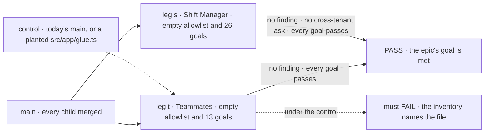
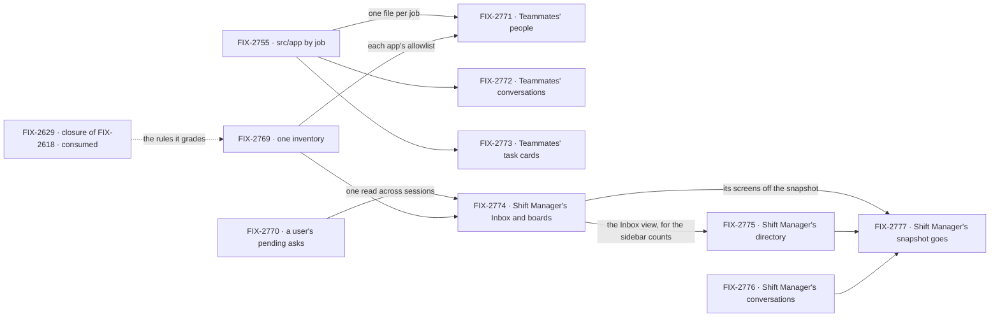

# FIX-2683 · Teammates and Shift Manager read through kit views, and their adapters go

**Spec** · [Decisions](DECISIONS.md)

## Four teams, before and after

| A team that… | Today | After this epic |
|---|---|---|
| **starts an app from Teammates** | Copies a 1,813-line adapter, 32 hand-written types and a 900-line fake of it | Copies screens and thin hooks over the kit packages' views. A row's type comes from its view |
| **works a Lab through Shift Manager** | Sees one snapshot, read again on set events; a 1,014-line module stitches it from per-session reads | Sees each screen kept current on its own. The Inbox count and the Inbox list still come from one answer |
| **adds a screen need to either app** | Adds an adapter verb or a snapshot section, and a fake for it | Calls a package hook or view. A missing one goes into the package, never the app |
| **maintains the framework** | Has views proven on one app, claude-code-style | Has three apps on the same views, and can see what the two starters share ([FIX-2756](https://linear.app/fixpoint-labs/issue/FIX-2756)) |

**Why now.** Every piece FIX-2618 built has merged (FIX-2623 to FIX-2628), and FIX-2757 added
the package hooks an app needs to drive a session. Teammates' adapter is frozen by [FIX-2618
ER-8](../FIX-2618/DECISIONS.md#who-owns-what) until it is deleted, which holds sibling work in
FIX-2592, FIX-2616 and FIX-2369. [FIX-2755](https://linear.app/fixpoint-labs/issue/FIX-2755) is
splitting each starter's server module into `src/app/` by job now, so deletion can land one file
at a time. FIX-2756 waits for both starters to read through views.

## The goal, and how we'll know it's met

**Teammates and Shift Manager read everything the server computes through the kit packages'
views, direct reads and package hooks, held there by an inventory test that runs on every
`pnpm test`; Teammates meets claude-code-style's whole inventory, and every goal of both apps
passes.**

| Is it the right goal? | |
|---|---|
| **The real need** | FIX-2618's goal, for the two apps it left out: an app on workforce is configuration, UI and small flows. Its Leaves row named both adapters as this follow-up |
| **Smaller, and rejected** | "Teammates only." Shift Manager keeps a client that stitches one answer from per-session reads, which the owner ruled out (comment on this epic, 2026-11-16). Or "both adapters shrink" with no inventory: nothing stops them growing back |
| **Bigger, and not this epic's** | Pulling what the starters share into packages or a kit (FIX-2756, after this epic). Serving each answer on one route. Any new feature in either app |
| **Not done if** | a file in either app imports a client value other than `createClient` in its entry (Teammates `src/main.tsx`, Shift Manager `src/lib/connection.ts`), or calls `.subscribe(` or `.flow(` · either app's inventory allowlist has an entry · Teammates keeps a fake app or breaks a cap · Shift Manager keeps `reads.ts`, `lab-data.tsx`'s snapshot or a snapshot type · a pending ask is listed to a user in another tenant, or after it expired or resolved · a goal of either app fails or is skipped without a stated retirement · claude-code-style's inventory goes red · a bug the closure found is open |

The counts (13 and 26 goals, and the findings below) were measured on `origin/main` `5876068b`. Run on the merge-base, both inventories must fail by name, which is what makes the PASS mean something.

| How we verify | |
|---|---|
| **Goal check** | The closure's goal check (`FIX-2778 · closure`), on one `main` commit after every other child merges. Its clean run is the wrap condition |
| **Signal** | Leg t: Teammates' allowlist is empty and its inventory test passes, and every goal in `goals/teammates-lab/` passes, the three of [FIX-2763](https://linear.app/fixpoint-labs/issue/FIX-2763) included. Leg s: the same for Shift Manager and `goals/shift-manager/`, and the pending-asks read's cross-tenant, expired and resolved-elsewhere tests pass. Both legs: claude-code-style's inventory still passes |
| **Input** | Each goal's own held-out input; real models where the goal names one |
| **Anti-game** | Don't assert on a hook's return or a view's unit test: both pass while a screen still reads through glue. The inventory reads the source; the goals read the page and the store. A stitcher moved outside the scanned folders is caught only by review ([ER-2](DECISIONS.md#who-owns-what)) |
| **Control that must fail** | Run the inventory on the merge-base; it must fail. Measured on `origin/main` `5876068b`: Teammates fails L2, L3 and L4 (608 config lines; 5 L3 findings; 32 types), Shift Manager fails L3 and L4 (19 findings in 14 files; 68). A planted `src/app/glue.ts` with a client import and a row type fails either app |

## What's in the box

![In the box: both apps read through kit views, direct reads and package hooks; a user's pending asks read at the source, and one workforce Inbox view on it; one inventory module with an allowlist ratchet per app. Fence: no new kit or shared package, no legacy path, an answer across sessions is one server read. Composed in by each app: its screens, its src/app hooks, its screen types. Replaced: the Teammates adapter and fake by hooks, Shift Manager's snapshot by views. Not built: FIX-2756's shared packages and kit, one route per answer, new features](figures/end-state.svg)

Inside the box is what both apps end up reading through. The fence is the owner's: no new kit or
shared package in this epic ([ER-7](DECISIONS.md#who-owns-what)), and no old path kept beside
a new one ([ER-3](DECISIONS.md#who-owns-what)).

**Docs:** the shared story is "a screen reads a kit's views", already told by FIX-2618.
Shift Manager is published, so the child that changes when its screens read
(`FIX-2774 · Shift Manager's Inbox and boards`) carries that to `/release-docs` in its changeset.
Teammates is private: the last Teammates child rewrites its README.

## The set · as of 2026-11-17

The reviewed snapshot. Live state is on [FIX-2683 in Linear](https://linear.app/fixpoint-labs/issue/FIX-2683).
The rows the gate approved were filed after it. Each job child's done-state is the allowlist
entries it deletes, plus a green run of the goals its screens touch ([ER-2](DECISIONS.md#who-owns-what)).

| Issue | What it delivers | Why the set needs it | Status |
|---|---|---|---|
| [FIX-2755](https://linear.app/fixpoint-labs/issue/FIX-2755) | Labs named starters; each starter's server module split into `src/app/` by job | The layout the Teammates children delete from, one file at a time | **Done** · [#5332](https://github.com/fixpoint-labs/flow-state-dev/pull/5332) |
| [FIX-2769](https://linear.app/fixpoint-labs/issue/FIX-2769) · one inventory for every app | claude-code-style's rules as one module; each app's checked-in allowlist that may only shrink; a line-count ratchet on what is left of each read model | Every job child deletes its own entries; the closure runs the same rules ([D3](DECISIONS.md#d3)) | Backlog · [FIX-2629](https://linear.app/fixpoint-labs/issue/FIX-2629) merged (#5313) |
| [FIX-2770](https://linear.app/fixpoint-labs/issue/FIX-2770) · a user's pending asks, read at the source | A user-scoped read of pending asks beside `RequestSessions.read`/`history`, over the engine's `SuspensionStore`: filtered at the source, expired rows dropped, heard only on suspension changes, in one store query joined to each ask's request, exact-matching user, tenant, organization and today's worker flows, returning a projection that never carries `stepInput` or `resumeData` ([ER-6](DECISIONS.md#who-owns-what)). A changeset if it changes a published export | Shift Manager's Inbox has no server read across sessions today ([D2](DECISIONS.md#d2)) | Backlog |
| [FIX-2771](https://linear.app/fixpoint-labs/issue/FIX-2771) · Teammates' people, context and talk | Roster, hire and edits, the context strip, harness readiness, messages between workers, the busy dot (`workers.ts` goes); the host within the caps; its own scenarios cut from the fake | One job of the adapter | Backlog |
| [FIX-2772](https://linear.app/fixpoint-labs/issue/FIX-2772) · Teammates' conversations | Feed, send, files, stop, approvals, retry, window on the package's session hooks; `App.tsx`'s `ClientHttpError` import; `steps.ts` moves to `src/lib/`; `session-feed.ts` goes with the last child off `watchFeed`; its own scenarios cut from the fake | One job | Backlog |
| [FIX-2773](https://linear.app/fixpoint-labs/issue/FIX-2773) · Teammates' task cards | Board, run, review, recorded work, holds, actions, working now on the coding board and recorded work views; its own scenarios cut from the fake into its ledger. Each Teammates child cuts its own; whichever of FIX-2771, FIX-2772 and FIX-2773 merges last deletes the fake, its `gone` entry and the shared plumbing types | One job; the second consumer of claude-code-style's task views | Backlog |
| [FIX-2774](https://linear.app/fixpoint-labs/issue/FIX-2774) · Shift Manager's Inbox and boards | One workforce user view on the pending-asks read and `inboxItems`' task holds; the Inbox, its count and the boards move onto it | The cross-session answer [D2](DECISIONS.md#d2) decides | Backlog · after the pending-asks read |
| [FIX-2775](https://linear.app/fixpoint-labs/issue/FIX-2775) · Shift Manager's directory | Organization, inventory, roster, projects, documents, routines, usage, rules, messages by direct reads and existing views, through `listAll()` | One job | Backlog |
| [FIX-2776](https://linear.app/fixpoint-labs/issue/FIX-2776) · Shift Manager's conversations and runs | Run, task, send, conversation and ask reads on the session hooks; delegates through a typed workforce view if the list is read across sessions, a package hook if per session, settled in its spec before code; a project Stream's files survive its session opening | One job, the delegate list (Codex review), and the dropped-attachments edge (comment on this epic, 2026-11-17) | Backlog |
| [FIX-2777](https://linear.app/fixpoint-labs/issue/FIX-2777) · Shift Manager's snapshot goes | `lab-data.tsx`'s snapshot, its re-read, `reads.ts` and the snapshot types deleted once no screen reads them | 32 files import `reads.ts`; it can only go last | Backlog · after the three Shift Manager jobs |
| [FIX-2763](https://linear.app/fixpoint-labs/issue/FIX-2763) · bug | Three Teammates goals pass, or each is retired with a reason | Leg t runs every Teammates goal | Backlog · no spec PR, by design |
| [FIX-2766](https://linear.app/fixpoint-labs/issue/FIX-2766) · related | Claude Code-style's task screens read the coding board row directly | Parented here; the same views t3 reads. Not a gate of either app | Backlog |
| [FIX-2778](https://linear.app/fixpoint-labs/issue/FIX-2778) · closure · **required** | The QA run on one `main` commit: both legs, every goal, the seams | The only child that proves both adapters are gone | Backlog · blocked by every other child |

1 done · 1 bug · 1 related · 10 in backlog. Six job children, one framework read, one final
deletion, one inventory. Whether twelve is really fewer: Teammates' people and conversation jobs
could merge; they stay separate unless their allowlist entries share files once FIX-2755 lands. The snapshot child stays separate. [FIX-2756](https://linear.app/fixpoint-labs/issue/FIX-2756)
is parented here but follows the epic and is not in the set ([D1](DECISIONS.md#d1)).

## How the issues flow into each other

An edge is what one issue hands the next. The inventory child also feeds T2, T3, S2 and S3, and
every child, FIX-2763 included, blocks the closure; those edges are left off to keep the graph
readable. **The order:** FIX-2629 merges, then the inventory child. FIX-2755 lands, then the
three Teammates jobs run in parallel. The pending-asks read lands before Shift Manager's Inbox.
The Inbox child and the conversations child run in parallel; the directory child starts once the
Inbox view has landed, since its sidebar counts read that view. Each moves its screens off the
snapshot, and the snapshot child deletes it last ([ER-8](DECISIONS.md#who-owns-what)).

## What stays as it is

- **Claude Code-style.** Done by FIX-2628 and FIX-2757; this epic only moves its rules into the
  shared module, and its inventory stays green. [FIX-2764](https://linear.app/fixpoint-labs/issue/FIX-2764) is its bug, related, not parented.
- **What the starters share.** Copies stay copies until FIX-2756.
- **Teammates' "needs you" and unread** (`attention.ts`, `unread.ts`). Screen-computed from views
  here; a server view for them is FIX-2756's kit candidate.
- **`deriveSuspensions` in `react`**, for one conversation's rendering.
- **Shift Manager's DevTeam fixture host** (`teams/devteam/`). It is a test host, not the app.
- **Every screen's behaviour**, apart from when Shift Manager's screens read ([D2](DECISIONS.md#d2)).

## What's already here, and the debt

| Already here | What the set does with it |
|---|---|
| FIX-2618's views, direct reads, ids on notices and kits ([its SPEC](../FIX-2618/SPEC.md)) | **Builds on**, unchanged |
| FIX-2618 Leaves: "Teammates' and Shift Manager's remaining adapters" | **Delivers** it |
| [FIX-2618 ER-8](../FIX-2618/DECISIONS.md#who-owns-what): no lab adapter grows until deleted | **Kept** as [ER-4](DECISIONS.md#who-owns-what), now a line-count ratchet, and it ends here |
| [FIX-2629 D1](../../issues/FIX-2629/DECISIONS.md#d1): the inventory reads the code; "Teammates is not held to the content rules" until this epic | **Amended**: Teammates is held to them, Shift Manager to the content rules ([D3](DECISIONS.md#d3)) |
| FIX-2152 ER-1's path classes and caps ([its DECISIONS](../FIX-2152/DECISIONS.md#who-owns-what)) | **Kept** for Teammates; not applied to Shift Manager ([D3](DECISIONS.md#d3)) |
| Shift Manager's snapshot: one read per refresh, never on a route change ([FIX-1662 PLAN S3](../../issues/FIX-1662/PLAN.md), [FIX-2409](../../issues/FIX-2409/SPEC.md)) | **Superseded** by per-screen views ([D2](DECISIONS.md#d2)). The rule that a count and its list never disagree is kept |
| The engine's `SuspensionStore`: each `ctx.suspend` row carries `userId`, `sessionId`, `flowId`, `status`, `expiresAt`; resume, cancel and expiry move it out of pending under a fence (`core/types/suspension.ts`, `engine/stores/types.ts`) | **Builds on**: the pending-asks read queries it. It has no tenant or organization field and an optional session; every row has a request, whose record carries both, so the read scopes through it ([ER-6](DECISIONS.md#who-owns-what)) |
| FIX-2757's hooks: the lab reaches the server only through package hooks | **Builds on**; a missing hook is added there ([ER-1](DECISIONS.md#who-owns-what)) |

| Adds | Existing piece considered | Why it doesn't fit / how composed |
|---|---|---|
| A user-scoped pending-asks read (`FIX-2770 · a user's pending asks`) | The server session list (`SessionListQuery`: no dispatch-runs option); `deriveSuspensions` (in `react`, per chat); `SuspensionStore.list` | **New**: a required `SuspensionStore.listPendingForUser` (`list` cannot see the request's tenant or organization), read through a user-scoped verb beside `RequestSessions.read`/`history`. No new store. The predicate behind `suspensionShape` moves to core beside `isUserSuspension` and `suspendForUserKindOf` (already in `contracts`); `react` keeps exporting `suspensionShape` and the ui registry card is unchanged |
| The Inbox view (`FIX-2774 · Shift Manager's Inbox and boards`) | `inboxItems`; the coding board view (one conversation) | **Composes** the pending-asks read with `inboxItems`' task-hold composition for task-run asks |
| A typed delegate view or hook (`FIX-2776 · Shift Manager's conversations and runs`) | The `listDelegates` action that `DelegatesPanel` reaches through app-local `readDelegates` | **Extends** workforce: the same data, typed by its output |
| One inventory module with per-app allowlists (`FIX-2769 · one inventory`) | claude-code-style's `test/inventory-rules.ts` | **Extends**: the same rules, parameterized by app. No second inventory |
| Hooks missing from `react` or a kit package | FIX-2757's `useSessionFeed`, `useRequestStream`, `useView`, `useResource` | **Extends** those packages; never an app-local copy |

| The debt | |
|---|---|
| **Removes** | Teammates' adapter (1,813 lines today), its fake (900), `session-feed.ts` (108); Shift Manager's `reads.ts` (1,014), its snapshot plumbing and the re-read loop; about 100 hand-written types across both apps (an estimate) |
| **Adds** | One pending-asks read in core and the engine; one workforce Inbox view; one delegate view; one shared test module and two allowlists that end empty; any package hook a child finds missing |
| **Leaves** | The copies between the two starters (FIX-2756). The same data served on two routes (FIX-2618's follow-up). Teammates' "needs you" computed on the screen. An unauthenticated answer path on asks ([FIX-2743](https://linear.app/fixpoint-labs/issue/FIX-2743), related) |

**Net: down.** Two read models go; the framework gains one read and two views.

## Sign off

**[The goal](#the-goal-and-how-well-know-its-met), at that size:** both apps, held by an
inventory, every goal passing. If wrong: we pay for Shift Manager's move while only Teammates
needed it, or we skip it and the stitching stays.

**[The set's debt](#whats-already-here-and-the-debt), net down:** two read models go, one read
and two views come. If wrong: the Inbox costs more per user than the snapshot did.

**[D1](DECISIONS.md#d1) is decided by the owner:** both apps in one epic, cut per app and per
job, after FIX-2755 and before FIX-2756.

1. **[D2](DECISIONS.md#d2) · Shift Manager's snapshot goes: each screen reads its own view, and
   one workforce view, on a new pending-asks read, answers the Inbox and its count.** If wrong:
   Shift Manager reads more often than it did, for no user-visible gain.
2. **[D3](DECISIONS.md#d3) · One inventory module with an allowlist per app that only shrinks;
   Teammates meets all of it, Shift Manager the content rules.** If wrong: Shift Manager's own
   files grow logic the caps would have caught.
3. **[Teammates' config stays under the 300-line cap](DECISIONS.md#decided-while-drafting-recorded-so-no-child-reopens-them),
   prompts included.** If wrong: ~310 lines of host move into packages for a cap that measures
   prose.

**Open: none.** D2, D3 and the cap are the sign-off; the reasoning and the rules are in
[DECISIONS.md](DECISIONS.md).

Epic · 12 issues · Framework simplification & cleanup · Goal 4 (keep the foundation honest), with
Goal 1 (validate through real usage)
