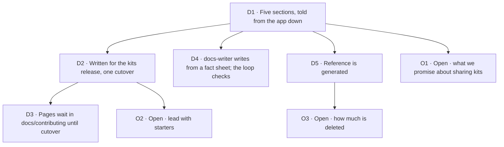

# FIX-2696 · Decisions

[Spec](SPEC.md) · **Decisions**

## The tree

## D1 · Five sections, told from the app down

Start, Concepts, Catalog, Build and Reference replace today's eleven sidebar groups. The story runs starter, kit, flow, block. "Advanced" goes away as a category; its twenty pages regroup by the reader's job.

**Why.** The audit found the landing page and the docs describe different products, and that the reading path has no end. *If wrong:* a restructure is redirects and a sidebar file; the pages survive.

## D2 · Pages are written for the release that carries kits, and ship in one cutover · decided by the owner, 2026-11-11

Pages describe Workforce, the harnesses and Claude Code as kits an app installs. Nothing publishes before that release.

*If wrong:* if kits slip, the kit snippets and the Catalog wait; Concepts and Reference can still ship.

## D3 · Pages live in `docs/contributing/docs-revamp/pages/` until cutover

The repo's rule is that user docs change only at release, and CI enforces it. Writing in the contributor folder keeps every PR mergeable and keeps unreleased surface off the site. FIX-2705 moves the pages under `apps/docs/` in one release-docs pass.

## D4 · The `docs-writer` agent writes each page from a fact sheet; three checks review it; the writer revises · tried on Blocks and in the concept-doc pilot, 2026-11-12

The loop is: a fresh `docs-writer`, on a smaller model, collects the page's fact sheet (`<page>.facts.md`), asking of each stored part who owns it, who can see it and where it is stored; cold-read questions are written before any draft; the writer writes from the brief; a fresh agent fact-checks against the code with a type-check of the examples; `docs-editor` prose-checks; two or more tool-less readers answer the questions from the page alone; the writer revises from all three. On the Blocks page the first draft needed the review round, mostly for scope and density, and the revision stood beside the pilots. A person reads each Concepts page cold before it merges.

**Why `docs-writer`, not a second writer.** The pages are user docs written by agents that hold the spec. `docs-writer` is the agent whose reading list keeps design context out of a page, and the fact sheet is its surface brief. A separate writer with its own reading list would be a second way to write user docs, and the Blocks run showed the gap: its fact sheet cites `CLAUDE.md` and an architecture doc, and the brief's queue pointed the Views page at `docs/internal/`. ER-9 closes it.

**Why not write a concept doc first.** The owner asked for the three pilots to be rewritten through `concept-doc`, both as the bare concept doc (B) and through the route it feeds, concept doc then `docs-writer` (C). The full route is rejected: it costs a 5,000-word doc per page, and cold readers understood its pages least. Two of its steps are adopted, because they found what the fact check and the editor missed: the cold read, and the ownership questions, which caught the pilot's claim that a standard worker can't be edited. Scores (current pilots A / B / C): cold read on the page's own questions 8 / 6.5 / 5.5 of 9, on all questions 15 / 13 / 9.5 of 24; wrong claims 4 / 10 / 5. Read them as weak: the questions were written after reading A, one cold reader per page, grading varied by up to 2.5 of 8, A had review rounds the others didn't, every arm ran on Opus, and no example was type-checked. Evidence: [`poc/concept-doc-pilot/COMPARISON.md`](poc/concept-doc-pilot/COMPARISON.md). `concept-doc` stays for an area whose model is unclear or contested; kits and slots is the likely one.

## D5 · The API reference is generated from doc comments

The seven hand-written `api/*` pages and the long READMEs go. Behaviour that is a state machine or a contract is hand-written as tables (FIX-2699). The choice of generator is FIX-2698's.

## O1 · Open · How much the docs promise about sharing kits

The owner's direction is a community that builds, shares and remixes kits. `docs/objectives.md` lists "a third-party plugin or extension ecosystem: publishing, discovery, versioning, a registry" as a non-goal, and FIX-2618 chose the word "kit" to avoid promising one.

**Recommendation.** Teach sharing as something that works the day kits ship: a kit is an npm package anyone can publish, and "Write a kit" is a tutorial. Give the Catalog a "From the community" shelf that starts empty. Say nothing about a registry. Update the objectives file to match.
**Changes my mind:** a registry or discovery feature with a date.
**If wrong:** over-promising costs trust with the first readers; under-promising costs one landing page later.
**Touches:** FIX-2702, FIX-2703.

## O2 · Open · Whether the docs lead with starters before a starter installs in one command

Today a starter runs from a clone of the framework monorepo, and building on one means forking the framework.

**Recommendation.** Lead with starters, and treat a one-command install as a requirement before the Start pages publish. The examples folder already has a copy-out recipe. Until then the page uses the clone path and says so.
**Changes my mind:** the install is more than a quarter away. Then Start opens on the terminal run of one flow.
**If wrong:** a first-run page that takes thirty minutes loses the readers the epic is for.
**Touches:** FIX-2702, and product work outside this epic.

## O3 · Open · How much detail is deleted

About 330,000 words leave the reading path. Much is regenerated as reference. Some is deleted: migration notes for past releases, internal mechanisms, narrated race conditions, pages about the framework's own test suites.

**Recommendation.** Keep behaviour a user can observe and depend on, as tables. Delete history older than the current release, and delete mechanism. About a third of today's words go for good.
**Changes my mind:** evidence that users rely on a specific deep page.
**If wrong:** someone hits an undocumented edge and reads the source. Git history keeps every page.
**Touches:** FIX-2699, FIX-2705.

## Who owns what

| Area | Owner |
|---|---|
| Page types, budgets, the concept outline, code-example rules, the writing loop and ER-9 | FIX-2697 (today: `WRITING-BRIEF.md`) |
| Generated reference, READMEs | FIX-2698 |
| Tabular behaviour reference, Upgrading | FIX-2699 |
| Machine-readable output | FIX-2700 |
| Concepts pages | FIX-2701 |
| Start pages | FIX-2702 |
| Catalog pages, the kit-page template | FIX-2703 |
| Tutorials and recipes, consolidated with `polish-docs` | FIX-2704 |
| Navigation, redirects, removing old pages, reconciling kit claims, the `polish-docs` pass over the whole set, the first-hour goals | FIX-2705 |

**Rules every child obeys**

- **ER-1 · A fact has one home.** Every other page links to it.
- **ER-2 · Nothing lands under `apps/docs/{docs,guides,blog}` before FIX-2705.** (D3)
- **ER-3 · Every page passes `scripts/check-docs-page.mjs` and `scripts/check-retired-terms.mjs`.**
- **ER-4 · Every code example names its file and imports or declares every name it uses, in the one example-app layout the brief defines.** No phantom names.
- **ER-5 · A page says what the thing is before it says why it exists.** "What it gets you" comes after the explanation.
- **ER-6 · Where our word differs from the industry's, the page says so once**, in an "If you know ..." section: what is the same first, then the one difference.
- **ER-7 · No option tables, error cases or migration notes outside Reference.**
- **ER-8 · Kit names, config keys and import paths in a page are reconciled against the shipped surface at FIX-2705**, not before.
- **ER-9 · A fact sheet cites only what `docs-writer` may read**: the exported surface and its doc comments, tests and `goals/`, examples, existing user docs. Never `specs/`, `docs/internal/`, `CLAUDE.md`, a pull request or a commit. (D4)

## Coordination seams

- **FIX-2618 and FIX-2627.** Workforce and the harnesses become kits there. FIX-2703 waits on FIX-2627 for the real install lines.
- **The release-docs process.** FIX-2705 is one release-docs pass, larger than usual. The pending changesets' docs lines are folded into the new pages, not the old ones.
- **`docs/contributing/glossary.mjs`.** "Worker" means the named agent a user talks to; "person" and "member" are retired where a user or worker is meant. A page that coins or retires a public term edits the glossary in the same PR.
- **FIX-2638.** It clears first-hour part (f) through changeset `Docs:` lines on today's pages. Those lines fold into the new pages, like every pending changeset's.
- **FIX-601.** The launch IA issue in the Public Launch project. This epic covers its scope; whether to close it is the owner's call.
- **Starter install.** Product work O2 depends on; not in this set.
- **The Claude Code-style starter's name.** Needed before its Catalog page.

## Decided while drafting, recorded so no child reopens them

- The first page opens "Most agent frameworks hand you parts. Flow State hands you an app." The prose reviewer flagged it as a slogan; kept.
- The remix line stays on the first page: "That is how one developer's app becomes the base for another's."
- Workers are introduced as agents, and the page then says what differs: a worker runs on a flow, and the flow is yours to define.
- A concept page shows four code blocks at most and does not reprint a file to change one line.
- The product is written "Flow State".
- Shift Manager is documented as a starter; the Shift Coordinator page moves with it.

## How it got here

Four readers audited all 193 pages on 2026-11-11 for duplication, concept-versus-reference mix, voice and the first-hour path. The full findings, the proposed structure, the fate of every section and a verdict for every page are retained in [`analysis/RECOMMENDATION.md`](analysis/RECOMMENDATION.md). Three pilot pages set the voice. A fourth page, Blocks, was then written by a smaller model from the brief alone to test whether the brief was enough; what it exposed went back into the brief.

No end-state POC was built; the pilots and the Blocks run stand in for it.

- **Concept-doc pilot** ([`poc/concept-doc-pilot/`](poc/concept-doc-pilot/COMPARISON.md)) · built: the three pilots rewritten as concept docs, and through concept doc then `docs-writer`, each graded blind by a fact check, a cold read and `docs-editor` · showed: better facts, pages harder to understand · changed: the loop gains a cold read and the ownership questions (D4), and the pilots lose four wrong claims (a root import of `harnesses`, `workspace` as a path, a task claimed only once, a standard worker that can't be edited).

## Analysis · 2026-11-12 · watermark 2026-11-10

**Right approach, with changes.** Prior art agrees with the shape: LangChain's docs split tutorials and concepts from a separate generated reference, and both it and [Mastra](https://mastra.ai/docs/getting-started/build-with-ai) serve `llms.txt` and per-page Markdown. Reuse moved three things. The writer step is now `docs-writer` (D4, ER-9). The one-home consolidation is `polish-docs`. The closure tests are goals under `goals/first-hour/`, where FIX-2452's failing check already reads these pages. `concept-doc` is a different job, an internal model doc that feeds user docs, so its rules are cited and nothing is added. Linear since the watermark added FIX-601 and FIX-2638 as seams, and nothing that changes the division into issues. The rest went to the children as notes: Mastra skips `llms-full.txt` as too large to help, so FIX-2700 tests both; a newcomer meets capability and kit as two installable things, so FIX-2701's pages say when to pick which. The pass ran in the epic agent's own context, with no fresh analyst and no `adhd` run, because that session had no way to dispatch one. Re-run it independently if the owner wants that check.
