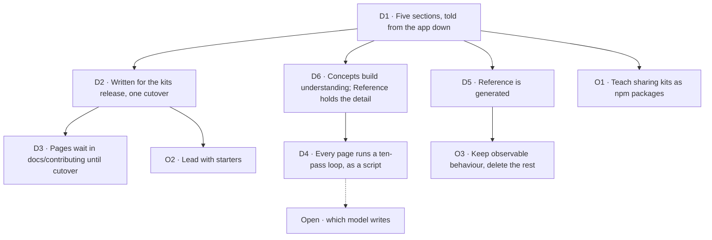

# FIX-2696 · Decisions

[Spec](SPEC.md) · **Decisions** · [Sitemap](SITEMAP/README.md)

## The tree



**Who decided what.** The owner decided D2 on 2026-11-11, and O1, O2, O3, D4's loop, D6 and the sitemap's three questions (D1) on 2026-11-12. The epic agent decided D1, D3, D5 and the drafting calls at the end, inside that direction. Which model writes is open (D4).

## D1 · Five sections, told from the app down

Start, Concepts, Catalog, Build and Reference replace today's eleven sidebar groups. The story runs starter, kit, flow, block. "Advanced" goes away as a category; its twenty pages regroup by the reader's job.

**Why.** The audit found the landing page and the docs describe different products, and that the reading path has no end. *If wrong:* a restructure is redirects and a sidebar file; the pages survive.

**The page plan.** [`SITEMAP/`](SITEMAP/README.md) names every page of the five sections: its job, its contents, its cold-read questions, a brief for each figure, its examples, what it leaves to Reference, its sources today and the issue that writes it. The owner signs it off with this PR. It is the page plan every writing child works from; adding, dropping or re-homing a page is an amendment to it first. It plans 108 hand-written pages and about 95,200 words, against the estimates of about 75 and about 90,000 the epic was filed with; Start + Concepts is 25,900 against the 30,000 target. The owner settled its three questions on 2026-11-12, as recommended: the 95,200 words stand as written, Concepts keeps all 23 pages, and `guides/projects-on-org-scope` is cut, because "project" already means a Workforce project. They are recorded at the end of its index.

## D2 · Pages are written for the release that carries kits, and ship in one cutover · decided by the owner, 2026-11-11

Pages describe Workforce, the harnesses and Claude Code as kits an app installs. Nothing publishes before that release.

*If wrong:* if kits slip, the kit snippets and the Catalog wait; Concepts and Reference can still ship.

## D3 · Pages live in `docs/contributing/docs-revamp/pages/` until cutover

The repo's rule is that user docs change only at release, and CI enforces it. Writing in the contributor folder keeps every PR mergeable and keeps unreleased surface off the site. FIX-2705 moves the pages under `apps/docs/` in one release-docs pass.

## D4 · Every page runs a ten-pass loop, as a workflow script · decided by the owner, 2026-11-12

```text
 1 fact sheet ─ 2 cold-read questions ─ 3 draft ─ 4 machine checks ─ 5 fact check
                                                                         │
10 owner read ─ 9 cold read ─ 8 revise ─ 7 docs-editor ─ 6 depth pass ───┘
figures:  brief ─ draw ─ render light + dark ─ figure lint ─ compare with two published figures
```

1. **Fact sheet** (`<page>.facts.md`) by a fresh `docs-writer`, from ER-9 sources only, answering the ownership questions for each stored part: who owns it, who can see it, where it is stored, how many exist.
2. **Cold-read questions**, written before any draft.
3. **Draft** to a prose target well under budget, about 700 words for a concept page.
4. **Machine checks:** budget, type-check of the examples, fences, retired terms, figure lint.
5. **Fact check** by a separate agent.
6. **Depth pass:** each paragraph is model or mechanism; mechanism becomes a Reference row (FIX-2699) the page links to (D6).
7. **`docs-editor`.**
8. **Revise once.**
9. **Cold read** by at least two readers.
10. **The owner reads** the first two pages of each section, then a sample.

**Figures run as their own track.** One shared style in which each mark has one meaning, taken from the published site figures: hatching is "outlives the request", a dashed outline is "lasts one action run", the highlighter is the one idea. Every figure has a key. Each starts from a figure brief, is rendered in light and dark, passes a figure lint (no hex colours, no `<style>` block, a key present) and is checked by eye against two published figures. The style is written down in [`figures/FIGURES.md`](../../../docs/contributing/docs-revamp/figures/FIGURES.md): the marks and their meanings, the key, the canvas, the render script, the `Figure` markup, sixteen lint rules for FIX-2697 to implement, and the three pilot figures redrawn as exemplars. Across all pages, `polish-docs` runs once at cutover (FIX-2705).

FIX-2697 owns the loop and runs it as a workflow script, so no pass can be skipped, with a per-page record of each pass. The steps are in [`WRITING-BRIEF.md`](../../../docs/contributing/docs-revamp/WRITING-BRIEF.md) → "Writing a page, step by step".

**Which model writes is open.** It is settled by running one page through the whole loop with Sonnet as the writer, against the brief as this fold leaves it: the concept/reference contract (D6), the 700-word target and the figure rules. That run is FIX-2697's acceptance run, on C-07 State and scopes, kept as evidence in FIX-2697's spec; its verdict goes to the owner, and no writing child starts a page before it reports. Until then, D4 names no model.

**A page kept from today's site skips the draft.** The pages the audit kept because they are already the right size (the pattern, tool and memory pages, the guides that are already recipes) and the pilots are written; pass 3 exists to write a page, and a fresh draft risks undoing what the audit kept. They run every other pass. Pass 1 still lists what they state, and pass 2 still writes the cold-read questions and their answer key, by an agent that has not read the page, because pass 9 grades against that key. Their record marks pass 3 skipped. *Amended by the spec set (FIX-2704, FIX-2703).*

**Why `docs-writer`, not a second writer.** The pages are user docs written by agents that hold the spec. `docs-writer` is the agent whose reading list keeps design context out of a page, and the fact sheet is its surface brief. A separate writer with its own reading list would be a second way to write user docs, and the Blocks run showed the gap: its fact sheet cites `CLAUDE.md` and an architecture doc, and the brief's queue pointed the Views page at `docs/internal/`. ER-9 closes it.

**Why this many passes.** Each pass caught something the others missed. On the Blocks page the first draft needed the review round, mostly for scope and density. In the concept-doc pilot the cold read and the ownership questions found what the fact check and the editor passed, including the claim that a standard worker can't be edited. In the model pilot every version, on every model, put mechanism on concept pages, which no existing pass flagged; the depth pass is for that.

**Why not write a concept doc first.** The owner asked for the three pilots to be rewritten through `concept-doc`, both as the bare concept doc (B) and through the route it feeds, concept doc then `docs-writer` (C). The full route is rejected: it costs a 5,000-word doc per page, and cold readers understood its pages least. Two of its steps are adopted: the cold read, and the ownership questions. Scores (current pilots A / B / C): cold read on the page's own questions 8 / 6.5 / 5.5 of 9, on all questions 15 / 13 / 9.5 of 24; wrong claims 4 / 10 / 5. Read them as weak: the questions were written after reading A, one cold reader per page, grading varied by up to 2.5 of 8, A had review rounds the others didn't, every arm ran on Opus, and no example was type-checked. Evidence: [`poc/concept-doc-pilot/COMPARISON.md`](poc/concept-doc-pilot/COMPARISON.md). `concept-doc` stays for an area whose model is unclear or contested; kits and slots is the likely one.

## D5 · The API reference is generated from doc comments

The seven hand-written `api/*` pages and the long READMEs go. Behaviour that is a state machine or a contract is hand-written as tables (FIX-2699). The choice of generator is FIX-2698's.

## D6 · A Concepts page builds understanding; Reference holds the detail · decided by the owner, 2026-11-12

In the owner's words: "We should have the dedicated reference section where we can go into more detail. The conceptual docs are there to really create a deeper understanding and the framework's philosophy, value prop, and how concepts fit together. It should use svgs to document concepts well, and plenty of crisp clean coding examples to showcase concepts in action."

- **A Concepts page** gives the mental model, the philosophy and why it is built this way, what the reader gets from it, and how the concept fits with the others. It shows the concept in SVG figures, more than one where each earns its place, and in plenty of short, crisp code examples.
- **Mechanism, checks, limits, edge cases and option tables go to Reference**, and the Concepts page links to them.
- **Every code example type-checks** against the real surface, or against the specified one where it is not built yet.
- **The checker caps prose, not examples.** The word budget counts prose only. The four-code-block cap and the one-figure limit are gone.

**Why.** This is the depth rule the pilots found, stated as what a page is for. In the model pilot every version, on every model, put mechanism on concept pages; a rule that only forbids it left writers without a picture of what goes there instead. *Mechanism* here is behaviour a user can observe and depend on, which O3 keeps as Reference tables; the framework's internals are what O3 deletes. *If wrong:* pages lean on Reference more than a reader wants, and a detail comes back to a page in one edit.

**Touches:** FIX-2697 (brief and checker), FIX-2699 (the rows), FIX-2701 (the pages).

## O1 · Teach sharing kits as npm packages, and promise no registry · decided by the owner, 2026-11-12, as recommended

The owner's direction is a community that builds, shares and remixes kits. `docs/objectives.md` lists "a third-party plugin or extension ecosystem: publishing, discovery, versioning, a registry" as a non-goal, and FIX-2618 chose the word "kit" to avoid promising one.

**Decision.** Teach sharing as something that works the day kits ship: a kit is an npm package anyone can publish, and "Write a kit" is a tutorial. Give the Catalog a "From the community" shelf that starts empty. Say nothing about a registry. Update the objectives file to match; FIX-2703 makes that edit with the shelf.
**Would reopen it:** a registry or discovery feature with a date.
**If wrong:** over-promising costs trust with the first readers; under-promising costs one landing page later.
**Touches:** FIX-2702, FIX-2703.

## O2 · Lead with starters, before a starter installs in one command · decided by the owner, 2026-11-12, as recommended

Today a starter runs from a clone of the framework monorepo, and building on one means forking the framework.

**Decision.** Lead with starters, and treat a one-command install as a requirement before the Start pages publish. The examples folder already has a copy-out recipe. Until then the page uses the clone path and says so.
**Would reopen it:** the install is more than a quarter away. Then Start opens on the terminal run of one flow.
**If wrong:** a first-run page that takes thirty minutes loses the readers the epic is for.
**Touches:** FIX-2702, and product work outside this epic.

## O3 · Keep observable behaviour as tables; delete history and internals · decided by the owner, 2026-11-12, as recommended

About 330,000 words leave the reading path. Much is regenerated as reference. Some is deleted: migration notes for past releases, internal mechanisms, narrated race conditions, pages about the framework's own test suites.

**Decision.** Keep behaviour a user can observe and depend on, as tables. Delete history older than the current release, and delete mechanism. About a third of today's words go for good. "Mechanism" here is the framework's internals; mechanism a user can observe is the behaviour kept, and D6 puts it in Reference.
**Would reopen it:** evidence that users rely on a specific deep page.
**If wrong:** someone hits an undocumented edge and reads the source. Git history keeps every page.
**Touches:** FIX-2699, FIX-2705.

## Who owns what

| Area | Owner |
|---|---|
| Page types, budgets, the concept outline, the concept/reference contract (D6), code-example rules, ER-9, the hardened checker, the figure style and key (today: `figures/FIGURES.md`), the figure lint built from its rules, the ten-pass workflow script with its per-page record, cold-read questions | FIX-2697 (today: `WRITING-BRIEF.md`) |
| Generated reference (27 package sections in the sitemap), READMEs | FIX-2698 |
| Tabular behaviour reference (sitemap R-01 to R-43), including the rows the depth pass moves off pages; Upgrading | FIX-2699 owns each R-page's shape. A writing child's depth pass lists the rows it moves in the page's record until that R-page is on `main`, and FIX-2699 folds them; after that the writing child adds its rows to the R-page in its own PR |
| Machine-readable output | FIX-2700 |
| Concepts pages (sitemap C-01 to C-23), and redrawing the Blocks figure in the shared style; the three pilot figures are redrawn | FIX-2701 |
| Start pages (sitemap S-1 to S-5) | FIX-2702 |
| Catalog pages (sitemap K-01 to K-43), the kit-page template, the "From the community" shelf and the objectives edit (O1) | FIX-2703 |
| Tutorials and recipes (sitemap B-01 to B-37), consolidated with `polish-docs` | FIX-2704 |
| The page plan ([`SITEMAP/`](SITEMAP/README.md)): which pages exist and where each topic lives | This spec; a child proposes a change as an amendment |
| Navigation, redirects, removing old pages, reconciling kit claims, the `polish-docs` pass over the whole set, the first-hour goals | FIX-2705 |

**Rules every child obeys**

- **ER-1 · A fact has one home.** Every other page links to it. The sitemap's one-home table names the home of each duplicated topic.
- **ER-2 · Nothing lands under `apps/docs/{docs,guides,blog}` before FIX-2705.** (D3)
- **ER-3 · Every page passes `scripts/check-docs-page.mjs` and `scripts/check-retired-terms.mjs`.**
- **ER-4 · Every code example names its file, imports or declares every name it uses, in the one example-app layout the brief defines, and type-checks against the real or specified surface.** No phantom names. (D6)
- **ER-5 · A page says what the thing is before it says why it exists.** "What it gets you" comes after the explanation.
- **ER-6 · Where our word differs from the industry's, the page says so once**, in an "If you know ..." section: what is the same first, then the one difference.
- **ER-7 · Mechanism, checks, limits, edge cases, option tables, error cases and migration notes live in Reference.** A Concepts page links to them. (D6)
- **ER-8 · Kit names, config keys and import paths in a page are reconciled against the shipped surface at FIX-2705**, not before.
- **ER-9 · A fact sheet cites only what `docs-writer` may read**: the exported surface and its doc comments, tests and `goals/`, examples, existing user docs. Never `specs/`, `docs/internal/`, `CLAUDE.md`, a pull request or a commit. (D4) One exception, for a surface specified and not yet built (ER-4): the fact sheet may cite an approved spec's public names, config keys and import paths, and nothing else from it, each marked for ER-8.

## Coordination seams

- **FIX-2618 and FIX-2627.** Workforce and the harnesses become kits there. FIX-2703 waits on FIX-2627 for the real install lines.
- **The release-docs process.** FIX-2705 is one release-docs pass, larger than usual. The pending changesets' docs lines are folded into the new pages, not the old ones.
- **`docs/contributing/glossary.mjs`.** "Worker" means the named agent a user talks to; "person" and "member" are retired where a user or worker is meant. A page that coins or retires a public term edits the glossary in the same PR.
- **FIX-2638.** It clears first-hour part (f) through changeset `Docs:` lines on today's pages. Those lines fold into the new pages, like every pending changeset's.
- **FIX-601.** The launch IA issue in the Public Launch project, closed as a duplicate of this epic.
- **Starter install.** Product work O2 depends on; not in this set.
- **The Claude Code-style starter's name.** Needed before its Catalog page.

## Decided while drafting, recorded so no child reopens them

- The first page opens "Most agent frameworks hand you parts. Flow State hands you an app." The prose reviewer flagged it as a slogan; kept.
- The remix line stays on the first page: "That is how one developer's app becomes the base for another's."
- Workers are introduced as agents, and the page then says what differs: a worker runs on a flow, and the flow is yours to define.
- A concept page does not reprint a file to change one line.
- The product is written "Flow State".
- Shift Manager is documented as a starter; the Shift Coordinator page moves with it.

## How it got here

Four readers audited all 193 pages on 2026-11-11 for duplication, concept-versus-reference mix, voice and the first-hour path. The full findings, the proposed structure, the fate of every section and a verdict for every page are retained in [`analysis/RECOMMENDATION.md`](analysis/RECOMMENDATION.md). Three pilot pages set the voice. A fourth page, Blocks, was then written by a smaller model from the brief alone to test whether the brief was enough; what it exposed went back into the brief.

The page plan and the figure rules were written on 2026-11-12, after the owner asked for every page to be named and for one figure language before more pages were drafted. The three pilot figures were redrawn to the rules, and the pilot pages moved to the site's `Figure` markup.

No end-state POC was built; the pilots and the Blocks run stand in for it.

- **Concept-doc pilot** ([`poc/concept-doc-pilot/`](poc/concept-doc-pilot/COMPARISON.md)) · built: the three pilots rewritten as concept docs, and through concept doc then `docs-writer`, each graded blind by a fact check, a cold read and `docs-editor` · showed: better facts, pages harder to understand · changed: the loop gains a cold read and the ownership questions (D4), and the pilots lose four wrong claims (a root import of `harnesses`, `workspace` as a path, a task claimed only once, a standard worker that can't be edited).
- **Model pilot** ([`poc/model-pilot/`](poc/model-pilot/SCORECARD.md)) · built: the three pilots written again from the recipe A was written with, once by Sonnet and once by Opus, beside A (Fable) at its first-check state, each given the same blind fact check and `docs-editor` pass · showed: accuracy is about equal across models; Fable's pages are 30–45% shorter; every version, Fable's included, puts mechanism on concept pages and breaks the site's figure conventions · changed: the brief gains the concept/reference contract (D6), a 700-word draft target, the depth pass and the figure track (D4). Which model writes stays open until the one-page Sonnet test, the next step.

## Analysis · 2026-11-12 · watermark 2026-11-10

**Right approach, with changes.** Prior art agrees with the shape: LangChain's docs split tutorials and concepts from a separate generated reference, and both it and [Mastra](https://mastra.ai/docs/getting-started/build-with-ai) serve `llms.txt` and per-page Markdown. Reuse moved three things. The writer step is now `docs-writer` (D4, ER-9). The one-home consolidation is `polish-docs`. The closure tests are goals under `goals/first-hour/`, where FIX-2452's failing check already reads these pages. `concept-doc` is a different job, an internal model doc that feeds user docs, so its rules are cited and nothing is added. Linear since the watermark added FIX-601 and FIX-2638 as seams, and nothing that changes the division into issues. The rest went to the children as notes: Mastra skips `llms-full.txt` as too large to help, so the closure's agent test (FIX-2705) runs both arms, the full file and the index with per-page Markdown; a newcomer meets capability and kit as two installable things, so FIX-2701's pages say when to pick which. The pass ran in the epic agent's own context, with no fresh analyst and no `adhd` run, because that session had no way to dispatch one. Re-run it independently if the owner wants that check.
