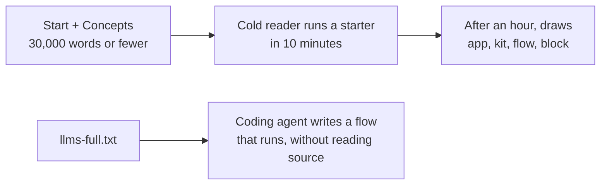
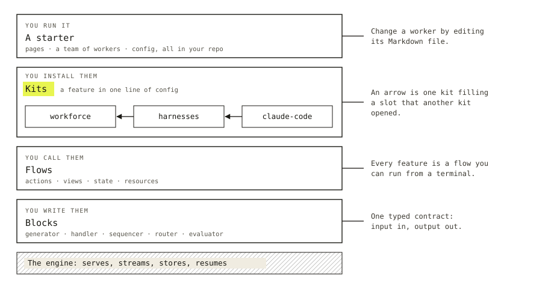
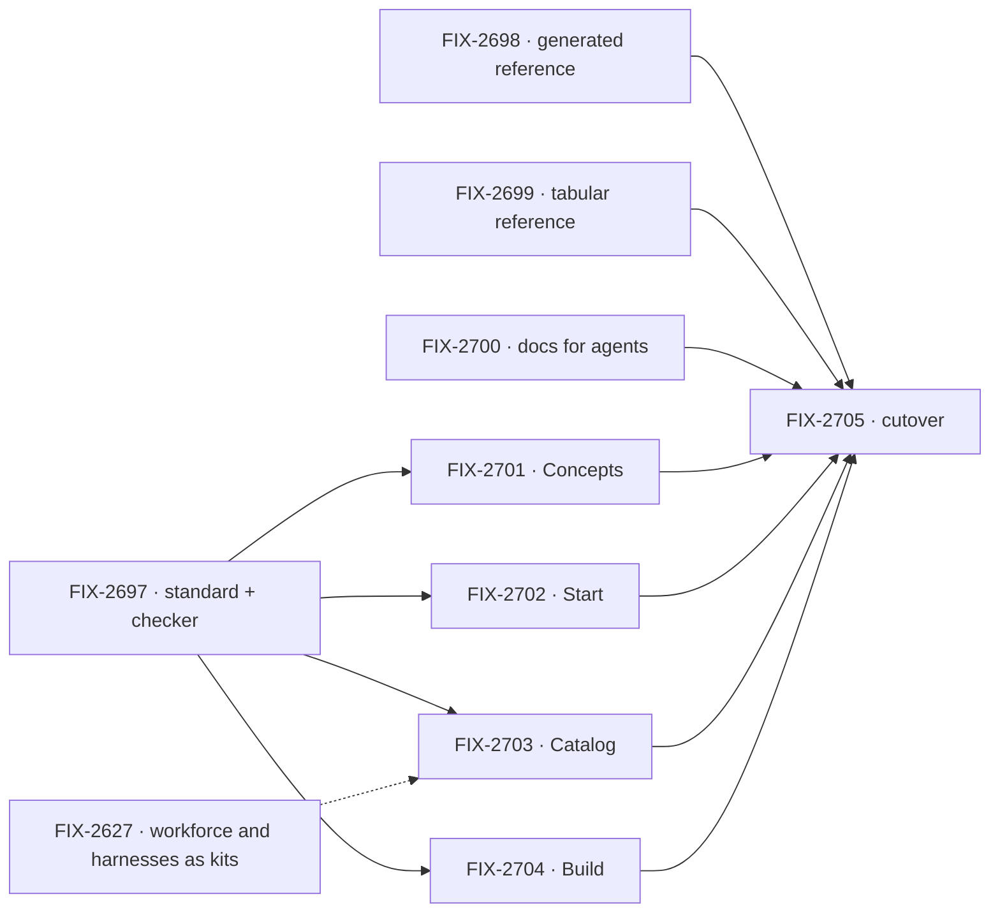

# FIX-2696 · A newcomer reads the docs in an hour and knows what they can build

**Spec** · [Decisions](DECISIONS.md)

## Four readers, before and after

| A reader who… | Today | After this epic |
|---|---|---|
| **wants their own agent app** (the builder) | Lands on blocks, SSE and four scopes. The word "starter" never appears in the docs. Five pages and about 5,150 words come before anything runs | Runs a starter in ten minutes, changes it in twenty, and reads a 20-page book that explains what they are looking at |
| **packages a feature for others** (the kit author) | No page on kits, slots or views | Reads Kits and Views as ordinary concepts, then a "Write a kit" tutorial |
| **adds flows to an existing product** (the integrator) | Reads the same wiring on seven pages, each a little different | One "Add to an existing app" page, then the same Concepts and recipes |
| **is a coding agent** | Nothing to read but HTML: no `llms.txt`, no per-page Markdown | Reads generated reference and every page as Markdown |
| **maintains the docs** | 422,000 words in 193 pages, plus 165,000 in READMEs. Each release edits three or four copies of a topic | About 90,000 hand-written words. A fact has one home. Reference comes from doc comments |

**Why now.** The release that carries kits needs docs. About a hundred changesets name pages this epic rewrites or deletes, so writing them into the old structure pays for that prose twice. The product has also moved: apps are built from starters and kits, and the docs still teach the framework from the block up.

## The goal, and how we'll know it's met

**A reader new to Flow State has a working app in ten minutes, and after an hour can say what an app, a kit, a flow and a block are and which one to change.**

| Is it the right goal? | |
|---|---|
| **The real need** | People cannot tell what they can build or where to start. Shorter pages alone would not fix that; the order has to change from primitives-first to app-first |
| **A smaller goal we could meet while the need stays unmet** | Trimming the longest pages. The reading path would still start at blocks and still run past 100,000 words |
| **What we are not promising** | A registry or marketplace for kits ([O1](DECISIONS.md)), or a one-command starter install ([O2](DECISIONS.md)). Each is product work outside this epic |

The left path is the human test and the right path is the agent test. The closure issue (FIX-2705) writes both as goals under `goals/first-hour/`, each with a control that must fail: the same cold read against today's site, where the path to a running app is five pages long.

Measures the closure issue also checks: no concept page over 1,500 words; every topic in the duplication table of [`analysis/RECOMMENDATION.md`](analysis/RECOMMENDATION.md) has one home; every old URL redirects; `goals/first-hour/runs-without-store-ceremony` passes its part (f), which fails today on the pages this epic rewrites.

**The project objective it serves.** Goal 1 in [`docs/objectives.md`](../../../docs/objectives.md), *validate through real usage*: real apps start from the docs. It closes a small part of that gap. On the lead measure it turns one failing goal green (first-hour, part f, unless FIX-2638's release gets there first) and adds two to the corpus; it does not prove any app runs on a real model.

## What's in the box

Five sections replace eleven. A reader reads Start and Concepts and looks things up in the other three.

| Section | Its job | Pages | Hand-written words |
|---|---|---|---|
| **Start** | Get a working app and change it | 5 | about 5,000 |
| **Concepts** | Teach the model, in order, once | about 20 | about 25,000 |
| **Catalog** | Say what you can install: starters, kits, libraries | about 25 | about 35,000 |
| **Build** | Do one task: tutorials and recipes | about 25 | about 25,000 |
| **Reference** | Exact answers, for people and agents | generated, plus about 25 tabular pages | no budget |

Every page has a type with a shape and a word budget ([`WRITING-BRIEF.md`](../../../docs/contributing/docs-revamp/WRITING-BRIEF.md)), and `scripts/check-docs-page.mjs` checks the mechanical part.

## The set · as of 2026-11-12

Live state is in Linear under FIX-2696.

| Issue | Delivers | State |
|---|---|---|
| FIX-2697 | The brief becomes part of the user-docs standard; the page checker, hardened, runs in CI; the figure style, lint and key; the ten-pass loop as a workflow script with a per-page record | Not started |
| FIX-2698 | API reference generated from doc comments; READMEs cut to install, one example, a link | Not started |
| FIX-2699 | Behaviour detail moved to tabular Reference; an Upgrading page per release | Not started |
| FIX-2700 | `llms.txt`, `llms-full.txt`, every page as Markdown | Not started |
| FIX-2701 | The Concepts pages, written through the ten-pass loop ([D4](DECISIONS.md)) to the concept/reference contract ([D6](DECISIONS.md)) | Blocks drafted; three pilots written |
| FIX-2702 | The five Start pages | "What Flow State is" piloted |
| FIX-2703 | The Catalog: Workforce, Harnesses, Skills on the kit template; starter pages | Not started; waits on FIX-2627 |
| FIX-2704 | Guides consolidated into tutorials and recipes | Not started |
| FIX-2705 | Cutover at the kits release, and the closure checks | Not started |

## How the issues flow into each other

FIX-2697 hands every writing issue its rules. FIX-2700 is site code and can merge on its own, but the closure run needs it: it delivers the `llms-full.txt` the agent test reads. Everything else lands together at FIX-2705.

## What stays as it is

- The voice standard in `docs/contributing/user-docs.md`, and the rule that user docs change only at release.
- The site's drawing system and its `Figure` component.
- The pattern, tool and memory pages that are already the right size, and the twelve guides that are already recipes.
- The glossary file and the vocabulary checks that read it.

## What's already here, and the debt

**Builds on**
- The release-docs pipeline. The writing loop is its `docs-writer` agent, given a fact sheet as its surface brief, and its `docs-editor` agent, plus a fact check, a type-check, a depth pass and a cold read ([D4](DECISIONS.md)).
- The `polish-docs` skill, which release-docs already runs. FIX-2704 and FIX-2705 use it to give each topic one home. It edits presentation, never facts, so what is deleted is decided by FIX-2699 and O3 first.
- The `concept-doc` skill's rules for building a model up part by part, one cast of examples, and one claim per figure, and its cold read and ownership questions. The brief cites them rather than restating them; the full concept-doc route was piloted and not adopted ([D4](DECISIONS.md)).
- `goals/first-hour/`, the home of first-hour goal checks. The closure's two tests go there.
- Two earlier sidebar reorganizations, FIX-266 (March) and FIX-495 (May), and the launch IA issue FIX-601, closed as a duplicate of this epic. This epic keeps their lesson that a regrouping alone does not last, which is why it adds page types and a checker.
- The rule that every exported API has a doc comment, which is what makes generated reference possible.
- The redirects plugin, already installed on the site.
- PR 5126: three pilot pages, the brief, the checker, and one Concepts page written from the brief.

**Adds**
- A page-type field and word budgets (considered: the existing standard, which has voice rules and no page shapes).
- A reference generator (considered: the hand-written `api/*` pages and READMEs, which disagree with each other).
- `llms.txt` output (nothing exists to extend).

**Debt the set carries**
- Pages sit under `docs/contributing/docs-revamp/pages/` until cutover and are not seen on the site before then.
- The pilot pages name kit factories that are specified and not built. FIX-2705 reconciles them.
- The widened vocabulary-sweep exclusion means SVG text in any `figures/` folder under `docs/contributing/` is not scanned.
- The three pilots and `pages/blocks.md` predate the concept/reference contract (D6) and the figure style: they carry mechanism, a "What it won't do" section and figures with `<style>` blocks. FIX-2701 brings them to the contract.

**Docs.** The shared story is "you start with an app; the app is made of kits; kits are made of flows and blocks; you build with an agent beside you." FIX-2705 publishes it.

## Sign off

Approving this spec says the objective and the five-section shape are right, and that the set above is the work. It does not approve any page's wording. The owner decided O1, O2 and O3 as recommended, the ten-pass loop (D4) and the concept/reference contract (D6) on 2026-11-12 ([decisions](DECISIONS.md)). Which model writes is open, and a one-page Sonnet run through the loop settles it next.
