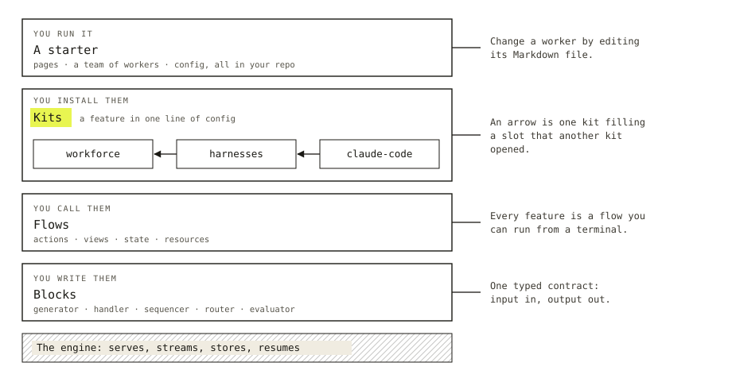

# Docs revamp: analysis and recommendation

Retained with the epic spec for FIX-2696 ([Spec](../SPEC.md) · [Decisions](../DECISIONS.md)). Written 2026-11-11 as the audit and recommendation that the epic was filed from. It is the record of the analysis, not the live plan: where it and the spec differ, the spec wins. Its "Need your sign-off" section is carried in the decisions as O1 to O3; its fourth item was settled as D2.

Rebuild the docs as five sections told from the app down: a short Start, a 20-page book of Concepts, a Catalog of starters, kits and libraries, a Build section of tutorials and recipes, and a Reference generated from the code. The reading path drops from about 422,000 words to about 30,000. Four decisions at the end need your sign-off before any of it starts.

## The diagnosis

The site holds about 422,000 words across 193 pages, and most of it is reference written as prose. That is the length of four or five novels. A reader who wants to understand the framework has to find the fifty pages' worth of ideas inside it, and nothing tells them which pages those are.

Four readers went through every page for this audit. Word counts are exact. The concept-versus-reference shares are their estimates from heading outlines and sampled reading.

| Measure | Today |
| --- | --- |
| Docs pages | 162 pages, about 376,000 words |
| Guides | 31 pages, about 46,000 words |
| Package READMEs (a third copy of much of it) | about 165,000 words |
| Largest page | Task board, 17,770 words |
| Pages over 5,000 words | 18 |
| Words on the prescribed path before anything runs | about 5,150, over five pages |
| Durable concept text in Orchestration, Workforce, Skills, Tools, Patterns, Memory, UI | 8,000 to 10,000 of 192,000 words |
| Machine-readable docs for coding agents (llms.txt, per-page Markdown, skills) | none |

### The landing page and the docs describe different products

The landing page says "Start from a working app, not a blank page" and shows two starters. Both buttons link to the GitHub repo root. Inside the docs the word "starter" never appears. The first page, titled "Why flow-state.dev?", answers with "streams items over SSE, holds state in four scopes." The pitch is about harnesses and workers. The docs open on blocks.

### The first run is five pages away

The intro says "Read these in order" and lists seven pages. Quick Start introduces about eighteen concepts before step 6, including intents, `user` versus `userMessage`, and a sequencer the page then says it "doesn't need yet." The best first moment in the framework is one terminal command that runs a flow with no server and no React. It sits at the bottom of Quick Start under "Skip the React layer." No page shows a screenshot of a finished app.

### Most things are said three or four times

| Topic | Where it lives | Words |
| --- | --- | --- |
| Tasks and boards | 9 pages across Orchestration, Workforce and Guides | about 38,000 |
| Coding agents | harness manager, three adapters, coding agents, half of Projects | about 33,000 |
| The client | 2 concept pages, 2 API pages, 1 config page, 2 READMEs | about 31,000 |
| Pause, resume, retry | 9 pages | about 15,500 |
| Background work | 6 pages in both tabs | about 12,700 |
| State writes | 4 pages at three depths | about 12,000 |
| The hello-chat app | built four times, three with the same counter | about 6,800 |

The `createFlowState` and Next handler snippet appears on seven pages. Approvals are documented in eight files. Each copy is a little different, so a reader cannot tell which one to trust, and each release has to update all of them.

### Concept pages are reference in disguise

Task board is 17,770 words. The idea a reader needs (stored tasks, a drain, workers, dependencies, a stop rule) takes the first thousand. One section, "Assignees that dispatch," is 7,600 words and is really a second feature. The auditor put the page at 8% concept. Projects, Harness manager, Coordinators and Workers on disk came out between 10% and 20%. The field catalogs are interleaved into Fundamentals, so the fourth "fundamental" a newcomer meets is a 113-row table.

The detail is real and somebody needs it. It should not sit in the reading path. Two examples of where the path goes today:

> "The comparison uses `Object.is` for primitives (NaN-equal-NaN, `+0 != -0`) and recursive structural equality." (Fundamentals, State operations)

> "Windows device names (`con`, `prn`, `aux`, `nul`, `com1` through `com9`, `lpt1` through `lpt9`) are refused too." (Skills, Authoring)

### Nobody draws the layers

Orchestration, Workforce and Shift Manager are sidebar peers with no hint that each sits on the one before. "Worker" means any block registered on a board in one section and a named, owned configuration in the next, and a whole page exists to reconcile the two. "Project" has two meanings as well. "Advanced" appears as three separate sidebar groups holding twenty pages that range from error handling, which everyone needs, to transport adapters, which almost nobody does.

### The docs narrate their own history

The house standard in `docs/contributing/user-docs.md` is good, and the pages break it often. They carry migration notes ("After upgrading"), history ("Suspend/resume started as a sequencer feature"), roadmap ("Coming next", "a no-op in Phase 1"), and instructions that only work inside this monorepo. Two testing pages document the framework's own test suites. The Shift Manager overview introduces itself as "research software."

### What is already good

The material for a much better site is in here. "You're probably looking for the `agent()` function. There isn't one" is the best opening on the site, and nothing on the newcomer path links to it. The background-work guide reduces a hard choice to one question: "what still has to be alive when this finishes." The board-lifecycle guide explains the board better than the board page. The Memory overview, Standing rules, the deployment overview and the three webhook recipes are the right size and shape. The recommendation below builds on these and treats them as the standard for everything else.

## The story the docs should tell

The docs should be told from the app down, and today they are told from the block up. A reader meets blocks, then flows, then four scopes, then the engine, and 150 pages later learns that all of it adds up to an app they could have been running since minute five.

The story has four beats, and each one is true at a different depth:

1. **You start with an app that works.** A team of workers, a place to talk to them, and the backend that keeps them running. It is yours: the code is in your repo and the data is in your stores.
2. **The app is made of kits.** A kit is a feature you install in one line. Kits leave openings, called slots, that other kits fill, so features build on each other without knowing about each other.
3. **Kits are made of flows, and flows are made of blocks.** Five kinds of block, one typed contract. Everything a kit does, you can read, change or write yourself with the same pieces.
4. **You build with an agent beside you.** The framework is typed end to end and runs from a terminal, so a coding agent can write a flow, run it, read the trace and fix it. Most people will work this way, and the docs should say so on the first page.

A reader can stop after any beat and still have something that works. That is the test for the structure: nobody should have to read beat three to use beat one.

### Who we are writing for

| Reader | What they want | Where they live |
| --- | --- | --- |
| The builder | Their own harness, shaped to how they work | Start, then the Catalog |
| The kit author | To package a feature others can install and extend | Concepts, then "Write a kit" |
| The integrator | Flows inside a product they already have | "Add to an existing app", Concepts, Recipes |
| The coding agent | Exact signatures, options and failure shapes | Reference, in Markdown |

The builder is the primary reader. Today's docs are written almost entirely for the integrator, with the agent's level of detail.

The fourth row is what makes the cut possible. Exhaustive detail has a reader, and that reader is a machine that does not mind length. Once the reference is written for agents, the pages people read can be short.

## The new shape

Five sections replace today's eleven, and each has one job. A reader reads Start and Concepts, about 30,000 words. They look things up in the other three.

A reader starts at the top with a working app and goes down only as far as they need. Kits are highlighted because they are the new layer, and the arrows show one kit filling a slot that another kit opened.

| Section | Its job | Pages | Hand-written words |
| --- | --- | --- | --- |
| **Start** | Get a working app and change it | 5 | about 5,000 |
| **Concepts** | Teach the model, in order, once | about 20 | about 25,000 |
| **Catalog** | Say what you can install: starters, kits, libraries | about 25 | about 35,000 |
| **Build** | Do one task: tutorials and recipes | about 25 | about 25,000 |
| **Reference** | Answer exact questions, for people and agents | generated, plus about 25 spec pages | tables, no budget |

That is roughly 90,000 hand-written words against 422,000 today. The reference grows more complete while the prose shrinks, because most of it is generated from the code.

### Start

Five pages: What Flow State is, Run a starter, Make it yours, Build with your coding agent, Add to an existing app. The first page answers "why" with a picture of a finished app and the layer drawing. It absorbs today's intro, Fundamentals overview and Anatomy of a flow, which are three attempts at the same page.

### Concepts

Concepts is a short book, read front to back. Each page teaches one idea in 1,500 words or fewer, opens on the problem the idea solves, and carries no option tables.

- **The model:** Blocks. Generators and tools (the "there is no `agent()`" page). Composition. Flows and actions. Sessions, items and streaming. State and scopes. Resources. Views. Capabilities. Kits and slots.
- **Running it:** Serving flows. Persistence. Pausing, resuming and surviving a crash. Background work. Auth and tenancy. Models.
- **Getting work done:** Tasks and boards. Workers. Coding harnesses.

Kits and Views enter here as ordinary concepts beside the others. A view is what a screen reads. A kit is how a feature installs. Neither needs a special section, and writing them as page 8 and page 10 of the model shows where they fit.

"Advanced" goes away as a category. Its twenty pages regroup by the reader's job: nine pages on pause, resume and retry become one concept page and a reference page, and the three block-state pages become one.

### Catalog

The Catalog is the part of the site that grows. It has three shelves:

- **Starters:** whole apps you run and reshape. Teammates, the Claude Code-style agent (under its new name), Shift Manager.
- **Kits:** features you install. Workforce, Harnesses and Claude Code first, as they land.
- **Libraries:** pieces you import. Patterns, Tools, Memory, UI, Skills.

Every entry on a shelf follows the same template, covered in the next section. A reader who has read one kit page knows how to read all of them.

### Build

Build holds two kinds of page and labels them. A **tutorial** ends with something running and teaches along the way; there are four or five (first flow, a research team, human in the loop, write a kit, ship a starter of your own). A **recipe** is 800 words or fewer and does one task: deploy to Vercel, receive a Stripe webhook, run on a schedule, send errors to Sentry. Twelve of today's guides are already recipes and are the right size.

### Reference

Reference has four parts: the API of each package, generated from the code; configuration catalogs; file formats and the wire protocol; and behaviour tables for the things with real state machines (task lifecycle, state operations, store contracts). An **Upgrading** page per release is the only place the words "now" and "no longer" are allowed.

## The first hour

The first hour should end with the reader holding a changed app and a correct picture of how it is built. Each step shows one thing before explaining it.

1. **Minutes 0 to 10: run a starter.** One command, one API key, a browser tab with a working team in it. The page has a screenshot and nothing about blocks.
2. **Minutes 10 to 20: change it.** Open a worker's Markdown file, rewrite its brief, and talk to the changed worker. The reader learns that the app is files they own.
3. **Minutes 20 to 30: look underneath.** Run one of the app's flows from the terminal with `fsdev run` and watch the items stream. Open the DevTool on the same run. The reader learns that every feature is a flow they can run alone.
4. **Minutes 30 to 45: write one.** A handler, a generator, a two-step sequencer, exposed as an action. This is the single tutorial, and it replaces the four copies of hello-chat.
5. **Minutes 45 to 60: read the map.** One page, "How it fits together", with the layer drawing from this document and a sentence on each layer. It links into Concepts.

A second door sits beside step 1 for the integrator: "Add to an existing app", which starts at step 4.

Step 1 has a product dependency. The starters run from a clone of the framework's monorepo today, and building on one means forking the framework. That is a heavy first step for the reader the story is aimed at. It is the second item under sign-off.

## Kits, starters, and where Workforce goes

Write today's feature modules in the shape of a kit page now, before they are kits. When Workforce becomes a kit, its docs change by one install snippet. If we wait, we rewrite 65,000 words twice.

### Where things stand

`defineKit`, slots and the engine's kit install are merged and unreleased. No real kit exists yet: Workforce and the harnesses are specced to become kits, and the Claude Code-style app is the planned first app built on them. Views are further along. The roster, the conversation board and a coding run's changes are already views.

The docs site only deploys what is on npm, so nothing about kits can publish ahead of the release. The structure can be ready for them.

### One template for everything you install

Every kit page answers the same six questions in the same order:

1. **What you get.** Two sentences and a screenshot or a short transcript.
2. **Install it.** The line in `kits: [...]` and the config it takes.
3. **Use it.** The smallest thing that works, as runnable code or a file.
4. **Slots it opens.** What other kits, or your app, can add to it.
5. **Slots it fills and views it serves.** What it adds to others, and what your screens can read from it.
6. **Change it.** The files it owns in your repo and how to replace a piece.

A kit page is 1,500 words or fewer. Longer features get sub-pages on the same template, one per capability a user would name: Coordinators, Messaging, Standing rules, Projects. Refusal tables, delivery states and file-format rules go to Reference.

Starters use a sibling template: a screenshot, who it is for, run it, the kits it installs, the first three things to change, what isn't wired yet.

### What this does to Workforce and Orchestration

| Today | Words | Becomes |
| --- | --- | --- |
| Orchestration (9 pages) | 42,000 | Concept page "Tasks and boards" (about 2,500, absorbing the board-lifecycle guide), a "Background tasks" page, and reference tables |
| Workforce (18 pages) | 66,000 | Concept page "Workers" (about 1,500), a Workforce kit page with about eight sub-pages, one "The workforce folder" page replacing five on-disk pages, and reference |
| Harness manager and three adapters | 28,000 | Concept page "Coding harnesses" (about 1,000), a Harnesses kit page, three adapter pages on one template, and reference |
| Shift Manager (3 pages) | 4,000 | A starter page. The Shift Coordinator page moves here from Workforce. "From a checkout" leaves user docs. |
| Skills (4 pages and a guide) | 9,700 | One library page (about 2,000) and a file-format reference |

The vocabulary gets fixed in the same pass. "Worker" means the named agent a user talks to. The thing a board runs gets a different word, and the glossary file that already drives the vocabulary checks enforces it. "Project" keeps its Workforce meaning, and the org-scope guide is renamed.

### The two concept pages that carry the new story

**Views** opens on a screen: a sidebar that lists your workers, with a badge on the ones waiting for you. Where does that list come from? A view answers a screen's question. It is computed when asked, stored nowhere, and re-read when what it depends on changes. Workforce's roster is the worked example.

**Kits and slots** opens on an app's config file with three kits in it, then asks how a coding-harness kit can add a worker type to a workforce kit that has never heard of it. The answer is a slot. The page ends on the chain: a kit that fills a slot can open slots of its own. That one idea is what makes an app remixable, and it deserves the best drawing on the site.

## Reference, and writing for agents

Generate the API reference from the code, publish every page as Markdown, and ship the docs to the reader's coding agent. Nothing on the site does any of this today.

### One source for reference

The same API is described in three places: seven hand-written `api/*` pages (20,600 words), the concept pages, and the package READMEs (165,000 words, with the engine's alone at 17,400). They disagree in coverage. `api/core` documents a fraction of what the core README lists.

The repo already requires a doc comment on every exported API. Generate the reference from those comments and delete the hand-written copies. READMEs shrink to what the package is, an install line, one example and a link. A release then updates a doc comment in the same PR as the code, and the reference is correct without a writing pass.

Hand-written reference survives where the subject is behaviour, and it is written as tables: task states and what moves between them, what each state operation returns, what a store must guarantee. Today these are narrated as prose, one race condition per paragraph.

### For agents

| Piece | What it is | Cost |
| --- | --- | --- |
| `llms.txt` and `llms-full.txt` | An index of the docs, and the Concepts and Reference in one file | A build script; site code, so it can ship in any PR |
| Markdown per page | Every page at its URL plus `.md`, and a "Copy page" button | A small theme change |
| A skills pack in every starter | The `install-fsd` skill exists already. Add "write a flow", "write a kit", "debug a run" | Three short skills, adapted from the repo's own |
| An agent instructions file in every starter | Where the flows live, how to run one, how to read a trace | One file per starter |
| "Build with your coding agent" | A Start page: install the skills, then ask for a change and watch the loop | Rewrite of today's agent-dev-loop page, minus the monorepo paths |

The `fsdev run` loop is the framework's real advantage here. An agent can write a flow, run it headless, read typed NDJSON and fix what it sees. The docs mention this once, on a page whose examples only work inside the monorepo.

## Page standards and voice

Give every page a type, and give every type a shape and a word budget that a check can enforce. The existing voice standard is right and stays. What it lacks is a rule about what a page is for.

### Five page types

| Type | Job | Budget | Shape |
| --- | --- | --- | --- |
| Concept | One idea the reader keeps | 1,500 words | The problem, the idea in plain words, the smallest working example, one drawing, what it won't do, where to go next |
| Catalog entry | One thing you can install | 1,500 words | The six-question template |
| Tutorial | One outcome, built start to finish | 2,500 words | Ends with something running; each step shows a result |
| Recipe | One task | 800 words | Task-shaped title, numbered steps, the finished code |
| Reference | Exact answers | none | Tables and signatures; no narrative |

### Six rules

1. **A fact has one home.** Every other page links to it. The `createFlowState` snippet lives on one page, not seven.
2. **No option tables outside Reference.** A concept page shows the two options a reader needs today and links to the rest.
3. **Show it before you explain it.** Code or a screenshot comes before the paragraph about it.
4. **State the guarantee and drop the mechanism.** "A task is claimed by one worker at a time" stays. How the lease is fenced goes to Reference or goes away.
5. **A term means one thing.** It is defined once, where it is first needed, and the glossary check fails a page that uses a retired word.
6. **History lives on the Upgrading page.** Nowhere else.

A page declares its type in frontmatter. A lint step fails a page that is over budget, carries a table of more than a few rows outside Reference, or uses the diff-narrative words the standard already lists. The rules then hold without a reviewer remembering them.

### What the writing should sound like

Three openings, as they read today and as they could read. The rewrites show the voice. Their facts would go through the normal writer and editor passes against the public surface before anything ships, and the first one is written for the release that carries kits.

**The first page of the docs, today:**

> flow-state.dev is a TypeScript framework for agents and agentic systems. You write typed, composable blocks. The framework runs them, streams items over SSE, holds state in four scopes, and turns a flow into an HTTP API.

**Rewritten:**

> Most agent frameworks hand you parts. Flow State hands you an app.
>
> Run a starter and you have a team of AI workers, a page to talk to them on, and a backend that streams their answers, remembers what they learned, and picks up where it stopped after a crash. The code is in your repo. The data is in your database.
>
> Then you change it. A worker is a Markdown file, so you rewrite its brief. A feature is a kit, so you add a line. When you want something nobody has built yet, you write it with the same typed pieces the kits are made of.

**Task board, today:**

> Task board is the building block underneath Parallel Tasks, Supervisor, and Plan and Execute. It runs a pool of workers that pull from a shared `TaskCollection`, respects task dependencies, and drains until the collection is finished: either every task completed, or nothing left can run.

**Rewritten:**

> Some work is a list. Research five competitors, then write the comparison. The five can run at once. The comparison has to wait for all of them, and if one fails you want to know before the writer starts.
>
> A board is that list, stored, plus the loop that works through it. You add tasks and say which ones depend on which. Workers take whatever is ready. The loop stops when every task is done or nothing left can run.

**Workforce, today:**

> `@flow-state-dev/workforce` gives each user a roster of workers: agents, or deterministic workflows, that work for that user and act as them. One rule covers who sees what: a worker's own state and your user data are private to you, while shared resources and org-scope data are shared with your org, and a flow writes to org scope only when its author built it to.

**Rewritten:**

> A worker is an agent with a name and a job. You brief it in a Markdown file, the way you would brief a new colleague: what it's for, what it can use, who it can ask for help.
>
> You can talk to a worker, or hand it a task and come back later. What it learns about you stays with you. The people you work with have rosters of their own.

The rewrites are shorter and say less. The privacy rule, the pool, the `TaskCollection` and the SSE transport are all still true, and each has a later sentence or a reference page waiting for it. An opening only has to make the reader want the second paragraph.

## What happens to today's pages

About a fifth of today's hand-written words survive as prose. The rest becomes generated reference, becomes a table, or is cut. The appendix has a verdict for every page.

| Today's section | Pages | Words | Becomes | Hand-written after |
| --- | --- | --- | --- | --- |
| Intro and Getting Started | 7 | 7,200 | Start (5 pages). Installation, models setup and project structure fold into Run a starter and the tutorial | 5,000 |
| Fundamentals, Configuration, State | 16 | 40,200 | Six concept pages. Field catalogs, state operations and the mutation model go to Reference. Models splits into a concept page and reference | 8,000 |
| Composition | 5 | 7,600 | One concept page, plus control flow and connectors as reference | 1,500 |
| Resources | 9 | 19,600 | Two concept pages (Resources, Views) and reference. Client access splits into hooks reference | 3,000 |
| Streaming and Items | 4 | 7,600 | One concept page. The item protocol is reference | 1,500 |
| Engine, Persistence, Advanced | 30 | 63,900 | Six "Running it" concept pages, a store chooser with the missing SQLite section, an operations page for data migration, and reference | 10,000 |
| Client | 2 | 7,400 | One concept page ("What the browser sees") and generated hook reference | 1,500 |
| CLI, DevTool, Testing | 14 | 18,600 | Two Start pages, a testing concept page, recipes, CLI reference. The two pages on the framework's own suites move to contributor docs | 5,000 |
| API Reference | 7 | 20,600 | Generated | 0 |
| Orchestration and Skills | 13 | 49,600 | Two concept pages, a Skills library page, reference tables | 6,000 |
| Workforce and Shift Manager | 21 | 69,700 | One concept page, the Workforce kit shelf, a starter page, reference | 12,000 |
| Patterns, Tools, Memory, UI | 30 | 60,000 | Library shelf. Most pattern, tool and memory pages are already the right shape. Three coding-adapter pages share one template; catalogs go to Reference | 18,000 |
| Guides | 31 | 46,000 | Five tutorials and about fifteen recipes. Five concept pages filed as guides move to Concepts | 18,000 |
| Glossary | 1 | 3,800 | Kept, generated from the glossary file, grouped by layer | generated |

Redirects cover every moved URL. The site already uses the redirects plugin.

## Rollout

Build the new skeleton first and write the pending release's docs into it. About a hundred changesets are waiting on docs, and most of them name pages this plan rewrites or deletes. Writing them into the old structure pays for that prose twice.

| Phase | What ships | Depends on | Done when |
| --- | --- | --- | --- |
| 0. Agree | This plan, the page-type rules added to the writing standard, the budget lint | Your sign-off below | The lint runs in CI in report-only mode |
| 1. Pilot | Three pages in the new voice: What Flow State is, Tasks and boards, Workers | Phase 0 | You read them cold and would publish them |
| 2. Skeleton | New navigation and five sections. Existing pages moved, not rewritten. Reference pulled out of the reading path. Contributor pages removed. Redirects. `llms.txt` and per-page Markdown | Phase 0 | Every old URL resolves; nothing is in "Advanced" |
| 3. Release | The pending release's docs, written into the skeleton: Kits and Views as concept pages, the files guide, Upgrading, generated API reference | Phase 2, and the packages on npm | The release-docs check passes |
| 4. The book | Start and Concepts written fresh, about 30,000 words | Phase 1's voice, phase 2's structure | A reader new to the framework can draw the layers after an hour |
| 5. The shelves | Workforce, Harnesses and Skills rewritten on the catalog template. Starter pages. READMEs cut down | Phase 4; kit pages follow each kit as it lands | No page in Catalog is over budget |
| 6. Agents | Skills pack and agent instructions in each starter; the "Build with your coding agent" page | Starters that install outside the monorepo | An agent with only the starter and the docs adds a flow that runs |

Phase 1 comes before the skeleton on purpose. Three pages are cheap, and the voice has to be right before thirty more are written to match.

The writing goes through the existing pipeline: a writer agent that sees only the public surface, then an editor kept ignorant of the implementation. That pipeline was built for release notes turned into pages. For the book it needs one addition, which is a person reading each concept page cold before it merges. The concept pages are where the writing has to be good, and there are only twenty of them.

### How we'll know it worked

- A new reader has a running app in ten minutes and has changed it in twenty.
- Start plus Concepts is 30,000 words or fewer, and no concept page is over 1,500.
- Each topic in the duplication table has one home.
- A release touches doc comments and, at most, a handful of prose pages.
- A coding agent given `llms-full.txt` writes a working flow without reading source.

## Need your sign-off

Four decisions are yours. They are ordered hardest first.

### 1. How much the docs promise about sharing kits

**In plain terms.** You described a community that builds, shares and remixes kits. The repo's objectives list "a third-party plugin or extension ecosystem: publishing, discovery, versioning, a registry" as a non-goal, and the kits epic chose the word "kit" to avoid promising one. The docs have to pick a side.

**The trade-off.** Promise a community and the Catalog reads as the start of something bigger, but a reader who goes looking for the registry finds nothing. Stay silent and the docs are accurate, but they read as a framework with a plugin API.

**My recommendation.** Teach sharing as something that works on the day kits ship: a kit is an npm package, anyone can publish one, and "Write a kit" is a tutorial. Give the Catalog a "From the community" shelf that starts empty and takes pull requests. Say nothing about a registry or marketplace. Update the objectives file so it matches the direction you described.

**What would change my mind.** A registry or discovery feature with a date on it. Then the Catalog is designed around it from the start.

**What being wrong costs.** Over-promising costs trust with the first hundred readers, who are the ones most likely to write kits. Under-promising costs a later rewrite of one landing page.

### 2. Whether the docs lead with starters before a starter installs in one command

**In plain terms.** The new first page says "run a starter." Today that means cloning the framework's monorepo, building it, and forking the framework to make the app yours.

**The trade-off.** Leading with starters tells the right story and exposes a rough first ten minutes. Leading with a blank-project chat app is smooth and tells the old story.

**My recommendation.** Lead with starters, and treat a one-command install (a `create` command, or starters published as templates) as a requirement for phase 4. The examples folder already has a copy-out recipe that rewrites workspace dependencies, so most of the mechanism exists. Until it ships, the Start page uses the clone path and says so plainly.

**What would change my mind.** If the one-command install is more than a quarter away, phase 4 opens with the terminal run of a single flow, and starters become step two.

**What being wrong costs.** A first-run page that takes thirty minutes and a monorepo build loses most of the readers the revamp is for.

### 3. How much detail we delete

**In plain terms.** Roughly 330,000 words leave the reading path. Much of that is regenerated as reference. Some is deleted: migration notes for past releases, internal mechanisms, narrated race conditions, pages about the framework's own test suites.

**The trade-off.** Keeping everything somewhere is safe and leaves a reference nobody maintains. Deleting makes the docs maintainable and means a few edge cases are documented only in code and doc comments.

**My recommendation.** Keep behaviour that a user can observe and depend on, as tables. Delete history older than the current release, and delete mechanism. I estimate a third of today's words are gone for good.

**What would change my mind.** Evidence that users rely on a specific deep page. Search analytics or support threads would show it, and I have not seen either.

**What being wrong costs.** Someone hits an undocumented edge and reads the source or asks. Git history keeps every deleted page, so restoring one is a copy.

### 4. Whether the revamp goes before or with the pending release

**In plain terms.** The release that carries kits and views needs docs. They can be written into today's structure now, or into the new skeleton after a short delay.

**The trade-off.** Old structure: the release ships sooner and its docs are rewritten soon after. New skeleton: the release waits for phases 0 to 2, and its docs are written once.

**My recommendation.** New skeleton. Phases 0 to 2 move pages and do not rewrite them, so the delay is short. Kits and Views then arrive as part of the story.

**What would change my mind.** A date the release has to hit that phases 0 to 2 would miss.

**What being wrong costs.** A short delay on the release, against a second writing pass on about a hundred changesets' worth of pages.

### Decided, for the record

- Reference is generated from doc comments, and the hand-written `api/*` pages and long READMEs go. The generator is an engineering choice.
- "Advanced" is removed as a category.
- Guides split into tutorials and recipes under one Build section.
- Shift Manager is documented as a starter. Its Shift Coordinator page moves with it.

### Still open, and small

- The Claude Code-style starter needs its name before its page can be written.
- The site says "flow-state.dev" and the README says "Flow State." The rewrites above use "Flow State."
- Shift Manager calls a team a "Lab." The word is not defined anywhere a newcomer would find it. It should be defined once or dropped.

## Appendix: every page

The auditors' verdict for each page on the site today. Paths are under `apps/docs/`. "Reference" means the page's content moves to the Reference section, generated or as tables.

### Start, fundamentals and the core model

| Page | Words | Verdict |
| --- | --- | --- |
| Landing page |  | Keep. Fix the two starter buttons, which link to the repo root |
| `docs/intro` | 714 | Rewrite as "What Flow State is" |
| `getting-started/installation` | 528 | Merge into Run a starter |
| `getting-started/setting-up-models` | 1,003 | Key setup into Run a starter; the rest into Models |
| `getting-started/quick-start` | 991 | Rewrite. Lead with a starter or `fsdev run`; drop the intent and sequencer asides |
| `getting-started/existing-project` | 1,599 | Keep, trim. Absorbs `guides/nextjs-setup` |
| `getting-started/your-first-flow` | 2,009 | Keep as the one tutorial |
| `getting-started/project-structure` | 369 | Merge into the tutorial |
| `fundamentals/overview` | 606 | Merge into "What Flow State is" |
| `fundamentals/blocks` | 5,826 | Rewrite to about 1,200; rest to Reference |
| `fundamentals/flows`, `actions` | 3,694 | Rewrite as one page; cardinality and settings to Reference |
| `fundamentals/state-and-scopes` | 4,625 | Rewrite to about 1,000; split out session creation and tenancy |
| `fundamentals/state-operations` | 3,529 | Reference |
| `state/mutation-model` | 4,110 | Reference, or cut as internals |
| `fundamentals/capabilities` | 1,675 | Keep; later in the order |
| `fundamentals/type-system` | 2,187 | Keep; trim the helper tables |
| `fundamentals/models` | 4,842 | Short concept page plus Reference. Cut migration, SDK-version and roadmap notes |
| `configuration/*` (6 pages) | 9,074 | Reference |
| `sequencers/overview` | 1,543 | Rewrite; keep the opening |
| `sequencers/composing-blocks` | 2,028 | Keep |
| `sequencers/control-flow`, `connectors`, `wait-for-condition` | 4,065 | Reference. Delete the duplicate connectors section in Blocks |
| `resources/overview`, `storage` | 4,773 | Rewrite as one page of about 1,000 |
| `resources/collections` | 4,319 | Split: concept and Reference |
| `resources/client-access` | 4,604 | Split: hooks and HTTP to Reference |
| `resources/projected-collections`, `edges`, `reactive-blocks`, `searching` | 5,362 | Keep in a later group; cut migration notes |
| `resources/manifest` | 586 | Reference |
| `streaming/overview`, `emitting-items` | 3,653 | Keep, trim; cut the rename note |
| `streaming/items` | 3,290 | Reference (it is the wire protocol) |
| `streaming/trace-channel` | 657 | Move to dev tools |
| `glossary` | 3,753 | Keep; group by layer |

### Engine, client, tooling

| Page | Words | Verdict |
| --- | --- | --- |
| `server/setup` | 1,903 | Rewrite as the one "Serving flows" page |
| `server/host-adapters` | 931 | Keep |
| `server/authentication` | 3,723 | Rewrite; keep the first 1,200, rest to Reference |
| `server/background-work` | 3,901 | Reference. The concept lives in `guides/background-work` |
| `server/connection-resilience` | 1,641 | Merge into durability |
| `server/mcp`, `webhooks` | 4,424 | Keep, trim |
| `server/scheduled` | 2,763 | Rewrite; split concept from endpoint reference |
| `server/schedule-index` | 1,486 | Reference |
| `persistence/overview` | 6,935 | Split: a store chooser of about 1,200 with a SQLite section, a data-migration operations page, custom stores to Reference |
| `advanced/durable-execution` | 4,727 | Rewrite to about 1,500; rest to Reference |
| `advanced/block-memoization-and-replay`, `idempotency` | 2,250 | Merge into durability |
| `advanced/generator-and-router-suspend-resume` | 1,520 | Merge into the human-in-the-loop tutorial |
| `advanced/concurrency-policies` | 2,562 | Keep, trim |
| `advanced/error-handling`, `error-capture` | 2,130 | Merge into one |
| `advanced/manual-flow-execution` | 1,038 | Keep; it is a basic task |
| `advanced/inbound-transports` | 1,648 | Reference |
| `advanced/flow-isolation`, `voice` | 2,547 | Keep; trim upgrade notes |
| `advanced/capabilities-authoring`, `generator-context`, `generator-prompts-markdown`, `resource-templates-markdown`, `custom-model-resolver` | 11,043 | Rewrite and regroup under Prompts and Models |
| `advanced/block-state`, `sequencer-state`, `state-targets-and-parents` | 3,761 | Merge into one state page |
| `advanced/sequencer-side-chains` | 2,944 | Rewrite with background work; delete the changelog |
| `client/overview` | 2,958 | Keep, trim |
| `client/react` | 4,421 | Rewrite to about 1,500; hook tables to Reference |
| `api/*` (7 pages) | 20,576 | Replace with generated reference |
| `cli/overview`, `configuration`, `interactive-chat` | 4,663 | Keep; trim configuration |
| `cli/agent-dev-loop` | 748 | Rewrite as "Build with your coding agent" |
| `devtool/overview`, `setup` | 4,392 | Rewrite as one tour of about 1,500 |
| `devtool/embedding`, `observing-resource-loads`, `debug-vs-client-state` | 3,448 | Recipes |
| `testing/overview`, `testing-flows` | 2,323 | Merge into one |
| `testing/flow-integration-tests`, `end-to-end-tests` | 1,539 | Move to contributor docs |
| `testing/benchmarks` | 1,500 | Keep |

### Orchestration, Workforce, Shift Manager

| Page | Words | Verdict |
| --- | --- | --- |
| `orchestration/overview` | 1,049 | Rewrite; keep the opening |
| `orchestration/task-board` | 17,770 | Rewrite to about 2,500. Split out Background tasks. Rest to Reference. Cut Migrating |
| `orchestration/task-substrate`, `configuration`, `flow-policy` | 10,695 | Reference |
| `orchestration/agents` | 633 | Merge into Tasks and boards |
| `orchestration/discovery` | 1,423 | Workforce kit page |
| `orchestration/harness-manager` | 9,178 | Harnesses kit page of about 2,000, plus Reference |
| `orchestration/goal-seek-loop` | 1,495 | Keep |
| `skills/overview`, `binding`, `activation` | 5,539 | One Skills library page |
| `skills/authoring` | 1,834 | Reference (file format) |
| `workforce/overview` | 2,635 | Rewrite; lead with a worker file and a conversation |
| `workforce/workers-on-disk` | 8,678 | Rewrite to about 2,000; "Hiring the roster" to Reference |
| `workforce/built-in-worker`, `durable-hire` | 5,079 | Merge into the Workforce kit page |
| `workforce/standing-rules` | 1,074 | Keep. It is the model for the other sub-pages |
| `workforce/coordinators` | 8,324 | Sub-page of about 1,500, plus Reference |
| `workforce/delegating-work` | 4,323 | Rewrite to about 1,200; cut "After upgrading" |
| `workforce/messaging-workers` | 7,673 | Sub-page plus Reference |
| `workforce/documents-on-disk`, `code-on-disk`, `capabilities-on-disk`, `packages-on-disk` | 8,411 | Merge into one "The workforce folder" page |
| `workforce/projects` | 10,212 | Sub-page of about 1,500; the coding half to Harnesses |
| `workforce/inventory`, `worker-usage` | 2,364 | Reference |
| `workforce/shift-coordinator` | 3,175 | Move to the Shift Manager starter |
| `workforce/ui`, `error-reporter` | 3,698 | Sub-pages. `error-reporter` is missing from the sidebar today |
| `shift-manager/overview`, `settings` | 2,540 | Rewrite as one starter page; lead with the screens |
| `shift-manager/from-a-checkout` | 1,470 | Move to contributor docs |

### Patterns, tools, memory, UI

| Page | Words | Verdict |
| --- | --- | --- |
| `ecosystem/overview` | 335 | Replace with the Catalog index |
| `patterns/overview` | 1,108 | Rewrite as a chooser; fold in the benchmark guide |
| Eight pattern pages | 717 to 2,684 each | Keep; trim Debate and Plan and Execute |
| `patterns/utility-blocks/core` | 6,728 | Reference |
| `tools/overview`, `search`, `fetch`, `crawl`, `mcp` | 4,530 | Keep |
| `tools/bash`, `workspace` | 5,099 | Keep, trim |
| `tools/coding-agents` | 5,117 | Rewrite as the "Coding harnesses" concept page of about 1,000 |
| `tools/claude-code-sdk`, `codex`, `cursor` | 13,702 | Three adapter pages on one template, plus Reference |
| `memory/overview`, `relations`, `recall-tool`, `hygiene` | 3,255 | Keep |
| `memory/configuration` | 2,461 | Reference |
| `ui/overview`, `generative` | 1,860 | Keep |
| `ui/common-components`, `flow-aware-components` | 3,014 | Reference |

### Guides

| Page | Words | Verdict |
| --- | --- | --- |
| `anatomy-of-a-flow` | 1,920 | Merge into "What Flow State is" and "How it fits together" |
| `building-a-chat-app` | 1,841 | Merge into the tutorial; keep the tests step |
| `nextjs-setup` | 1,410 | Merge into Add to an existing app; keep "Common pitfalls" |
| `development-tips` | 1,391 | Merge into the CLI and DevTool pages |
| `building-agents` | 2,293 | Promote to Concepts as "Generators and tools" |
| `building-a-research-team` | 1,471 | Keep as a tutorial |
| `board-lifecycle` | 1,935 | Merge into the Tasks and boards concept page |
| `human-in-the-loop` | 2,782 | Keep as a tutorial; canonical for approvals |
| `create-your-own-pattern`, `prompts-as-markdown`, `routing-with-evaluators`, `realtime` | 5,468 | Keep |
| `adding-skills-to-your-app` | 2,364 | Merge into the Skills page |
| `projects-on-org-scope` | 818 | Rename or cut; it collides with Workforce projects |
| `choosing-patterns-with-benchmarks` | 1,137 | Merge into the patterns chooser |
| `writing-ui-stories` | 840 | Move to contributor docs |
| `background-work` | 2,462 | Promote to Concepts |
| `keeping-a-flow-running` | 1,830 | Merge into Background work |
| `deployment` | 1,454 | Keep as the deploy overview |
| Four deploy recipes, three webhook recipes, three scheduler recipes, BullMQ, Sentry | 12,166 | Keep as recipes; cut kitchen-sink specifics |
| `scheduled-dynamic` | 2,112 | Rewrite; half of it is reference |
